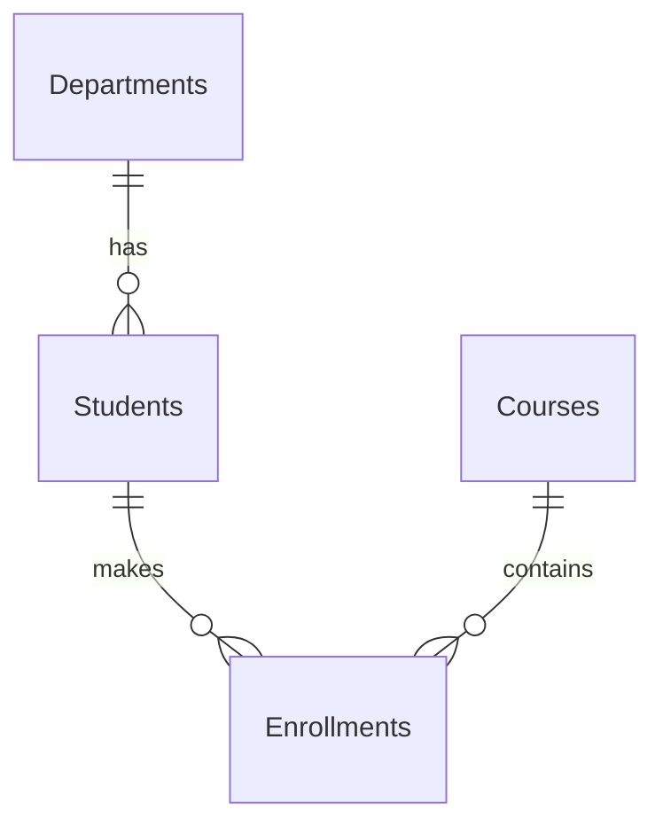

# Session 01: Introduction to T-SQL and SSMS

> Module: Data Handling using T-SQL · Diploma in AI / Data Science · Term 1 · ⏱ ~2 hours

Before an AI model can learn anything, someone has to store, clean and fetch its data. In most companies that data sits in a **relational database**. In this first session you will learn what a database is, meet the T-SQL language, and run your first queries in SQL Server Management Studio (SSMS).

## 🎯 Learning Objectives

- Explain what a database and a database management system (DBMS) are
- Compare the main types of DBMS (hierarchical, network, relational, NoSQL)
- Describe the three families of T-SQL statements: DDL, DML and DCL
- Connect to a SQL Server instance using SSMS
- Use Object Explorer to browse databases, tables and columns
- Write and execute a simple query in the SSMS query window

## 📖 Concepts Explained

### 1. What is a database?

A **database** is an organised collection of related data that can be stored, searched and updated easily. A **DBMS** is the software that manages that data for you: it stores it on disk, checks rules, handles many users at once and answers questions (queries).

> **Analogy:** A database is a well-organised school office cupboard. The DBMS is the clerk who knows exactly which drawer has which file, and only lets authorised people take files out.

### 2. Types of DBMS

| Type | How data is organised | Example |
|---|---|---|
| Hierarchical | Tree: each child has one parent | Windows Registry, old IBM IMS |
| Network | Graph: a child can have many parents | IDMS (older systems) |
| **Relational (RDBMS)** | **Tables of rows and columns linked by keys** | **SQL Server, MySQL, PostgreSQL, Oracle** |
| NoSQL | Documents, key-value pairs, graphs | MongoDB (Module 02), Redis |

In a relational database each **table** stores one kind of thing (students, courses). A **primary key** uniquely identifies each row, and a **foreign key** in another table points back to it.



### 3. What is T-SQL?

**SQL** (Structured Query Language) is the standard language for relational databases. **Transact-SQL (T-SQL)** is Microsoft's version of SQL used by SQL Server and Azure SQL. It adds extra features such as variables, `IF...ELSE`, loops and error handling.

T-SQL statements fall into three main families:

| Family | Full name | Purpose | Key statements |
|---|---|---|---|
| DDL | Data Definition Language | Create and change the *structure* | `CREATE`, `ALTER`, `DROP` |
| DML | Data Manipulation Language | Work with the *rows* | `SELECT`, `INSERT`, `UPDATE`, `DELETE` |
| DCL | Data Control Language | Control *permissions* | `GRANT`, `REVOKE`, `DENY` |

> Tip: Think **D**efine the shelves (DDL), **M**ove the books (DML), **C**ontrol the keys (DCL).

### 4. SQL Server Management Studio (SSMS)

SSMS is a free Windows tool for working with SQL Server. Its main parts:

| Part | What it does |
|---|---|
| Connect to Server dialog | Choose server name and login type |
| Object Explorer (left) | Tree of databases, tables, views, logins |
| Query Editor (centre) | Where you type T-SQL |
| Results / Messages tabs (bottom) | Output rows and messages such as "3 rows affected" |

### 5. Connecting to a SQL Server instance

1. Open SSMS. The **Connect to Server** box appears.
2. **Server type:** Database Engine.
3. **Server name:** `localhost` for the default instance, or `localhost\SQLEXPRESS` for Express edition.
4. **Authentication:** Windows Authentication (uses your Windows account).
5. On new SSMS versions tick **Trust server certificate** for a local practice server.
6. Click **Connect**. Your server now appears in Object Explorer.

### 6. Working with Object Explorer

- Expand **Databases** to see every database on the server.
- Expand **CampusDB → Tables** to see the tables.
- Right-click a table → **Select Top 1000 Rows** to quickly preview data.
- Expand a table → **Columns** to see column names and data types.
- Press **F5** inside Object Explorer to refresh after you create something new.

### 7. Executing a query

1. Click **New Query** on the toolbar.
2. Choose the database from the drop-down, or type `USE CampusDB;`.
3. Type your query.
4. Press **F5** (or click **Execute**). To run only part of the script, highlight it first, then press F5.

## 💻 Code Examples

### Example 1: Build the practice database

Open [`campusdb-setup.sql`](./campusdb-setup.sql) and press F5. It creates `CampusDB` with five tables and sample rows.

### Example 2: First queries (`first-queries.sql`)

```sql
USE CampusDB;
GO

-- show every row and column
SELECT * FROM Students;

-- show only two columns
SELECT FirstName, City FROM Students;

-- only students from Karachi
SELECT FirstName, LastName
FROM Students
WHERE City = 'Karachi';

SELECT @@VERSION AS ServerVersion;   -- SQL Server version
SELECT GETDATE() AS ServerDateTime;  -- current date and time
```

**How it works:** `USE` picks the database. `SELECT` lists the columns you want, `FROM` names the table and `WHERE` keeps only matching rows. `@@VERSION` and `GETDATE()` are built-in values that SQL Server gives you.

### Example 3: DDL, DML and DCL together (`ddl-dml-dcl-examples.sql`)

```sql
CREATE TABLE Clubs (ClubID INT PRIMARY KEY, ClubName VARCHAR(40) NOT NULL); -- DDL
INSERT INTO Clubs (ClubID, ClubName) VALUES (1, 'AI Club');                -- DML
SELECT * FROM Clubs;                                                       -- DML
CREATE USER DemoReader WITHOUT LOGIN;                                      -- setup
GRANT SELECT ON Clubs TO DemoReader;                                       -- DCL
REVOKE SELECT ON Clubs FROM DemoReader;                                    -- DCL
DROP USER DemoReader;
DROP TABLE Clubs;                                                          -- DDL
```

**How it works:** the table is built (DDL), filled and read (DML), and a demo user is given and then denied read permission (DCL). Finally everything is cleaned up so the database stays tidy. The full file also shows `ALTER`, `UPDATE` and `DELETE`.

## 🧪 Lab Practice

1. Install SQL Server Express/Developer and SSMS, then connect to `localhost`.
2. Run `campusdb-setup.sql`. In Object Explorer, refresh and find all five tables of CampusDB.
3. Right-click `Courses` → **Select Top 1000 Rows**. Note the SQL that SSMS wrote for you.
4. In a new query window, list the `CourseName` and `Fee` of every course.
5. List the first and last names of students who live in Lahore.

## 📝 Assignment

Create a database called `MyShopDB` with a `Products` table (`ProductID`, `ProductName`, `Price`, `Stock`). Insert five products, then write one query that shows all products and one that shows only products with `Stock` greater than 10. Label each statement with a comment saying whether it is DDL or DML.

## ❓ Quick Quiz

1. Which family does `ALTER TABLE` belong to?
2. Name two relational DBMS products.
3. Which SSMS panel shows the tree of databases and tables?
4. What key press runs the query in SSMS?
5. What does a foreign key do?

<details>
<summary>Show answers</summary>

1. DDL
2. Any two of SQL Server, MySQL, PostgreSQL, Oracle
3. Object Explorer
4. F5 (or the Execute button)
5. It links a row in one table to the primary key of a row in another table.

</details>

## 💼 Interview Questions

**1. What is the difference between SQL and T-SQL?**

> SQL is the ANSI standard language. T-SQL is Microsoft's extension of it, adding variables, flow control, error handling and many built-in functions.

**2. What is the difference between DDL and DML?**

> DDL defines or changes database objects such as tables. DML reads and changes the data stored inside those objects.

**3. Why use a relational database instead of Excel files?**

> It enforces rules (keys, data types), supports many users at once, handles large data and lets you ask complex questions with SQL.

## ✅ Summary

- A DBMS stores, protects and serves data; relational DBMSs use linked tables.
- T-SQL is Microsoft's SQL dialect with DDL, DML and DCL statements.
- SSMS is the main tool: connect, browse in Object Explorer, write in the Query Editor.
- `campusdb-setup.sql` builds the practice database used for the whole module.

---

[🏠 Module Home](../README.md) · [Next ➡](../Session-02-T-SQL-Language-Elements/README.md)

Prepared by Zeeshan Abbas · Aptech Learning North Nazimabad
