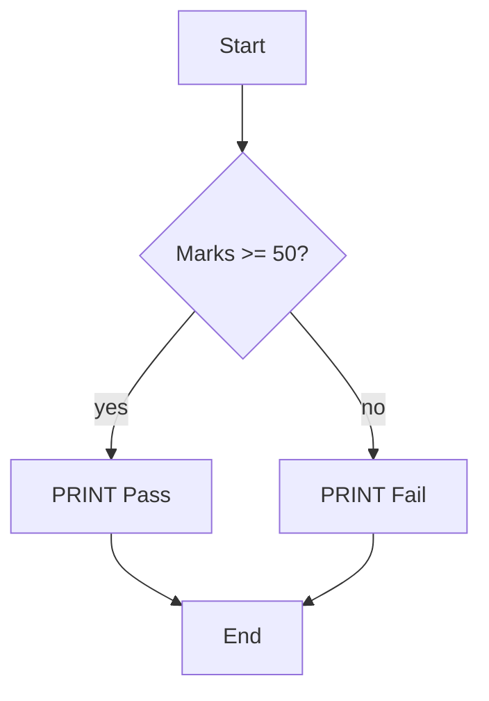

# Session 02: T-SQL Language Elements

> Module: Data Handling using T-SQL · Diploma in AI / Data Science · Term 1 · ⏱ ~2 hours

Every language has grammar: nouns, verbs and punctuation. T-SQL is no different. In this session you learn its building blocks: data types, variables, operators, comments, batches, expressions, decision making, loops, error handling and transactions.

## 🎯 Learning Objectives

- Choose a suitable data type for numbers, text, dates and true/false values
- Declare variables and assign values with `DECLARE` and `SET`
- Use arithmetic, comparison, logical, string, compound and bitwise operators
- Explain comments, `GO` batches and the `USE` statement
- Control program flow with `IF...ELSE`, `BEGIN...END`, `WHILE` and `CASE`
- Handle errors with `TRY...CATCH` and group changes into a transaction

## 📖 Concepts Explained

### 1. Data types

A data type tells SQL Server what kind of value a column or variable can hold and how much space it needs.

| Category | Common types | Example value |
|---|---|---|
| Whole numbers | `TINYINT`, `SMALLINT`, `INT`, `BIGINT` | `21` |
| Exact decimals | `DECIMAL(p,s)`, `NUMERIC(p,s)`, `MONEY` | `15000.50` |
| Approximate | `FLOAT`, `REAL` | `3.14159` |
| Text | `CHAR(n)`, `VARCHAR(n)` | `'Karachi'` |
| Unicode text | `NCHAR(n)`, `NVARCHAR(n)` | `N'کراچی'` |
| Date/time | `DATE`, `TIME`, `DATETIME2` | `'2026-01-10'` |
| True/false | `BIT` | `1` or `0` |

> Rule of thumb: use `DECIMAL` for money (exact), `NVARCHAR` when names may contain Urdu or Arabic, and `DATE` when you do not need the time.

### 2. Variables

A variable is a named box that holds one value while a script runs. Its name starts with `@`.

```sql
DECLARE @Age INT = 21;   -- create and give a starting value
SET @Age = @Age + 1;     -- change it
```

### 3. Operators

| Kind | Operators | Example | Result |
|---|---|---|---|
| Arithmetic | `+ - * / %` | `10 % 3` | `1` |
| Comparison | `= <> != > < >= <=` | `Fee >= 20000` | true/false |
| Logical | `AND OR NOT BETWEEN IN LIKE` | `City = 'Karachi' AND DeptID = 1` | true/false |
| String | `+` | `'Ali' + ' ' + 'Khan'` | `Ali Khan` |
| Compound | `+= -= *= /=` | `SET @x += 5` | adds 5 |
| Bitwise | `&` (AND), `\|` (OR), `^` (XOR) | `6 & 3` | `2` |

> Watch out: `10 / 3` gives `3`, because two integers produce an integer. Write `10.0 / 3` to get `3.333...`.

### 4. Comments, GO and USE

- `-- text` is a single-line comment; `/* text */` is a block comment.
- `USE CampusDB;` switches the current database.
- `GO` is not T-SQL itself. It is a signal to SSMS that marks the end of a **batch**. Variables only live inside the batch where they are declared.

### 5. Expressions

An expression is anything that produces a value: a constant (`5`), a column (`Fee`), a calculation (`Fee * 1.1`) or a function call (`GETDATE()`). The `CASE` expression returns different values based on conditions, like a small `IF` inside a `SELECT`.

### 6. Control of flow



- `IF...ELSE` runs one block or another.
- `BEGIN...END` groups several statements into one block.
- `WHILE` repeats a block; use `BREAK` to exit early and `CONTINUE` to skip to the next round.

### 7. Errors and transactions

- `TRY...CATCH`: put risky code in `TRY`; if it fails, control jumps to `CATCH`. Inside `CATCH`, `ERROR_MESSAGE()` and `ERROR_NUMBER()` describe the problem.
- A **transaction** is a unit of work that is "all or nothing". `BEGIN TRANSACTION` starts it, `COMMIT` saves it and `ROLLBACK` cancels everything since it started.

> **Analogy:** Transferring money between two bank accounts must either take from A *and* give to B, or do neither. That is exactly what a transaction guarantees.

## 💻 Code Examples

### Example 1: Variables and data types (`data-types-and-variables.sql`)

```sql
DECLARE @StudentName VARCHAR(50)   = 'Ayesha Khan';
DECLARE @Fee         DECIMAL(10,2) = 15000.50;
DECLARE @IsActive    BIT           = 1;
SELECT @StudentName AS StudentName, @Fee AS Fee, @IsActive AS IsActive;

DECLARE @TotalStudents INT;
SELECT @TotalStudents = COUNT(*) FROM Students;
PRINT 'Total students: ' + CAST(@TotalStudents AS VARCHAR(5));
```

**How it works:** each `DECLARE` creates a variable with a type and a starting value. The second part stores the result of a query in a variable. `CAST` converts the number to text so that it can be joined with `+`.

### Example 2: Operators (`operators.sql`)

```sql
SELECT 10 / 3 AS IntegerDivide, 10.0 / 3 AS DecimalDivide, 10 % 3 AS Remainder;
SELECT FirstName + ' ' + LastName AS FullName FROM Students;
DECLARE @Counter INT = 10;
SET @Counter += 5;
SELECT @Counter AS CounterValue;   -- 15
```

**How it works:** the first line shows the integer-division trap and the remainder operator, the second joins text, and the last part uses a compound operator.

### Example 3: Decisions and loops (`control-of-flow.sql`)

```sql
DECLARE @Number INT = 1;
WHILE @Number <= 5
BEGIN
    PRINT 'Number is ' + CAST(@Number AS VARCHAR(2));
    SET @Number = @Number + 1;
END
```

**How it works:** the loop prints 1 to 5. The `SET` line increases the counter; without it the loop would never stop. The file also has `IF...ELSE` and a `CASE` grade calculator.

### Example 4: Error handling with a transaction (`errors-and-transactions.sql`)

```sql
BEGIN TRY
    BEGIN TRANSACTION;
        UPDATE Courses SET Fee = Fee + 1000;
        INSERT INTO Courses (CourseID, CourseName, Credits, Fee)
        VALUES (1, 'Duplicate Course', 3, 1000);   -- fails
    COMMIT TRANSACTION;
END TRY
BEGIN CATCH
    ROLLBACK TRANSACTION;
    PRINT 'Error, all changes undone: ' + ERROR_MESSAGE();
END CATCH;
```

**How it works:** the insert breaks the primary key rule, so control jumps to `CATCH` and `ROLLBACK` cancels the fee increase as well. Run `SELECT * FROM Courses` to confirm the fees are unchanged.

## 🧪 Lab Practice

1. Declare `@Price DECIMAL(8,2) = 2500` and `@Qty INT = 3`, then print the total bill.
2. Use `%` to check whether `@Qty` is even or odd with `IF...ELSE`.
3. Write a `WHILE` loop that prints the 7 times table (7 × 1 to 7 × 10).
4. Write a `SELECT` on `Courses` with a `CASE` column: `Fee > 18000` → `'Premium'`, else `'Standard'`.
5. Use `TRY...CATCH` to catch the error from `SELECT CAST('abc' AS INT);` and print the message.

## 📝 Assignment

Write a script that declares `@Marks`, and uses `IF...ELSE IF...ELSE` to print the grade (A ≥ 80, B ≥ 65, C ≥ 50, otherwise F). Test it with four different values and include a comment block at the top explaining which data type you chose and why.

## ❓ Quick Quiz

1. Which data type should store a fee of 15000.50 exactly?
2. What is the result of `17 % 5`?
3. What does `GO` do?
4. Which statement cancels all changes inside a transaction?
5. Why is `N` written before `N'کراچی'`?

<details>
<summary>Show answers</summary>

1. `DECIMAL(10,2)` (or `MONEY`)
2. `2`
3. It ends a batch in SSMS; statements are sent to the server batch by batch.
4. `ROLLBACK TRANSACTION`
5. It marks the text as Unicode so that non-English characters are stored correctly.

</details>

## 💼 Interview Questions

**1. What is the difference between `VARCHAR` and `NVARCHAR`?**

> `VARCHAR` stores non-Unicode text (1 byte per character for most text). `NVARCHAR` stores Unicode and supports every language, using 2 bytes per character.

**2. What are the ACID properties of a transaction?**

> Atomicity (all or nothing), Consistency (rules stay valid), Isolation (transactions do not disturb each other) and Durability (committed data survives a crash).

**3. How do you handle errors in T-SQL?**

> With `BEGIN TRY ... END TRY BEGIN CATCH ... END CATCH`, using `ERROR_MESSAGE()` and related functions in the catch block, and rolling back any open transaction.

## ✅ Summary

- Data types control what a column or variable can store.
- Variables start with `@`; create with `DECLARE`, change with `SET`.
- Six operator groups: arithmetic, comparison, logical, string, compound, bitwise.
- `IF`, `WHILE` and `CASE` add decision making to SQL.
- `TRY...CATCH` plus transactions keep your data safe when something fails.

---

[⬅ Previous](../Session-01-Introduction-to-T-SQL-and-SSMS/README.md) · [🏠 Module Home](../README.md) · [Next ➡](../Session-03-SELECT-Filtering-and-Sorting/README.md)

Prepared by Zeeshan Abbas · Aptech Learning North Nazimabad
