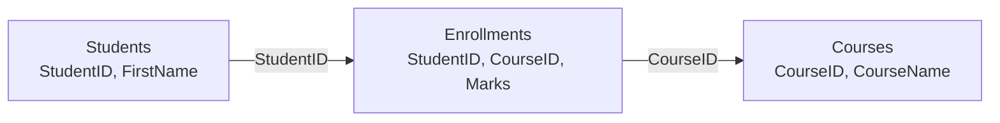

# Session 04: Joins, Set Operators and Subqueries

> Module: Data Handling using T-SQL · Diploma in AI / Data Science · Term 1 · ⏱ ~2 hours

Real data is split across many tables so that nothing is stored twice. A student's name lives in `Students`, a course name lives in `Courses`, and `Enrollments` only stores their IDs. To answer a question like *"Which student scored what in which course?"* you must bring those tables back together. This session shows three ways to do that: **joins**, **set operators** and **subqueries**.

## 🎯 Learning Objectives

- Explain why data is split into related tables and how keys link them
- Write inner, outer (left, right, full), cross and self joins
- Use table aliases to keep join queries short and readable
- Combine result sets with `UNION`, `UNION ALL`, `INTERSECT` and `EXCEPT`
- Write scalar, multi-value, correlated and `EXISTS` subqueries
- Choose between a join and a subquery for a given question

## 📖 Concepts Explained

### 1. Joins in one picture

A **join** places columns from two tables side by side, matching rows with an `ON` condition (usually primary key = foreign key).



| Join type | Returns | Typical question |
|---|---|---|
| `INNER JOIN` | only matching rows from both tables | "Show each enrollment with student and course names" |
| `LEFT [OUTER] JOIN` | all rows from the left table + matches (or NULL) | "Show every student, even those with no course" |
| `RIGHT [OUTER] JOIN` | all rows from the right table + matches | "Show every course, even if empty" |
| `FULL [OUTER] JOIN` | all rows from both sides | "Show everything, matched where possible" |
| `CROSS JOIN` | every combination (rows A × rows B) | "Build a timetable of every department × course" |
| Self join | a table joined to itself (with two aliases) | "Show each teacher with their manager" |

> **Analogy:** Think of two class registers. An inner join lists only students present in both registers. A left join keeps everyone from the first register and leaves a blank where the second register has no entry.

### 2. Table aliases

`FROM Students AS s` lets you write `s.FirstName` instead of `Students.FirstName`. When two tables share a column name (`StudentID`), the alias tells SQL Server which one you mean. A self join *must* use two different aliases.

### 3. Finding "missing" rows

A very common pattern: `LEFT JOIN` then keep rows where the right side is `NULL`.

```sql
SELECT s.FirstName
FROM Students AS s
LEFT JOIN Enrollments AS e ON s.StudentID = e.StudentID
WHERE e.EnrollmentID IS NULL;   -- students who never enrolled
```

### 4. Set operators

Joins add **columns**; set operators stack **rows** from two queries. Both queries must return the same number of columns with compatible types.

| Operator | Result | Duplicates |
|---|---|---|
| `UNION` | rows in either query | removed |
| `UNION ALL` | rows in either query | kept (faster) |
| `INTERSECT` | rows in both queries | removed |
| `EXCEPT` | rows in the first but not the second | removed |

Column names come from the first query, and `ORDER BY` may appear only once, at the end.

### 5. Subqueries

A subquery is a `SELECT` inside brackets, used inside another statement.

| Kind | Returns | Used with |
|---|---|---|
| Scalar | one value | `=`, `>`, `<` |
| Multi-value | a list of values | `IN`, `NOT IN` |
| Correlated | runs once per outer row, using its values | `SELECT` list or `WHERE` |
| `EXISTS` | true/false: "is there at least one row?" | `WHERE EXISTS (...)` |
| Derived table | a temporary table in `FROM` | needs an alias |

> **Careful with NOT IN:** if the subquery returns even one `NULL`, `NOT IN` returns no rows. `NOT EXISTS` is safer.

### 6. Join or subquery?

Both often give the same answer. Use a **join** when you need columns from both tables in the output. Use a **subquery** when the second table only helps you filter or calculate one value. The query optimizer frequently turns them into the same plan, so choose the one that is easier to read.

## 💻 Code Examples

### Example 1: Inner join across three tables (`joins.sql`)

```sql
SELECT s.FirstName, c.CourseName, e.Marks
FROM Enrollments AS e
INNER JOIN Students AS s ON e.StudentID = s.StudentID
INNER JOIN Courses  AS c ON e.CourseID  = c.CourseID;
```

**How it works:** start from `Enrollments` (which holds IDs), then join `Students` to fetch the name and `Courses` to fetch the course name. Student 106 and course 5 do not appear because they have no matching enrollment.

### Example 2: Self join (`joins.sql`)

```sql
SELECT f.FullName AS Teacher, m.FullName AS Manager
FROM Faculty AS f
LEFT JOIN Faculty AS m ON f.ManagerID = m.FacultyID;
```

**How it works:** the same table is opened twice: `f` for the teacher, `m` for the manager. A `LEFT JOIN` keeps the head of department, whose manager is `NULL`. The file also shows left, right, full and cross joins.

### Example 3: Set operators (`set-operators.sql`)

```sql
SELECT StudentID FROM Enrollments WHERE CourseID = 1
INTERSECT
SELECT StudentID FROM Enrollments WHERE CourseID = 4;   -- 101, 103
```

**How it works:** each query returns a list of student IDs; `INTERSECT` keeps only IDs in both lists, i.e. students who took T-SQL *and* Python. Swap in `UNION`, `UNION ALL` or `EXCEPT` to see the difference.

### Example 4: Subqueries (`subqueries.sql`)

```sql
SELECT CourseName, Fee
FROM Courses
WHERE Fee > (SELECT AVG(Fee) FROM Courses);

SELECT c.CourseName
FROM Courses AS c
WHERE EXISTS (SELECT 1 FROM Enrollments AS e WHERE e.CourseID = c.CourseID);
```

**How it works:** the first inner query calculates the average fee once, and the outer query compares each course to it. The second is correlated: for each course, it checks whether any enrollment exists for that course.

## 🧪 Lab Practice

1. List every enrollment with the student's full name, course name and marks, sorted by course.
2. Show every department with the names of its students; include departments with no students.
3. List courses that nobody has enrolled in (use `LEFT JOIN ... IS NULL`, then again with `NOT EXISTS`).
4. Use `UNION` to produce one list of all first names of students and all faculty full names.
5. Find students whose marks in any course are above the overall average mark (subquery).

## 📝 Assignment

Write a query that shows, for each student who has at least one graded enrollment, their name, department name and the name of the course in which they scored their **highest** mark. Use joins plus a correlated subquery. Save it as `assignment-04.sql`.

## ❓ Quick Quiz

1. Which join returns all rows from the left table even if there is no match?
2. How many rows does a `CROSS JOIN` of a 3-row and a 5-row table return?
3. What is the difference between `UNION` and `UNION ALL`?
4. What makes a subquery "correlated"?
5. Why must a self join use two aliases?

<details>
<summary>Show answers</summary>

1. `LEFT [OUTER] JOIN`
2. 15
3. `UNION` removes duplicate rows; `UNION ALL` keeps them.
4. It refers to a column from the outer query, so it is evaluated for each outer row.
5. So SQL Server can tell the two copies of the same table apart.

</details>

## 💼 Interview Questions

**1. What is the difference between `INNER JOIN` and `LEFT JOIN`?**

> `INNER JOIN` returns only rows that match in both tables. `LEFT JOIN` returns every row from the left table and fills the right side with `NULL` when no match exists.

**2. Why might `NOT IN` return no rows when you expect some?**

> If the subquery list contains a `NULL`, every `NOT IN` comparison becomes unknown. Use `NOT EXISTS` or filter out NULLs.

**3. When would you use `EXCEPT`?**

> To find rows in one result that are not in another, for example customers this year who did not buy last year, or to compare two copies of a table.

## ✅ Summary

- Joins combine columns from related tables using an `ON` condition.
- Inner = matches only; outer = keep unmatched rows; cross = all combinations; self = table with itself.
- Set operators stack rows: `UNION`, `UNION ALL`, `INTERSECT`, `EXCEPT`.
- Subqueries can return one value, a list, or test existence; correlated subqueries run per row.

---

[⬅ Previous](../Session-03-SELECT-Filtering-and-Sorting/README.md) · [🏠 Module Home](../README.md) · [Next ➡](../Session-05-Modifying-Data-INSERT-UPDATE-DELETE-MERGE/README.md)

Prepared by Zeeshan Abbas · Aptech Learning North Nazimabad
