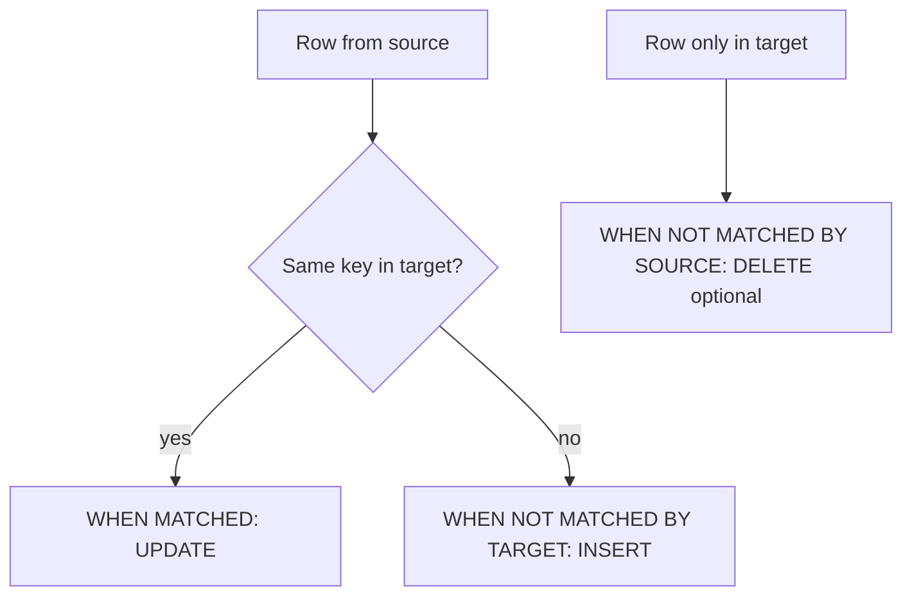

# Session 05: Modifying Data: INSERT, UPDATE, DELETE, MERGE

> Module: Data Handling using T-SQL · Diploma in AI / Data Science · Term 1 · ⏱ ~2 hours

So far you have only *read* data. Databases are living systems: new students join, emails change, old records are removed and price lists arrive from other departments. In this session you will add, change, remove and synchronise data with four DML statements, and load a CSV file into a table.

## 🎯 Learning Objectives

- Insert single rows, multiple rows and query results into a table
- Work with `IDENTITY` columns and read the new value with `SCOPE_IDENTITY()`
- Update one or many columns, including updates that use another table
- Delete rows safely and explain `DELETE` vs `TRUNCATE` vs `DROP`
- Synchronise two tables with `MERGE` and inspect the changes with `OUTPUT`
- Load CSV data with `BULK INSERT` or the SSMS import wizard

## 📖 Concepts Explained

### 1. The four data-changing statements

| Statement | What it does | Analogy |
|---|---|---|
| `INSERT` | adds new rows | writing a new name in the register |
| `UPDATE` | changes values in existing rows | correcting a phone number |
| `DELETE` | removes rows | crossing a name out |
| `MERGE` | compares a source with a target and inserts, updates or deletes as needed | matching the register against the new admissions list |

### 2. INSERT

```sql
INSERT INTO TableName (col1, col2, ...)
VALUES (value1, value2, ...);
```

- Always **list the columns**. Your code keeps working even if someone adds a column later.
- Text and dates go in single quotes: `'Karachi'`, `'2026-05-02'`.
- Several rows can follow one `VALUES`, separated by commas.
- **IDENTITY** columns (like `EnrollmentID`) are filled automatically; leave them out of the column list. `SCOPE_IDENTITY()` returns the value just generated.
- `INSERT INTO ... SELECT` copies rows from a query into an existing table.
- `SELECT ... INTO NewTable` creates a brand-new table from a query (handy for quick backups).

### 3. UPDATE

```sql
UPDATE TableName
SET column = new_value, other_column = other_value
WHERE condition;
```

> ⚠️ **Forget the `WHERE` and every row changes.** Professionals first run a `SELECT` with the same `WHERE`, check the rows, then turn it into an `UPDATE`.

You can also update from a join, e.g. give bonus marks only to students from one city, by writing `UPDATE alias ... FROM table AS alias JOIN ...`.

### 4. DELETE vs TRUNCATE vs DROP

| Command | Removes | WHERE allowed? | Resets IDENTITY? | Table still exists? |
|---|---|---|---|---|
| `DELETE` | chosen rows (or all) | yes | no | yes |
| `TRUNCATE TABLE` | all rows, very fast | no | yes | yes |
| `DROP TABLE` | the table itself | no | n/a | **no** |

A row cannot be deleted if another table's foreign key still points to it (e.g. a student with enrollments). Delete the child rows first, or design the key with `ON DELETE CASCADE`.

### 5. MERGE

`MERGE` compares a **source** (new data) with a **target** (your table) on a key and decides per row:



The `OUTPUT` clause with `$action` reports which rows were inserted, updated or deleted. A `MERGE` statement must end with a semicolon.

### 6. Loading a CSV file

Data scientists often receive data as CSV. Two easy options:

1. **SSMS Import Flat File wizard:** right-click the database → *Tasks* → *Import Flat File*. Point and click; good for beginners.
2. **`BULK INSERT`:** a T-SQL command for repeatable loads. The file path is read by the **server**, so the file must be in a folder the SQL Server service can access.

## 💻 Code Examples

> Run the files in this order: `insert-data.sql` → `update-delete.sql` → `merge-data.sql`. Re-run `campusdb-setup.sql` from [Session 01](../Session-01-Introduction-to-T-SQL-and-SSMS/campusdb-setup.sql) whenever you want clean data.

### Example 1: Inserting rows (`insert-data.sql`)

```sql
INSERT INTO Students (StudentID, FirstName, LastName, Email, City, DeptID, EnrollDate)
VALUES (110, 'Maham', 'Javed', NULL, 'Quetta', 2, '2026-05-03'),
       (111, 'Saad',  'Qureshi', 'saad@mail.com', 'Karachi', 3, '2026-05-04');

INSERT INTO Enrollments (StudentID, CourseID, Marks, EnrolledOn)
VALUES (109, 5, NULL, '2026-05-10');
SELECT SCOPE_IDENTITY() AS NewEnrollmentID;
```

**How it works:** the first statement adds two students at once. The second leaves out `EnrollmentID` so SQL Server generates it, and `SCOPE_IDENTITY()` shows the new number. The file also demonstrates `INSERT ... SELECT` and `SELECT ... INTO`.

### Example 2: Updating safely (`update-delete.sql`)

```sql
SELECT StudentID, Email FROM Students WHERE StudentID = 103;  -- preview
UPDATE Students
SET Email = 'sara@mail.com'
WHERE StudentID = 103;                                         -- change
```

**How it works:** the preview proves the `WHERE` hits exactly one row, then the update changes only that row. The file continues with multi-column updates, an update from a join, `DELETE`, `TRUNCATE` and `DROP`.

### Example 3: MERGE a price list (`merge-data.sql`)

```sql
MERGE Courses AS target
USING CoursePriceList AS source
    ON target.CourseID = source.CourseID
WHEN MATCHED AND target.Fee <> source.Fee THEN
    UPDATE SET target.Fee = source.Fee
WHEN NOT MATCHED BY TARGET THEN
    INSERT (CourseID, CourseName, Credits, Fee)
    VALUES (source.CourseID, source.CourseName, source.Credits, source.Fee)
OUTPUT $action AS ActionTaken, inserted.CourseID, inserted.Fee;
```

**How it works:** course 1 exists with a different fee → updated. Course 2 is the same → nothing happens. Course 6 is new → inserted. `OUTPUT` prints one line per change.

### Example 4: Load a CSV (`bulk-insert-csv.sql` + `new-students.csv`)

```sql
BULK INSERT Students
FROM 'C:\SQLData\new-students.csv'
WITH (FORMAT = 'CSV', FIRSTROW = 2, FIELDTERMINATOR = ',', ROWTERMINATOR = '0x0a');
```

**How it works:** SQL Server reads the file, skips the header row and inserts the five students from [`new-students.csv`](./new-students.csv).

## 🧪 Lab Practice

1. Insert yourself as a new student (ID 150) and enroll yourself in two courses.
2. Update your email address, then update the marks for one of your enrollments.
3. Use `SELECT ... INTO` to back up `Enrollments` into `EnrollmentsBackup`.
4. Delete all enrollments with marks below 50 from the backup table only, and check the row count message.
5. Write a `MERGE` that inserts a new department (ID 4, 'Cyber Security') and renames department 3 to 'Software Development' from a small staging table.

## 📝 Assignment

Create a `Products` table and a `ProductUpdates` staging table. Write a `MERGE` that updates prices for existing products, inserts new products and **deletes** products not in the update list (`WHEN NOT MATCHED BY SOURCE THEN DELETE`). Use `OUTPUT $action` and paste the output as a comment in your file.

## ❓ Quick Quiz

1. What happens if you run `UPDATE Students SET City = 'Lahore';` with no `WHERE`?
2. Which is faster for emptying a big table: `DELETE` or `TRUNCATE`?
3. How do you get the IDENTITY value just inserted?
4. Which `MERGE` clause handles rows that exist in the source but not in the target?
5. Why should you list column names in an `INSERT`?

<details>
<summary>Show answers</summary>

1. Every student's city becomes Lahore.
2. `TRUNCATE TABLE`
3. `SELECT SCOPE_IDENTITY();`
4. `WHEN NOT MATCHED BY TARGET THEN INSERT ...`
5. So the statement still works and values land in the right columns if the table structure changes.

</details>

## 💼 Interview Questions

**1. Difference between `DELETE`, `TRUNCATE` and `DROP`?**

> `DELETE` removes chosen rows and is fully logged; `TRUNCATE` removes all rows quickly and resets identity; `DROP` removes the table and its structure.

**2. What is `MERGE` used for?**

> To synchronise a target table with a source in one statement: update matching rows, insert new ones and optionally delete rows missing from the source. Common in data warehouse loading.

**3. How do you avoid accidental mass updates?**

> Preview with a `SELECT` using the same `WHERE`, wrap the change in a transaction, check `@@ROWCOUNT`, and commit only when the count is as expected.

## ✅ Summary

- `INSERT` adds rows; list columns and let IDENTITY fill itself.
- `UPDATE` and `DELETE` must almost always have a `WHERE`.
- `TRUNCATE` empties a table fast; `DROP` deletes the table.
- `MERGE` inserts, updates and deletes in one go; `OUTPUT` shows what changed.
- `BULK INSERT` or the Import Flat File wizard load CSV data.

---

[⬅ Previous](../Session-04-Joins-Set-Operators-and-Subqueries/README.md) · [🏠 Module Home](../README.md) · [Next ➡](../Session-06-Practice-Lab-Safe-Data-Changes-with-Transactions/README.md)

Prepared by Zeeshan Abbas · Aptech Learning North Nazimabad
