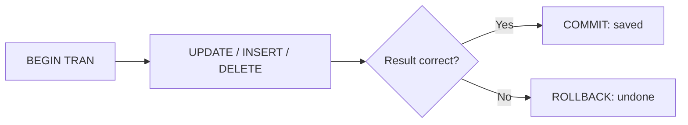

# Session 06: Practice Lab: Safe Data Changes with Transactions

> Module: Data Handling using T-SQL · Diploma in AI / Data Science · Term 1 · ⏱ ~2 hours

This is a hands-on lab. You will not learn new statements; instead you will practise the `INSERT`, `UPDATE`, `DELETE` and `MERGE` statements from Session 05 and learn the habit that separates careful professionals from beginners: **changing data inside a transaction**, checking the result, and only then making it permanent.

## 🎯 Learning Objectives

- Explain what a transaction is and the four ACID properties in simple words
- Use `BEGIN TRANSACTION`, `COMMIT` and `ROLLBACK` to control changes
- Check how many rows a statement changed with `@@ROWCOUNT`
- Catch errors with `TRY...CATCH` and undo the whole job when something fails
- See exactly which rows changed using the `OUTPUT` clause
- Follow a safe "preview → change → verify → commit" routine

## 📖 Concepts Explained

### 1. What is a transaction?

A **transaction** is a group of statements that SQL Server treats as **one unit of work**: either *all* of them succeed, or *none* of them do.

> **Analogy:** sending money with a mobile wallet. Rs. 5,000 leaves your account **and** arrives in your friend's account. If the second step fails, the first must be undone, otherwise money disappears. A transaction guarantees "both or nothing".

### 2. ACID in plain English

| Letter | Property | Meaning for you |
|---|---|---|
| A | Atomicity | all statements succeed or all are undone |
| C | Consistency | rules (keys, constraints) are never broken |
| I | Isolation | other users do not see your half-finished work |
| D | Durability | once committed, the change survives a power cut |

### 3. The three key commands

| Command | What it does |
|---|---|
| `BEGIN TRANSACTION` (or `BEGIN TRAN`) | start the unit of work |
| `COMMIT` | make all changes permanent |
| `ROLLBACK` | undo every change since `BEGIN TRAN` |

`@@TRANCOUNT` tells you how many transactions are open. If it shows `1` after your script, you forgot to commit or roll back, and other users may be blocked.



### 4. Checking your work with @@ROWCOUNT

`@@ROWCOUNT` returns the number of rows touched by the **last** statement. Read it immediately, because the next statement replaces it. A common rule: *"If I expected 1 row and got 50, roll back."*

### 5. Handling errors with TRY...CATCH

If a statement inside a `TRY` block fails (for example a foreign-key violation), SQL Server jumps to the `CATCH` block. There you roll back and show a friendly message with `ERROR_MESSAGE()` and `ERROR_NUMBER()`.

### 6. The safe-change routine

1. **Preview**: run a `SELECT` with the same `WHERE` you plan to use.
2. **Begin**: `BEGIN TRAN`.
3. **Change**: run the `UPDATE`/`DELETE`, with `OUTPUT` to see the rows.
4. **Verify**: check `@@ROWCOUNT` and run the `SELECT` again.
5. **Decide**: `COMMIT` if correct, `ROLLBACK` if not.

## 💻 Code Examples

Run `campusdb-setup.sql` from Session 01 first so you start with clean data.

### Example 1: commit and rollback (`transaction-basics.sql`)

```sql
USE CampusDB;

-- Try a change, then UNDO it
BEGIN TRANSACTION;
    UPDATE Courses SET Fee = 0;          -- oops, no WHERE: every fee is now 0
    SELECT CourseName, Fee FROM Courses; -- we see the mistake
ROLLBACK;                                -- undo everything

SELECT CourseName, Fee FROM Courses;     -- fees are back to normal

-- A correct change that we KEEP
BEGIN TRANSACTION;
    UPDATE Courses SET Fee = Fee + 1000 WHERE CourseID = 5;
COMMIT;
```

**How it works:** the first transaction makes a classic mistake, shows it, and `ROLLBACK` restores the old fees. The second one changes exactly one course and `COMMIT` saves it.

### Example 2: check the row count (`rowcount-check.sql`)

```sql
DECLARE @rows INT;

BEGIN TRAN;
    UPDATE Students SET City = 'Karachi' WHERE StudentID = 106;
    SET @rows = @@ROWCOUNT;              -- save it straight away

IF @rows = 1
    COMMIT;                              -- exactly what we expected
ELSE
    ROLLBACK;                            -- something is wrong, undo
```

**How it works:** we store `@@ROWCOUNT` in a variable right after the `UPDATE` and use an `IF` to decide whether to keep the change.

### Example 3: TRY...CATCH (`try-catch-transaction.sql`)

```sql
BEGIN TRY
    BEGIN TRAN;
        INSERT INTO Enrollments (StudentID, CourseID, Marks, EnrolledOn)
        VALUES (106, 5, NULL, '2026-05-01');          -- valid row
        INSERT INTO Enrollments (StudentID, CourseID, Marks, EnrolledOn)
        VALUES (999, 5, NULL, '2026-05-01');          -- student 999 does not exist
    COMMIT;
END TRY
BEGIN CATCH
    IF @@TRANCOUNT > 0 ROLLBACK;                       -- undo BOTH inserts
    PRINT 'Error: ' + ERROR_MESSAGE();
END CATCH;
```

**How it works:** the second insert breaks the foreign key, so control jumps to `CATCH`. The rollback also removes the first, valid insert: all or nothing.

### Example 4: see what changed (`output-clause.sql`)

```sql
BEGIN TRAN;
    UPDATE Enrollments
    SET Marks = Marks + 5
    OUTPUT deleted.EnrollmentID, deleted.Marks AS OldMarks, inserted.Marks AS NewMarks
    WHERE Marks < 60;
COMMIT;
```

**How it works:** `deleted` holds the row *before* the change and `inserted` holds it *after*. You get a before/after report for free.

The file `lab-solutions.sql` contains model answers for the lab tasks below. Try them yourself first.

## 🧪 Lab Practice

1. Inside a transaction, delete all enrollments of student 108, show the remaining rows with `SELECT`, then `ROLLBACK`. Confirm the rows are back.
2. Give every student from Lahore an email ending in `@campus.pk` **only** where `Email IS NULL`. Use `@@ROWCOUNT` to commit only if 0 or 1 rows changed.
3. Write a `TRY...CATCH` block that inserts a new course with `CourseID = 1` (a duplicate key). Print the error number and message.
4. Increase the fee of every 4-credit course by 10 % and use `OUTPUT` to show old and new fees.
5. Run `SELECT @@TRANCOUNT;` at the end of each task. It must always be `0`.

## 📝 Assignment

Write `fee-transfer.sql`: a student moves from course 4 to course 5. In **one transaction**: delete the old enrollment, insert the new one, and update the student's `EnrollDate` to today (`CAST(GETDATE() AS DATE)`). Use `TRY...CATCH`, and test it once with a wrong `StudentID` to prove the rollback works.

## ❓ Quick Quiz

1. What does the "A" in ACID stand for?
2. Which command undoes all changes since `BEGIN TRAN`?
3. Why should you save `@@ROWCOUNT` into a variable immediately?
4. In the `OUTPUT` clause, which table holds the old values?
5. What does `@@TRANCOUNT = 1` at the end of a script tell you?

<details><summary>Answers</summary>

1. Atomicity (all or nothing) · 2. `ROLLBACK` · 3. the next statement overwrites it · 4. `deleted` · 5. a transaction is still open; you forgot `COMMIT` or `ROLLBACK`

</details>

## 💼 Interview Questions

1. **Explain ACID with a real example.** A bank transfer: debit and credit happen together (atomic), balances never break rules (consistent), others do not see half the transfer (isolated), and it survives a crash after commit (durable).
2. **What happens if an error occurs inside a transaction without TRY...CATCH?** Depending on the error, some statements may stay applied and the transaction may stay open; that is why we use `TRY...CATCH` with an explicit `ROLLBACK`.
3. **What is the OUTPUT clause used for?** To return the rows affected by `INSERT`, `UPDATE`, `DELETE` or `MERGE`, with before (`deleted`) and after (`inserted`) values, for auditing or checking.

## ✅ Summary

- A transaction is all-or-nothing: `BEGIN TRAN` → `COMMIT` or `ROLLBACK`.
- ACID = Atomicity, Consistency, Isolation, Durability.
- Check `@@ROWCOUNT` straight after a change and `@@TRANCOUNT` at the end.
- `TRY...CATCH` plus `ROLLBACK` protects you from half-finished work.
- `OUTPUT` shows exactly which rows changed.

---

[⬅ Previous](../Session-05-Modifying-Data-INSERT-UPDATE-DELETE-MERGE/README.md) · [🏠 Module Home](../README.md) · [Next ➡](../Session-07-Aggregate-and-Ranking-Functions/README.md)

Prepared by Zeeshan Abbas · Aptech Learning North Nazimabad
