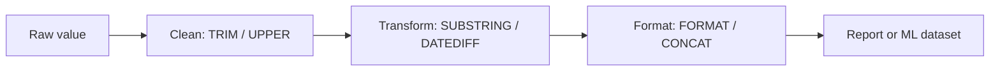

# Session 08: Scalar Functions: Math, String and Date

> Module: Data Handling using T-SQL · Diploma in AI / Data Science · Term 1 · ⏱ ~2 hours

Real data is messy: names typed in lowercase, extra spaces, fees with too many decimals, dates that need to become "months since joining". Before data reaches a report or a machine learning model, it is **cleaned and reshaped**. In this final session you will do that cleaning inside SQL Server with **scalar functions**, which work on one value at a time and return one value per row.

## 🎯 Learning Objectives

- Explain how scalar functions differ from aggregate functions
- Round and calculate numbers with `ROUND`, `CEILING`, `FLOOR`, `ABS`, `POWER` and `SQRT`
- Clean and reshape text with `UPPER`, `LEN`, `TRIM`, `SUBSTRING`, `REPLACE`, `CONCAT` and `CHARINDEX`
- Get and break down dates with `GETDATE`, `YEAR`, `MONTH`, `DATENAME` and `DATEPART`
- Calculate with dates using `DATEADD`, `DATEDIFF` and `EOMONTH`
- Format and convert values with `FORMAT`, `CAST`, `CONVERT` and handle NULL with `ISNULL`/`COALESCE`

## 📖 Concepts Explained

### 1. Scalar vs aggregate

| | Scalar function | Aggregate function |
|---|---|---|
| Input | one value from one row | many rows |
| Output | one value **per row** | one value **per group** |
| Example | `UPPER('ali')` → `ALI` | `COUNT(*)` → 8 |

> **Analogy:** a scalar function is a tailor altering one shirt at a time; an aggregate is a stock-taker counting all shirts in the shop.

You can nest them: `UPPER(LEFT(FirstName, 1))` takes the first letter, then capitalises it.

### 2. Mathematical functions

| Function | Example | Result |
|---|---|---|
| `ROUND(n, d)` | `ROUND(15499.567, 1)` | 15499.600 |
| `CEILING(n)` | `CEILING(4.1)` | 5 (always up) |
| `FLOOR(n)` | `FLOOR(4.9)` | 4 (always down) |
| `ABS(n)` | `ABS(-12)` | 12 |
| `POWER(n, p)` | `POWER(2, 10)` | 1024 |
| `SQRT(n)` | `SQRT(81)` | 9 |
| `n % m` (operator) | `17 % 5` | 2 (remainder) |

Use case: rounding a percentage, working out how many 30-seat classrooms you need (`CEILING(students / 30.0)`).

### 3. String functions

| Function | Example | Result |
|---|---|---|
| `LEN` | `LEN('Karachi')` | 7 |
| `UPPER` / `LOWER` | `UPPER('sara')` | SARA |
| `TRIM` / `LTRIM` / `RTRIM` | `TRIM('  Ali  ')` | `Ali` |
| `LEFT` / `RIGHT` | `LEFT('Lahore', 3)` | Lah |
| `SUBSTRING(s, start, len)` | `SUBSTRING('Islamabad', 1, 5)` | Islam |
| `CHARINDEX(find, s)` | `CHARINDEX('@', 'ali@mail.com')` | 4 |
| `REPLACE(s, old, new)` | `REPLACE('mail.com', 'mail', 'campus')` | campus.com |
| `CONCAT(a, b, ...)` | `CONCAT('Ali', ' ', 'Khan')` | Ali Khan |
| `REVERSE` | `REVERSE('abc')` | cba |

> `CONCAT` treats NULL as an empty string, while `'a' + NULL` returns NULL. Prefer `CONCAT` when joining columns that may be empty.

### 4. Date and time functions

| Function | Purpose | Example |
|---|---|---|
| `GETDATE()` | current date and time | 2026-05-02 10:15:30 |
| `YEAR` / `MONTH` / `DAY` | parts as numbers | `MONTH('2026-03-20')` → 3 |
| `DATENAME(part, d)` | part as text | `DATENAME(weekday, '2026-03-20')` → Friday |
| `DATEPART(part, d)` | part as number | `DATEPART(quarter, '2026-05-02')` → 2 |
| `DATEADD(part, n, d)` | add time | `DATEADD(day, 30, '2026-01-10')` → 2026-02-09 |
| `DATEDIFF(part, a, b)` | difference | `DATEDIFF(month, '2026-01-10', '2026-04-10')` → 3 |
| `EOMONTH(d)` | last day of month | `EOMONTH('2026-02-10')` → 2026-02-28 |

### 5. Conversion and NULL helpers

- `CAST(value AS type)` and `CONVERT(type, value, style)` change data types; `CONVERT` style `103` gives `dd/mm/yyyy`.
- `FORMAT(value, pattern)` produces display text: `FORMAT(15000, 'N0')` → `15,000`. It is slower, so use it for display only.
- `ISNULL(x, 'replacement')` and `COALESCE(a, b, c)` (first non-NULL) fill gaps.



## 💻 Code Examples

Run `campusdb-setup.sql` (Session 01) first.

### Example 1: math (`math-functions.sql`)

```sql
SELECT CourseName, Fee,
       ROUND(Fee * 1.075, 0)   AS FeeWithTax,     -- add 7.5% and round
       CEILING(Fee / 3)        AS InstalmentOf3,  -- round up so nothing is short
       FLOOR(Fee / 1000)       AS ThousandsOnly
FROM Courses;
```

**How it works:** each function runs once for every course row. `CEILING` makes sure three instalments cover the full fee.

### Example 2: strings (`string-functions.sql`)

```sql
SELECT CONCAT(FirstName, ' ', UPPER(LastName))      AS FullName,
       LEN(FirstName)                                AS NameLength,
       LEFT(FirstName, 1) + LEFT(LastName, 1)        AS Initials,
       ISNULL(Email, 'not provided')                 AS Email,
       SUBSTRING(Email, CHARINDEX('@', Email) + 1, 50) AS EmailDomain
FROM Students;
```

**How it works:** `CHARINDEX` finds the position of `@`, and `SUBSTRING` copies everything after it. NULL emails stay NULL in the last column but show "not provided" in the fourth.

### Example 3: dates (`date-functions.sql`)

```sql
SELECT FirstName, EnrollDate,
       DATENAME(month, EnrollDate)              AS JoinMonth,
       DATEDIFF(day, EnrollDate, GETDATE())     AS DaysSinceJoining,
       DATEADD(month, 6, EnrollDate)            AS ReviewDate,
       EOMONTH(EnrollDate)                      AS MonthEnd
FROM Students;
```

**How it works:** `DATEDIFF` counts days from enrollment to today, and `DATEADD` schedules a review six months later.

### Example 4: formatting and conversion (`format-and-convert.sql`)

```sql
SELECT CourseName,
       FORMAT(Fee, 'N0') + ' PKR'              AS FeeText,
       CONVERT(VARCHAR(10), GETDATE(), 103)    AS TodayDDMMYYYY,
       CAST(Credits AS VARCHAR(2)) + ' credits' AS CreditText
FROM Courses;
```

**How it works:** numbers are turned into readable text. `CAST` is needed because `+` between a number and text would otherwise fail.

The file `data-cleaning-demo.sql` puts everything together on a small table of messy names and phone numbers.

## 🧪 Lab Practice

1. Show each student's email in lowercase and its length; show "N/A" for missing emails.
2. Display student names as `KHAN, Ayesha` (last name upper case, comma, first name).
3. For every enrollment show the weekday name of `EnrolledOn` and how many months ago it was.
4. Show each course fee rounded to the nearest thousand (`ROUND(Fee, -3)`).
5. List students who joined in the first quarter of 2026 using `DATEPART(quarter, ...)`.

## 📝 Assignment

Write `student-id-cards.sql` that produces one row per student with: a card number like `AI-2026-101` (department short code + year of `EnrollDate` + `StudentID`), full name in proper case, city in capitals, expiry date = `EnrollDate` + 2 years, and the expiry formatted as `dd-MMM-yyyy`.

## ❓ Quick Quiz

1. What does `CEILING(7.01)` return?
2. Which function gives the position of a character inside a string?
3. What is `DATEDIFF(year, '2025-12-31', '2026-01-01')`?
4. Why use `CONCAT` instead of `+` for names?
5. Which function returns the first non-NULL value from a list?

<details><summary>Answers</summary>

1. 8 · 2. `CHARINDEX` · 3. 1 (it counts year *boundaries* crossed, not full years) · 4. `CONCAT` treats NULL as empty text, `+` returns NULL · 5. `COALESCE`

</details>

## 💼 Interview Questions

1. **Difference between CAST and CONVERT?** Both change data types; `CAST` is ANSI-standard, `CONVERT` is SQL Server specific and accepts a style number for dates.
2. **ISNULL vs COALESCE?** `ISNULL` takes two arguments; `COALESCE` takes many and returns the first non-NULL, and is standard SQL.
3. **How do you calculate someone's age in years?** `DATEDIFF(year, BirthDate, GETDATE())`, then subtract 1 if the birthday has not happened yet this year, because `DATEDIFF` counts boundaries.

## ✅ Summary

- Scalar functions return one value per row and can be nested.
- Math: `ROUND`, `CEILING`, `FLOOR`, `ABS`, `POWER`, `SQRT`.
- String: `LEN`, `UPPER`, `TRIM`, `SUBSTRING`, `CHARINDEX`, `REPLACE`, `CONCAT`.
- Date: `GETDATE`, `DATENAME`, `DATEPART`, `DATEADD`, `DATEDIFF`, `EOMONTH`.
- `CAST`/`CONVERT`/`FORMAT` convert values; `ISNULL`/`COALESCE` fill NULLs.
- You have finished the T-SQL module. Try the mini-project in the module README.

---

[⬅ Previous](../Session-07-Aggregate-and-Ranking-Functions/README.md) · [🏠 Module Home](../README.md) · [Next Module ➡](../../02-Managing-Large-Datasets-using-MongoDB/README.md)

Prepared by Zeeshan Abbas · Aptech Learning North Nazimabad
