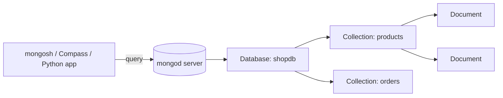

# Session 01: Introduction to MongoDB

> Module: Managing Large Datasets using MongoDB · Diploma in AI / Data Science · Term 1 · ⏱ ~2 hours

In Module 01 you stored data in tables. Real-world data for AI is often messier: one product has a size, another has a warranty, a third has a list of reviews. In this session you will learn why **NoSQL** databases exist, how **MongoDB** stores data as documents, and you will install the tools and run your very first commands.

## 🎯 Learning Objectives

- Explain what a database and a DBMS are, and name the main types of DBMS
- Compare a relational database (RDBMS) with a NoSQL database
- Describe how MongoDB works: server, database, collection and document
- Name the main MongoDB products: Server, Atlas (cloud), mongosh, Compass, Database Tools
- Install MongoDB Server, mongosh and Compass on your computer
- Connect to the local server with mongosh and run your first commands

## 📖 Concepts Explained

### 1. Databases and DBMS (quick recap)

A **database** is an organised store of data. A **DBMS** (Database Management System) is the software that saves the data, finds it quickly, checks rules and lets many users work at the same time.

| Type of DBMS | How data is organised | Examples |
|---|---|---|
| Hierarchical | a tree (parent → children) | IBM IMS, Windows Registry |
| Network | a graph (a child can have many parents) | IDMS |
| Relational (RDBMS) | tables with rows and columns, linked by keys | SQL Server, MySQL, PostgreSQL |
| **NoSQL** | documents, key-value pairs, wide columns or graphs | **MongoDB**, Redis, Cassandra, Neo4j |

### 2. RDBMS vs NoSQL

| Point | RDBMS (e.g. SQL Server) | NoSQL document DB (MongoDB) |
|---|---|---|
| Storage unit | row in a table | document in a collection |
| Structure | fixed schema: every row has the same columns | flexible: documents can have different fields |
| Related data | split across tables, joined with `JOIN` | often **embedded** inside one document |
| Query language | SQL | MongoDB Query API (JSON-style) |
| Scaling | usually a bigger server (scale up) | many servers working together (scale out) |
| Best for | banking, accounting, strict relations | catalogues, logs, IoT, user profiles, AI data |

> **Analogy:** an RDBMS is a printed form where every person must fill the same boxes. MongoDB is a folder of index cards: each card can hold exactly the details that person has.

Neither is "better". Many companies use both: SQL for money and orders, MongoDB for flexible or very large data.

### 3. What is MongoDB and how does it work?

MongoDB is an open-source, **document-oriented** NoSQL database. Data is written as JSON-like documents and stored on disk in **BSON** (Binary JSON), which is faster to read and supports extra types such as dates and `ObjectId`.



- The **server** program is called `mongod`. It listens on port **27017** by default.
- Clients (mongosh, Compass, your Python code) send requests to the server and get results back.

### 4. Database, collection and document

| SQL word | MongoDB word | Example |
|---|---|---|
| Database | Database | `shopdb` |
| Table | Collection | `products` |
| Row | Document | `{ name: "Wireless Mouse", price: 1800 }` |
| Column | Field | `price` |
| Primary key | `_id` field | `"P001"` or an automatic `ObjectId` |

A **document** is a set of `field: value` pairs inside curly braces. A value can be text, a number, a date, a list (array) or even another document (embedded document). See the sample in `student-document.json`.

### 5. Getting started: the MongoDB family

| Product | What it is |
|---|---|
| **MongoDB Server** (Community Edition) | the free database you install on your PC |
| **MongoDB Atlas** | MongoDB in the cloud; has a free tier (Session 14) |
| **mongosh** | the MongoDB Shell, a command-line tool to type commands |
| **Compass** | a graphical tool to browse, insert and query data with the mouse |
| **Database Tools** | command-line helpers: `mongoimport`, `mongoexport`, `mongodump`, `mongorestore` |

### 6. Installing on Windows (step by step)

1. Download **MongoDB Community Server** (MSI) from the link in the module README. Choose *Complete* setup and keep **"Install MongoD as a Service"** ticked, so the server starts automatically.
2. The installer can also install **Compass**; keep that option ticked (or download Compass separately).
3. Download **mongosh** (MSI) and install it. Tick the option to add it to your PATH.
4. Open a new Command Prompt and type `mongosh --version`. If you see a version number, it worked.

> On macOS you can use Homebrew (`brew install mongodb-community mongosh`) and on Ubuntu the official `apt` repository. Follow the official install guide for your OS.

### 7. Connecting the server with mongosh

```bash
mongosh                                  # connects to mongodb://localhost:27017
mongosh "mongodb://localhost:27017"      # the same, written in full
```

When connected you will see a prompt like `test>`. `test` is the default database. Useful first commands:

| Command | What it does |
|---|---|
| `show dbs` | list databases |
| `use shopdb` | switch to (or prepare) a database |
| `db` | show the current database name |
| `show collections` | list collections in the current database |
| `db.version()` | show the server version |
| `cls` / `exit` | clear the screen / leave mongosh |

## 💻 Code Examples

### Example 1: first commands (`first-commands.js`)

```javascript
// first-commands.js - run with:  mongosh --file first-commands.js
print("Server version: " + db.version());               // 1. which MongoDB version?
print("Current database: " + db.getName());             // 2. where are we? (test)
const names = db.getMongo().getDBNames();               // 3. same as "show dbs"
print("Databases on this server: " + names.join(", "));
```

**How it works:** inside a script file you cannot type shell shortcuts like `show dbs`, so we use the method versions. `db` always points to the current database, and `print()` writes a line to the screen.

### Example 2: your first document (`first-document.js`)

```javascript
// first-document.js
db = db.getSiblingDB("hello");                           // 1. switch to database "hello"
db.greetings.insertOne({ text: "Assalam o Alaikum, MongoDB!", lang: "en" }); // 2. save a document
printjson(db.greetings.findOne());                       // 3. read it back
```

**How it works:** the database `hello` and the collection `greetings` did not exist. MongoDB creates both automatically on the first insert. `findOne()` returns one document and `printjson()` prints it nicely. Notice the extra `_id` field MongoDB added for you.

### Example 3: what a document looks like (`student-document.json`)

```json
{
  "name": "Ayesha Khan",
  "age": 24,
  "isEnrolled": true,
  "skills": ["Python", "SQL"],
  "address": { "city": "Karachi", "area": "North Nazimabad" }
}
```

**How it works:** one document holds text, a number, a boolean, an **array** (`skills`) and an **embedded document** (`address`). In SQL this would need at least two tables.

## 🧪 Lab Practice

1. Install MongoDB Server, mongosh and Compass. Run `mongosh --version` and take a screenshot.
2. Open mongosh and run `show dbs`, `db`, `db.version()`. Write down the three default databases you see (`admin`, `config`, `local`).
3. Run `mongosh --file first-commands.js` and then `mongosh --file first-document.js` from this folder.
4. Open Compass, click **Connect** (default `mongodb://localhost:27017`), open `hello` → `greetings` and find your document.
5. In Compass, add a second document to `greetings` using **ADD DATA → Insert Document**, then refresh mongosh with `db.getSiblingDB("hello").greetings.find()`.

## 📝 Assignment

Write a document (in a file `me.json`) that describes **you**: name, age, city, a list of 3 hobbies and an embedded `education` document (institute, program, term). Insert it into a database `profile`, collection `me`, using mongosh, and submit a screenshot of `findOne()`.

## ❓ Quick Quiz

1. What does MongoDB call a "row"?
2. Which format does MongoDB use to store documents on disk?
3. What is the default port of the MongoDB server?
4. Which tool lets you manage data with a graphical interface?
5. True or false: you must create a collection before inserting into it.

<details><summary>Answers</summary>

1. A document · 2. BSON (Binary JSON) · 3. 27017 · 4. MongoDB Compass · 5. False, it is created automatically on the first insert

</details>

## 💼 Interview Questions

1. **What is the difference between SQL and NoSQL databases?** SQL databases use fixed tables and joins; NoSQL databases such as MongoDB use flexible structures (documents) and scale out across many servers.
2. **What is BSON and why does MongoDB use it?** A binary form of JSON that is faster to scan and supports more types (dates, ObjectId, decimals).
3. **What is `_id`?** The unique primary key of every document. If you do not supply one, MongoDB generates an `ObjectId`.

## ✅ Summary

- A DBMS manages data; RDBMS uses tables, NoSQL uses other models such as documents.
- MongoDB stores JSON-like documents (BSON) in collections inside databases.
- `mongod` is the server (port 27017); mongosh, Compass and drivers are clients.
- Databases and collections are created automatically on the first insert.
- Next session you will build the **shopdb** practice database and learn full CRUD.

---

[🏠 Module Home](../README.md) · [Next ➡](../Session-02-Working-with-MongoDB-Databases/README.md)

Prepared by Zeeshan Abbas · Aptech Learning North Nazimabad
