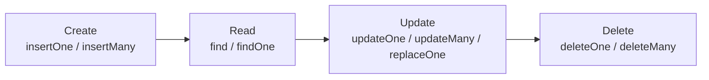

# Session 02: Working with MongoDB Databases (CRUD)

> Module: Managing Large Datasets using MongoDB · Diploma in AI / Data Science · Term 1 · ⏱ ~2 hours

Every application does four basic things with data: **C**reate, **R**ead, **U**pdate and **D**elete (CRUD). In this session you will learn MongoDB data types, build the **shopdb** practice database and perform all four operations, then clean up by dropping collections and databases.

## 🎯 Learning Objectives

- List the common BSON data types (string, number, boolean, date, ObjectId, array, embedded document, null)
- Create a database and a collection (automatically and with `createCollection`)
- Insert documents with `insertOne()` and `insertMany()`
- Query documents with `find()`, `findOne()`, projection, `sort()` and `limit()`
- Update documents with `updateOne()`, `updateMany()` and `replaceOne()`
- Delete documents, drop a collection and drop a database

## 📖 Concepts Explained

### 1. Data types in MongoDB

| Type | Example | Notes |
|---|---|---|
| String | `"Karachi"` | text in double quotes (UTF-8, so Urdu works too) |
| Int32 / Int64 | `NumberInt(25)`, `NumberLong(9000000000)` | whole numbers |
| Double | `1800`, `4.5` | the default number type in mongosh |
| Decimal128 | `NumberDecimal("1999.99")` | exact decimals, best for money |
| Boolean | `true` / `false` | |
| Date | `new Date()`, `ISODate("2026-01-05")` | stored in UTC |
| ObjectId | `ObjectId()` | 12-byte unique id, includes creation time |
| Array | `["mobile", "laptop"]` | a list of values |
| Embedded document | `{ brand: "Anker", warrantyMonths: 18 }` | a document inside a document |
| Null | `null` | "no value" |

### 2. Databases and collections

- `use shopdb` switches to a database. It only appears in `show dbs` after it holds data.
- A collection is created **implicitly** on the first insert, or **explicitly** with `db.createCollection("name", options)`. Options include `capped` (fixed size, like a ring buffer for logs) and `validator` (rules for documents). Both ways are shown in `create-db-and-collection.js`.

### 3. The practice database: shopdb

| Collection | Documents | Important fields |
|---|---|---|
| `products` | 10 | `_id`, `name`, `category`, `price`, `stock`, `tags` (array), `ratings` (array), `specs` (embedded, some only) |
| `customers` | 6 | `_id`, `name`, `email`, `city`, `age`, `isPremium`, `joined` (date) |
| `orders` | 12 | `_id`, `customerId`, `city`, `orderDate`, `items` (array of embedded docs), `total`, `status`, `payment` |

Build it now with `mongosh --file shopdb-setup.js` (run from this folder). The same data is also provided as `products.json`, `customers.json` and `orders.json` so you can load it with `mongoimport` or Compass:

```bash
mongoimport --db shopdb --collection products --jsonArray --drop --file products.json
```

### 4. CRUD at a glance



| SQL | MongoDB |
|---|---|
| `INSERT INTO products ...` | `db.products.insertOne({...})` |
| `SELECT * FROM products` | `db.products.find()` |
| `SELECT name, price FROM products WHERE category='Books'` | `db.products.find({category: "Books"}, {name: 1, price: 1})` |
| `UPDATE products SET stock=50 WHERE _id='P001'` | `db.products.updateOne({_id: "P001"}, {$set: {stock: 50}})` |
| `DELETE FROM products WHERE stock=0` | `db.products.deleteMany({stock: 0})` |
| `DROP TABLE products` | `db.products.drop()` |
| `DROP DATABASE shopdb` | `db.dropDatabase()` |

**Filter** = which documents (`{category: "Books"}`). **Projection** = which fields to show (`1` show, `0` hide). Every update needs an **update operator** such as `$set` or `$inc`; otherwise use `replaceOne()` to swap the whole document.

## 💻 Code Examples

> Run `shopdb-setup.js` once before the other files. Each file is small and does one job.

### Example 1: data types (`data-types.js`)

```javascript
db = db.getSiblingDB("shopdb");
db.typesDemo.drop();
db.typesDemo.insertOne({
  name: "Sample", qty: NumberInt(5), price: NumberDecimal("1999.99"),
  inStock: true, addedOn: new Date(), tags: ["new", "sale"],
  supplier: { name: "ABC Traders", city: "Lahore" }, discount: null
});
printjson(db.typesDemo.findOne());
```

**How it works:** one document uses ten different types. `findOne()` shows how mongosh displays each one (`Int32`, `Decimal128`, `ISODate`, `ObjectId`).

### Example 2: insert (`insert-documents.js`)

```javascript
db.products.insertOne({ _id: "P011", name: "Webcam HD", category: "Electronics", price: 5200, stock: 10, tags: ["computer"] });
db.products.insertMany([
  { _id: "P012", name: "Urdu Novel", category: "Books", price: 900, stock: 30, tags: ["urdu"] },
  { _id: "P013", name: "Prayer Mat", category: "Home", price: 1500, stock: 40, tags: ["gift"] }
]);
```

**How it works:** `insertOne` adds a single document; `insertMany` takes an array. Because we give our own `_id`, running the file twice would fail with a duplicate key error, so the file first deletes these three ids.

### Example 3: query (`query-documents.js`)

```javascript
printjson(db.products.find({ category: "Books" }).toArray());              // filter
printjson(db.products.find({}, { name: 1, price: 1, _id: 0 }).toArray()); // projection
printjson(db.products.find().sort({ price: -1 }).limit(3).toArray());     // top 3 by price
```

**How it works:** `find(filter, projection)` returns a cursor; `.toArray()` turns it into a list for printing. `sort({price: -1})` means highest first, `limit(3)` keeps three.

### Example 4: update (`update-documents.js`)

```javascript
db.products.updateOne({ _id: "P003" }, { $set: { stock: 25 } });              // restock earbuds
db.products.updateMany({ category: "Grocery" }, { $inc: { price: 50 } });    // grocery +50 PKR
db.customers.replaceOne({ _id: "C006" }, { name: "Faraz Hussain", city: "Hyderabad", age: 36 });
```

**How it works:** `$set` changes a field, `$inc` adds to a number. `replaceOne` keeps only `_id` and swaps everything else, so `email` and `isPremium` are gone afterwards.

### Example 5: delete and drop (`delete-documents.js`, `drop-collection-and-database.js`)

```javascript
db.orders.deleteOne({ _id: "O003" });                 // remove one cancelled order
db.orders.deleteMany({ status: "pending" });          // remove all pending orders
db.typesDemo.drop();                                  // drop a collection
db.getSiblingDB("hello").dropDatabase();              // drop the "hello" database
```

**How it works:** `deleteMany({})` with an empty filter deletes **all** documents but keeps the collection; `drop()` removes the collection itself. Re-run `shopdb-setup.js` to get your data back.

## 🧪 Lab Practice

1. Run `shopdb-setup.js`, then in mongosh: `use shopdb`, `show collections`, `db.products.countDocuments()`.
2. Run `data-types.js` and identify the type of each field in the output.
3. Insert two customers of your own with `insertMany` (one from Quetta, one from Peshawar).
4. Show only `name` and `city` of all customers, sorted by `name` A→Z.
5. Mark order `O008` as `"shipped"`, then delete all `"cancelled"` orders and count what is left.

## 📝 Assignment

Create a database `librarydb` with a collection `books` created explicitly by `db.createCollection("books")`. Insert 8 books (title, author, year, price, genres array, available boolean). Then write and save in `assignment.js`: (a) all available books, (b) title and author only, sorted by year, (c) increase every price by 100, (d) delete books published before 1990, (e) drop the collection.

## ❓ Quick Quiz

1. Which method inserts several documents at once?
2. In a projection, what does `0` mean?
3. What is the difference between `deleteMany({})` and `drop()`?
4. Which number type should you use for money?
5. What happens to fields not mentioned in `replaceOne()`?

<details><summary>Answers</summary>

1. `insertMany()` · 2. hide that field · 3. `deleteMany({})` empties the collection, `drop()` removes the collection (and its indexes) completely · 4. `Decimal128` (`NumberDecimal`) · 5. they are removed; only `_id` is kept

</details>

## 💼 Interview Questions

1. **What is the difference between `updateOne` and `replaceOne`?** `updateOne` changes selected fields using operators; `replaceOne` replaces the whole document except `_id`.
2. **How is a database created in MongoDB?** Implicitly: `use name` and insert a document; it is saved when the first data is written.
3. **What is a capped collection?** A fixed-size collection that keeps insertion order and overwrites the oldest documents when full, useful for logs.

## ✅ Summary

- MongoDB supports rich BSON types, including arrays, embedded documents, dates and Decimal128.
- CRUD = `insertOne/insertMany`, `find/findOne`, `updateOne/updateMany/replaceOne`, `deleteOne/deleteMany`.
- `find(filter, projection)` plus `sort()` and `limit()` covers most everyday reads.
- `drop()` removes a collection, `dropDatabase()` removes the current database.
- `shopdb-setup.js` rebuilds the practice data at any time.

---

[⬅ Previous](../Session-01-Introduction-to-MongoDB/README.md) · [🏠 Module Home](../README.md) · [Next ➡](../Session-03-MongoDB-Operators/README.md)

Prepared by Zeeshan Abbas · Aptech Learning North Nazimabad
