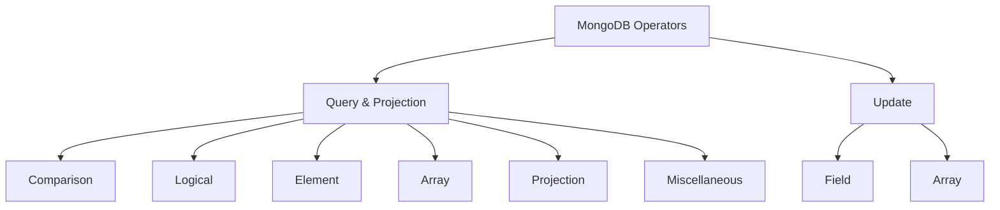

# Session 03: MongoDB Operators

> Module: Managing Large Datasets using MongoDB · Diploma in AI / Data Science · Term 1 · ⏱ ~2 hours

In Session 02 every filter was an exact match, such as `{category: "Books"}`. Real questions are richer: *products under 3,000 PKR*, *customers from Karachi **or** Lahore*, *products that have a warranty*. MongoDB answers these with **operators**: special keywords that start with a dollar sign `$`.

## 🎯 Learning Objectives

- Explain what an operator is and where it goes in a query or update
- Filter with comparison (`$gt`, `$in` ...), logical (`$and`, `$or` ...) and element (`$exists`, `$type`) operators
- Query arrays with `$all`, `$size` and `$elemMatch`
- Control output with projection operators (`$slice`, `$elemMatch`, positional `$`)
- Use miscellaneous operators such as `$regex` and `$expr`
- Change documents with field update operators (`$set`, `$inc`, `$unset` ...) and array update operators (`$push`, `$pull` ...)

## 📖 Concepts Explained

### 1. Where do operators go?

```javascript
db.collection.find(  { field: { $operator: value } },  { projection }  )
db.collection.updateOne( { filter },  { $updateOperator: { field: value } } )
```

> **Analogy:** a filter is a question you ask a shopkeeper. Without operators you can only ask "do you have exactly this?". Operators let you ask "show me everything **cheaper than** 3,000" or "anything **with** a warranty".



### 2. Comparison operators

| Operator | Meaning | Example |
|---|---|---|
| `$eq` / `$ne` | equal / not equal | `{status: {$ne: "cancelled"}}` |
| `$gt` / `$gte` | greater than / or equal | `{price: {$gt: 3000}}` |
| `$lt` / `$lte` | less than / or equal | `{age: {$lte: 25}}` |
| `$in` / `$nin` | value is in / not in a list | `{city: {$in: ["Karachi", "Lahore"]}}` |

Two conditions on the same field form a range: `{price: {$gte: 2000, $lte: 4000}}`.

### 3. Logical operators

| Operator | Meaning |
|---|---|
| `$and` | all conditions true (a comma between fields already means AND) |
| `$or` | at least one condition true |
| `$nor` | none of the conditions true |
| `$not` | reverses one operator expression |

### 4. Element operators

- `$exists: true/false` → does the field exist? (Only some products have `specs`.)
- `$type: "string" | "double" | "array" | "date" ...` → is the value of this type?

### 5. Array query operators

| Operator | Meaning | Example |
|---|---|---|
| plain value | array **contains** the value | `{tags: "python"}` |
| `$all` | contains **all** listed values | `{tags: {$all: ["python", "data"]}}` |
| `$size` | array has exactly N items | `{ratings: {$size: 0}}` |
| `$elemMatch` | **one element** meets all conditions | `{items: {$elemMatch: {productId: "P001", qty: {$gte: 2}}}}` |

### 6. Projection and miscellaneous operators

- `$slice: 2` shows only the first 2 items of an array; `$slice: -1` shows the last one.
- `$elemMatch` in a projection shows only the first matching array element.
- `"items.$": 1` (positional) shows the array element that matched the filter.
- `$regex` matches text patterns: `{name: {$regex: "^B", $options: "i"}}` = names starting with B or b.
- `$expr` compares two fields of the **same** document, e.g. orders where `total` is greater than 10 × the number of items.
- `$mod: [2, 0]` → even numbers.

### 7. Update operators

| Field operators | Effect | Array operators | Effect |
|---|---|---|---|
| `$set` | set a value | `$push` | add item to array |
| `$unset` | remove a field | `$addToSet` | add only if not already there |
| `$inc` | add a number | `$pull` | remove matching items |
| `$mul` | multiply | `$pop` | remove first (`-1`) or last (`1`) |
| `$rename` | rename a field | `$each` | used with `$push`/`$addToSet` for many items |
| `$min` / `$max` | update only if smaller / larger | `$` | update the matched element |
| `$currentDate` | set to now | | |
| `$setOnInsert` | only when an upsert inserts | | |

## 💻 Code Examples

> Run `../Session-02-Working-with-MongoDB-Databases/shopdb-setup.js` first. The update files change data, so re-run the setup to reset.

### Example 1: comparison (`comparison-operators.js`)

```javascript
db.products.find({ price: { $gt: 3000 } }, { name: 1, price: 1 });
db.products.find({ price: { $gte: 2000, $lte: 4000 } }, { name: 1, price: 1 });
db.customers.find({ city: { $in: ["Karachi", "Lahore"] } }, { name: 1, city: 1 });
db.orders.find({ status: { $ne: "cancelled" } }, { status: 1 });
```

**How it works:** the operator sits inside the field's value. The second query is a price range because both conditions apply to `price`.

### Example 2: logical (`logical-operators.js`)

```javascript
db.customers.find({ $or: [{ city: "Islamabad" }, { age: { $lt: 25 } }] });
db.products.find({ $and: [{ category: "Electronics" }, { stock: { $gt: 0 } }] });
db.orders.find({ $nor: [{ status: "delivered" }, { status: "cancelled" }] });
db.products.find({ price: { $not: { $gt: 3000 } } });
```

**How it works:** `$or`, `$and`, `$nor` take an **array** of conditions. `$not` wraps one operator. Note that `$not` also returns documents that do not have the field at all.

### Example 3: element and array (`element-operators.js`, `array-operators.js`)

```javascript
db.products.find({ specs: { $exists: false } }, { name: 1 });
db.products.find({ tags: { $all: ["python", "data"] } }, { name: 1 });
db.products.find({ ratings: { $size: 0 } }, { name: 1 });
db.orders.find({ items: { $elemMatch: { productId: "P001", qty: { $gte: 2 } } } });
```

**How it works:** `$exists` checks if the field is present. `$all` needs every tag, `$size` counts items, `$elemMatch` makes sure **the same** item has both `productId: "P001"` and `qty >= 2`.

### Example 4: projection and miscellaneous (`projection-operators.js`, `misc-operators.js`)

```javascript
db.products.find({}, { name: 1, ratings: { $slice: 1 } });
db.orders.find({ "items.productId": "P001" }, { "items.$": 1 });
db.products.find({ name: { $regex: "^b", $options: "i" } }, { name: 1 });
db.products.find({ $expr: { $lt: ["$stock", 10] } }, { name: 1, stock: 1 });
```

**How it works:** `$slice` trims the array, `items.$` returns only the matched item, `$regex` finds names starting with "B", `$expr` lets you use aggregation expressions; `"$stock"` (with a dollar) means "the value of the stock field".

### Example 5: update operators (`field-update-operators.js`, `array-update-operators.js`)

```javascript
db.products.updateOne({ _id: "P009" }, { $inc: { stock: -5 }, $currentDate: { updatedAt: true } });
db.products.updateOne({ _id: "P006" }, { $rename: { tags: "labels" } });
db.products.updateOne({ _id: "P004" }, { $push: { ratings: { $each: [5, 4] } } });
db.products.updateOne({ _id: "P001" }, { $addToSet: { tags: "wireless" } });
db.products.updateOne({ _id: "P007" }, { $pull: { tags: "eid" } });
db.orders.updateOne({ _id: "O001", "items.productId": "P001" }, { $set: { "items.$.qty": 3 } });
```

**How it works:** several operators can be used in one update. `$each` pushes many values, `$addToSet` avoids duplicates, and `items.$.qty` changes only the matched item.

## 🧪 Lab Practice

1. Find customers aged between 25 and 35 (inclusive), showing only `name` and `age`.
2. Find orders paid by `"Card"` **or** with a total above 8,000.
3. Find products that have `specs.warrantyMonths` and a warranty of at least 12 months.
4. Find products tagged `"summer"` and show only the first rating.
5. Add a rating `5` to every Clothing product with `$push`, then increase all Book prices by 10% with `$mul`.

## 📝 Assignment

Write `assignment.js` that uses at least **eight different operators** on `shopdb` (four query, two projection or misc, two update). Next to each line, add a comment explaining it in your own words and the result you saw.

## ❓ Quick Quiz

1. Which operator matches any value in a list?
2. What is the difference between `$push` and `$addToSet`?
3. Which operator checks whether a field exists?
4. What does `$size: 0` find?
5. In `$expr`, what does `"$price"` mean?

<details><summary>Answers</summary>

1. `$in` · 2. `$addToSet` skips values already in the array · 3. `$exists` · 4. documents whose array is empty · 5. the value of the `price` field in the current document

</details>

## 💼 Interview Questions

1. **Why use `$elemMatch` instead of two separate conditions on an array?** Separate conditions may be met by different elements; `$elemMatch` requires one element to meet all of them.
2. **What does `upsert: true` do?** If no document matches, the update inserts a new one (`$setOnInsert` fields are set only then).
3. **How do you compare two fields in the same document?** With `$expr`, for example `{$expr: {$gt: ["$spent", "$budget"]}}`.

## ✅ Summary

- Operators start with `$` and turn simple filters into real questions.
- Query operators: comparison, logical, element, array, projection and miscellaneous.
- Update operators: field (`$set`, `$inc`, `$unset` ...) and array (`$push`, `$pull`, `$addToSet` ...).
- Dot notation (`"specs.brand"`) and the positional `$` reach inside embedded documents and arrays.
- Next session is a practice lab covering Sessions 01-03.

---

[⬅ Previous](../Session-02-Working-with-MongoDB-Databases/README.md) · [🏠 Module Home](../README.md) · [Next ➡](../Session-04-Practice-Lab-CRUD-and-Operators/README.md)

Prepared by Zeeshan Abbas · Aptech Learning North Nazimabad
