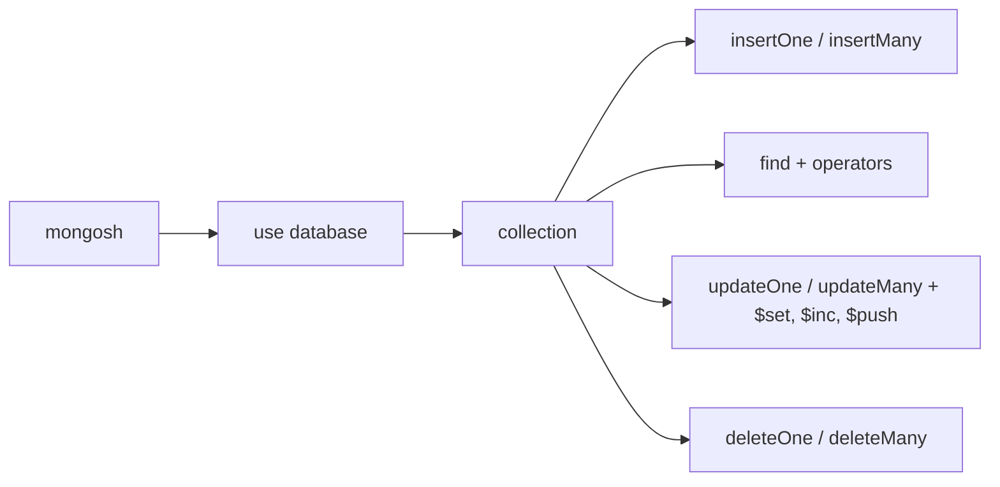

# Session 04: Practice Lab: Basics, CRUD and Operators

> Module: Managing Large Datasets using MongoDB · Diploma in AI / Data Science · Term 1 · ⏱ ~2 hours

This is a **hands-on lab** covering Sessions 01 to 03. There is no new theory. You will rebuild a small database from scratch, run CRUD commands, and answer business questions with operators. Every task has a model answer in this folder, but try first: typing the commands yourself is how they stick.

## 🎯 Learning Objectives

- Start `mongosh`, switch databases and inspect collections without help
- Create a new database and insert documents with embedded objects and arrays
- Read data with filters, projection, sorting, `limit` and `skip`
- Use comparison, logical, element and array operators to answer real questions
- Update and delete documents safely, checking `matchedCount` and `deletedCount`
- Read the acknowledgement objects that MongoDB returns after a write

## 📖 Concepts Explained

### 1. Quick revision map



| Task | Method | Remember |
|---|---|---|
| Create | `insertOne`, `insertMany` | `_id` is added automatically if you skip it |
| Read | `find`, `findOne`, `countDocuments` | 2nd argument is the projection |
| Update | `updateOne`, `updateMany`, `replaceOne` | always use an update operator such as `$set` |
| Delete | `deleteOne`, `deleteMany` | an empty filter `{}` deletes **everything** |

### 2. Reading the result of a write

Every write returns a small report. Learn to read it, because it tells you whether your filter matched what you expected.

| Field | Returned by | Meaning |
|---|---|---|
| `acknowledged: true` | all writes | the server received the command |
| `insertedId` / `insertedIds` | inserts | the new `_id` value(s) |
| `matchedCount` | updates | how many documents the filter found |
| `modifiedCount` | updates | how many were actually changed |
| `deletedCount` | deletes | how many were removed |

> If `matchedCount` is 1 but `modifiedCount` is 0, the document already had that value. Nothing is wrong.

### 3. Cursor helpers

`find()` returns a **cursor**, a pointer you can shape before reading:

- `.sort({ price: -1 })`: `1` = ascending, `-1` = descending
- `.limit(3)`: only the first 3
- `.skip(3)`: jump over 3 (used for paging: page 2 = `skip(3).limit(3)`)
- `.toArray()`: turn the cursor into a normal array for `printjson`

### 4. A safe habit

Before `updateMany` or `deleteMany`, run `find()` or `countDocuments()` with **the same filter**. If the count looks wrong, fix the filter first.

> **Analogy:** a carpenter measures twice and cuts once. `countDocuments` is your measuring tape.

## 💻 Code Examples

This lab builds its own small database, **librarydb**, so it does not disturb `shopdb`.

### Example 1: build the lab database (`library-setup.js`)

```javascript
db = db.getSiblingDB("librarydb");
db.books.drop();
db.books.insertMany([
  { _id: 1, title: "Python Basics", author: "Ali Raza", year: 2021, copies: 4, genres: ["programming"], available: true },
  { _id: 2, title: "Data Stories",  author: "Sana Mir", year: 2019, copies: 0, genres: ["data", "statistics"], available: false }
  // ... 8 books in total, see the file
]);
```

**How it works:** `getSiblingDB` switches database inside a script (the same as `use librarydb`), `drop()` clears old data, and `insertMany` adds the books.

### Example 2: read tasks (`lab-read-solutions.js`)

```javascript
// Books published after 2020, newest first, only title and year
db.books.find({ year: { $gt: 2020 } }, { _id: 0, title: 1, year: 1 }).sort({ year: -1 });

// Books that are out of stock OR older than 2018
db.books.find({ $or: [{ copies: 0 }, { year: { $lt: 2018 } }] });
```

**How it works:** the first query combines a comparison operator, projection and sort. The second uses `$or` with two separate conditions.

### Example 3: write tasks (`lab-write-solutions.js`)

```javascript
const result = db.books.updateMany({ copies: 0 }, { $set: { available: false } });
print("matched: " + result.matchedCount + ", modified: " + result.modifiedCount);
```

**How it works:** we store the report in a variable and print the counts so we can see exactly what happened.

## 🧪 Lab Practice

Run `mongosh --file library-setup.js` first. Then, in `mongosh`, write a command for each task. Check yourself with `lab-read-solutions.js` and `lab-write-solutions.js`.

**Part A: read (Sessions 01-02)**

1. Show all books, then only `title` and `author` without `_id`.
2. Count the books with `available: true`.
3. Show the 3 newest books (`sort` + `limit`), then "page 2" of the same list (`skip`).

**Part B: operators (Session 03)**

4. Books with 1 to 3 copies (`$gte`, `$lte`).
5. Books in genre `"data"` or `"ai"` (`$in`).
6. Books that have a `rating` field (`$exists`) and books with exactly 2 genres (`$size`).
7. Books whose title starts with "Data" (`$regex: /^Data/`).

**Part C: write**

8. Insert a new book with your own details, then find it by its title.
9. Add 2 copies to book 2 (`$inc`) and push the genre `"beginner"` into book 1 (`$addToSet`).
10. Set `available: false` for every book with 0 copies; print `matchedCount`.
11. Delete all books published before 2015. Count them first.

## 📝 Assignment

Create `my-movies.js` that builds a `moviesdb` database with at least 10 movies (title, year, rating, genres array, `director` sub-document with `name` and `country`). Then write and print the results of 5 queries using at least 5 **different** operators and 2 updates using `$set` and `$push`.

## ❓ Quick Quiz

1. What does `db.books.deleteMany({})` do?
2. What is the difference between `matchedCount` and `modifiedCount`?
3. How do you show page 3 of a list with 5 items per page?
4. What does `{ _id: 0, title: 1 }` mean as a second argument to `find`?
5. Which method switches database inside a `.js` script?

<details><summary>Answers</summary>

1. deletes **every** document in the collection · 2. matched = found by the filter, modified = actually changed · 3. `.skip(10).limit(5)` · 4. show `title`, hide `_id` · 5. `db.getSiblingDB("name")`

</details>

## 💼 Interview Questions

1. **What is a cursor in MongoDB?** A pointer to the result set of `find()`. Documents are fetched in batches as you iterate, so large results do not load into memory at once.
2. **`updateOne` vs `replaceOne`?** `updateOne` changes chosen fields with operators; `replaceOne` swaps the whole document (except `_id`) for a new one.
3. **How do you avoid deleting the wrong data?** Test the filter with `find` or `countDocuments`, use specific filters (ideally `_id`), and keep backups (`mongodump`).

## ✅ Summary

- CRUD = `insert*`, `find*`, `update*`, `delete*`.
- Operators make filters expressive; update operators change only the fields you name.
- Read write reports (`matchedCount`, `deletedCount`) to confirm what happened.
- Shape results with `sort`, `skip`, `limit` and projection.
- Next: summarising data with the aggregation pipeline.

---

[⬅ Previous](../Session-03-MongoDB-Operators/README.md) · [🏠 Module Home](../README.md) · [Next ➡](../Session-05-Aggregation-Pipeline/README.md)

Prepared by Zeeshan Abbas · Aptech Learning North Nazimabad
