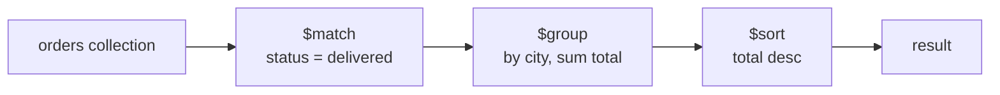

# Session 05: The Aggregation Pipeline

> Module: Managing Large Datasets using MongoDB · Diploma in AI / Data Science · Term 1 · ⏱ ~2 hours

`find()` returns documents as they are stored. A data analyst needs more: *total sales per city*, *best-selling products*, *revenue per month*. In SQL you would use `GROUP BY` and `JOIN`; in MongoDB you build an **aggregation pipeline**. This is the most important tool in the module for data science work.

## 🎯 Learning Objectives

- Explain what an aggregation pipeline is and how documents flow through stages
- Use the core stages: `$match`, `$group`, `$sort`, `$limit`, `$project`, `$count`
- Flatten arrays with `$unwind` and join collections with `$lookup`
- Add calculated fields with `$addFields`/`$set` and use accumulators (`$sum`, `$avg`, `$max`, `$push`)
- Write expressions with arithmetic, conditional (`$cond`) and date (`$dateToString`) operators
- Order stages for good performance (filter early)

## 📖 Concepts Explained

### 1. What is a pipeline?

A pipeline is an **array of stages**. Documents enter the first stage, each stage transforms them, and the output of one stage becomes the input of the next.

> **Analogy:** a factory assembly line. Raw parts enter, one station filters out faulty parts, the next sorts them, the next packs them in boxes. Each station does one simple job.



```javascript
db.orders.aggregate([
  { stage1 },
  { stage2 },
  ...
])
```

### 2. Common stages

| Stage | Job | SQL cousin |
|---|---|---|
| `$match` | keep documents that match a filter | `WHERE` |
| `$group` | combine documents by a key and calculate | `GROUP BY` |
| `$sort` | order documents | `ORDER BY` |
| `$limit` / `$skip` | take / skip N documents | `TOP` / `OFFSET` |
| `$project` | choose, rename or compute fields | column list in `SELECT` |
| `$addFields` (`$set`) | add new fields, keep the rest | computed column |
| `$unwind` | one document per array element | (no direct equal) |
| `$lookup` | bring matching documents from another collection | `LEFT JOIN` |
| `$count` | return the number of documents | `COUNT(*)` |

### 3. `$group` and accumulators

```javascript
{ $group: { _id: "$city", totalSales: { $sum: "$total" }, orders: { $sum: 1 } } }
```

- `_id` is the **grouping key**. Use `null` to put everything in one group.
- `"$city"` (with a dollar and quotes) means "the value of the `city` field".
- Accumulators: `$sum`, `$avg`, `$min`, `$max`, `$first`, `$last`, `$push` (collect into array), `$addToSet` (unique values).
- `{ $sum: 1 }` adds 1 per document, so it counts.

### 4. Aggregation expressions

Expressions compute new values inside `$project`, `$addFields` or `$group`.

| Type | Examples |
|---|---|
| Arithmetic | `$add`, `$subtract`, `$multiply`, `$divide`, `$round` |
| Comparison | `$gt`, `$eq`, `$lte` (return true/false) |
| Conditional | `$cond: { if: ..., then: ..., else: ... }`, `$ifNull` |
| String | `$concat`, `$toUpper`, `$substrCP` |
| Date | `$year`, `$month`, `$dateToString` |
| Array | `$size`, `$avg` over an array, `$filter` |

### 5. Performance tips

- Put `$match` (and `$limit` where possible) **as early as possible** so later stages handle fewer documents. An early `$match` can also use an index (Session 09).
- `$project` away big fields you do not need.
- A pipeline stage has a memory limit; large sorts and groups may write temporary files to disk (allowed by default since MongoDB 6).

## 💻 Code Examples

All examples use **shopdb**. Run `shopdb-setup.js` from Session 02 first.

### Example 1: match, group, sort (`sales-by-city.js`)

```javascript
db.orders.aggregate([
  { $match: { status: "delivered" } },                 // only completed orders
  { $group: { _id: "$city", revenue: { $sum: "$total" }, orders: { $sum: 1 } } },
  { $sort: { revenue: -1 } }                           // biggest city first
]);
```

**How it works:** the 6 delivered orders enter `$group`, which makes one bucket per city with the revenue and order count. `$sort` puts the highest revenue first.

### Example 2: project and calculated fields (`project-and-expressions.js`)

```javascript
db.products.aggregate([
  { $project: {
      _id: 0, name: 1, price: 1,
      priceWithTax: { $round: [{ $multiply: ["$price", 1.18] }, 0] },
      stockStatus:  { $cond: { if: { $gt: ["$stock", 0] }, then: "In stock", else: "Sold out" } },
      avgRating:    { $avg: "$ratings" }
  } }
]);
```

**How it works:** `$multiply` adds 18% tax, `$cond` turns a number into a label, and `$avg` on an array averages the ratings of each product (a product with no ratings gets `null`).

### Example 3: unwind (`unwind-items.js`)

```javascript
db.orders.aggregate([
  { $unwind: "$items" },
  { $group: { _id: "$items.productId", unitsSold: { $sum: "$items.qty" } } },
  { $sort: { unitsSold: -1 } },
  { $limit: 3 }
]);
```

**How it works:** an order with 2 items becomes 2 documents, so we can add up quantities per product and keep the top 3 sellers.

### Example 4: lookup (`lookup-customers.js`)

```javascript
db.orders.aggregate([
  { $lookup: { from: "customers", localField: "customerId", foreignField: "_id", as: "customer" } },
  { $unwind: "$customer" },
  { $project: { _id: 1, total: 1, customerName: "$customer.name" } }
]);
```

**How it works:** `$lookup` adds an array `customer` with the matching customer document. `$unwind` turns the one-element array into an object so we can read `customer.name`.

### Example 5: monthly report (`monthly-report.js`)

Groups orders by `$dateToString: { format: "%Y-%m", date: "$orderDate" }` to show revenue per month. Open the file to see the full pipeline.

## 🧪 Lab Practice

1. Count the orders for each `status` and sort by count.
2. Show the average order total per `payment` method, rounded to 0 decimals.
3. List each category with its number of products and the most expensive price.
4. Using `$unwind` and `$lookup`, show total units sold per product **name**.
5. Show the top 2 customers by money spent (exclude cancelled orders) with their names.

## 📝 Assignment

Write `dashboard.js` that prints four small reports for a shop owner: revenue per city, revenue per month, best-selling category (hint: `$unwind` items, `$lookup` products, `$group` by category) and the share of COD vs Card orders as a percentage.

## ❓ Quick Quiz

1. In `$group`, what does `_id: null` mean?
2. Which stage is the MongoDB equivalent of SQL `WHERE`?
3. What does `$unwind` do to a document whose `items` array has 3 elements?
4. Why should `$match` come early in a pipeline?
5. What does `{ $sum: 1 }` calculate?

<details><summary>Answers</summary>

1. put all documents in one single group · 2. `$match` · 3. it outputs 3 documents, one per element · 4. fewer documents reach later stages and it can use an index · 5. the number of documents (a count)

</details>

## 💼 Interview Questions

1. **What is the aggregation pipeline?** A sequence of stages that process documents in order; each stage transforms the stream (filter, group, reshape, join) and passes it on.
2. **How do you join collections in MongoDB?** With the `$lookup` stage, which works like a left outer join and returns matches as an array.
3. **`$project` vs `$addFields`?** `$project` outputs only the fields you list (plus `_id`), while `$addFields` keeps all existing fields and adds or overwrites the ones you name.

## ✅ Summary

- `aggregate([...])` runs documents through an ordered list of stages.
- `$match`, `$group`, `$sort`, `$project`, `$limit` cover most reports.
- `$unwind` flattens arrays; `$lookup` joins another collection.
- Expressions (`$multiply`, `$cond`, `$dateToString` ...) create calculated fields.
- Filter early for speed.

---

[⬅ Previous](../Session-04-Practice-Lab-CRUD-and-Operators/README.md) · [🏠 Module Home](../README.md) · [Next ➡](../Session-06-Database-Commands/README.md)

Prepared by Zeeshan Abbas · Aptech Learning North Nazimabad
