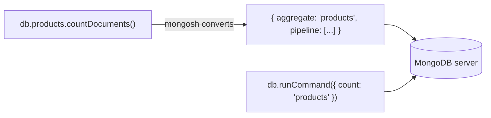

# Session 06: Database Commands

> Module: Managing Large Datasets using MongoDB · Diploma in AI / Data Science · Term 1 · ⏱ ~2 hours

Every friendly shell method you have used, such as `insertOne()` or `countDocuments()`, is turned into a **database command** before it is sent to the server. Knowing the commands themselves lets you check a server's health, see how big a database is, run work from any driver in the same way, and use features that have no shortcut method. In this session you will run commands directly with `db.runCommand()`.

## 🎯 Learning Objectives

- Explain what a database command is and how shell methods relate to commands
- Run commands with `db.runCommand()` and `db.adminCommand()` and read the `ok` field
- Use diagnostic commands: `ping`, `hello`, `buildInfo`, `dbStats`, `listCollections`
- Perform writes and reads with the `insert`, `update`, `delete` and `find` commands
- Use aggregation commands: `count`, `distinct` and `aggregate`
- Run geospatial queries with a `2dsphere` index, `$near` and `$geoNear`, and authentication commands (`createUser`, `usersInfo`)

## 📖 Concepts Explained

### 1. Methods vs commands



| You type (shell method) | Sent to server (command) |
|---|---|
| `db.products.insertOne({...})` | `{ insert: "products", documents: [...] }` |
| `db.products.find({...})` | `{ find: "products", filter: {...} }` |
| `db.products.distinct("category")` | `{ distinct: "products", key: "category" }` |
| `db.stats()` | `{ dbStats: 1 }` |

> **Analogy:** a shell method is like ordering food through a waiter who speaks your language. A command is the order slip the waiter writes in the kitchen's format. Learning the slip format means you can order from any kitchen (any driver: Python, Node, Java).

### 2. Running a command

```javascript
db.runCommand({ commandName: value, option1: ..., option2: ... })
db.adminCommand({ ... })   // same, but runs on the "admin" database
```

- The **first field** names the command and usually the target collection.
- Every reply has `ok: 1` for success or `ok: 0` with an `errmsg` for failure.

### 3. Command categories

| Category | Examples | Use |
|---|---|---|
| Diagnostic | `ping`, `hello`, `buildInfo`, `serverStatus`, `dbStats`, `listCollections`, `listDatabases` | health and size checks |
| Write | `insert`, `update`, `delete`, `findAndModify` | change data |
| Query | `find`, `getMore` | read data in batches |
| Aggregation | `aggregate`, `count`, `distinct` | summaries |
| Geospatial | `$near`, `$geoWithin` queries, `$geoNear` stage (need a geo index) | location searches |
| Authentication / users | `createUser`, `usersInfo`, `updateUser`, `dropUser` | security |
| Administration | `create`, `drop`, `renameCollection`, `createIndexes` | manage objects |

### 4. Geospatial data in brief

MongoDB stores locations as **GeoJSON**: `{ type: "Point", coordinates: [longitude, latitude] }`. Note the order: **longitude first**. A `2dsphere` index lets MongoDB measure distances on the Earth's surface in metres.

- `$near` (query operator): nearest documents to a point, sorted by distance.
- `$geoWithin`: documents inside a shape, such as a circle (`$centerSphere`) or polygon.
- `$geoNear` (aggregation stage): like `$near`, but also returns the distance as a field.

### 5. Authentication commands

When access control is on, users must log in. Users are created **in a database** (often `admin`) and given **roles**. Commands: `createUser`, `usersInfo`, `grantRolesToUser`, `dropUser`. In mongosh you log in with `db.auth("user", "password")` or with `mongosh -u user -p --authenticationDatabase admin`. Session 07 covers users and roles in detail.

## 💻 Code Examples

Run `shopdb-setup.js` (Session 02) first.

### Example 1: diagnostics (`diagnostic-commands.js`)

```javascript
printjson(db.adminCommand({ ping: 1 }));          // { ok: 1 } means the server is alive
printjson(db.runCommand({ dbStats: 1, scale: 1024 })); // sizes in KB
printjson(db.runCommand({ listCollections: 1, nameOnly: true }).cursor.firstBatch);
```

**How it works:** `ping` is the quickest health check, `dbStats` reports the number of collections, objects and storage size, and `listCollections` lists the collection names.

### Example 2: write commands (`write-commands.js`)

```javascript
db.runCommand({ insert: "products", documents: [{ _id: "P011", name: "Webcam HD", price: 5200 }] });
db.runCommand({ update: "products", updates: [{ q: { _id: "P011" }, u: { $set: { stock: 10 } } }] });
db.runCommand({ delete: "products", deletes: [{ q: { _id: "P011" }, limit: 1 }] });
```

**How it works:** `q` is the filter, `u` the update, and `limit: 1` deletes one match (`0` deletes all matches). Replies contain `n`, the number of documents affected.

### Example 3: aggregation commands (`aggregation-commands.js`)

```javascript
db.runCommand({ count: "orders", query: { status: "pending" } });
db.runCommand({ distinct: "customers", key: "city" });
db.runCommand({ aggregate: "orders", pipeline: [{ $group: { _id: "$payment", n: { $sum: 1 } } }], cursor: {} });
```

**How it works:** the `aggregate` command needs `cursor: {}`; its results are in `reply.cursor.firstBatch`.

### Example 4: geospatial (`geospatial-commands.js`)

```javascript
db.stores.createIndex({ location: "2dsphere" });
db.stores.find({ location: { $near: { $geometry: { type: "Point", coordinates: [67.03, 24.93] }, $maxDistance: 8000 } } });
```

**How it works:** we create a few Karachi stores, index their location and find the ones within 8 km of a point in central Karachi (distances are in metres). The file also shows `$geoNear` with a distance field.

### Example 5: users (`auth-commands.js`)

Creates a read-only user `reporter` on `shopdb` with `createUser`, lists it with `usersInfo` and removes it with `dropUser`.

## 🧪 Lab Practice

1. Run `ping`, `buildInfo` and `hello`. Write down your server version and whether it is a primary.
2. Use `dbStats` to find how many objects `shopdb` contains and its data size in KB.
3. With the `insert` command add two products, then with the `update` command raise both prices by 10% (`$mul`).
4. Use the `distinct` command to list all product categories, and `count` to count products under 3,000.
5. Add 3 places near your home to a `places` collection and find the nearest one with `$geoNear`.

## 📝 Assignment

Write `health-check.js` that prints a one-screen report: server version, uptime in hours (`serverStatus`), list of databases with their size (`listDatabases`), and for `shopdb` the number of documents in each collection (use `listCollections` and the `count` command in a loop).

## ❓ Quick Quiz

1. What field in a command reply tells you if it succeeded?
2. Which database does `db.adminCommand()` run against?
3. In GeoJSON, which comes first: latitude or longitude?
4. Which index type is needed for `$near` on GeoJSON points?
5. In the `delete` command, what does `limit: 0` mean?

<details><summary>Answers</summary>

1. `ok` (1 = success) · 2. `admin` · 3. longitude · 4. `2dsphere` · 5. delete **all** matching documents

</details>

## 💼 Interview Questions

1. **What is the relationship between `insertOne()` and the `insert` command?** `insertOne()` is a shell/driver helper that builds and sends an `insert` command; the server only understands commands.
2. **How would you quickly check if a MongoDB server is up?** Run `db.adminCommand({ ping: 1 })` and check for `ok: 1`.
3. **How do you find the nearest locations to a user?** Store locations as GeoJSON points, create a `2dsphere` index and query with `$near` or the `$geoNear` aggregation stage.

## ✅ Summary

- Every shell method becomes a command; `db.runCommand()` sends one directly.
- Replies always include `ok`.
- Diagnostic commands (`ping`, `dbStats`, `serverStatus`) check health and size.
- Write, query and aggregation commands mirror CRUD and aggregation methods.
- Geospatial queries need GeoJSON (longitude first) and a `2dsphere` index.

---

[⬅ Previous](../Session-05-Aggregation-Pipeline/README.md) · [🏠 Module Home](../README.md) · [Next ➡](../Session-07-MongoDB-Shell-Methods/README.md)

Prepared by Zeeshan Abbas · Aptech Learning North Nazimabad
