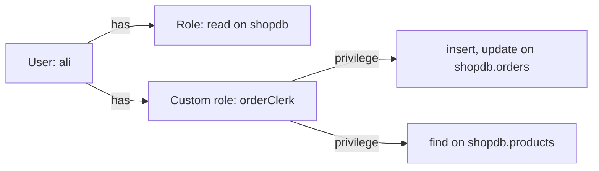

# Session 07: MongoDB Shell Methods, Users and Roles

> Module: Managing Large Datasets using MongoDB · Diploma in AI / Data Science · Term 1 · ⏱ ~2 hours

In Session 06 you sent raw commands. Day to day, people use the shorter **shell methods** that `mongosh` provides. This session organises those methods into four families (collection, database, user and role) and shows how to protect data by giving each person only the access they need.

## 🎯 Learning Objectives

- Describe what `mongosh` is and how its methods are grouped
- Use collection methods beyond basic CRUD: `findOneAndUpdate`, `bulkWrite`, `estimatedDocumentCount`, `renameCollection`
- Use database methods: `getName`, `getCollectionNames`, `createCollection` (with a validator), `stats`
- Manage users with `createUser`, `getUsers`, `grantRolesToUser`, `changeUserPassword`, `dropUser`
- Explain built-in roles and create a custom role with `createRole`
- Apply the principle of least privilege

## 📖 Concepts Explained

### 1. The MongoDB Shell

`mongosh` is a JavaScript-based command line tool. It connects to a server and gives you helper objects:

| Object | Represents | Example |
|---|---|---|
| `db` | the current database | `db.getName()` |
| `db.<collection>` | one collection | `db.products.find()` |
| `rs` | replica set helpers (Session 10) | `rs.status()` |
| `sh` | sharding helpers (Session 10) | `sh.status()` |

Useful shell tips: `help`, `db.help()`, `db.products.help()`, the **Tab** key for auto-complete, and the up arrow for history.

### 2. Collection methods

| Method | Purpose |
|---|---|
| `find`, `findOne`, `insertOne`, `updateMany` ... | CRUD (Sessions 02-03) |
| `countDocuments(filter)` | exact count with a filter |
| `estimatedDocumentCount()` | very fast count of the whole collection (uses metadata) |
| `distinct(field)` | list of different values |
| `findOneAndUpdate(filter, update, options)` | update and **return** the document in one step |
| `bulkWrite([...])` | many inserts/updates/deletes in one round trip |
| `renameCollection(newName)` | rename a collection |
| `drop()` | delete the collection |

> `findOneAndUpdate` is perfect for counters such as "next invoice number": read and increase in one safe step, so two users never get the same number.

### 3. Database methods

| Method | Purpose |
|---|---|
| `db.getName()` | current database name |
| `db.getCollectionNames()` | array of collection names |
| `db.createCollection(name, options)` | create a collection with options such as a **schema validator** |
| `db.stats()` | size and object counts |
| `db.getSiblingDB(name)` | switch database inside a script |
| `db.dropDatabase()` | delete the current database |

A **validator** lets a flexible database still enforce rules, for example "every student must have a name and an age between 16 and 60".

### 4. Users, roles and privileges



- A **privilege** = a resource (database/collection) + actions (`find`, `insert` ...).
- A **role** = a named group of privileges.
- A **user** = login name + password + list of roles.

Common built-in roles:

| Role | Allows |
|---|---|
| `read` | read all collections in one database |
| `readWrite` | read and change data in one database |
| `dbAdmin` | indexes, stats, schema tasks (no data reading) |
| `userAdmin` | create and manage users in one database |
| `readAnyDatabase` / `root` | wide or full access, for administrators only |

> **Principle of least privilege:** give each user the smallest set of roles needed for their job. A data analyst needs `read`, not `root`.

> **Analogy:** a hotel key card. Guests open only their own room, cleaning staff open many rooms but not the safe, and only the manager's card opens everything.

Access control is switched on with `security: authorization: enabled` in the `mongod.conf` file. On a fresh local install it is off, so the examples run without logging in.

## 💻 Code Examples

Run `shopdb-setup.js` (Session 02) first.

### Example 1: collection methods (`collection-methods.js`)

```javascript
const updated = db.products.findOneAndUpdate(
  { _id: "P001" },
  { $inc: { stock: -1 } },              // sell one mouse
  { returnDocument: "after" }            // give me the NEW version
);
print("stock now: " + updated.stock);
```

**How it works:** the update and the read happen together, and `returnDocument: "after"` returns the document after the change. The file also shows `bulkWrite` and `estimatedDocumentCount`.

### Example 2: database methods and a validator (`database-methods.js`)

```javascript
db.createCollection("students", {
  validator: { $jsonSchema: {
    bsonType: "object",
    required: ["name", "age"],
    properties: { age: { bsonType: "int", minimum: 16, maximum: 60 } }
  } }
});
```

**How it works:** inserting a student without a name, or with age 10, is now rejected with a "Document failed validation" error.

### Example 3: users (`user-methods.js`)

```javascript
db.createUser({ user: "analyst", pwd: passwordPrompt(), roles: [{ role: "read", db: "shopdb" }] });
db.grantRolesToUser("analyst", [{ role: "readWrite", db: "shopdb" }]);
```

**How it works:** `passwordPrompt()` asks for the password instead of saving it in the script. The second line gives extra rights later.

### Example 4: custom role (`role-methods.js`)

Creates `orderClerk`, which can read products and insert/update orders but cannot delete anything, then gives it to a user.

## 🧪 Lab Practice

1. Print the current database name and all its collection names.
2. Use `findOneAndUpdate` to mark order `O008` as `shipped` and print the new document.
3. Use `bulkWrite` to insert one product, update another's price and delete a third, in one call.
4. Create a `feedback` collection with a validator: `rating` must be an integer from 1 to 5. Test one valid and one invalid insert.
5. Create a user `intern` with `read` on `shopdb`, list it with `db.getUsers()`, then remove it.

## 📝 Assignment

Design access for a small shop team in `team-access.js`: an **owner** (full access to `shopdb`), an **analyst** (read only), and a **clerk** (custom role: insert and update `orders`, read `products`, no deletes). Create the role and three users, print `db.getUsers()` and `db.getRoles({ showPrivileges: true })`, and write in comments why each user got those rights.

## ❓ Quick Quiz

1. Which is faster on a big collection: `countDocuments({})` or `estimatedDocumentCount()`? Why?
2. What option makes `findOneAndUpdate` return the updated document?
3. What is the difference between a privilege and a role?
4. Which built-in role lets a user read and write one database?
5. Why use `passwordPrompt()` in scripts?

<details><summary>Answers</summary>

1. `estimatedDocumentCount()`, it reads collection metadata instead of scanning documents · 2. `returnDocument: "after"` · 3. a privilege is one resource + actions; a role is a named set of privileges · 4. `readWrite` · 5. so passwords are not saved in plain text in files

</details>

## 💼 Interview Questions

1. **What is the principle of least privilege?** Give each user or application only the permissions required for its task, which limits damage from mistakes or stolen passwords.
2. **How can you enforce a schema in MongoDB?** With a `$jsonSchema` validator on the collection, set in `createCollection` or later with `collMod`.
3. **Why use `bulkWrite`?** It sends many write operations in one network round trip, which is much faster than sending them one by one.

## ✅ Summary

- `mongosh` provides `db`, collection, `rs` and `sh` helpers; use `help` and Tab.
- Collection methods go beyond CRUD: `findOneAndUpdate`, `bulkWrite`, `distinct`.
- Database methods manage collections; validators enforce rules.
- Users get roles; roles hold privileges; follow least privilege.

---

[⬅ Previous](../Session-06-Database-Commands/README.md) · [🏠 Module Home](../README.md) · [Next ➡](../Session-08-Practice-Lab-Aggregation-Commands-and-Shell-Methods/README.md)

Prepared by Zeeshan Abbas · Aptech Learning North Nazimabad
