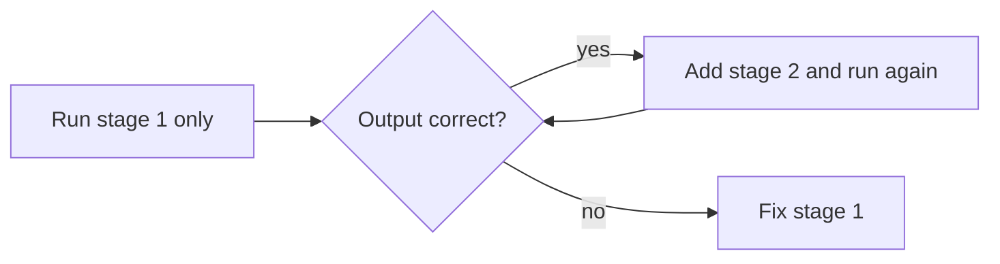

# Session 08: Practice Lab: Aggregation, Commands and Shell Methods

> Module: Managing Large Datasets using MongoDB · Diploma in AI / Data Science · Term 1 · ⏱ ~2 hours

A hands-on lab covering Sessions 05 to 07. You play the role of a junior data analyst at an online store. The manager sends you questions; you answer each one with an aggregation pipeline, a database command or a shell method. Model answers are in this folder; open them only after you have tried.

## 🎯 Learning Objectives

- Turn a business question into an aggregation pipeline, stage by stage
- Combine `$unwind`, `$lookup` and `$group` in one report
- Use `db.runCommand()` for diagnostics and counts
- Use collection and database methods such as `findOneAndUpdate`, `bulkWrite` and `createCollection`
- Create a user with a suitable role and test what it can and cannot do
- Debug a pipeline by running it one stage at a time

## 📖 Concepts Explained

### 1. From question to pipeline

Before typing, answer three questions on paper:

| Ask yourself | Pipeline stage it becomes |
|---|---|
| Which documents matter? | `$match` |
| Do I need to split arrays or bring data from another collection? | `$unwind`, `$lookup` |
| What am I grouping by and what am I calculating? | `$group` with accumulators |
| How should the answer look and be ordered? | `$project`, `$sort`, `$limit` |

> **Example:** "Which city spent the most on Electronics?" → match non-cancelled orders → unwind items → lookup product → match category Electronics → group by city, sum qty × price → sort → limit 1.

### 2. Debug one stage at a time



Keep the pipeline in a variable so you can test parts of it:

```javascript
const pipeline = [ stage1, stage2, stage3 ];
db.orders.aggregate(pipeline.slice(0, 1));   // only the first stage
db.orders.aggregate(pipeline.slice(0, 2));   // first two stages
```

### 3. Choosing the right tool

| Need | Best tool |
|---|---|
| summary report | `aggregate()` |
| a quick count or list of values | `countDocuments()`, `distinct()` |
| server health or size | `db.runCommand({ dbStats: 1 })`, `ping` |
| update and read back in one step | `findOneAndUpdate()` |
| many writes at once | `bulkWrite()` |
| control who sees data | `createUser()`, `createRole()` |

### 4. Common mistakes

- Forgetting the `$` before a field name inside an expression: write `"$total"`, not `"total"`.
- `$unwind` before `$lookup` can multiply documents; check counts after each stage.
- After `$group`, the old field names are gone; only `_id` and your accumulators remain.
- `$lookup` returns an **array**, even with one match. Use `$unwind` or `$first`.

## 💻 Code Examples

Run `shopdb-setup.js` from Session 02 first. Solution files:

| File | Covers |
|---|---|
| `part-a-aggregation-solutions.js` | tasks 1-5 |
| `part-b-commands-and-methods-solutions.js` | tasks 6-10 |

### Sample solution: Electronics spend per city

```javascript
db.orders.aggregate([
  { $match: { status: { $ne: "cancelled" } } },
  { $unwind: "$items" },
  { $lookup: { from: "products", localField: "items.productId", foreignField: "_id", as: "product" } },
  { $unwind: "$product" },
  { $match: { "product.category": "Electronics" } },
  { $group: { _id: "$city", spent: { $sum: { $multiply: ["$items.qty", "$items.price"] } } } },
  { $sort: { spent: -1 } }
]);
```

**How it works:** each order item becomes its own document, gets its product attached, is filtered to Electronics and is then added up per city. `$multiply` calculates the line value.

## 🧪 Lab Practice

**Part A: aggregation (Session 05)**

1. Revenue per payment method for delivered orders, highest first.
2. For each customer: name, number of orders and total spent (use `$lookup`), sorted by spending.
3. The 3 products with the highest average rating (ignore products with no ratings).
4. Electronics spend per city (see the sample above), then change it for Books.
5. Number of orders per weekday name (hint: `$dayOfWeek` returns 1 = Sunday ... 7 = Saturday, or use `$dateToString` with `%u`).

**Part B: commands and shell methods (Sessions 06-07)**

6. Use `runCommand` to print the number of collections and objects in `shopdb`.
7. Use the `distinct` command to list all payment methods.
8. With `findOneAndUpdate`, change order `O010` to `shipped` and print the new document.
9. With `bulkWrite`, increase the stock of `P003` by 20 and decrease `P006` by 5 in one call.
10. Create a user `manager` with role `read` on `shopdb`; print it with `db.getUsers()`, then drop it.

## 📝 Assignment

Write `weekly-review.js` that a manager could run every Monday. It should print: (1) orders by status, (2) top 3 customers by spending with names, (3) products with stock under 10, (4) revenue per city as a percentage of total revenue. Use at least one `$lookup`, one `$unwind` and one `$project` with a calculation.

## ❓ Quick Quiz

1. Which fields remain after a `$group` stage?
2. What does `pipeline.slice(0, 2)` help you do?
3. Why might document counts grow after `$unwind`?
4. Which method updates a document and returns it in one call?
5. You need the list of different cities only. Which is simplest: `aggregate`, `distinct` or `find`?

<details><summary>Answers</summary>

1. only `_id` and the accumulator fields you defined · 2. run just the first two stages to debug · 3. one document is output for every array element · 4. `findOneAndUpdate()` · 5. `distinct("city")`

</details>

## 💼 Interview Questions

1. **How do you debug a long aggregation pipeline?** Run it stage by stage (or use `$limit` early on a sample) and check the output and counts after each stage.
2. **When would you choose `distinct` over `$group`?** When you only need the list of unique values of one field and no calculations.
3. **How can you calculate a percentage of a total in one pipeline?** Use `$group` with `_id: null` to get the total and `$push` the items, or use `$setWindowFields`/`$facet`; then divide each value by the total in `$project`.

## ✅ Summary

- Plan the pipeline on paper: filter, reshape, group, present.
- Build and debug one stage at a time.
- Pick the simplest tool: `distinct` and `countDocuments` for quick answers, `aggregate` for reports.
- Commands and shell methods cover diagnostics, safe updates and security.

---

[⬅ Previous](../Session-07-MongoDB-Shell-Methods/README.md) · [🏠 Module Home](../README.md) · [Next ➡](../Session-09-MongoDB-Indexing/README.md)

Prepared by Zeeshan Abbas · Aptech Learning North Nazimabad
