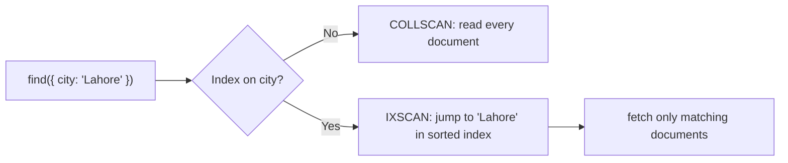

# Session 09: MongoDB Indexing

> Module: Managing Large Datasets using MongoDB · Diploma in AI / Data Science · Term 1 · ⏱ ~2 hours

With 12 orders, every query is instant. With 12 **million** orders, a query without an index may take minutes, because MongoDB has to read every document. An **index** is the single biggest speed-up you can give a large dataset. In this session you will create a big test collection, measure a slow query, add indexes and watch it become fast.

## 🎯 Learning Objectives

- Explain what an index is and why a collection scan is slow
- Create single-field and compound indexes with `createIndex()`
- Describe multikey indexes (on arrays) and hashed indexes (for sharding)
- Read `explain("executionStats")` and tell `COLLSCAN` from `IXSCAN`
- List, hide and drop indexes with `getIndexes()`, `hideIndex()` and `dropIndex()`
- Weigh the costs of indexes: extra storage and slower writes

## 📖 Concepts Explained

### 1. What is an index?

An index is a separate, **sorted** list of the values of one or more fields, each pointing to the documents that contain them.

> **Analogy:** the index at the back of a textbook. To find "photosynthesis" you do not read all 400 pages (a **collection scan**); you look it up alphabetically in the index and jump straight to page 212 (an **index scan**).



Every collection already has one index: on `_id`, which is unique and cannot be dropped.

### 2. Index types you need to know

| Type | Created with | Good for |
|---|---|---|
| Single field | `{ city: 1 }` | filters/sorts on one field |
| Compound | `{ city: 1, total: -1 }` | filters on several fields, or filter + sort |
| Multikey | automatic when the field is an **array**, e.g. `{ tags: 1 }` | queries on array elements |
| Hashed | `{ customerId: "hashed" }` | even spread of data for sharding; equality only |
| Text | `{ name: "text" }` | word search in strings |
| Unique (option) | `{ email: 1 }, { unique: true }` | block duplicate values |
| TTL (option) | `{ createdAt: 1 }, { expireAfterSeconds: 3600 }` | auto-delete old documents |

`1` means ascending and `-1` descending. For single-field indexes the direction does not matter much; in compound indexes it matters for sorting.

### 3. Compound indexes and the ESR rule

A compound index `{ city: 1, total: -1 }` can serve queries on `city`, or on `city` **and** `total`, but **not** on `total` alone (the "prefix" rule, like a phone book sorted by surname then first name).

When choosing field order, follow **ESR**: **E**quality fields first (`city: "Lahore"`), then **S**ort fields, then **R**ange fields (`total: { $gt: 5000 }`).

### 4. Reading explain()

```javascript
db.orders.find({ city: "Lahore" }).explain("executionStats")
```

| Field | Look for |
|---|---|
| `winningPlan.stage` (or its `inputStage`) | `COLLSCAN` = no index used, `IXSCAN` = index used |
| `executionStats.nReturned` | documents returned |
| `executionStats.totalDocsExamined` | documents read; ideally close to `nReturned` |
| `executionStats.executionTimeMillis` | time taken |

### 5. The cost of indexes

Indexes are not free:

- Each index uses disk space and RAM.
- Every insert, update and delete must also update every index, so writes get slower.
- Unused indexes are pure cost. Check usage with `db.orders.aggregate([{ $indexStats: {} }])`.

**Rule of thumb:** index the fields your important queries filter and sort on, and nothing more. Before dropping an index on a live system, `hideIndex()` it first to check nothing slows down.

## 💻 Code Examples

### Example 1: make a big collection (`make-big-collection.js`)

```javascript
const cities = ["Karachi", "Lahore", "Islamabad", "Quetta", "Peshawar"];
const batch = [];
for (let i = 1; i <= 100000; i++) {
  batch.push({ orderNo: i, city: cities[i % 5], total: Math.floor(Math.random() * 20000) });
}
db.bigorders.insertMany(batch);
```

**How it works:** a simple loop builds 100,000 practice orders in memory and inserts them in one call. This takes a few seconds and gives `explain()` something real to measure.

### Example 2: before and after (`single-field-index.js`)

```javascript
db.bigorders.find({ orderNo: 77777 }).explain("executionStats").executionStats.totalDocsExamined; // 100000
db.bigorders.createIndex({ orderNo: 1 });
db.bigorders.find({ orderNo: 77777 }).explain("executionStats").executionStats.totalDocsExamined; // 1
```

**How it works:** without the index MongoDB reads all 100,000 documents to find one. With it, it reads exactly one.

### Example 3: compound, multikey and hashed (`other-index-types.js`)

```javascript
db.bigorders.createIndex({ city: 1, total: -1 });     // compound
db.products.createIndex({ tags: 1 });                  // multikey (tags is an array)
db.customers.createIndex({ email: 1 }, { unique: true });
db.bigorders.createIndex({ orderNo: "hashed" });       // hashed
```

**How it works:** the same `createIndex` method creates every type; the value (`1`, `-1`, `"hashed"`) and options decide which.

### Example 4: list, hide, drop (`manage-indexes.js`)

```javascript
db.bigorders.getIndexes();
db.bigorders.hideIndex("city_1_total_-1");
db.bigorders.dropIndex("city_1_total_-1");
```

**How it works:** indexes get automatic names such as `city_1_total_-1`. A hidden index is still maintained but ignored by queries, which lets you test the effect of removing it safely.

## 🧪 Lab Practice

1. Run `make-big-collection.js`. Query `{ city: "Quetta", total: { $gt: 15000 } }` with `explain("executionStats")` and note `totalDocsExamined` and time.
2. Create `{ city: 1, total: 1 }` and run the same explain. What changed?
3. Query only `{ total: { $gt: 15000 } }`. Is the compound index used? Explain why with the prefix rule.
4. Create a unique index on `customers.email` and try to insert a duplicate email.
5. List all indexes on `bigorders`, drop the ones you created and confirm only `_id_` remains.

## 📝 Assignment

Write `index-report.js`: for three queries of your choice on `bigorders`, print a small table (query, stage, docs examined, ms) **before** and **after** creating the best index for each. Add a comment explaining your field order with the ESR rule.

## ❓ Quick Quiz

1. What does `COLLSCAN` in an explain plan mean?
2. Which index exists on every collection automatically?
3. An index on an array field is called what?
4. Can the index `{ city: 1, total: 1 }` serve a query on `total` alone?
5. Give one disadvantage of having many indexes.

<details><summary>Answers</summary>

1. a full collection scan: every document was read · 2. the `_id` index · 3. a multikey index · 4. no, `total` is not a prefix of the index · 5. slower writes (or extra storage and memory)

</details>

## 💼 Interview Questions

1. **How do you know if a query uses an index?** Run `explain("executionStats")` and look for `IXSCAN` in the winning plan, and compare `totalDocsExamined` with `nReturned`.
2. **What is the ESR rule?** For compound indexes, put Equality fields first, then Sort fields, then Range fields, for the most efficient index use.
3. **When would you use a hashed index?** As a shard key to spread writes evenly across shards when the field values increase steadily (like ids or timestamps). Hashed indexes support equality matches, not range queries.

## ✅ Summary

- Indexes are sorted lookup structures that avoid full collection scans.
- Types: single, compound, multikey, hashed, text, plus unique and TTL options.
- `explain("executionStats")` shows `COLLSCAN` vs `IXSCAN` and documents examined.
- Follow the prefix and ESR rules for compound indexes.
- Indexes cost space and write speed, so create only the ones you need.

---

[⬅ Previous](../Session-08-Practice-Lab-Aggregation-Commands-and-Shell-Methods/README.md) · [🏠 Module Home](../README.md) · [Next ➡](../Session-10-Replication-and-Sharding/README.md)

Prepared by Zeeshan Abbas · Aptech Learning North Nazimabad
