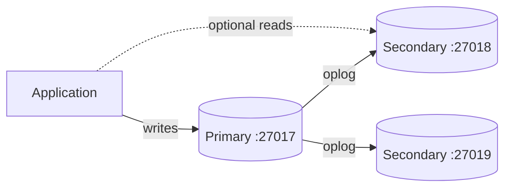
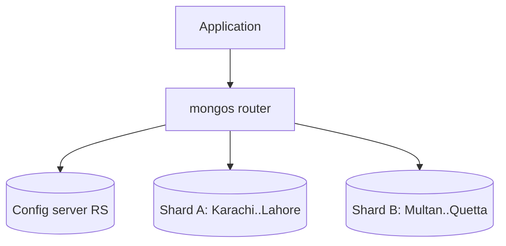

# Session 10: Replication and Sharding

> Module: Managing Large Datasets using MongoDB · Diploma in AI / Data Science · Term 1 · ⏱ ~2 hours

So far everything ran on **one** MongoDB server. If that laptop dies, the data is gone; if the data grows to terabytes, one machine is not enough. MongoDB solves the first problem with **replication** (copies of the data on several servers) and the second with **sharding** (splitting the data across servers). In this session you will build both on your own computer.

## 🎯 Learning Objectives

- Explain replication, replica sets and the roles of primary, secondary and arbiter
- Describe elections, automatic failover and read preferences
- Start a three-member replica set locally and manage it with `rs.*` methods
- Explain sharding and the components of a sharded cluster (shards, config servers, `mongos`)
- Choose a good shard key and compare ranged vs hashed sharding
- Shard a collection with `sh.enableSharding()` and `sh.shardCollection()`

## 📖 Concepts Explained

### 1. Replication: copies for safety

A **replica set** is a group of `mongod` servers that hold the **same data**.

| Member | Job |
|---|---|
| **Primary** | the only member that accepts writes |
| **Secondary** | copies every change from the primary (via the **oplog**) and can serve reads |
| **Arbiter** (optional) | holds no data; only votes in elections |

> **Analogy:** a class has one class representative (primary) who takes decisions, while two assistants (secondaries) keep identical notes. If the representative is absent, the class votes and an assistant takes over immediately.



**Automatic failover:** members send heartbeats every 2 seconds. If the primary is unreachable for about 10 seconds, the others hold an **election** and a secondary becomes the new primary. An odd number of voting members (3, 5 ...) avoids ties.

**Read preference** decides where reads go: `primary` (default), `primaryPreferred`, `secondary`, `secondaryPreferred`, `nearest`. **Write concern** `w: "majority"` waits until most members have the write, so it survives a failover.

Replication gives you: high availability, data safety, and the ability to run reports on a secondary. It also is a requirement for **transactions** (Session 11).

### 2. Sharding: splitting for size

**Sharding** splits one large collection across several servers (shards). Each shard holds part of the data.

| Component | Job |
|---|---|
| **Shard** | stores a subset of the data (each shard is itself a replica set) |
| **Config servers** | a replica set that stores the cluster metadata: which data lives on which shard |
| **`mongos`** | the router; applications connect to it, and it sends each query to the right shard(s) |



> **Analogy:** a huge library splits books across three buildings by author name A-H, I-P and Q-Z. The reception desk (`mongos`) checks the catalogue (config servers) and sends you to the right building.

### 3. The shard key

The **shard key** is the field (or fields) used to decide where each document lives. It is the most important sharding decision.

| Good shard key | Bad shard key |
|---|---|
| many different values (high cardinality) | few values, e.g. `status` |
| spreads writes evenly | always increasing, e.g. a timestamp with ranged sharding (all new data hits one shard) |
| used in most queries | rarely used in filters (queries go to every shard) |

- **Ranged sharding:** documents with nearby key values sit together; fast range queries, risk of "hot" shards.
- **Hashed sharding:** the key is hashed first; writes spread evenly, but range queries must ask every shard.

Data is divided into **chunks** (ranges of the shard key); the **balancer** moves chunks between shards to keep them even.

### 4. Replication vs sharding

| | Replication | Sharding |
|---|---|---|
| Purpose | availability and safety | scale beyond one machine |
| Each server holds | all the data | part of the data |
| Helper object | `rs` | `sh` |

Production clusters use **both**: every shard is a replica set.

## 💻 Code Examples

> These labs start several `mongod` processes on one PC with different ports and data folders. Stop your normal MongoDB service first (Windows: `net stop MongoDB` as administrator) or use ports that are free.

### Example 1: start three members (`replica-set-start.bat` / `replica-set-start.sh`)

```bat
mkdir C:\data\rs1 C:\data\rs2 C:\data\rs3
start mongod --replSet rs0 --port 27017 --dbpath C:\data\rs1 --bind_ip localhost
start mongod --replSet rs0 --port 27018 --dbpath C:\data\rs2 --bind_ip localhost
start mongod --replSet rs0 --port 27019 --dbpath C:\data\rs3 --bind_ip localhost
```

**How it works:** three servers start with the same replica set name `rs0`, each with its own port and data folder.

### Example 2: initiate and inspect (`replica-set-init.js`)

```javascript
rs.initiate({ _id: "rs0", members: [
  { _id: 0, host: "localhost:27017" },
  { _id: 1, host: "localhost:27018" },
  { _id: 2, host: "localhost:27019" }
] });
rs.status().members.forEach(m => print(m.name + "  " + m.stateStr));
```

**How it works:** `rs.initiate` joins the three servers into one set. After a few seconds one member shows `PRIMARY` and two show `SECONDARY`.

### Example 3: test replication and failover (`replication-test.js`)

Writes a document on the primary, reads it from a secondary (`readPref("secondary")`), then runs `rs.stepDown()` so you can watch a new primary being elected.

### Example 4: a small sharded cluster (`sharding-start.bat`, `sharding-setup.js`)

```javascript
sh.addShard("shardA/localhost:27031");
sh.enableSharding("shopdb");
sh.shardCollection("shopdb.bigorders", { orderNo: "hashed" });
sh.status();
```

**How it works:** the `.bat` file starts a config server, two single-member shard replica sets and a `mongos` on port 27040. The script connects to `mongos`, adds the shards and shards `bigorders` on a hashed key.

## 🧪 Lab Practice

1. Start the replica set with the start script and run `replica-set-init.js`. Record which member is primary.
2. Connect with `mongosh "mongodb://localhost:27017,localhost:27018,localhost:27019/?replicaSet=rs0"` and insert 5 documents.
3. Connect directly to a secondary, run `db.getMongo().setReadPref("secondary")` and read the documents.
4. Close the primary's window. Within ~15 seconds, run `rs.status()` and find the new primary.
5. (Advanced) Start the sharded cluster, shard `bigorders` and use `db.bigorders.getShardDistribution()` to see how documents are split.

## 📝 Assignment

Write a one-page `cluster-design.md` for a ride-hailing app in Pakistan that stores 50 million trips a year. Propose: the number of replica set members and why, the shard key for the `trips` collection (compare at least two options), ranged or hashed, and the read preference for the analytics team.

## ❓ Quick Quiz

1. Which replica set member accepts writes?
2. Why should a replica set have an odd number of voting members?
3. What does `mongos` do?
4. Name one property of a good shard key.
5. What is the difference between replication and sharding in one line?

<details><summary>Answers</summary>

1. the primary · 2. to avoid tied votes in elections · 3. routes client queries to the correct shards using the config server metadata · 4. high cardinality / even distribution / used in queries · 5. replication copies all data for safety; sharding splits data for scale

</details>

## 💼 Interview Questions

1. **What happens when the primary fails?** Secondaries notice missing heartbeats, hold an election, and one becomes primary; drivers reconnect automatically and retryable writes continue.
2. **What is the oplog?** A special capped collection on each member that records every write in order; secondaries replay it to stay in sync.
3. **Why can a monotonically increasing shard key be a problem?** With ranged sharding, all new inserts go to the chunk holding the highest values, creating a hot shard; hashing the key spreads them out.

## ✅ Summary

- Replica set = primary + secondaries (+ optional arbiter) with automatic failover.
- Read preference and write concern control where reads go and how safe writes are.
- Sharding splits data across shards; `mongos` routes, config servers remember.
- The shard key decides distribution; choose high cardinality and even spread.
- Real clusters combine both: each shard is a replica set.

---

[⬅ Previous](../Session-09-MongoDB-Indexing/README.md) · [🏠 Module Home](../README.md) · [Next ➡](../Session-11-Transaction-Management/README.md)

Prepared by Zeeshan Abbas · Aptech Learning North Nazimabad
