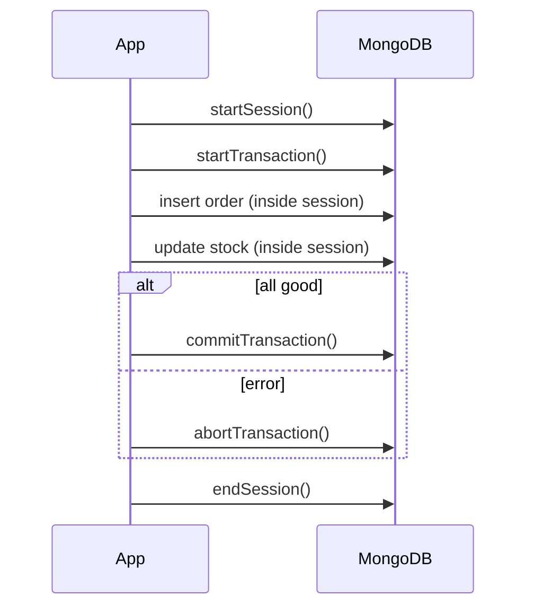

# Session 11: Transaction Management

> Module: Managing Large Datasets using MongoDB · Diploma in AI / Data Science · Term 1 · ⏱ ~2 hours

When a customer places an order, two things must happen together: an **order is created** and **stock goes down**. If the server fails between the two, you either sell stock you do not have or lose an order. A single-document write in MongoDB is always safe on its own, but for changes across **several documents or collections** you need a **multi-document transaction**. You met transactions in T-SQL (Session 06 of Module 01); here you will see how MongoDB does it.

## 🎯 Learning Objectives

- Explain when MongoDB needs a multi-document transaction and when it does not
- Describe the ACID properties as MongoDB applies them
- Understand sessions, read concern `snapshot` and write concern `majority`
- Run a transaction in `mongosh` with `startTransaction`, `commitTransaction` and `abortTransaction`
- Use the `withTransaction` helper, which retries on temporary errors
- List the limits and good practices of transactions

## 📖 Concepts Explained

### 1. Do you even need a transaction?

MongoDB guarantees that **a write to one document is atomic**, including all its embedded fields and arrays. Because related data is often embedded (an order holds its `items`), many tasks need no transaction at all.

| Situation | Transaction needed? |
|---|---|
| Update price and stock of one product | no, one document |
| Add an item to an order's `items` array | no, one document |
| Create an order **and** reduce product stock | **yes**, two collections |
| Move money from one wallet document to another | **yes**, two documents |

> **Analogy:** writing on one page of a register is always all-or-nothing. A transaction is needed when one job means writing on two different registers that must stay in step.

### 2. ACID in MongoDB

| Property | How MongoDB provides it |
|---|---|
| Atomicity | all writes in the transaction commit together or none do |
| Consistency | validators and unique indexes are checked; others never see half the work |
| Isolation | with read concern `snapshot`, the transaction sees one consistent point-in-time view |
| Durability | write concern `majority` makes the commit survive a primary failure |

### 3. Sessions

Every transaction runs inside a **client session**. The session ties the operations together.



Important: inside the transaction you must use collections obtained **from the session** (`session.getDatabase("shopdb").orders`). Operations on the normal `db` object are outside the transaction.

### 4. Requirements and limits

- Transactions need a **replica set** or sharded cluster. A one-member replica set on your PC is enough for practice (see below), and every Atlas cluster supports them.
- Default time limit: **60 seconds** per transaction (`transactionLifetimeLimitSeconds`).
- Keep transactions short and touch few documents; long ones hold resources and are more likely to conflict.
- If two transactions change the same document, one gets a **WriteConflict** (`TransientTransactionError`) and should be retried; `withTransaction` does this for you.
- Prefer good schema design (embedding) first; use transactions where they are truly needed.

### 5. Practice setup: a one-member replica set

```text
mongod --replSet rs0 --port 27017 --dbpath C:\data\rs1
mongosh --eval "rs.initiate()"
```

If you built the three-member set in Session 10, that works too. Then run `shopdb-setup.js` against it.

## 💻 Code Examples

### Example 1: manual transaction (`place-order-transaction.js`)

```javascript
const session  = db.getMongo().startSession();
const orders   = session.getDatabase("shopdb").orders;
const products = session.getDatabase("shopdb").products;

session.startTransaction({ readConcern: { level: "snapshot" }, writeConcern: { w: "majority" } });
try {
  orders.insertOne({ _id: "O100", customerId: "C002", items: [{ productId: "P004", qty: 2, price: 3200 }], total: 6400, status: "pending" });
  products.updateOne({ _id: "P004" }, { $inc: { stock: -2 } });
  session.commitTransaction();
} catch (err) {
  session.abortTransaction();
} finally {
  session.endSession();
}
```

**How it works:** both writes use collections from the session. If anything throws, `abortTransaction()` undoes both; otherwise `commitTransaction()` saves both at once.

### Example 2: abort on a business rule (`abort-when-out-of-stock.js`)

Tries to sell 5 units of `P003`, which has 0 stock. The script checks the stock inside the transaction and calls `abortTransaction()`, so the order is never saved.

### Example 3: withTransaction helper (`with-transaction-helper.js`)

```javascript
session.withTransaction(() => {
  wallets.updateOne({ _id: "Ali" },  { $inc: { balance: -500 } });
  wallets.updateOne({ _id: "Sara" }, { $inc: { balance:  500 } });
});
```

**How it works:** the helper starts the transaction, runs your function, commits, and automatically retries if a temporary error such as a write conflict happens.

## 🧪 Lab Practice

1. Start a one-member replica set and run `shopdb-setup.js` on it.
2. Run `place-order-transaction.js`. Confirm order `O100` exists and stock of `P004` dropped by 2.
3. Run `abort-when-out-of-stock.js`. Confirm no new order was created.
4. Inside a transaction, insert a document, then **before** committing, query the same collection from a second mongosh window. Can you see it? Commit and query again.
5. Run `with-transaction-helper.js` and check that the total of all wallet balances is unchanged.

## 📝 Assignment

Write `cancel-order.js`: in one transaction, set an order's `status` to `cancelled` and **add back** the quantity of every item to the matching product's stock (loop over `items`). Abort if the order is already cancelled or delivered. Test it on `O007` and on `O001`.

## ❓ Quick Quiz

1. Is an update that changes three fields of one document atomic without a transaction?
2. What kind of deployment do MongoDB transactions require?
3. Inside a transaction, which collection object must you use?
4. What does `withTransaction` add compared with `startTransaction`?
5. What is the default maximum lifetime of a transaction?

<details><summary>Answers</summary>

1. yes, single-document writes are always atomic · 2. a replica set or sharded cluster · 3. one obtained from the session, e.g. `session.getDatabase("shopdb").orders` · 4. automatic commit and retry on transient errors · 5. 60 seconds

</details>

## 💼 Interview Questions

1. **Does MongoDB support ACID transactions?** Yes. Single-document operations are always atomic, and since version 4.0 (replica sets) and 4.2 (sharded clusters) multi-document ACID transactions are supported.
2. **Why should transactions be kept short?** They hold locks/snapshots and cache resources; long ones increase conflicts and can hit the 60-second limit and be aborted.
3. **How can schema design reduce the need for transactions?** By embedding data that changes together in one document, so a single atomic write is enough.

## ✅ Summary

- Single-document writes are atomic; transactions are for multi-document changes.
- Transactions run inside a session on a replica set or sharded cluster.
- Use `snapshot` read concern and `majority` write concern.
- `startTransaction` → `commitTransaction` / `abortTransaction`; `withTransaction` adds retries.
- Keep transactions short, and design schemas to need them rarely.

---

[⬅ Previous](../Session-10-Replication-and-Sharding/README.md) · [🏠 Module Home](../README.md) · [Next ➡](../Session-12-Practice-Lab-Indexes-Replication-and-Transactions/README.md)

Prepared by Zeeshan Abbas · Aptech Learning North Nazimabad
