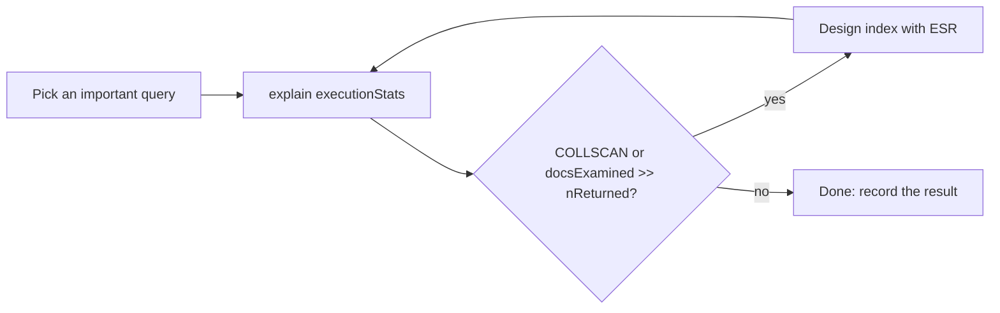

# Session 12: Practice Lab: Indexes, Replication and Transactions

> Module: Managing Large Datasets using MongoDB · Diploma in AI / Data Science · Term 1 · ⏱ ~2 hours

A hands-on lab covering Sessions 09 to 11. This time you are the **database engineer**: the store is growing, queries are slow, the owner is worried about server crashes, and the checkout must never lose an order. You will tune queries with indexes, run a replica set and protect checkout with a transaction.

## 🎯 Learning Objectives

- Find slow queries with `explain()` and fix them with the right index
- Apply the ESR rule to design a compound index
- Start a replica set, check member states and observe failover
- Use read preference and write concern from the shell
- Write a reliable multi-collection transaction with error handling
- Explain your engineering decisions in plain words

## 📖 Concepts Explained

### 1. The tuning loop



A healthy query has `totalDocsExamined` close to `nReturned` and an `IXSCAN` stage. A **covered query** goes one step further: every field it filters and returns is in the index, so MongoDB never opens the documents (`totalDocsExamined: 0`).

### 2. Checklist: which index?

| Query shape | Index to try |
|---|---|
| `{ orderNo: 5 }` | `{ orderNo: 1 }` |
| `{ city: "Lahore" }` sorted by `total` | `{ city: 1, total: -1 }` |
| `{ city: "Lahore", total: { $gt: 5000 } }` | `{ city: 1, total: 1 }` |
| `{ payment: "COD", city: "Quetta" }` sorted by `orderDate` | `{ payment: 1, city: 1, orderDate: -1 }` (E, E, S) |
| `{ tags: "python" }` | `{ tags: 1 }` (multikey) |

### 3. Replica set health at a glance

| Command | Tells you |
|---|---|
| `rs.status()` | each member's state, health and last heartbeat |
| `rs.conf()` | configuration: members, priorities, votes |
| `db.hello()` | which member is primary right now |
| `rs.printSecondaryReplicationInfo()` | how far behind each secondary is |

### 4. Transaction checklist

1. Collections come from `session.getDatabase(...)`.
2. Business checks happen **inside** the transaction.
3. Every path ends in `commitTransaction()` or `abortTransaction()`.
4. `endSession()` runs in `finally`.
5. The transaction touches only what it must and finishes quickly.

## 💻 Code Examples

| File | Covers |
|---|---|
| `part-a-index-tuning-solutions.js` | tasks 1-4 (needs `make-big-collection.js` from Session 09) |
| `part-b-replica-set-solutions.js` | tasks 5-7 (needs the replica set from Session 10) |
| `part-c-checkout-transaction-solution.js` | tasks 8-10 (needs a replica set + `shopdb-setup.js`) |

### Sample: a covered query

```javascript
db.bigorders.createIndex({ city: 1, total: 1 });
db.bigorders.find({ city: "Lahore", total: { $gt: 19000 } }, { _id: 0, city: 1, total: 1 })
  .explain("executionStats").executionStats.totalDocsExamined;   // 0
```

**How it works:** the filter and the projection use only `city` and `total`, both in the index, and `_id` is excluded, so the answer comes straight from the index.

## 🧪 Lab Practice

**Part A: indexes (Session 09)**

1. Run `make-big-collection.js`. Measure `{ payment: "COD", city: "Quetta" }` sorted by `orderDate: -1` with `explain`.
2. Create the index suggested by the ESR rule and measure again. Note docs examined and time before/after.
3. Make the sample covered query above and confirm `totalDocsExamined` is 0.
4. Use `$indexStats` to find an index that has never been used and drop it.

**Part B: replication (Session 10)**

5. Start the three-member replica set and print each member's state.
6. Insert a document with `writeConcern: { w: "majority" }` and read it from a secondary.
7. Step down the primary and record how long the election took (compare `rs.status()` before and after).

**Part C: transactions (Session 11)**

8. Write a checkout that inserts an order with **two** items and reduces stock for both products.
9. Make the checkout abort if **any** item has less stock than requested.
10. Test it twice: once with enough stock and once with product `P003` (stock 0).

## 📝 Assignment

Write a short `engineering-report.md` (about one page) for the shop owner: the three indexes you created and the speed-up for each (table), how the replica set protects the shop when a server fails (in non-technical words), and how the checkout transaction prevents overselling. Attach screenshots of your `explain` results and `rs.status()`.

## ❓ Quick Quiz

1. What does `totalDocsExamined: 0` with `nReturned: 25` tell you?
2. For `{ payment: "COD", city: "Quetta" }` sorted by `orderDate`, which fields go first in the index?
3. Which command shows how far behind the secondaries are?
4. Why must business checks happen inside the transaction?
5. Where should `endSession()` be called?

<details><summary>Answers</summary>

1. the query is covered: answered fully from the index · 2. the equality fields `payment` and `city`, then the sort field `orderDate` · 3. `rs.printSecondaryReplicationInfo()` · 4. so the check and the writes see the same consistent data and roll back together · 5. in the `finally` block, so it always runs

</details>

## 💼 Interview Questions

1. **What is a covered query?** A query whose filter and returned fields are all part of one index, so MongoDB answers it from the index without reading documents.
2. **How do you measure the effect of a new index?** Compare `explain("executionStats")` before and after: stage, `totalDocsExamined`, `totalKeysExamined` and `executionTimeMillis`.
3. **How would you test failover safely?** In a test environment, use `rs.stepDown()` on the primary and verify the application reconnects and that `w: "majority"` writes were not lost.

## ✅ Summary

- Tune with a loop: explain → index → explain again.
- ESR guides compound index order; covered queries avoid reading documents.
- `rs.status()`, `db.hello()` and replication info show replica set health.
- Checkout logic belongs in a short, well-handled transaction.

---

[⬅ Previous](../Session-11-Transaction-Management/README.md) · [🏠 Module Home](../README.md) · [Next ➡](../Session-13-MongoDB-Tools-Compass-BI-Connector-and-Excel/README.md)

Prepared by Zeeshan Abbas · Aptech Learning North Nazimabad
