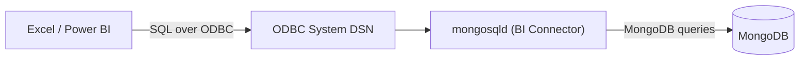

# Session 13: MongoDB Tools: Compass, BI Connector and Excel

> Module: Managing Large Datasets using MongoDB · Diploma in AI / Data Science · Term 1 · ⏱ ~2 hours

Not everyone on a data team types shell commands. Managers live in Excel, analysts in Power BI or Tableau, and developers like a visual view of their data. In this session you will manage MongoDB with **MongoDB Compass** (the official GUI), learn how SQL-based BI tools reach MongoDB (the **BI Connector** and its successor, the **SQL Interface**), and move data **between MongoDB and Excel** in both directions.

## 🎯 Learning Objectives

- Connect MongoDB Compass to a local server with a connection string
- Create, browse, filter, edit and delete documents in Compass
- Build an aggregation pipeline and create indexes visually, and read the explain plan
- Explain what the BI Connector (`mongosqld`) and an ODBC system DSN do, and why the SQL Interface now replaces it
- Export MongoDB data to CSV for Excel with Compass and `mongoexport`
- Import an Excel sheet (saved as CSV) into MongoDB with Compass and `mongoimport`

## 📖 Concepts Explained

### 1. MongoDB Compass

Compass is a free desktop application that shows your databases as folders and your documents as cards or a table.

| Compass tab | What you do there |
|---|---|
| **Documents** | browse, filter (`{ city: "Karachi" }`), insert, edit, clone, delete |
| **Aggregations** | build pipelines stage by stage with a live preview; export to code |
| **Schema** | sample documents and see field types and value distributions |
| **Explain Plan** | see `COLLSCAN` vs `IXSCAN` visually |
| **Indexes** | create and drop indexes with a form |
| **Validation** | add a `$jsonSchema` rule |
| **MONGOSH** (bottom panel) | a built-in shell |

**Connect:** open Compass → *New connection* → URI `mongodb://localhost:27017` → *Connect*. For Atlas you paste the `mongodb+srv://...` string from the Atlas *Connect* button (Session 14).

> **Analogy:** `mongosh` is driving a manual car: full control, more to learn. Compass is an automatic: easier for daily trips, and you can still see the engine through the built-in shell.

### 2. BI tools and the BI Connector

BI tools such as Power BI, Tableau and Excel expect **tables and SQL**. MongoDB stores **documents**. Something must translate.



How the **BI Connector** worked:

1. Install the BI Connector; it provides the `mongosqld` program.
2. Run `mongosqld --mongo-uri mongodb://localhost:27017` (it listens on port 3307). It samples collections and builds a **relational schema**: embedded arrays become extra tables.
3. Install the **MongoDB ODBC driver** and create a **System DSN** in *ODBC Data Sources (64-bit)* pointing to `localhost:3307`.
4. In Excel: *Data → Get Data → From Other Sources → From ODBC* → choose the DSN → pick a table.

> ⚠️ **Important update (2026):** MongoDB ended support for the BI Connector in **September 2026**. New projects use the **MongoDB SQL Interface** (Atlas and Enterprise Advanced), which offers ODBC/JDBC drivers and a Power BI connector. The idea is the same (SQL tools reading MongoDB data), so learn the concept, and use the SQL Interface or CSV export in real work. See `bi-connector-legacy-notes.txt` for the classic steps.

### 3. MongoDB ⇄ Excel with CSV (works everywhere)

The simplest, most reliable route is a **CSV file**, which Excel opens directly.

| Direction | Compass | Command line |
|---|---|---|
| MongoDB → Excel | Collection → *Export Data* → CSV → choose fields | `mongoexport --type=csv --fields=...` |
| Excel → MongoDB | Collection → *Add Data* → *Import JSON or CSV file* | `mongoimport --type=csv --headerline` |

Things to watch:

- **Nested fields** become columns with dot names, e.g. `specs.brand`.
- **Arrays** do not fit one cell well; export them as text or flatten them first with an aggregation (`$unwind`) and `$out` to a temporary collection.
- On import, numbers and dates may arrive as strings. Use `--columnsHaveTypes` with typed headers (`price.int32()`) or fix types in Compass's import dialog.
- Save Excel files as **CSV UTF-8** so Urdu names and special characters survive.

## 💻 Code Examples

### Example 1: export orders to Excel (`export-to-excel.bat`)

```bat
mongoexport --db shopdb --collection orders --type=csv ^
  --fields _id,customerId,city,total,status,payment ^
  --out orders.csv
```

**How it works:** `--type=csv` needs an explicit `--fields` list. Double-click `orders.csv` and it opens in Excel. The `^` continues a command on the next line in Windows.

### Example 2: flatten before exporting (`flatten-items-for-excel.js`)

```javascript
db.orders.aggregate([
  { $unwind: "$items" },
  { $project: { _id: 0, orderId: "$_id", city: 1, productId: "$items.productId", qty: "$items.qty" } },
  { $out: "order_lines" }
]);
```

**How it works:** one row per order item is written to a new collection `order_lines`, which then exports to a clean, flat CSV.

### Example 3: import an Excel sheet (`import-from-excel.bat` + `new-products.csv`)

```bat
mongoimport --db shopdb --collection products --type=csv ^
  --columnsHaveTypes --headerline --file new-products.csv
```

**How it works:** the first row of the CSV holds field names with types (`price.int32()`), so prices arrive as numbers, not text.

### Example 4: a pipeline for Compass (`compass-pipeline.js`)

A ready pipeline (revenue per city) to paste into Compass's Aggregations tab in *Text* mode, and then use *Export to Language* to see the same code in Python.

## 🧪 Lab Practice

1. Connect Compass to `localhost:27017`, open `shopdb.products` and filter `{ price: { $lt: 3000 } }`. Switch between List, JSON and Table views.
2. In Compass, insert a new customer, edit their city, then delete them.
3. In the Aggregations tab, build `$match` → `$group` → `$sort` for revenue per city. Export the pipeline to Python.
4. Create an index on `orders.city` in the Indexes tab and check the Explain Plan before and after.
5. Export `customers` to CSV, open it in Excel, add two rows, save as **CSV UTF-8** and import it into a new collection `customers_from_excel`.

## 📝 Assignment

Prepare a "monthly sales pack" for a manager: (1) run a pipeline that builds a flat `monthly_sales` collection (month, city, revenue, orders) with `$out`, (2) export it to CSV, (3) in Excel, build a pivot table and one chart, (4) write three bullet points of insight. Submit the CSV, the `.xlsx` file and your script.

## ❓ Quick Quiz

1. Which Compass tab shows field types and value distributions?
2. What does `mongosqld` provide?
3. What replaced the BI Connector for SQL tools?
4. Why must you give `--fields` when exporting CSV?
5. How do you keep numbers as numbers when importing a CSV?

<details><summary>Answers</summary>

1. Schema · 2. a SQL (MySQL-protocol) endpoint that translates SQL into MongoDB queries, used by ODBC/BI tools · 3. the MongoDB SQL Interface · 4. CSV has fixed columns, and documents can have different fields, so you must choose them · 5. typed headers with `--columnsHaveTypes` (or set types in the Compass import dialog)

</details>

## 💼 Interview Questions

1. **How can business users analyse MongoDB data in BI tools?** Through a SQL layer (SQL Interface, formerly BI Connector) over ODBC/JDBC, through MongoDB Charts, or by exporting flattened data to CSV/warehouse.
2. **What is the challenge in exporting documents to Excel?** Nested objects and arrays must be flattened into rows and columns; usually done with `$unwind` and `$project` before export.
3. **What is an ODBC DSN?** A saved Data Source Name holding the driver and connection details, so applications like Excel can connect to a database by name.

## ✅ Summary

- Compass gives a visual way to do CRUD, aggregations, schema analysis, indexes and explain plans.
- BI tools need SQL; the BI Connector (`mongosqld` + ODBC DSN) provided it and is now replaced by the SQL Interface.
- CSV via Compass, `mongoexport` and `mongoimport` is the universal bridge to Excel.
- Flatten arrays before export and use typed headers on import.

---

[⬅ Previous](../Session-12-Practice-Lab-Indexes-Replication-and-Transactions/README.md) · [🏠 Module Home](../README.md) · [Next ➡](../Session-14-MongoDB-Cloud-with-Atlas/README.md)

Prepared by Zeeshan Abbas · Aptech Learning North Nazimabad
