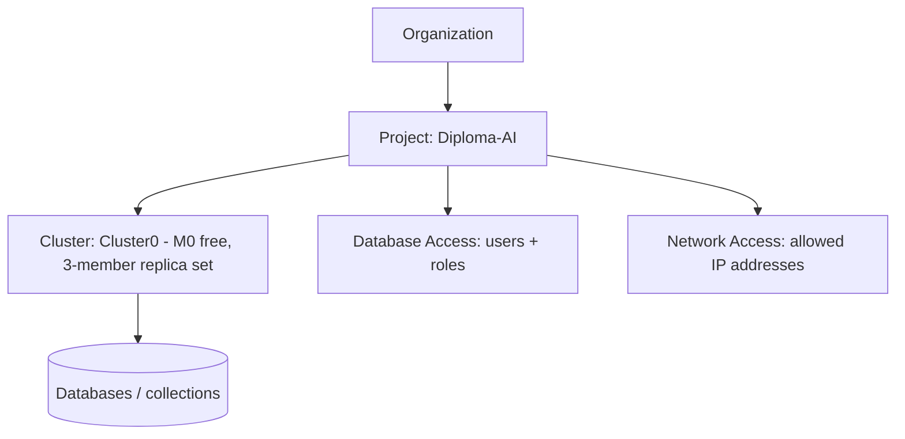

# Session 14: MongoDB in the Cloud with Atlas

> Module: Managing Large Datasets using MongoDB · Diploma in AI / Data Science · Term 1 · ⏱ ~2 hours

Running MongoDB on your laptop is great for learning, but real applications need a database that is online 24/7, backed up, secure and reachable from anywhere. **MongoDB Atlas** is MongoDB's cloud service: it runs replica sets for you on AWS, Google Cloud or Azure. In this session you will create a **free** cluster, connect to it from `mongosh`, Compass and a connection string, and move data in and out.

## 🎯 Learning Objectives

- Explain what Database-as-a-Service (DBaaS) means and what Atlas manages for you
- Create an Atlas account, project and a free M0 cluster
- Secure the cluster with a database user and an IP access list
- Connect with `mongosh` and Compass using a `mongodb+srv://` connection string
- Import data into Atlas with `mongoimport` and Compass, and load the sample datasets
- Export data from Atlas with `mongoexport`, `mongodump` and Compass

## 📖 Concepts Explained

### 1. Why Atlas?

| Task | Self-hosted (your server) | Atlas |
|---|---|---|
| Install and upgrade MongoDB | you | Atlas |
| Replica set and failover | you configure (Session 10) | automatic, 3 members by default |
| Backups | you script them | built in (paid tiers) |
| Security (TLS, firewall) | you configure | on by default |
| Monitoring and alerts | extra tools | dashboards included |
| Cost to start | your hardware | free M0 tier |

> **Analogy:** self-hosting is cooking every meal at home; Atlas is a good restaurant. You still choose the menu (your data and queries), but someone else runs the kitchen.

### 2. Atlas building blocks



| Tier | Use |
|---|---|
| **M0 (Free)** | learning: 512 MB storage, shared hardware, no credit card |
| Flex | small apps, pay as you go |
| Dedicated (M10+) | production, backups, more features |

Choose a cloud region close to your users (for Pakistan, regions such as Mumbai, Bahrain or UAE give lower latency).

### 3. Two security gates

Atlas blocks everyone by default. To connect you must pass **both**:

1. **Network Access:** your public IP must be on the access list. "Add current IP address" is the safe choice; `0.0.0.0/0` (allow from anywhere) is only for short tests.
2. **Database Access:** a **database user** (username + password + role such as `readWriteAnyDatabase`). This is **not** your Atlas website login.

### 4. The connection string

```text
mongodb+srv://<username>:<password>@cluster0.abcde.mongodb.net/?retryWrites=true&w=majority&appName=Cluster0
```

| Part | Meaning |
|---|---|
| `mongodb+srv://` | look up all replica set members through DNS automatically |
| `<username>:<password>` | your database user (special characters such as `@` must be URL-encoded, e.g. `%40`) |
| `cluster0.abcde.mongodb.net` | your cluster's address (copy it from the *Connect* button) |
| `retryWrites=true&w=majority` | safe write defaults |

> 🔒 Never commit a real connection string with a password to GitHub. Keep it in an environment variable (e.g. `MONGODB_URI`).

### 5. Moving data in and out

| Goal | Tools |
|---|---|
| Try ready-made data | Atlas → cluster → *Load Sample Dataset* (movies, Airbnb, restaurants ...) |
| Import JSON/CSV | `mongoimport --uri ...`, Compass *Add Data*, Atlas Data Explorer |
| Export for analysis | `mongoexport --uri ...` (JSON/CSV), Compass *Export Data* |
| Full backup / move a database | `mongodump --uri ...` then `mongorestore --uri ...` |

## 💻 Code Examples

> Replace `<username>`, `<password>` and `cluster0.xxxxx` with your own values. On Windows, keep the URI inside double quotes.

### Example 1: connect (`connect-to-atlas.bat`)

```bat
mongosh "mongodb+srv://cluster0.xxxxx.mongodb.net/" --apiVersion 1 --username <username>
```

**How it works:** `mongosh` asks for the password, finds the cluster members through DNS and connects to the primary. For Compass, paste the same URI (with username) into *New connection*.

### Example 2: first commands on Atlas (`atlas-first-steps.js`)

```javascript
db = db.getSiblingDB("shopdb");
db.products.insertOne({ _id: "A001", name: "Cloud Notebook", price: 999 });
print("I am connected to: " + db.hello().me + "  primary: " + db.hello().primary);
```

**How it works:** the same commands you used locally work in the cloud. `db.hello()` shows that Atlas runs a replica set.

### Example 3: copy shopdb to Atlas (`import-to-atlas.bat`)

```bat
mongodump --db shopdb --out dump
mongorestore --uri "mongodb+srv://<username>:<password>@cluster0.xxxxx.mongodb.net" dump
```

**How it works:** `mongodump` saves the local `shopdb` as BSON files, and `mongorestore` uploads them to Atlas. The file also shows `mongoimport` for single JSON files.

### Example 4: export from Atlas (`export-from-atlas.bat`)

```bat
mongoexport --uri "mongodb+srv://<username>:<password>@cluster0.xxxxx.mongodb.net/sample_mflix" ^
  --collection movies --query "{\"year\": 2015}" --fields title,year,imdb.rating --type=csv --out movies-2015.csv
```

**How it works:** downloads only 2015 movies from the sample dataset as a CSV for Excel or pandas.

## 🧪 Lab Practice

1. Create an Atlas account at the link below, a project `Diploma-AI` and a free **M0** cluster in a nearby region.
2. Create a database user `student` and add your current IP address in Network Access.
3. Connect with `mongosh` and with Compass. Run `atlas-first-steps.js`.
4. Copy your local `shopdb` to Atlas with `mongodump`/`mongorestore` and confirm the counts in the Atlas Data Explorer.
5. Click *Load Sample Dataset*, then export the 2015 movies from `sample_mflix.movies` to CSV and open it in Excel.

## 📝 Assignment

Migrate your **mini-project database** (`feedbackdb`) to Atlas. Create a second database user `analyst` with only the `read` role on `feedbackdb`, connect as that user and prove that an insert fails. Submit screenshots of the cluster overview, Network Access list (blur your IP) and the failed insert.

## ❓ Quick Quiz

1. Which Atlas tier is free?
2. Name the two settings you must configure before you can connect.
3. What does `+srv` in a connection string do?
4. Is the database user the same as your Atlas login?
5. Which pair of tools copies an entire database to Atlas?

<details><summary>Answers</summary>

1. M0 · 2. Network Access (IP list) and Database Access (database user) · 3. discovers the cluster members through a DNS record · 4. no, it is a separate user that exists only for database connections · 5. `mongodump` and `mongorestore`

</details>

## 💼 Interview Questions

1. **What are the advantages of a managed service like Atlas?** Automatic replica sets and failover, upgrades, backups, monitoring and built-in security, so the team focuses on data and code.
2. **How do you secure an Atlas cluster?** Restrict network access to known IPs or private endpoints, use least-privilege database users, keep TLS on, and store credentials in secrets/environment variables.
3. **`mongoexport` vs `mongodump`?** `mongoexport` writes human-readable JSON/CSV for one collection (may lose some BSON types); `mongodump` writes exact BSON backups of whole databases for restoring.

## ✅ Summary

- Atlas runs MongoDB for you as a cloud service; M0 is free for learning.
- Connecting needs an allowed IP and a database user.
- `mongodb+srv://` strings work in `mongosh`, Compass and drivers.
- Use `mongoimport`/`mongorestore` to load data and `mongoexport`/`mongodump` to take it out.
- Keep connection strings out of source code.

### Official links

- [Create a free Atlas account](https://www.mongodb.com/cloud/atlas/register)
- [Atlas documentation: Getting started](https://www.mongodb.com/docs/atlas/getting-started/)
- [Load sample data](https://www.mongodb.com/docs/atlas/sample-data/)

---

[⬅ Previous](../Session-13-MongoDB-Tools-Compass-BI-Connector-and-Excel/README.md) · [🏠 Module Home](../README.md) · [Next ➡](../Session-15-MongoDB-Connectivity-with-Python/README.md)

Prepared by Zeeshan Abbas · Aptech Learning North Nazimabad
