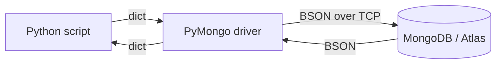

# Session 15: MongoDB Connectivity with Python (PyMongo)

> Module: Managing Large Datasets using MongoDB · Diploma in AI / Data Science · Term 1 · ⏱ ~2 hours

Python is the main language of AI and data science. In this session you connect the two worlds: a Python script talks to MongoDB using **PyMongo**, the official driver. You will create a database, insert documents, query them, update and delete them, and finally load an aggregation result into a **pandas** DataFrame, ready for analysis or a machine learning model.

## 🎯 Learning Objectives

- Explain what a database driver is and how PyMongo fits between Python and MongoDB
- Install PyMongo and connect to a local server or Atlas with `MongoClient`
- Create a database and collection from Python and insert documents with `insert_one` / `insert_many`
- Query documents with `find_one`, `find`, filters, projection, sort and limit
- Update and delete documents and read the result objects
- Run an aggregation pipeline and load the result into pandas

## 📖 Concepts Explained

### 1. What is a driver?

A **driver** is a library that lets a programming language talk to a database over the network. PyMongo turns Python dictionaries into BSON, sends commands, and turns the replies back into dictionaries.



> **Analogy:** a translator at a meeting. You speak Python, MongoDB speaks BSON, and PyMongo translates both ways instantly.

### 2. mongosh vs PyMongo

The ideas are the same; the spelling follows Python style (snake_case) and keys must be **strings in quotes**.

| mongosh | PyMongo |
|---|---|
| `use shopdb` | `db = client["shopdb"]` |
| `db.products.insertOne({...})` | `db.products.insert_one({...})` |
| `db.products.find({ price: { $lt: 3000 } })` | `db.products.find({"price": {"$lt": 3000}})` |
| `.sort({ price: -1 })` | `.sort("price", -1)` |
| `db.products.countDocuments({})` | `db.products.count_documents({})` |
| `true` / `false` / `null` | `True` / `False` / `None` |
| `ISODate("2026-05-01")` | `datetime(2026, 5, 1)` |

### 3. MongoClient and the connection string

```python
from pymongo import MongoClient
client = MongoClient("mongodb://localhost:27017")          # local
client = MongoClient(os.environ["MONGODB_URI"])             # Atlas, from an environment variable
```

- Create **one** `MongoClient` per program and reuse it; it manages a pool of connections.
- Databases and collections are created lazily, on the first insert, just like in `mongosh`.
- `client.admin.command("ping")` is a quick connection test.

### 4. Results and cursors

| Method | Returns | Useful attribute |
|---|---|---|
| `insert_one` | `InsertOneResult` | `.inserted_id` |
| `insert_many` | `InsertManyResult` | `.inserted_ids` |
| `update_one` / `update_many` | `UpdateResult` | `.matched_count`, `.modified_count` |
| `delete_one` / `delete_many` | `DeleteResult` | `.deleted_count` |
| `find` | `Cursor` | loop over it with `for doc in cursor:` |
| `find_one` | `dict` or `None` | |

### 5. From MongoDB to pandas

Data science work usually ends in a DataFrame: `pd.DataFrame(list(collection.find(...)))`. For big data, do the heavy lifting **in MongoDB** with an aggregation pipeline first, then bring only the summary into Python.

## 💻 Code Examples

Setup once: `pip install -r requirements.txt` (PyMongo and pandas). Run `shopdb-setup.js` from Session 02 for the query examples. To use Atlas instead of localhost, set `MONGODB_URI` before running (`set MONGODB_URI=...` on Windows, `export MONGODB_URI=...` on macOS/Linux).

### Example 1: connect (`connect.py`)

```python
uri = os.environ.get("MONGODB_URI", "mongodb://localhost:27017")
client = MongoClient(uri, serverSelectionTimeoutMS=5000)
client.admin.command("ping")
print("Connected! Databases:", client.list_database_names())
```

**How it works:** the script uses Atlas if `MONGODB_URI` is set, otherwise your local server. `ping` fails within 5 seconds if the server cannot be reached.

### Example 2: create and insert (`create_and_insert.py`)

```python
db = client["schooldb"]
students = db["students"]
result = students.insert_many([
    {"name": "Ayesha", "age": 21, "city": "Karachi", "skills": ["python", "sql"]},
    {"name": "Bilal",  "age": 23, "city": "Lahore",  "skills": ["excel"]},
])
print(result.inserted_ids)
```

**How it works:** `schooldb` and `students` are created by the first insert. MongoDB adds an `ObjectId` `_id` to each document.

### Example 3: query (`query_documents.py`)

```python
for p in db.products.find({"price": {"$lt": 3000}}, {"_id": 0, "name": 1, "price": 1}).sort("price", -1):
    print(p["name"], p["price"])
```

**How it works:** the filter and projection are normal Python dictionaries; operators like `$lt` must be quoted strings.

### Example 4: update and delete (`update_and_delete.py`)

Raises the price of all Books by 5% with `update_many` and `$mul`, then deletes test students and prints the counts.

### Example 5: aggregation to pandas (`aggregate_to_pandas.py`)

Runs a revenue-per-city pipeline in MongoDB and builds a DataFrame from the result, then prints it and saves `revenue_by_city.csv`.

## 🧪 Lab Practice

1. Install the requirements and run `connect.py` against your local server, then against Atlas.
2. Run `create_and_insert.py`, then check the new data in Compass.
3. Write a script that asks the user for a city with `input()` and prints that city's customers.
4. Run `update_and_delete.py` and confirm the new Book prices in `mongosh`.
5. Run `aggregate_to_pandas.py` and add a column `share` = revenue as a percentage of the total.

## 📝 Assignment

Build `student_cli.py`: a tiny menu program (1 = add student, 2 = list all, 3 = search by city, 4 = update age, 5 = delete, 0 = exit) that stores students in MongoDB with PyMongo. Validate that age is a number, print friendly messages using the result objects (`inserted_id`, `modified_count`, `deleted_count`), and keep the connection string in `MONGODB_URI`.

## ❓ Quick Quiz

1. Which class creates a connection in PyMongo?
2. What is the PyMongo name for `countDocuments`?
3. How do you write `null` and `true` in a PyMongo filter?
4. What does `find_one` return when nothing matches?
5. Why should you create only one `MongoClient` per program?

<details><summary>Answers</summary>

1. `MongoClient` · 2. `count_documents` · 3. `None` and `True` · 4. `None` · 5. it holds a connection pool and is designed to be shared; creating many wastes connections and time

</details>

## 💼 Interview Questions

1. **How do you connect a Python application to MongoDB Atlas securely?** Use PyMongo's `MongoClient` with the `mongodb+srv://` string stored in an environment variable or secrets manager, a least-privilege database user and an IP access list.
2. **How would you load MongoDB data into pandas efficiently?** Filter, project and aggregate inside MongoDB first so only needed data travels, then build a DataFrame from the cursor.
3. **What is an ObjectId?** MongoDB's default 12-byte `_id` type; it contains a timestamp, so it is unique and roughly ordered by creation time. In Python it is `bson.ObjectId`.

## ✅ Summary

- PyMongo is the official Python driver; install it with `pip install pymongo`.
- `MongoClient` → database → collection, then the familiar CRUD methods in snake_case.
- Filters and updates are Python dictionaries with quoted `$` operators.
- Result objects report what changed; cursors are iterated with `for`.
- Aggregate in MongoDB, analyse in pandas.

---

[⬅ Previous](../Session-14-MongoDB-Cloud-with-Atlas/README.md) · [🏠 Module Home](../README.md) · [Next ➡](../Session-16-Practice-Lab-Tools-Atlas-and-Python/README.md)

Prepared by Zeeshan Abbas · Aptech Learning North Nazimabad
