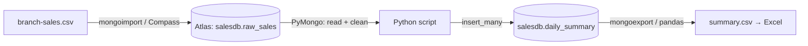

# Session 16: Practice Lab: Tools, Atlas and Python

> Module: Managing Large Datasets using MongoDB · Diploma in AI / Data Science · Term 1 · ⏱ ~2 hours

The final lab of the module, covering Sessions 13 to 15. You will build a small **end-to-end data pipeline**, the kind a junior data engineer builds in the first month of a job: data arrives as a CSV from a branch office, is loaded into MongoDB Atlas, cleaned and summarised with Python, and handed back to the manager as an Excel-ready report.

## 🎯 Learning Objectives

- Import a CSV file into Atlas with the correct data types
- Inspect and fix data quality issues using Compass's Schema tab and update queries
- Write a Python script that reads, cleans and summarises data with PyMongo
- Push the summary back into MongoDB and export it to CSV for Excel
- Keep credentials safe with an environment variable
- Explain the whole pipeline in a short, clear report

## 📖 Concepts Explained

### 1. The pipeline you will build



This pattern is called **ETL**: **E**xtract (read the CSV), **T**ransform (clean and summarise), **L**oad (store the result where people can use it).

### 2. Typical data quality problems

| Problem in the CSV | How it looks | How to fix |
|---|---|---|
| Text instead of numbers | `"amount": "1500"` | import with typed headers, or convert with `$toInt` / `int()` |
| Inconsistent spelling | `karachi`, `Karachi `, `KHI` | trim and map to one standard value |
| Missing values | empty `amount` cell | skip, fill with 0, or flag for review |
| Duplicates | the same `receiptNo` twice | unique index on `receiptNo`, or remove duplicates |

> **Analogy:** data cleaning is washing vegetables before cooking. Skip it and every dish (report, chart, model) tastes wrong, no matter how good the recipe.

### 3. Where to do the work: MongoDB or Python?

| Do it in MongoDB when ... | Do it in Python when ... |
|---|---|
| filtering and grouping large data | logic is complex (mappings, rules, ML) |
| the result is small | you need pandas, charts or files |
| many users need the same view | it is a one-off analysis |

Most real pipelines combine both, as you will here.

### 4. Safety checklist

- The connection string lives in `MONGODB_URI`, never inside the script or Git.
- The Atlas user for the script has `readWrite` on `salesdb` only.
- Re-running the script should not create duplicates: clear or upsert the summary each run.

## 💻 Code Examples

| File | Purpose |
|---|---|
| `branch-sales.csv` | the messy input file (15 rows, typed header) |
| `load-branch-sales.bat` | imports the CSV into Atlas or local MongoDB |
| `clean_and_summarise.py` | reads raw data, cleans it, writes `daily_summary` and `summary.csv` |
| `requirements.txt` | PyMongo and pandas |

### The core of the Python script

```python
CITY_FIX = {"karachi": "Karachi", "khi": "Karachi", "lahore": "Lahore", "lhr": "Lahore"}

for row in raw.find():
    city = CITY_FIX.get(str(row.get("city", "")).strip().lower(), "Unknown")
    amount = row.get("amount")
    if not isinstance(amount, (int, float)):
        continue                      # skip rows without a valid amount
```

**How it works:** each raw document is read with a cursor; the city is trimmed, lower-cased and mapped to a standard name; rows with no usable amount are skipped and counted. The cleaned rows are then grouped by date and city with pandas.

## 🧪 Lab Practice

1. **Extract:** run `load-branch-sales.bat` (set `MONGODB_URI` first for Atlas). Check `salesdb.raw_sales` in Compass and note how many documents arrived.
2. **Inspect:** open the Schema tab in Compass. Which fields have mixed types or missing values? Which city spellings exist?
3. **Protect:** create a unique index on `receiptNo` in a fresh collection and try importing the CSV again into it. What happens to the duplicate receipt?
4. **Transform and load:** run `clean_and_summarise.py`. Compare the number of raw rows, cleaned rows and skipped rows it prints.
5. **Report:** open `summary.csv` in Excel, build a pivot table of revenue by city and a column chart.

## 📝 Assignment (module wrap-up)

Extend the pipeline: add a second CSV from another branch with at least 20 rows and different mistakes, make the script handle both files, store a `quality_log` collection (one document per skipped row with the reason), and create a read-only Atlas user `manager` who can see `daily_summary` only through the `salesdb` database. Submit your scripts, the CSV files and a one-page README explaining the pipeline with a diagram.

## ❓ Quick Quiz

1. What do the letters ETL stand for?
2. Which Compass tab helps you spot mixed data types?
3. How can a unique index help data quality?
4. Why should the summary step clear or upsert old results?
5. Where should the Atlas connection string be stored?

<details><summary>Answers</summary>

1. Extract, Transform, Load · 2. Schema · 3. it rejects duplicate values, e.g. the same receipt number twice · 4. so re-running the script does not create duplicate summary rows · 5. in an environment variable or secrets store, not in the code

</details>

## 💼 Interview Questions

1. **Describe a data pipeline you have built.** Use this lab: CSV → Atlas (raw) → Python cleaning and aggregation → summary collection → CSV/Excel, with a quality log and safe credentials.
2. **How do you make a pipeline idempotent?** Design it so running it twice gives the same result: upsert on a natural key or replace the output collection each run, and use unique indexes to block duplicates.
3. **Raw vs clean collections: why keep both?** The raw copy lets you re-run or fix the cleaning rules later and audit what arrived; the clean copy is what reports and models use.

## ✅ Summary

- ETL = extract, transform, load; MongoDB and Python share the work.
- Compass's Schema tab reveals data quality problems quickly.
- Typed imports, unique indexes and cleaning rules protect data quality.
- Keep credentials in environment variables and make scripts safe to re-run.
- You have completed the MongoDB module. Try the module mini-project next.

---

[⬅ Previous](../Session-15-MongoDB-Connectivity-with-Python/README.md) · [🏠 Module Home](../README.md) · [Next Module ➡](../../03-Inferential-Statistical-Analysis/README.md)

Prepared by Zeeshan Abbas · Aptech Learning North Nazimabad
