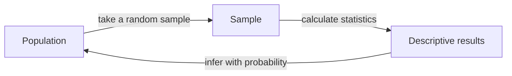

# Session 01: Introduction to Statistics

> Module: Inferential Statistical Analysis · Diploma in AI / Data Science · Term 1 · ⏱ ~2 hours

Every AI model is built on data, and statistics is the language we use to describe and question data. Before we can train a model, we must answer simple questions: *What is a typical value? How much do values vary? Are there strange values?* This session introduces statistics, shows where it is used in data science and teaches the descriptive measures you will use in every later session.

## 🎯 Learning Objectives

- Define statistics and explain the difference between descriptive and inferential statistics
- Describe how statistics is used across the data science workflow
- Identify types of data (qualitative/quantitative, discrete/continuous) and levels of measurement
- Calculate mean, median and mode, and choose the right one
- Calculate range, variance, standard deviation and inter-quartile range
- Summarise a dataset in Python using `statistics`, `numpy` and `pandas`

## 📖 Concepts Explained

### 1. What is statistics?

**Statistics** is the science of collecting, organising, summarising and interpreting data so that we can make decisions. Think of it like a doctor's check-up: the doctor measures a few things (temperature, blood pressure) and uses them to judge your overall health.

| Branch | Question it answers | Example |
|---|---|---|
| **Descriptive** statistics | "What does my data look like?" | Average marks of *this* class were 72 |
| **Inferential** statistics | "What can I conclude about a bigger group?" | From 200 surveyed students, we estimate that 60% of *all* Karachi students prefer online classes |

### 2. Population and sample

- **Population**: the complete group you care about (all students in Pakistan).
- **Sample**: the smaller part you actually measure (500 students you surveyed).
- **Parameter**: a number describing the population (true average, written μ).
- **Statistic**: a number calculated from the sample (sample average, written x̄).

We almost never measure a full population; it is too expensive. Inferential statistics lets us go from the sample to the population.



### 3. Statistics in data science

| Stage | How statistics helps |
|---|---|
| Data collection | sampling methods, survey design |
| Data cleaning | spotting outliers and missing values |
| Exploratory analysis | averages, spread, correlations, charts |
| Modelling | regression, probability, loss functions |
| Evaluation | accuracy, confidence intervals, A/B tests |

Real examples: a bank checks if a transaction is unusual (fraud detection), an online shop tests if a new button increases sales (A/B testing), a hospital estimates the average recovery time for a treatment.

### 4. Types of data

| Type | Meaning | Examples |
|---|---|---|
| Qualitative (categorical) | labels or categories | city, gender, grade A/B/C |
| Quantitative – discrete | counted, whole numbers | number of siblings, cars sold |
| Quantitative – continuous | measured, any value in a range | height, temperature, salary |

**Levels of measurement:** *nominal* (names only: city), *ordinal* (ordered: small < medium < large), *interval* (equal gaps, no true zero: °C), *ratio* (true zero: weight, income).

### 5. Measures of central tendency

| Measure | How to find it | Best when |
|---|---|---|
| **Mean** | sum ÷ count | data is symmetric, no extreme values |
| **Median** | middle value of sorted data | data has outliers (salaries, house prices) |
| **Mode** | most frequent value | categorical data (most popular course) |

Example: salaries 30k, 32k, 35k, 40k, 500k. Mean = 127.4k (misleading), median = 35k (realistic).

### 6. Measures of dispersion (spread)

- **Range** = max − min. Quick but affected by outliers.
- **Variance** = average of squared distances from the mean. For a sample we divide by *n − 1*.
- **Standard deviation (SD)** = √variance, in the same unit as the data. Small SD = values close to the mean.
- **Quartiles** split sorted data into four equal parts. **IQR = Q3 − Q1** holds the middle 50%.
- **Outlier rule:** a value below Q1 − 1.5×IQR or above Q3 + 1.5×IQR is a likely outlier.

### 7. Shape of data

- **Symmetric**: mean ≈ median (heights of adults).
- **Right (positive) skew**: long tail on the right, mean > median (incomes).
- **Left (negative) skew**: long tail on the left, mean < median (marks in an easy exam).

## 💻 Code Examples

### Example 1: Mean, median, mode (`mean_median_mode.py`)

```python
import statistics
marks = [12, 15, 18, 15, 9, 20, 15, 11, 17, 14]
print("Mean  :", statistics.mean(marks))
print("Median:", statistics.median(marks))
print("Mode  :", statistics.mode(marks))
```

**How it works:** Python's built-in `statistics` module does the arithmetic for us. Output: mean 14.6, median 15, mode 15.

### Example 2: Spread of two shops (`spread_measures.py`)

```python
import numpy as np
shop_a = np.array([50, 52, 49, 51, 50, 48, 50])
shop_b = np.array([20, 80, 35, 70, 50, 30, 65])
print(shop_a.std(ddof=1), shop_b.std(ddof=1))
```

**How it works:** both shops average 50, but Shop B's standard deviation is about 22 compared with about 1.3 for Shop A. The mean alone hides this difference; always report spread too.

### Example 3: Summary with pandas (`describe_with_pandas.py`)

```python
import pandas as pd
df = pd.DataFrame({"marks": [72, 88, 65, 91, 58, 79]})
print(df.describe())
q1, q3 = df["marks"].quantile(0.25), df["marks"].quantile(0.75)
print("IQR =", q3 - q1)
```

**How it works:** `describe()` prints count, mean, std, min, 25%, 50% (median), 75% and max in one call. `value_counts()` (in the file) counts categories.

Run any file with: `python mean_median_mode.py`

## 🧪 Lab Practice

1. Create a list of the ages of 12 people in your family or class. Find the mean, median and mode.
2. Add one extreme value (e.g. age 95). Recalculate. Which measure changed the most and why?
3. Using `spread_measures.py`, add a third shop with your own numbers and compare its SD.
4. Build a DataFrame of 8 products with `price` and `category`. Print `describe()` and `value_counts()`.
5. Use the 1.5×IQR rule to check whether any price is an outlier.

## 📝 Assignment

Collect the daily temperature of Karachi for the last 14 days (from any weather website). Write `assignment-01.py` that prints the mean, median, range, standard deviation, IQR and any outliers, then write 3 lines (as comments) describing the shape of the data.

## ❓ Quick Quiz

1. A survey of 300 voters is used to predict an election. Is this descriptive or inferential?
2. Which measure of centre is best for house prices in a city?
3. Why do we divide by *n − 1* for sample variance?
4. "Blood group" is which type of data?
5. If mean > median, what is the likely skew?

<details>
<summary>Show answers</summary>

1. Inferential (sample → population).
2. Median, because a few very expensive houses pull the mean up.
3. It corrects the small under-estimate that happens when we use the sample mean instead of the true mean (Bessel's correction).
4. Qualitative, nominal.
5. Right (positive) skew.

</details>

## 💼 Interview Questions

**1. What is the difference between a parameter and a statistic?**

> A parameter describes the whole population (e.g. μ); a statistic is calculated from a sample (e.g. x̄) and is used to estimate the parameter.

**2. When would you use the median instead of the mean?**

> When the data is skewed or has outliers, such as salaries, because the median is not pulled by extreme values.

**3. Why is standard deviation more useful than variance for reporting?**

> SD is in the same unit as the original data (rupees, marks), so it is easier to interpret.

## ✅ Summary

- Statistics turns raw data into decisions; descriptive describes, inferential generalises.
- A sample is used to learn about a population.
- Mean, median and mode measure the centre; choose based on outliers and data type.
- Range, variance, SD and IQR measure spread.
- `statistics`, `numpy` and `pandas.describe()` summarise data in a few lines.

---

[🏠 Module Home](../README.md) · [Next ➡](../Session-02-Introduction-to-Probability/README.md)

Prepared by Zeeshan Abbas · Aptech Learning North Nazimabad
