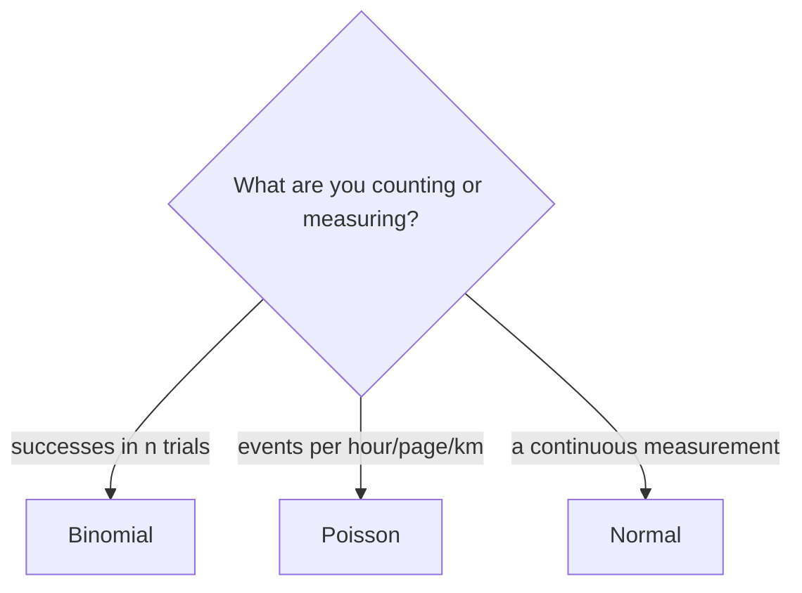

# Session 02: Introduction to Probability

> Module: Inferential Statistical Analysis · Diploma in AI / Data Science · Term 1 · ⏱ ~2 hours

Probability measures how likely something is. Weather apps, spam filters, insurance prices and every classification model in AI speak the language of probability. In this session you will learn the basic rules, Bayes' theorem, random variables, the most common probability distributions and the **Central Limit Theorem**, the idea that makes inferential statistics possible.

## 🎯 Learning Objectives

- Define experiment, sample space, event and classical probability
- Apply addition, multiplication and conditional probability rules, and Bayes' theorem
- Explain discrete and continuous random variables and calculate expected value
- Describe the Binomial, Poisson and Normal distributions and when to use each
- Explain the Central Limit Theorem and why it matters
- Compute probabilities in Python with `random` and `scipy.stats`

## 📖 Concepts Explained

### 1. Basic vocabulary

| Term | Meaning | Die example |
|---|---|---|
| Experiment | an action with uncertain result | rolling a die |
| Sample space (S) | all possible outcomes | {1, 2, 3, 4, 5, 6} |
| Event (E) | outcomes we care about | "even" = {2, 4, 6} |
| Probability P(E) | number from 0 (impossible) to 1 (certain) | 3/6 = 0.5 |

**Classical probability:** P(E) = favourable outcomes ÷ total outcomes, valid when all outcomes are equally likely.
**Experimental probability:** P(E) = times E happened ÷ number of trials. With many trials it approaches the classical value (Law of Large Numbers).

### 2. Probability rules

| Rule | Formula | Example |
|---|---|---|
| Complement | P(not A) = 1 − P(A) | P(not 6) = 5/6 |
| Addition (any) | P(A or B) = P(A) + P(B) − P(A and B) | |
| Mutually exclusive | P(A and B) = 0 | a die cannot show 2 and 5 together |
| Independent events | P(A and B) = P(A) × P(B) | two coin heads = 0.25 |
| Conditional | P(A \| B) = P(A and B) ÷ P(B) | chance of rain *given* cloudy sky |

### 3. Bayes' theorem

Bayes' theorem updates a belief after seeing evidence:

`P(A | B) = P(B | A) × P(A) ÷ P(B)`

- **Prior** P(A): what we believed before (1% of emails are scams).
- **Likelihood** P(B | A): how likely the evidence is if A is true (filter catches 95%).
- **Posterior** P(A | B): updated belief after the evidence.

It is the basis of the **Naive Bayes** classifier used in spam detection and text classification.

### 4. Random variables

A **random variable** assigns a number to each outcome.

- **Discrete**: countable values (number of heads, customers per hour).
- **Continuous**: any value in a range (height, waiting time).

**Expected value** E[X] = Σ x·P(x) is the long-run average. **Variance** Var(X) = Σ (x − E[X])²·P(x) measures how far results usually land from that average.

### 5. Common distributions

| Distribution | Type | Use when | Parameters |
|---|---|---|---|
| **Binomial** | discrete | fixed number of yes/no trials | n trials, p success |
| **Poisson** | discrete | count of events in a time/space interval | λ (average rate) |
| **Uniform** | either | every value equally likely | min, max |
| **Normal** | continuous | natural measurements, bell-shaped | μ mean, σ SD |

**68-95-99.7 rule** for the normal curve: about 68% of values lie within 1 SD of the mean, 95% within 2 SD and 99.7% within 3 SD.

A **z-score** tells how many SDs a value is from the mean: `z = (x − μ) / σ`.



### 6. Central Limit Theorem (CLT)

If we take many random samples of size *n* (usually n ≥ 30) from **any** population and calculate each sample's mean, then:

1. the sample means form an approximately **normal** distribution,
2. centred on the population mean μ,
3. with standard deviation σ/√n, called the **standard error**.

Analogy: individual cricket scores are very uneven, but the average score of many 30-match samples is stable and bell-shaped. The CLT is why we can use normal-based tests and confidence intervals in Sessions 05 and 06.

## 💻 Code Examples

### Example 1: Classical vs experimental (`classical_probability.py`)

```python
p_even = len(even) / len(outcomes)          # 0.5
for _ in range(rolls):
    if random.choice(outcomes) % 2 == 0:
        even_count += 1
```

**How it works:** we calculate the theory, then simulate 10,000 rolls. The simulated value (about 0.50) confirms the Law of Large Numbers.

### Example 2: Bayes' theorem (`bayes_theorem.py`)

```python
p_flag = 0.95 * 0.01 + 0.04 * 0.99
p_scam_given_flag = 0.95 * 0.01 / p_flag    # about 0.19
```

**How it works:** even a good filter gives mostly false alarms when the thing it looks for is rare. This "base rate" effect is a classic interview topic.

### Example 3: Distributions (`distributions.py`)

```python
from scipy import stats
stats.binom.pmf(k=3, n=10, p=0.25)          # guessing MCQs
stats.poisson.pmf(k=6, mu=4)                # customers per hour
stats.norm.cdf(175, loc=165, scale=8)       # heights below 175 cm
```

**How it works:** `pmf` gives P(X = k) for discrete distributions; `cdf` gives P(X ≤ x) for any distribution.

### Example 4: Expected value (`expected_value.py`) and CLT (`central_limit_theorem.py`)

`expected_value.py` shows that a Rs. 100 lucky-draw ticket returns only Rs. 85 on average. `central_limit_theorem.py` draws 2,000 samples from a skewed population and prints a text histogram of the sample means, which is clearly bell-shaped.

## 🧪 Lab Practice

1. Simulate tossing two coins 5,000 times. Estimate P(two heads) and compare with 0.25.
2. Change the Bayes example: what happens to P(scam | flag) if 10% of emails are scams?
3. A call centre receives 12 calls per hour. Use Poisson to find P(more than 15 calls) (hint: `1 - stats.poisson.cdf(15, 12)`).
4. Exam marks are normal with μ = 60, σ = 10. What percentage of students score above 80?
5. In `central_limit_theorem.py` change the sample size to 5 and then 100. How does the SD of sample means change?

## 📝 Assignment

A medical test is 98% accurate for sick people and gives a false positive 3% of the time. The disease affects 2 in 1,000 people. Write `assignment-02.py` that calculates the chance that a person who tests positive is actually sick, and explain the result in a comment.

## ❓ Quick Quiz

1. What is the probability of getting a total of 7 with two dice?
2. Two events are independent. P(A) = 0.3, P(B) = 0.5. What is P(A and B)?
3. Which distribution fits "number of typing errors per page"?
4. About what percentage of normal data lies within 2 SD of the mean?
5. According to the CLT, what is the standard error of the mean?

<details>
<summary>Show answers</summary>

1. 6/36 = 1/6
2. 0.15
3. Poisson
4. About 95%
5. σ / √n

</details>

## 💼 Interview Questions

**1. Explain Bayes' theorem with a real example.**

> It updates a prior probability using new evidence. Example: a spam filter starts with the base rate of spam, then uses the words in an email to compute the posterior probability that it is spam.

**2. Why is the Central Limit Theorem important in data science?**

> It lets us use the normal distribution to build confidence intervals and run hypothesis tests on means, even when the raw data is not normal, as long as samples are large enough.

**3. What is the difference between a PMF and a PDF?**

> A PMF gives the probability of each exact value of a discrete variable. A PDF describes density for a continuous variable; probabilities come from areas under the curve.

## ✅ Summary

- Probability ranges from 0 to 1; classical probability counts equally likely outcomes.
- Use addition, multiplication and conditional rules; Bayes' theorem updates beliefs.
- Random variables are discrete or continuous; expected value is the long-run average.
- Binomial and Poisson count events; Normal models measurements.
- The CLT makes sample means normal with standard error σ/√n.

---

[⬅ Previous](../Session-01-Introduction-to-Statistics/README.md) · [🏠 Module Home](../README.md) · [Next ➡](../Session-03-Correlation-and-Regression/README.md)

Prepared by Zeeshan Abbas · Aptech Learning North Nazimabad
