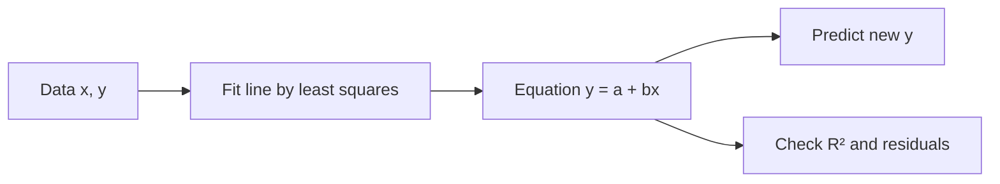

# Session 03: Correlation and Regression

> Module: Inferential Statistical Analysis · Diploma in AI / Data Science · Term 1 · ⏱ ~2 hours

Does studying more lead to higher marks? Does advertising increase sales? **Correlation** tells us whether two variables move together and how strongly. **Regression** goes one step further and gives us an equation to predict one variable from another. Linear regression is often the very first machine learning model a data scientist builds.

## 🎯 Learning Objectives

- Explain correlation, its direction and strength, and read a scatter pattern
- Calculate and interpret Pearson's correlation coefficient *r*
- Calculate Spearman's rank correlation and know when to prefer it
- Explain why correlation does not prove causation
- Describe regression and its types (simple, multiple, polynomial, logistic)
- Fit a line by least squares, interpret slope, intercept and R², and make predictions

## 📖 Concepts Explained

### 1. What is correlation?

Correlation measures how two numeric variables change together.

| Type | Pattern | Example |
|---|---|---|
| Positive | both rise together | study hours ↑, marks ↑ |
| Negative | one rises, the other falls | car age ↑, resale price ↓ |
| Zero | no linear pattern | shoe size and exam marks |

### 2. Pearson's correlation coefficient (r)

`r = Σ(x − x̄)(y − ȳ) / √[Σ(x − x̄)² · Σ(y − ȳ)²]`

- r is always between **−1 and +1**.
- +1 = perfect positive line, −1 = perfect negative line, 0 = no *linear* relationship.

| |r| | Rough meaning |
|---|---|
| 0.0 – 0.3 | weak |
| 0.4 – 0.6 | moderate |
| 0.7 – 1.0 | strong |

Pearson assumes both variables are numeric, roughly normal and linearly related. A single outlier can change *r* a lot.

### 3. Rank correlation (Spearman's ρ)

Spearman's correlation converts values to **ranks** (1st, 2nd, 3rd...) and then measures agreement. Formula when there are no ties:

`ρ = 1 − 6Σd² / [n(n² − 1)]` where *d* is the difference between the two ranks.

Use Spearman when the data is **ordinal** (rankings, ratings 1-5), when the relationship is monotonic but curved, or when there are outliers.

### 4. Correlation is not causation

Ice-cream sales and drowning cases are correlated, but ice cream does not cause drowning; hot weather (a **confounding variable**) drives both. Only a controlled experiment can show cause and effect.

### 5. What is regression?

Regression finds an equation that **predicts** a dependent variable (y, the target) from one or more independent variables (x, the features).

| Type | Equation idea | Example |
|---|---|---|
| Simple linear | y = a + bx | sales from ad spend |
| Multiple linear | y = a + b₁x₁ + b₂x₂ + ... | house price from size and rooms |
| Polynomial | y = a + bx + cx² | growth that curves |
| Logistic | P(y = 1) = 1 / (1 + e^−(a+bx)) | pass/fail, spam/not spam |

### 6. Least squares line

For **y = a + bx**:

- **b (slope)**: change in y for every 1-unit increase in x.
- **a (intercept)**: value of y when x = 0.
- **Least squares** chooses a and b so that the sum of squared **residuals** (actual − predicted) is as small as possible.

`b = Σ(x − x̄)(y − ȳ) / Σ(x − x̄)²` and `a = ȳ − b·x̄`



### 7. How good is the line? R²

**R² (coefficient of determination)** = share of the variation in y explained by the model, from 0 to 1. R² = 0.95 means 95% of the changes in sales are explained by ad spend. In simple linear regression, R² = r².

### 8. Regression vs correlation

| Correlation | Regression |
|---|---|
| symmetric: r(x,y) = r(y,x) | has a direction: x predicts y |
| one number | an equation |
| measures strength | used for prediction |

## 💻 Code Examples

### Example 1: Pearson r (`pearson_correlation.py`)

```python
from scipy import stats
r, p_value = stats.pearsonr(hours, marks)
```

**How it works:** the file first calculates *r* with the formula using numpy so you can see each step, then confirms it with `scipy`. For this data r ≈ 0.998, a very strong positive relationship.

### Example 2: Spearman rank (`spearman_rank.py`)

```python
df["d"] = df["judge_1"] - df["judge_2"]
rho = 1 - 6 * (df["d"] ** 2).sum() / (n * (n ** 2 - 1))
```

**How it works:** two judges' rankings agree strongly (ρ ≈ 0.83). The last part shows that with an outlier, Spearman still gives 1.0 while Pearson drops.

### Example 3: Simple linear regression (`simple_linear_regression.py`)

```python
result = stats.linregress(ad_spend, sales)
predicted = result.intercept + result.slope * 8
```

**How it works:** `linregress` returns slope, intercept and r. The slope (≈ 4.3) means each extra lakh of advertising adds about 4.3 lakh of sales.

### Example 4: Multiple regression (`multiple_regression.py`)

```python
X = np.column_stack([np.ones(len(df)), df["size_sq_yd"], df["rooms"]])
coef, *_ = np.linalg.lstsq(X, y, rcond=None)
```

**How it works:** the column of 1s lets numpy find the intercept. `lstsq` returns the best coefficients for size and rooms together.

## 🧪 Lab Practice

1. Create two lists: temperature and cold-drink sales for 7 days. Find Pearson's r and interpret it.
2. Ask two friends to rank 5 movies. Compute Spearman's ρ by hand and check with `spearmanr`.
3. Using `simple_linear_regression.py`, predict sales for a spend of 10 lakh. Is this prediction safe? (Think about extrapolation.)
4. Add a 7th row with an outlier to the regression data. How do slope and R² change?
5. In `multiple_regression.py`, add a `age_years` column and refit the model.

## 📝 Assignment

Collect (or invent realistic) data of 10 used cars: age in years and price. Write `assignment-03.py` that calculates Pearson's r, fits a regression line, prints the equation and R², and predicts the price of a 6-year-old car. Explain the meaning of the slope in a comment.

## ❓ Quick Quiz

1. What is the range of Pearson's r?
2. r = −0.85 between car age and price. What does it mean?
3. When should you use Spearman instead of Pearson?
4. In y = 20 + 3x, what is the predicted y when x = 5?
5. If r = 0.9, what is R² in simple linear regression?

<details>
<summary>Show answers</summary>

1. −1 to +1
2. Strong negative relationship: older cars tend to be much cheaper.
3. Ranked/ordinal data, monotonic but non-linear data, or data with outliers.
4. 35
5. 0.81

</details>

## 💼 Interview Questions

**1. Does a high correlation mean one variable causes the other?**

> No. A third (confounding) variable may cause both, or it may be coincidence. Causation needs controlled experiments.

**2. What does the least squares method minimise?**

> The sum of the squared residuals, i.e. the squared differences between actual and predicted values.

**3. What is the difference between linear and logistic regression?**

> Linear regression predicts a continuous number; logistic regression predicts the probability of a category (e.g. yes/no) using the sigmoid function.

## ✅ Summary

- Correlation measures direction and strength of a relationship between two variables.
- Pearson's r measures linear relationships; Spearman's ρ works on ranks.
- Correlation does not imply causation.
- Regression gives an equation for prediction; least squares finds the best line.
- Slope, intercept and R² explain what the model says and how well it fits.

---

[⬅ Previous](../Session-02-Introduction-to-Probability/README.md) · [🏠 Module Home](../README.md) · [Next ➡](../Session-04-Practice-Lab-Statistics-Probability-and-Regression/README.md)

Prepared by Zeeshan Abbas · Aptech Learning North Nazimabad
