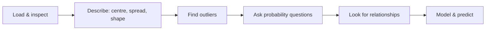

# Session 04: Practice Lab – Statistics, Probability and Regression

> Module: Inferential Statistical Analysis · Diploma in AI / Data Science · Term 1 · ⏱ ~2 hours

This is a hands-on revision session. You will apply everything from Sessions 01 to 03 to one realistic dataset, [`students.csv`](./students.csv), which holds 40 students with their city, batch, weekly study hours, attendance percentage and final marks. Work through the three labs in order; each one has a ready solution script you can compare with after trying yourself.

## 🎯 Learning Objectives

- Load a CSV file with pandas and inspect it
- Produce a complete descriptive statistics report, including outliers and skewness
- Estimate simple and conditional probabilities directly from data
- Apply binomial and normal distributions to real questions
- Measure correlations and build a simple regression model to predict marks

## 📖 Concepts Explained

### 1. The dataset

| Column | Type | Meaning |
|---|---|---|
| `student_id` | identifier | unique number, not used in calculations |
| `city` | nominal | Karachi, Lahore, Islamabad or Multan |
| `batch` | nominal | Morning or Evening |
| `study_hours` | discrete | self-study hours per week (1-10) |
| `attendance` | continuous (%) | class attendance |
| `marks` | continuous | final marks out of 100 |

> Always look at a dataset's columns and types before calculating anything. An average of `student_id` is a number, but it means nothing.

### 2. A data-analysis checklist



### 3. Reminder of the key formulas

| Idea | Formula / function |
|---|---|
| Mean, median, SD | `df[col].mean()`, `.median()`, `.std()` |
| IQR and outlier fences | Q3 − Q1; Q1 − 1.5·IQR and Q3 + 1.5·IQR |
| Skewness | `df[col].skew()` (0 ≈ symmetric) |
| Probability from data | count of event ÷ total rows |
| Conditional probability | filter to the condition first, then count |
| Binomial | `stats.binom.pmf(k, n, p)` |
| Normal tail | `1 - stats.norm.cdf(x, mu, sigma)` |
| z-score | (x − μ) / σ |
| Correlation | `df.corr()` / `df.corr(method="spearman")` |
| Regression | `stats.linregress(x, y)` |

### 4. Probability from a table

Counting rows is the most practical way to get probabilities in data science:

- P(Karachi) = rows where city is Karachi ÷ all rows.
- P(pass | Evening) = among Evening rows only, the share with marks ≥ 60.

If P(pass | Evening) is very different from P(pass), batch and passing are probably **not independent**. (Session 06 will test this formally with a chi-square test.)

### 5. Interpreting results honestly

- A correlation from 40 students is only an estimate; a new class may give a slightly different value.
- A regression line is trustworthy only inside the range of data used (1-10 hours). Predicting for 30 hours a week is **extrapolation**.
- Report numbers with sensible rounding (2-3 decimals) and a sentence that explains them in plain words.

## 💻 Code Examples

Run each script from inside this folder so pandas can find `students.csv`:

```bash
cd Session-04-Practice-Lab-Statistics-Probability-and-Regression
python lab1_descriptive_report.py
```

### Lab 1 solution: Descriptive report (`lab1_descriptive_report.py`)

```python
q1, q3 = df["marks"].quantile([0.25, 0.75])
iqr = q3 - q1
outliers = df[(df["marks"] < q1 - 1.5 * iqr) | (df["marks"] > q3 + 1.5 * iqr)]
print(df.groupby("city")["marks"].mean())
```

**How it works:** the script prints shape, first rows, mean/median/mode, SD, IQR, outliers, skewness and average marks per city with `groupby`.

### Lab 2 solution: Probability (`lab2_probability_practice.py`)

```python
evening = df[df["batch"] == "Evening"]
p_pass_given_evening = (evening["marks"] >= 60).sum() / len(evening)
stats.binom.pmf(8, 10, p_pass)
```

**How it works:** a filtered DataFrame turns a conditional probability into a simple count. The estimated pass rate then feeds a binomial question and a normal model of marks.

### Lab 3 solution: Correlation and regression (`lab3_correlation_regression.py`)

```python
print(numeric.corr().round(3))
line = stats.linregress(df["study_hours"], df["marks"])
```

**How it works:** the correlation matrix shows study hours relate to marks far more strongly than attendance. The regression line converts that into "each extra study hour adds about 5 marks".

## 🧪 Lab Practice

1. **Lab 1 (Session 01):** Without looking at the solution, write code to print mean, median, SD, IQR and skewness of `attendance`. Then compare the Morning and Evening batches.
2. **Lab 2 (Session 02):** Find P(Lahore and pass) and P(Lahore or pass). Check the addition rule: P(A or B) = P(A) + P(B) − P(A and B).
3. **Lab 2 extension:** Simulate picking 10 random students 1,000 times (`df.sample(10)`) and record the mean marks each time. Is the distribution of means bell-shaped (CLT)?
4. **Lab 3 (Session 03):** Fit a regression of marks on attendance. Compare its R² with the study-hours model. Which is the better predictor?
5. **Lab 3 extension:** Use `np.linalg.lstsq` (see Session 03) to fit marks on *both* study hours and attendance.

## 📝 Assignment

Write a one-page report `assignment-04.md` (with your code in `assignment-04.py`) that answers: *"Which city's students perform best, does batch matter, and how many study hours does a student need to expect 75 marks?"* Use at least one descriptive measure, one probability and one regression result.

## ❓ Quick Quiz

1. Which pandas method gives count, mean, std and quartiles in one call?
2. How do you calculate P(pass | Morning) from the table?
3. A skewness of −0.8 means what?
4. Why is predicting marks for 25 study hours risky?
5. Which function returns slope, intercept and r together?

<details>
<summary>Show answers</summary>

1. `df.describe()`
2. Filter to Morning rows, then divide the number with marks ≥ 60 by the number of Morning rows.
3. A moderate left (negative) skew: a tail of low values.
4. It is extrapolation beyond the observed 1-10 hours; the linear pattern may not continue.
5. `scipy.stats.linregress`

</details>

## 💼 Interview Questions

**1. Describe your first steps when you receive a new dataset.**

> Check shape, column types and missing values, compute descriptive statistics, look for outliers, then explore relationships with correlation and charts before modelling.

**2. How would you check if two categorical variables are related?**

> Compare conditional probabilities in a cross-tab, then confirm with a chi-square test of independence.

**3. What is extrapolation and why is it dangerous?**

> Predicting outside the range of the training data. The relationship learnt may not hold there, so predictions can be badly wrong.

## ✅ Summary

- One dataset can answer descriptive, probability and regression questions.
- `groupby`, filtering and counting are the everyday tools for these answers.
- Conditional probabilities hint at relationships between categories.
- Correlation finds the strongest predictors; regression quantifies their effect.
- Always explain results in plain language and respect the data range.

---

[⬅ Previous](../Session-03-Correlation-and-Regression/README.md) · [🏠 Module Home](../README.md) · [Next ➡](../Session-05-Hypothesis-Testing-Sampling-and-Confidence-Intervals/README.md)

Prepared by Zeeshan Abbas · Aptech Learning North Nazimabad
