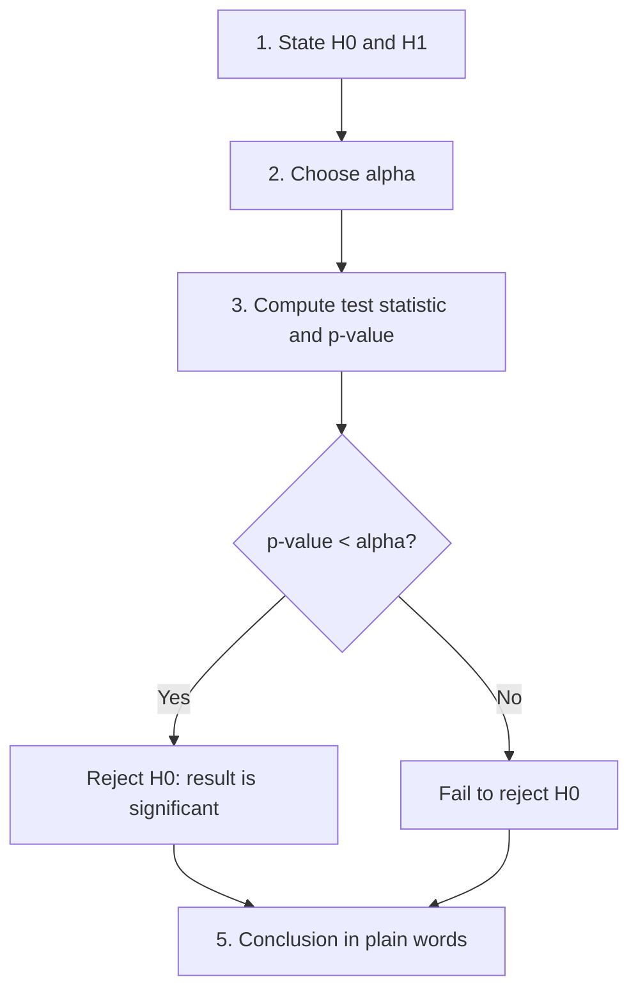

# Session 05: Hypothesis Testing, Sampling and Confidence Intervals

> Module: Inferential Statistical Analysis · Diploma in AI / Data Science · Term 1 · ⏱ ~2 hours

Inferential statistics answers questions about a large group using a small sample. Is a new teaching method really better? Is a factory's machine filling bottles correctly? Did a website change increase sales or was it luck? In this session you will learn how to take good samples, how to estimate a value with a **confidence interval**, and how to make a decision with a **hypothesis test**.

## 🎯 Learning Objectives

- Explain sampling theory, sampling methods and sampling error
- Describe the sampling distribution and the standard error
- Build and interpret confidence intervals for a mean
- Explain null and alternative hypotheses, test statistics and p-values
- Explain the level of significance, Type I and Type II errors
- Run a complete hypothesis test in Python using `scipy.stats`

## 📖 Concepts Explained

### 1. Sampling theory

We study a **sample** because measuring the whole **population** is costly or impossible. A good sample is **representative**: it looks like the population in the ways that matter.

| Method | How it works | Example |
|---|---|---|
| Simple random | everyone has an equal chance | lucky draw of 50 roll numbers |
| Systematic | pick every k-th item | every 10th customer at a counter |
| Stratified | split into groups (strata), sample from each | 10% of each department |
| Cluster | randomly pick whole groups | survey 3 complete classrooms |
| Convenience | whoever is easy to reach (biased!) | asking only your friends |

**Sampling error** is the natural difference between a sample statistic and the true parameter. It shrinks as the sample size grows. **Bias** is different: it is a systematic error caused by a bad sampling method, and a bigger sample does not fix it.

### 2. Sampling distribution and standard error

If we took many samples and calculated the mean of each, those means would form the **sampling distribution of the mean**. By the Central Limit Theorem (Session 02) it is approximately normal, centred on μ, with spread:

`Standard Error (SE) = σ / √n` (use the sample SD *s* when σ is unknown)

Four times the sample size gives half the standard error.

### 3. Confidence intervals

A **point estimate** is a single number (sample mean = 32.75 min). A **confidence interval (CI)** gives a range that probably contains the true value:

`CI = x̄ ± (critical value) × SE`

| Confidence level | z critical value |
|---|---|
| 90% | 1.645 |
| 95% | 1.96 |
| 99% | 2.576 |

Use the **t distribution** (critical value from `stats.t.ppf`) when σ is unknown and the sample is small, which is the normal real-life case.

**Correct meaning of 95%:** if we repeated the sampling many times, about 95% of the intervals built this way would contain the true mean. It does *not* mean there is a 95% chance the true mean is in this one interval in a strict sense. The file `ci_simulation.py` demonstrates this.

### 4. Hypothesis testing

A hypothesis test is like a court case: the accused is *innocent until proven guilty*.

| Court | Statistics |
|---|---|
| Assume innocent | **H₀ (null hypothesis)**: no effect, no difference (μ = 30) |
| Prosecutor's claim | **H₁ (alternative)**: there is an effect (μ > 30, μ < 30 or μ ≠ 30) |
| Evidence | sample data → **test statistic** |
| "Beyond reasonable doubt" | **level of significance α** (usually 0.05) |
| Verdict | reject H₀ or fail to reject H₀ |



### 5. p-value and level of significance

- **p-value**: the probability of getting results at least as extreme as ours *if H₀ were true*. A small p-value means our data would be surprising under H₀.
- **α (level of significance)**: the threshold we set *before* testing; the risk of a false alarm we accept. Common values: 0.05, 0.01.
- One-tailed test: H₁ has a direction (> or <). Two-tailed: H₁ is ≠.

### 6. Errors in testing

| | H₀ actually true | H₀ actually false |
|---|---|---|
| Reject H₀ | **Type I error** (false positive), probability α | correct (power) |
| Fail to reject H₀ | correct | **Type II error** (false negative), probability β |

Example: a medical test that says a healthy person is sick makes a Type I error; missing a real disease is a Type II error. **Power = 1 − β** grows with larger samples.

## 💻 Code Examples

### Example 1: Sampling methods (`sampling_methods.py`)

```python
simple = population.sample(n=5, random_state=1)
stratified = population.groupby("dept").sample(frac=0.25, random_state=1)
```

**How it works:** pandas' `sample` picks random rows; combining it with `groupby` gives a stratified sample with the same share from every department. `random_state` makes results repeatable.

### Example 2: Confidence interval (`confidence_interval.py`)

```python
se = sd / np.sqrt(n)
t_crit = stats.t.ppf(0.975, df=n - 1)
print(mean - t_crit * se, mean + t_crit * se)
```

**How it works:** 0.975 leaves 2.5% in each tail, giving 95% in the middle. The result is about (30.05, 35.45) minutes; the 99% interval is wider.

### Example 3: Full hypothesis test (`hypothesis_test_steps.py`)

```python
t_stat, p_value = stats.ttest_1samp(times, popmean=30, alternative="greater")
decision = "Reject H0" if p_value < 0.05 else "Fail to reject H0"
```

**How it works:** each of the five steps is a commented block. Here p ≈ 0.023 < 0.05, so we conclude deliveries take longer than claimed.

### Example 4: Meaning of 95% (`ci_simulation.py`)

The script builds 1,000 intervals from fresh samples and counts how many contain the true mean. You will see a number close to 950 (for example 940); it varies a little with the random seed.

## 🧪 Lab Practice

1. In `sampling_methods.py`, change the stratified fraction to 0.5. How many people come from each department?
2. Recalculate the confidence interval with only the first 6 delivery times. Is it wider or narrower? Why?
3. Change `hypothesis_test_steps.py` to a two-sided test (`alternative="two-sided"`). What happens to the p-value?
4. A bottle machine should fill 500 ml. Sample: 498, 502, 497, 495, 499, 501, 496, 498. Test at α = 0.05 whether the mean is different from 500.
5. Run `ci_simulation.py` with 90% intervals. About how many capture the truth now?

## 📝 Assignment

A coaching centre claims its students study an average of 4 hours a day. You survey 15 students (create realistic numbers). Write `assignment-05.py` that builds a 95% confidence interval and tests the claim (two-sided, α = 0.05). Explain your conclusion and which error you might be making.

## ❓ Quick Quiz

1. Which sampling method guarantees every group is represented?
2. What happens to the standard error when n increases from 25 to 100?
3. What is a Type I error?
4. p-value = 0.03 and α = 0.05. What is the decision?
5. Is a 99% confidence interval wider or narrower than a 95% one?

<details>
<summary>Show answers</summary>

1. Stratified sampling
2. It halves (√100 is twice √25).
3. Rejecting H₀ when it is actually true (false positive).
4. Reject H₀; the result is significant at the 5% level.
5. Wider

</details>

## 💼 Interview Questions

**1. Explain a p-value to a non-technical manager.**

> It is how surprising our data would be if nothing had really changed. A very small p-value means "this is unlikely to be just luck", so we have evidence of a real effect.

**2. What is the difference between a Type I and a Type II error?**

> Type I: concluding there is an effect when there is none (false alarm). Type II: missing an effect that really exists.

**3. Why does "fail to reject H₀" not mean "H₀ is true"?**

> The data simply did not give enough evidence against H₀; a larger sample might. Absence of evidence is not evidence of absence.

## ✅ Summary

- Good samples are random and representative; bias is worse than sampling error.
- The standard error σ/√n measures how much sample means vary.
- A confidence interval is estimate ± critical value × SE.
- Hypothesis testing compares the p-value with α to decide about H₀.
- Type I and Type II errors are the two ways a test can be wrong.

---

[⬅ Previous](../Session-04-Practice-Lab-Statistics-Probability-and-Regression/README.md) · [🏠 Module Home](../README.md) · [Next ➡](../Session-06-Exact-Sampling-Distributions-Chi-Square-t-Z-F-Tests/README.md)

Prepared by Zeeshan Abbas · Aptech Learning North Nazimabad
