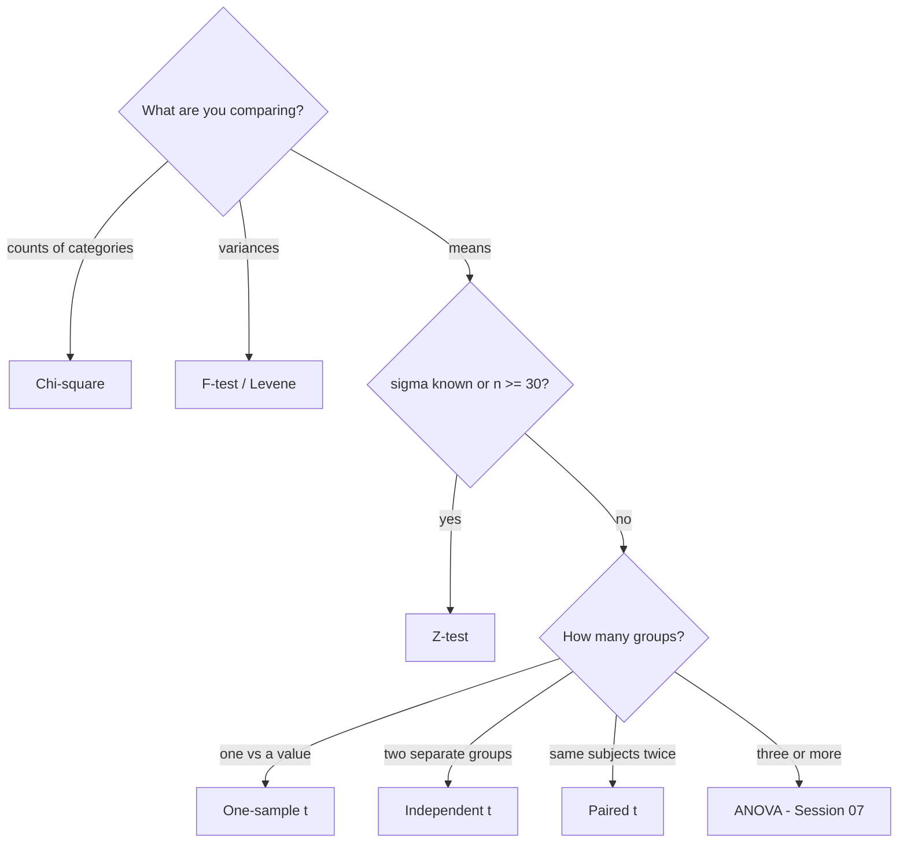

# Session 06: Exact Sampling Distributions – Chi-Square, t, Z and F Tests

> Module: Inferential Statistical Analysis · Diploma in AI / Data Science · Term 1 · ⏱ ~2 hours

In Session 05 you learnt the five steps of a hypothesis test. Now you will meet the four "workhorse" tests of statistics. Each one is built on its own **sampling distribution**: the shape the test statistic follows when H₀ is true. Choosing the right test depends on your question (means, variances or counts) and on what you know about the data.

## 🎯 Learning Objectives

- Explain what an exact sampling distribution is and the role of degrees of freedom
- Apply the chi-square test for goodness of fit and for independence
- Apply one-sample, independent two-sample and paired t-tests
- Apply the Z-test when σ is known or the sample is large
- Apply the F-test to compare two variances
- Choose the correct test for a given problem and run it in Python

## 📖 Concepts Explained

### 1. Exact sampling distributions

When we calculate a statistic (like t or χ²) from a sample, its value changes from sample to sample. If the data meets certain conditions (usually: random, independent, roughly normal), that statistic follows a **known** distribution exactly. We compare our value against that distribution to get the p-value.

**Degrees of freedom (df)** = how many values are free to vary. For a sample of 8 with a known mean, only 7 values can change freely, so df = n − 1 = 7. Distributions like t, χ² and F change shape with df.

| Distribution | Shape | Used for |
|---|---|---|
| Standard normal (Z) | symmetric bell, fixed | means with σ known / large n |
| t | bell with heavier tails, approaches Z as df grows | means with σ unknown, small n |
| Chi-square (χ²) | right-skewed, only positive | counts and categories, a single variance |
| F | right-skewed, ratio of two variances | comparing variances, ANOVA |

### 2. Chi-square (χ²) test

Works with **frequencies (counts)**, not averages.

`χ² = Σ (Observed − Expected)² / Expected`

| Version | Question | df |
|---|---|---|
| Goodness of fit | Do counts match an expected pattern? (Is a die fair?) | categories − 1 |
| Independence | Are two categorical variables related? (gender vs course) | (rows − 1)(cols − 1) |

Condition: every expected count should be at least 5.

### 3. t-test

Compares **means** when σ is unknown (the common case) and samples are small.

| Type | Question | scipy function |
|---|---|---|
| One-sample | Is the mean equal to a value? | `ttest_1samp` |
| Independent two-sample | Do two separate groups have equal means? | `ttest_ind` (use `equal_var=False` for Welch) |
| Paired | Did the same subjects change (before/after)? | `ttest_rel` |

`t = (x̄ − μ₀) / (s / √n)` for one sample. Assumptions: random samples, roughly normal data (less important when n ≥ 30).

### 4. Z-test

Same idea as the t-test, but uses the **standard normal** distribution. Use it when the population SD **σ is known** or n is large (n ≥ 30), and for tests about proportions.

`z = (x̄ − μ₀) / (σ / √n)`

Critical values at α = 0.05: ±1.96 (two-tailed), 1.645 (one-tailed).

### 5. F-test

Compares the **variances** (consistency) of two groups:

`F = s₁² / s₂²` (put the larger variance on top)

If F is close to 1, the variances are similar. The F-test is very sensitive to non-normal data, so in practice analysts often use **Levene's test** as a robust check. The F distribution is also the basis of ANOVA (Session 07).

### 6. Choosing the right test



## 💻 Code Examples

### Example 1: Chi-square (`chi_square_tests.py`)

```python
chi2, p = stats.chisquare(f_obs=observed, f_exp=expected)
chi2, p, dof, expected_table = stats.chi2_contingency(table)
```

**How it works:** the first test checks whether 120 die rolls look (p ≈ 0.42, so it looks fair). The second checks whether course choice depends on gender using a 2×3 table; `chi2_contingency` also returns the expected counts for comparison.

### Example 2: Three t-tests (`t_tests.py`)

```python
stats.ttest_1samp(battery, popmean=10)
stats.ttest_ind(morning, evening, equal_var=False)
stats.ttest_rel(after, before)
```

**How it works:** each line answers a different question about means. The paired test finds a significant improvement after the revision class because it compares each student with themselves.

### Example 3: Z-test (`z_test.py`)

```python
z = (sample_mean - mu_0) / (sigma / np.sqrt(n))
p_value = 2 * (1 - stats.norm.cdf(abs(z)))
```

**How it works:** with σ known, the formula is calculated directly. z ≈ −2.53 is beyond −1.96, so the cartons are not filled to 1000 ml on average.

### Example 4: F-test (`f_test.py`)

```python
f_stat = max(var_a, var_b) / min(var_a, var_b)
p_value = 2 * (1 - stats.f.cdf(f_stat, df1, df2))
```

**How it works:** Machine B's variance is many times larger, so it is less consistent even though both average about 200 g. Levene's test confirms it.

## 🧪 Lab Practice

1. A sweet shop expects equal sales of 4 flavours. Observed: 48, 35, 22, 15. Run a goodness-of-fit test.
2. Build a 2×2 table (smoker / non-smoker × exercise yes / no) with your own counts and test independence.
3. Change `equal_var=False` to `True` in the independent t-test. Does the p-value change much?
4. In `z_test.py`, what sample mean would just reach significance at α = 0.05? (Hint: solve for x̄ using z = −1.96.)
5. Use `f_test.py` with two lists of your own exam marks from two classes. Which class is more consistent?

## 📝 Assignment

An app company tests two layouts. Layout A: session times (min) 12, 15, 11, 14, 13, 16, 12, 15. Layout B: 14, 18, 16, 17, 15, 19, 16, 18. Write `assignment-06.py` to (a) compare variances with an F-test or Levene, (b) compare means with the right t-test, and (c) write a recommendation in a comment.

## ❓ Quick Quiz

1. Which test checks whether two categorical variables are related?
2. When should you use a paired t-test?
3. What is the df for a chi-square independence test on a 3×4 table?
4. Which test do you use when σ is known?
5. What does the F-test compare?

<details>
<summary>Show answers</summary>

1. Chi-square test of independence
2. When the same subjects are measured twice (before/after) or items are naturally paired.
3. (3 − 1)(4 − 1) = 6
4. Z-test
5. Two variances

</details>

## 💼 Interview Questions

**1. What is the difference between a t-test and a Z-test?**

> Both compare means. A Z-test uses the normal distribution and needs σ known (or a large n); a t-test estimates σ from the sample and uses the t distribution with heavier tails, so it suits small samples.

**2. How would you test if a marketing email's click rate depends on the customer's region?**

> Make a contingency table of region × clicked/not clicked and run a chi-square test of independence.

**3. Why does the t distribution have heavier tails than the normal?**

> Because σ is estimated from a small sample, adding uncertainty. As df grows the estimate improves and t approaches the normal distribution.

## ✅ Summary

- Each test statistic follows an exact distribution that depends on degrees of freedom.
- Chi-square: counts (goodness of fit, independence).
- t-test: means with σ unknown (one-sample, independent, paired).
- Z-test: means with σ known or large samples.
- F-test: variances; it also powers ANOVA.

---

[⬅ Previous](../Session-05-Hypothesis-Testing-Sampling-and-Confidence-Intervals/README.md) · [🏠 Module Home](../README.md) · [Next ➡](../Session-07-Analysis-of-Variance-ANOVA-and-MANOVA/README.md)

Prepared by Zeeshan Abbas · Aptech Learning North Nazimabad
