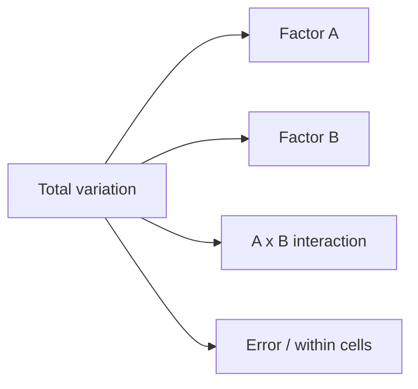

# Session 07: Analysis of Variance – ANOVA and MANOVA

> Module: Inferential Statistical Analysis · Diploma in AI / Data Science · Term 1 · ⏱ ~2 hours

A t-test compares two groups. But what if you want to compare **three teaching methods**, **four fertilisers** or **five ad campaigns**? Running many t-tests increases the chance of a false alarm. **ANOVA (Analysis of Variance)** compares many group means in one test. **MANOVA** extends the idea to several outcome variables at once.

## 🎯 Learning Objectives

- Explain why ANOVA is used instead of many t-tests
- Describe the logic of ANOVA: between-group vs within-group variation and the F ratio
- Perform one-way ANOVA and a post-hoc Tukey test in Python
- Explain one-way and two-way classification, including interaction effects
- Explain MANOVA and when to use it, and interpret Wilks' lambda
- State the assumptions behind ANOVA

## 📖 Concepts Explained

### 1. Why not many t-tests?

With 3 groups you need 3 t-tests (A-B, A-C, B-C); with 5 groups, 10 tests. If each has α = 0.05, the chance of at least one false positive grows quickly (about 40% for 10 tests). ANOVA tests everything at once with a single α.

- **H₀**: all group means are equal (μ₁ = μ₂ = μ₃).
- **H₁**: at least one group mean is different.

### 2. The logic of ANOVA

ANOVA splits the total variation in the data into two parts:

| Source | Meaning | Analogy |
|---|---|---|
| **Between groups** (SSB) | how far the group averages are from the overall average | the "signal" from the treatment |
| **Within groups** (SSW) | how far individuals are from their own group average | the "noise" of natural variation |

`F = MS_between / MS_within`, where MS = SS ÷ df.

- df between = k − 1 (k groups), df within = N − k (N total observations).
- A large F (signal much bigger than noise) gives a small p-value.

### 3. The ANOVA table

| Source | SS | df | MS | F |
|---|---|---|---|---|
| Between | SSB | k − 1 | SSB/(k−1) | MSB/MSW |
| Within (error) | SSW | N − k | SSW/(N−k) | |
| Total | SST | N − 1 | | |

SST = SSB + SSW always.

### 4. Post-hoc tests

ANOVA only says "some group differs". A **post-hoc** test such as **Tukey's HSD** compares every pair while controlling the overall error rate, telling you *which* groups differ.

### 5. One-way vs two-way classification

| Design | Factors | Example question |
|---|---|---|
| **One-way** classification | one factor with 3+ levels | Does teaching method affect marks? |
| **Two-way** classification | two factors | Do fertiliser **and** watering affect growth? |

Two-way ANOVA tests three things:

1. **Main effect of factor A** (fertiliser)
2. **Main effect of factor B** (water)
3. **Interaction A × B**: does the effect of fertiliser depend on the water level? Example: fertiliser B works especially well with high water.



### 6. MANOVA

**Multivariate ANOVA** compares groups on **two or more dependent variables together**, e.g. teaching method vs *theory marks and practical marks*. Benefits: one test instead of several ANOVAs, and it can detect differences that only appear when outcomes are considered together.

Common test statistics: **Wilks' lambda** (Λ), Pillai's trace, Hotelling's trace, Roy's largest root. Wilks' Λ = det(W) / det(W + B) lies between 0 and 1; a value **close to 0** means the groups differ a lot.

### 7. Assumptions

| Assumption | How to check |
|---|---|
| Independent observations | good study design / random assignment |
| Normality within each group | histogram, `stats.shapiro` |
| Equal variances (homogeneity) | `stats.levene` |
| MANOVA: multivariate normality, similar covariance matrices | Box's M test (advanced) |

If assumptions fail badly, use the non-parametric **Kruskal-Wallis** test (`stats.kruskal`).

## 💻 Code Examples

### Example 1: One-way ANOVA (`one_way_anova.py`)

```python
f_stat, p_value = stats.f_oneway(lecture, video, project)
ss_between = sum(len(g) * (g.mean() - grand_mean) ** 2 for g in groups)
ss_within = sum(((g - g.mean()) ** 2).sum() for g in groups)
```

**How it works:** `f_oneway` gives F and p directly. The file also calculates F by hand so you can see that it equals between-group variation divided by within-group variation.

### Example 2: Tukey post-hoc (`post_hoc_tukey.py`)

```python
result = stats.tukey_hsd(lecture, video, project)
print(result.pvalue[0, 2])
```

**How it works:** `result.pvalue` is a matrix of pairwise p-values. Here every pair differs, with project-based learning scoring highest.

### Example 3: Two-way ANOVA (`two_way_anova.py`)

```python
ss_a = b * r * ((df.groupby("fertiliser")["growth"].mean() - grand) ** 2).sum()
ss_ab = ss_cells - ss_a - ss_b
```

**How it works:** for a balanced design, `groupby` gives the factor means needed for each sum of squares. The output shows significant effects for fertiliser, water and their interaction.

### Example 4: MANOVA with Wilks' lambda (`manova_wilks.py`)

```python
wilks = np.linalg.det(W) / np.linalg.det(W + B)
```

**How it works:** `W` and `B` are 2×2 matrices that hold variation for both outcomes and how they move together. A very small Λ and tiny p-value show the methods differ on theory and practical marks combined. (In larger projects, the `statsmodels` library offers a ready `MANOVA` class.)

## 🧪 Lab Practice

1. Add a fourth teaching method (`online = [60, 64, 62, 66, 61, 63]`) to `one_way_anova.py`. Recalculate F.
2. Check the equal-variance assumption for the three methods with `stats.levene`.
3. Run `stats.kruskal(lecture, video, project)` and compare its p-value with ANOVA.
4. In `two_way_anova.py`, change fertiliser B's high-water values to `[16, 17, 15]`. Is the interaction still significant?
5. In `manova_wilks.py`, make the three groups very similar. What happens to Wilks' lambda?

## 📝 Assignment

Three branches of a pizza chain record delivery times (minutes) for 8 orders each. Create realistic data, then write `assignment-07.py` to run one-way ANOVA, check equal variances, run Tukey's HSD if needed and write a recommendation for the manager in a comment.

## ❓ Quick Quiz

1. What is H₀ in one-way ANOVA?
2. What does a large F value suggest?
3. With 4 groups and 20 observations, what are the two df values?
4. What does an interaction effect mean in two-way ANOVA?
5. When would you use MANOVA instead of ANOVA?

<details>
<summary>Show answers</summary>

1. All group means are equal.
2. Between-group variation is large compared with within-group variation: at least one mean probably differs.
3. Between: 3, within: 16.
4. The effect of one factor changes depending on the level of the other factor.
5. When you have two or more dependent (outcome) variables to compare across groups together.

</details>

## 💼 Interview Questions

**1. Why can't we just run multiple t-tests instead of ANOVA?**

> Each test has its own α, so the overall chance of a false positive grows with the number of tests. ANOVA keeps the overall error rate at α.

**2. ANOVA gives p < 0.05. What do you do next?**

> Run a post-hoc test (e.g. Tukey's HSD) to find which pairs of groups differ, and report effect sizes.

**3. What is the difference between ANOVA and MANOVA?**

> ANOVA has one dependent variable; MANOVA tests several dependent variables at the same time and accounts for the correlation between them.

## ✅ Summary

- ANOVA compares 3+ group means with one F test: signal (between) ÷ noise (within).
- Post-hoc tests (Tukey's HSD) show which groups differ.
- One-way ANOVA has one factor; two-way adds a second factor and an interaction.
- MANOVA handles several outcome variables; Wilks' lambda near 0 means groups differ.
- Check independence, normality and equal variances; use Kruskal-Wallis if needed.

---

[⬅ Previous](../Session-06-Exact-Sampling-Distributions-Chi-Square-t-Z-F-Tests/README.md) · [🏠 Module Home](../README.md) · [Next ➡](../Session-08-Practice-Lab-Inference-Tests-and-ANOVA/README.md)

Prepared by Zeeshan Abbas · Aptech Learning North Nazimabad
