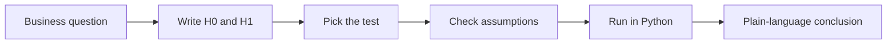

# Session 08: Practice Lab – Inference Tests and ANOVA

> Module: Inferential Statistical Analysis · Diploma in AI / Data Science · Term 1 · ⏱ ~2 hours

This practice session brings together hypothesis testing, confidence intervals, the chi-square and t-tests, and ANOVA (Sessions 05 to 07). You play the role of a data analyst at an online store that ran a marketing campaign on three channels: **Email, SMS and Social media**. The file [`campaign.csv`](./campaign.csv) records 60 customers. Management wants evidence, not opinions.

## 🎯 Learning Objectives

- Translate business questions into null and alternative hypotheses
- Build and interpret a confidence interval for an average
- Choose and run the correct test: t-test, chi-square or ANOVA
- Check test assumptions (equal variances, expected counts)
- Write clear, non-technical conclusions from statistical output

## 📖 Concepts Explained

### 1. The dataset

| Column | Type | Meaning |
|---|---|---|
| `customer_id` | identifier | unique customer number |
| `channel` | categorical (3 levels) | Email, SMS or Social |
| `region` | categorical | Karachi, Lahore or Islamabad |
| `order_value` | numeric (Rs.) | value of the first order |
| `returned_next_month` | categorical (Yes/No) | did the customer buy again? |

### 2. Business questions → statistical tests

| Business question | Variables | Test |
|---|---|---|
| What is the typical order value, with a margin of error? | one numeric | 95% confidence interval |
| Is the average order different from last year's Rs. 2,300? | one numeric vs a value | one-sample t-test |
| Do Social customers spend more than Email customers? | numeric × 2 groups | independent t-test (Welch) |
| Does the channel affect whether customers return? | two categorical | chi-square independence |
| Do the three channels differ in average order? | numeric × 3 groups | one-way ANOVA + Tukey |



### 3. Writing hypotheses for this case

- **Chi-square:** H₀: returning is independent of channel. H₁: returning depends on channel.
- **ANOVA:** H₀: μ_Email = μ_SMS = μ_Social. H₁: at least one channel's mean differs.
- **Welch t-test:** H₀: μ_Social = μ_Email. H₁: μ_Social ≠ μ_Email.

### 4. Reporting results like a professional

A good result sentence has four parts: **what was tested, the statistic, the p-value and the meaning.**

> "A one-way ANOVA showed that average order value differed between channels (F(2, 57) = 11.53, p < 0.001). Social media customers spent the most."

Avoid saying "we proved H₀" or "the result is 95% true". Say "we found / did not find significant evidence".

### 5. Statistical vs practical significance

With very large data, tiny differences (Rs. 5) can be "significant". Always look at the **size** of the difference too and ask whether it matters for the business.

## 💻 Code Examples

Run each script from this folder: `python lab1_ci_and_t_tests.py`

### Lab 1 solution: CI and t-tests (`lab1_ci_and_t_tests.py`)

```python
low, high = stats.t.interval(0.95, df=n - 1, loc=orders.mean(), scale=se)
t, p = stats.ttest_1samp(orders, popmean=2300)
t, p = stats.ttest_ind(social, email, equal_var=False)
```

**How it works:** the interval gives a range for the true average order. The one-sample test compares it with last year's figure, and Welch's test compares two channels without assuming equal variances.

### Lab 2 solution: Chi-square (`lab2_chi_square.py`)

```python
table = pd.crosstab(df["channel"], df["returned_next_month"])
chi2, p, dof, expected = stats.chi2_contingency(table)
```

**How it works:** `pd.crosstab` counts customers in each channel × returned combination, which is exactly the input a chi-square test needs. The script also checks that all expected counts are at least 5.

### Lab 3 solution: ANOVA (`lab3_anova.py`)

```python
groups = [g["order_value"].to_numpy() for _, g in df.groupby("channel")]
stat, p_lev = stats.levene(*groups)
f, p = stats.f_oneway(*groups)
res = stats.tukey_hsd(*groups)
```

**How it works:** `groupby` splits the data per channel; `*groups` passes each list as a separate argument. Levene checks the equal-variance assumption before ANOVA, and Tukey's HSD runs only when ANOVA is significant.

## 🧪 Lab Practice

1. **Session 05:** Calculate a 99% confidence interval for order value. Compare its width with the 95% interval.
2. **Session 05:** Test (one-sided) whether the average Social order is greater than Rs. 2,500.
3. **Session 06:** Make a contingency table of `region` × `returned_next_month` and test independence.
4. **Session 06:** Compare the variance of SMS and Social orders with an F-test or Levene's test.
5. **Session 07:** Run a one-way ANOVA of `order_value` by `region`. Which region spends most?

## 📝 Assignment

Write a short management memo `assignment-08.md` (code in `assignment-08.py`) titled *"Which channel should we invest in next quarter?"*. Support your recommendation with at least three test results from this lab, each written in the four-part reporting style.

## ❓ Quick Quiz

1. Which test compares the average order value across three channels?
2. Which pandas function builds a contingency table?
3. Why use Welch's t-test (`equal_var=False`)?
4. ANOVA p = 0.002. What should you do next?
5. What is the difference between statistical and practical significance?

<details>
<summary>Show answers</summary>

1. One-way ANOVA
2. `pd.crosstab`
3. It does not assume the two groups have equal variances, so it is safer when spreads differ.
4. Run a post-hoc test such as Tukey's HSD to see which channels differ.
5. Statistical significance means the effect is unlikely to be chance; practical significance means the effect is big enough to matter in real life.

</details>

## 💼 Interview Questions

**1. You ran an A/B/C test on three web page designs. How do you analyse conversion rates and time on page?**

> Conversion (yes/no counts) with a chi-square test; time on page (numeric) with one-way ANOVA or Kruskal-Wallis, followed by post-hoc comparisons.

**2. What assumptions do you check before ANOVA?**

> Independent observations, roughly normal residuals in each group and equal variances (Levene's test).

**3. How do you explain a non-significant result to a client?**

> We did not find enough evidence of a difference with this data. It does not prove there is no difference; a larger sample might detect a smaller effect.

## ✅ Summary

- Turn every business question into H₀/H₁ and pick the test from the variable types.
- Confidence intervals show both the estimate and its uncertainty.
- t-tests compare two means, chi-square compares category counts, ANOVA compares 3+ means.
- Check assumptions first and use post-hoc tests after a significant ANOVA.
- Report results clearly and consider practical importance.

---

[⬅ Previous](../Session-07-Analysis-of-Variance-ANOVA-and-MANOVA/README.md) · [🏠 Module Home](../README.md)

Prepared by Zeeshan Abbas · Aptech Learning North Nazimabad
