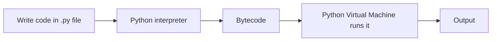

# Session 01: Basics of Python

> Module: Application Based Programming in Python · Diploma in AI / Data Science · Term 1 · ⏱ ~2 hours

Python is the most popular language for data science and AI because it is easy to read, free and has thousands of ready-made libraries. In this first session you will install Python, write your first programs and learn the building blocks of every Python script: keywords, identifiers, statements, comments, indentation and variables.

## 🎯 Learning Objectives

- Explain what Python is, its features and where it is used
- Install Python and run code in interactive mode and script mode
- List Python keywords and follow the rules for naming identifiers
- Write statements and comments, and use indentation correctly
- Create variables, assign values and check their types

## 📖 Concepts Explained

### 1. What is Python?

Python is a **high-level, interpreted, general-purpose** programming language created by Guido van Rossum (first released in 1991).

| Feature | Meaning for you |
|---|---|
| Easy syntax | code reads almost like English |
| Interpreted | runs line by line; no separate compile step |
| Dynamically typed | no need to declare variable types |
| Free & open source | download and use at no cost |
| Huge library ecosystem | NumPy, pandas, Flask, scikit-learn... |
| Cross-platform | same code runs on Windows, macOS, Linux |

**Where Python is used:** data science and AI, web development (Flask, Django), automation scripts, web scraping, desktop apps, testing and scientific computing.

### 2. Running Python

1. Download Python 3.12 from python.org. On Windows, tick **"Add python.exe to PATH"**.
2. Check: open a terminal and type `python --version`.
3. **Interactive mode (REPL):** type `python`, then type code after `>>>`. Good for quick tests. Type `exit()` to leave.
4. **Script mode:** save code in a file such as `hello.py` and run `python hello.py`. Used for real programs.
5. An editor such as **VS Code** (with the Python extension) or **Jupyter Notebook** makes writing code easier.

### 3. Keywords

**Keywords** are reserved words with special meaning, such as `if`, `else`, `for`, `while`, `def`, `class`, `return`, `True`, `False`, `None`, `import`. Python 3.12 has 35 of them. You cannot use them as variable names.

### 4. Identifiers and naming rules

An **identifier** is the name you give to a variable, function or class.

| Rule | Valid | Invalid |
|---|---|---|
| Letters, digits and `_` only | `total_marks` | `total-marks` |
| Cannot start with a digit | `marks2` | `2marks` |
| Cannot be a keyword | `class_name` | `class` |
| Case-sensitive | `Marks` and `marks` are different | |
| No spaces | `first_name` | `first name` |

**Good style (PEP 8):** use `snake_case` for variables and functions (`student_name`), `PascalCase` for classes (`StudentRecord`) and `UPPER_CASE` for constants (`PI = 3.14`). Choose meaningful names: `price` is better than `p`.

### 5. Statements, comments and indentation

- A **statement** is one instruction, e.g. `x = 5` or `print(x)`. Normally one per line.
- Long statements can continue inside `()`, `[]`, `{}` or after a backslash `\`.
- A **comment** starts with `#` and is ignored by Python. Use comments to explain *why*.
- A **docstring** (`"""..."""`) describes a file, function or class.
- **Indentation** (leading spaces) defines blocks of code. Python uses indentation instead of `{ }`. Use **4 spaces** consistently; mixing tabs and spaces causes `IndentationError`.



### 6. Variables

A **variable** is a name that refers to a value stored in memory. Think of it as a label stuck on a box.

```python
age = 20          # create a variable and assign a value
age = 21          # re-assign
x, y = 1, 2       # multiple assignment
a = b = 0         # same value to many names
```

- `=` is the **assignment operator** (not "equals" in maths).
- Python decides the type automatically: `type(age)` → `<class 'int'>`.
- `input()` reads text from the keyboard; it always returns a string.

## 💻 Code Examples

### Example 1: First program (`hello.py`)

```python
print("Assalam-o-Alaikum! Welcome to Python.")
print("Python version used in this course:", 3.12)
```

**How it works:** `print()` displays values. Commas separate several values and add a space between them.

### Example 2: Keywords and identifiers (`keywords_identifiers.py`)

```python
import keyword
print(keyword.kwlist)
print("2nd_place".isidentifier())   # False
```

**How it works:** the `keyword` module lists reserved words. `str.isidentifier()` checks the naming rules, so you can test any name.

### Example 3: Statements, comments, indentation (`statements_comments.py`)

```python
total = (10 + 20 +
         30 + 40)
if marks >= 50:
    print("Pass")
```

**How it works:** brackets let one statement span two lines. The indented lines belong to the `if` block; the last unindented line always runs.

### Example 4: Variables (`variables.py`)

```python
student_name = "Ayesha"
age = 20
x, y = y, x      # swap
```

**How it works:** variables are created by assignment. Python swaps two values in one line without a temporary variable.

## 🧪 Lab Practice

1. Install Python and VS Code. Run `python --version` and take a screenshot.
2. Use interactive mode to calculate `25 * 4 + 10` and `2 ** 10`.
3. Write `about_me.py` that stores your name, age, city and favourite subject in variables and prints them in a sentence.
4. Which of these names are valid? `_salary`, `my name`, `Total2`, `for`, `price$`. Check with `isidentifier()`.
5. Remove the indentation from the `print("Pass")` line in `statements_comments.py`. What error appears?

## 📝 Assignment

Write `assignment-01.py` that asks the user for their name and birth year using `input()`, calculates their age in 2026 (hint: `int()` converts text to a number) and prints a greeting like *"Hello Ali, you will be 20 years old in 2026."* Add a comment on every line.

## ❓ Quick Quiz

1. Is Python compiled or interpreted?
2. Which symbol starts a comment?
3. Is `first-name` a valid identifier?
4. How many spaces are recommended for one indentation level?
5. What does `type(3.5)` return?

<details>
<summary>Show answers</summary>

1. Interpreted (it is compiled to bytecode internally, but you run it directly).
2. `#`
3. No, the hyphen is not allowed. Use `first_name`.
4. 4 spaces
5. `<class 'float'>`

</details>

## 💼 Interview Questions

**1. Why is Python so popular for data science?**

> Simple readable syntax, a huge set of libraries (NumPy, pandas, scikit-learn, TensorFlow), strong community support and easy integration with other tools.

**2. What does "dynamically typed" mean?**

> The type of a variable is decided at run time from the value it holds, and a variable can later refer to a value of another type.

**3. Why is indentation important in Python?**

> Python uses indentation to define code blocks (if, loops, functions). Wrong indentation changes the program's meaning or causes an `IndentationError`.

## ✅ Summary

- Python is a simple, interpreted, dynamically typed language used heavily in AI.
- Run code interactively (`>>>`) or as scripts (`python file.py`).
- Keywords are reserved; identifiers follow clear naming rules.
- `#` starts comments; indentation (4 spaces) defines blocks.
- Variables are created by assignment and can change value and type.

---

[🏠 Module Home](../README.md) · [Next ➡](../Session-02-Data-Types-Operators-and-Control-Flow/README.md)

Prepared by Zeeshan Abbas · Aptech Learning North Nazimabad
