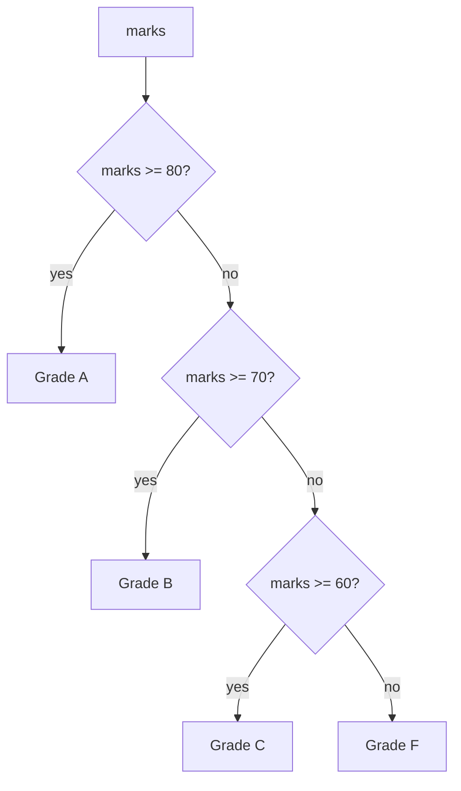

# Session 02: Data Types, Operators and Control Flow

> Module: Application Based Programming in Python · Diploma in AI / Data Science · Term 1 · ⏱ ~2 hours

Programs work with different kinds of data (numbers, text, lists), combine them with operators and make decisions or repeat work using control flow. These three ideas are the grammar of Python. After this session you can write programs that calculate, decide and loop.

## 🎯 Learning Objectives

- Explain Python's built-in data types: numbers, strings, booleans, lists, tuples, sets, dictionaries and `None`
- Convert between types with `int()`, `float()`, `str()` and `list()`
- Use arithmetic, comparison, logical, assignment, membership and identity operators
- Apply operator precedence correctly
- Write decisions with `if/elif/else` and `match`
- Repeat code with `for` and `while`, and control loops with `break`, `continue` and `pass`

## 📖 Concepts Explained

### 1. Data types

| Type | Example | Changeable? | Notes |
|---|---|---|---|
| `int` | `25` | – | whole numbers, any size |
| `float` | `3.14` | – | decimal numbers |
| `complex` | `2+3j` | – | used in engineering maths |
| `bool` | `True`, `False` | – | result of comparisons |
| `str` | `"Karachi"` | No (immutable) | text, in single or double quotes |
| `list` | `[1, 2, 3]` | Yes (mutable) | ordered collection |
| `tuple` | `(1, 2)` | No | ordered, fixed collection |
| `set` | `{1, 2}` | Yes | unique items, no order |
| `dict` | `{"a": 1}` | Yes | key → value pairs |
| `NoneType` | `None` | – | "no value" |

**Indexing and slicing** work on strings, lists and tuples: `s[0]` is the first item, `s[-1]` the last, `s[1:4]` items 1 to 3.

**Type conversion:** `int("5")` → 5, `float("2.5")` → 2.5, `str(10)` → "10". `input()` always returns a string, so convert before maths.

### 2. Operators

| Category | Operators | Example |
|---|---|---|
| Arithmetic | `+ - * / // % **` | `17 // 5` → 3, `17 % 5` → 2 |
| Comparison | `== != > < >= <=` | `5 > 3` → True |
| Logical | `and or not` | `age >= 18 and has_cnic` |
| Assignment | `= += -= *= /=` | `total += 5` |
| Membership | `in`, `not in` | `"a" in "cat"` → True |
| Identity | `is`, `is not` | same object in memory? |

**Precedence (high → low):** `()` → `**` → `* / // %` → `+ -` → comparisons → `not` → `and` → `or`. When unsure, use brackets.

`==` compares **values**; `is` checks whether two names point to the **same object**. Use `is` mainly with `None`: `if result is None:`.

### 3. Control flow: decisions

```python
if condition:
    ...
elif other_condition:
    ...
else:
    ...
```

Only the first true branch runs. `match` (Python 3.10+) compares one value against several patterns; `case _:` is the default.



### 4. Control flow: loops

| Loop | Use when | Example |
|---|---|---|
| `for` | you know the items / number of repeats | `for name in names:` |
| `while` | repeat until a condition changes | `while balance < 1500:` |

- `range(start, stop, step)` produces numbers; `stop` is not included. `range(5)` → 0 to 4.
- `break` exits the loop immediately; `continue` skips to the next round.
- `pass` does nothing; it is a placeholder for code you will write later.
- A loop inside a loop is a **nested loop** (e.g. multiplication tables).

## 💻 Code Examples

### Example 1: Data types and casting (`data_types.py`)

```python
marks = [70, 85, 90]
student = {"name": "Ali", "age": 19}
print(int("42") + 8)
```

**How it works:** the loop prints each value with `type(value).__name__`. The last lines convert between types.

### Example 2: Strings, lists, dictionaries (`strings_and_lists.py`)

```python
print(name[0:7])
fruits.append("orange")
for key, value in student.items():
    print(key, "=", value)
```

**How it works:** slicing extracts part of a string, list methods change the list, and `items()` loops over dictionary pairs.

### Example 3: Operators (`operators.py`)

```python
print(a // b, a % b, a ** 2)
print("Can vote:", age >= 18 and has_cnic)
```

**How it works:** each operator group prints its results so you can compare `/` with `//` and `==` with `is`.

### Example 4: Decisions and loops (`control_flow.py`)

```python
while balance < 1500:
    balance = balance * 1.10
    months += 1
```

**How it works:** the grade uses `if/elif/else`; `match` detects weekends; `for` prints a table; `while` repeats until the balance target is reached; `break`/`continue` control a loop.

## 🧪 Lab Practice

1. Ask the user for two numbers and print their sum, difference, product, quotient, floor division and remainder.
2. Write a program that checks whether a number is even or odd and positive, negative or zero.
3. Print the multiplication table of any number from 1 to 10 using a `for` loop.
4. Use a `while` loop to print the digits of 4729 in reverse (hint: `% 10` and `// 10`).
5. Store 5 students' marks in a dictionary and print each name with its grade.

## 📝 Assignment

Write `assignment-02.py`: an **electricity bill calculator**. Ask for units used. Charge Rs. 10/unit for the first 100 units, Rs. 15/unit for the next 100 and Rs. 20/unit above 200. Add 5% tax and print a neat bill using f-strings.

## ❓ Quick Quiz

1. What is the result of `7 // 2` and `7 % 2`?
2. Which type is immutable: list or tuple?
3. What does `range(2, 10, 3)` produce?
4. What is the difference between `break` and `continue`?
5. What does `input()` always return?

<details>
<summary>Show answers</summary>

1. 3 and 1
2. Tuple
3. 2, 5, 8
4. `break` exits the loop; `continue` skips the rest of the current round and moves to the next.
5. A string (`str`)

</details>

## 💼 Interview Questions

**1. What is the difference between a list and a tuple?**

> Lists are mutable (can change) and use `[]`; tuples are immutable and use `()`. Tuples are slightly faster and can be used as dictionary keys.

**2. What is the difference between `==` and `is`?**

> `==` compares values; `is` checks if both names refer to the same object in memory.

**3. When would you use a `while` loop instead of a `for` loop?**

> When the number of repetitions is not known in advance and depends on a condition, e.g. reading input until the user types "quit".

## ✅ Summary

- Python has numbers, strings, booleans, lists, tuples, sets, dictionaries and `None`.
- Convert types with `int()`, `float()`, `str()`; `input()` returns text.
- Operators calculate, compare and combine conditions; precedence decides the order.
- `if/elif/else` and `match` make decisions.
- `for` and `while` repeat work; `break`, `continue` and `pass` control loops.

---

[⬅ Previous](../Session-01-Basics-of-Python/README.md) · [🏠 Module Home](../README.md) · [Next ➡](../Session-03-Introduction-to-Functions/README.md)

Prepared by Zeeshan Abbas · Aptech Learning North Nazimabad
