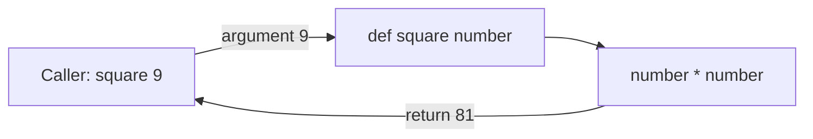

# Session 03: Introduction to Functions

> Module: Application Based Programming in Python · Diploma in AI / Data Science · Term 1 · ⏱ ~2 hours

As programs grow, you will repeat the same steps many times: calculating a grade, cleaning a name, converting a currency. A **function** packs those steps into one named block that you can call whenever you need it. Functions make code shorter, easier to test and easier to read. Every library you will use later (pandas, NumPy, Flask) is mostly a collection of functions.

## 🎯 Learning Objectives

- Explain what a function is and why we use functions
- Describe built-in and user-defined functions
- Define a function with `def`, call it and return values
- Explain local and global variable scope and the `global` keyword
- Distinguish parameters from arguments
- Use positional, keyword, default, variable-length (`*args`) and keyword variable-length (`**kwargs`) arguments

## 📖 Concepts Explained

### 1. What is a function?

A function is a **named, reusable block of code** that performs one task. Analogy: a juicer. You put fruit in (input), it does its job (processing) and gives juice back (output). You do not need to know how the motor works to use it.

**Benefits:** reuse (write once, call many times), organisation (one task per function), easier testing and debugging, and teamwork (different people write different functions).

### 2. Types of functions

| Type | Meaning | Examples |
|---|---|---|
| Built-in | come with Python | `print()`, `len()`, `sum()`, `max()`, `round()`, `type()` |
| User-defined | written by you with `def` | `calculate_grade()` |
| Lambda (anonymous) | one-line functions | `lambda x: x * 2` (Session 04) |
| Library/module functions | from imported modules | `math.sqrt()`, `random.randint()` |

### 3. Defining and calling

```python
def function_name(parameter1, parameter2):
    """Docstring: what the function does."""
    # body (indented)
    return result
```

- `def` starts the definition; the body must be indented.
- **Calling** means running it: `function_name(5, 10)`.
- `return` sends a value back and ends the function. Without `return`, a function returns `None`.
- A function can return several values separated by commas; they arrive as a tuple.



### 4. Variable scope

**Scope** is the part of the program where a variable can be used.

| Scope | Created | Visible |
|---|---|---|
| Local | inside a function | only inside that function, only while it runs |
| Global | outside all functions | everywhere in the file |

To *change* a global variable inside a function, declare it with `global name`. Use this rarely; passing values as arguments and returning results is cleaner. Python looks up names in the order **L**ocal → **E**nclosing → **G**lobal → **B**uilt-in (LEGB rule).

### 5. Parameters vs arguments

- **Parameter**: the variable name in the function definition (`def square(number)` → `number`).
- **Argument**: the actual value passed when calling (`square(9)` → `9`).

### 6. Types of arguments

| Type | How it looks | Rule |
|---|---|---|
| Positional | `full_name("Ali", "Raza")` | matched by order |
| Keyword | `full_name(last="Raza", first="Ali")` | matched by name |
| Default | `def fee(fee, discount=10)` | used if caller skips it; defaults come after non-defaults |
| Variable-length `*args` | `def average(*numbers)` | collects extra positional values into a tuple |
| Keyword variable-length `**kwargs` | `def profile(**details)` | collects extra keyword values into a dict |

**Order in a definition:** normal parameters → `*args` → default/keyword-only → `**kwargs`.

> ⚠️ Never use a mutable default like `def add(item, bucket=[])`; the same list is shared between calls. Use `bucket=None` and create the list inside.

## 💻 Code Examples

### Example 1: Define and call (`define_and_call.py`)

```python
def square(number):
    return number * number

def min_and_max(values):
    return min(values), max(values)

low, high = min_and_max([45, 12, 89, 33])
```

**How it works:** `square` returns one value; `min_and_max` returns two, which are unpacked into `low` and `high`. `help(greet)` prints the docstring.

### Example 2: Scope (`variable_scope.py`)

```python
visitors = 0
def add_visitor():
    global visitors
    visitors += 1
```

**How it works:** `batch` exists only inside `show_info`. The `global` keyword lets `add_visitor` change the global counter. The last part shows a local `x` hiding the global `x`.

### Example 3: Argument types (`argument_types.py`)

```python
def fee_with_discount(fee, discount=10): ...
def average(*numbers): ...
def print_profile(**details): ...
```

**How it works:** default arguments make parameters optional; `*numbers` accepts any count of marks; `**details` accepts any named fields.

## 🧪 Lab Practice

1. Write `is_even(n)` that returns `True` or `False`. Test it with 5 numbers.
2. Write `celsius_to_fahrenheit(c)` and print a conversion table for 0-100 °C in steps of 10.
3. Write `calculate_grade(marks)` that returns A/B/C/F and use it inside a loop over a list of marks.
4. Write `make_bill(*prices, tax=5)` that returns the total including tax.
5. Write `student_card(**info)` that prints any details in a neat box.

## 📝 Assignment

Create `assignment-03.py` with a **mini calculator** made of functions: `add`, `subtract`, `multiply`, `divide` (return a message for division by zero) and `power`. Write a `main()` function that shows a menu, reads the choice and two numbers, calls the right function and repeats until the user chooses "exit".

## ❓ Quick Quiz

1. Which keyword defines a function?
2. What does a function return if it has no `return` statement?
3. In `def area(length, width=1)`, which is the default parameter?
4. What type does `*args` arrive as inside the function?
5. Can a local variable be used outside its function?

<details>
<summary>Show answers</summary>

1. `def`
2. `None`
3. `width`
4. A tuple
5. No, it exists only inside the function.

</details>

## 💼 Interview Questions

**1. What is the difference between `*args` and `**kwargs`?**

> `*args` collects extra positional arguments into a tuple; `**kwargs` collects extra keyword arguments into a dictionary.

**2. Why is a mutable default argument dangerous?**

> The default object is created once when the function is defined, so changes persist across calls. Use `None` and create a new object inside.

**3. Explain the LEGB rule.**

> Python searches for a name in the Local scope, then Enclosing function scopes, then Global, then Built-in names.

## ✅ Summary

- Functions are reusable named blocks defined with `def` and called by name.
- `return` sends results back; without it the result is `None`.
- Local variables live inside functions; globals live in the file; `global` changes a global.
- Parameters are names in the definition; arguments are the values passed.
- Python supports positional, keyword, default, `*args` and `**kwargs` arguments.

---

[⬅ Previous](../Session-02-Data-Types-Operators-and-Control-Flow/README.md) · [🏠 Module Home](../README.md) · [Next ➡](../Session-04-Recursion-Lambda-Modules-and-Packages/README.md)

Prepared by Zeeshan Abbas · Aptech Learning North Nazimabad
