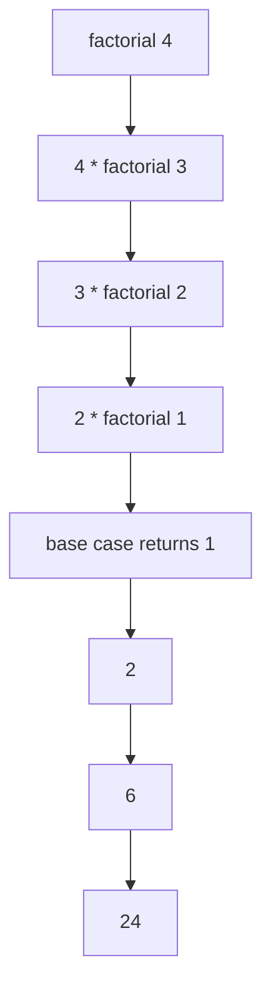

# Session 04: Recursion, Lambda Functions, Modules and Packages

> Module: Application Based Programming in Python · Diploma in AI / Data Science · Term 1 · ⏱ ~2 hours

In Session 03 you wrote your own functions. Now you will learn three more powerful ideas: functions that call themselves (**recursion**), tiny one-line functions (**lambda**), and how to organise functions into files (**modules**) and folders (**packages**) so they can be reused across projects. This is exactly how libraries such as NumPy and pandas are built.

## 🎯 Learning Objectives

- Explain recursion, base case and recursive case
- Write recursive functions for factorial, digit sum and Fibonacci
- Explain the purpose of lambda functions and use them with `sorted`, `map` and `filter`
- Create a module and import it in different ways
- Use `if __name__ == "__main__":` correctly
- Define a package with `__init__.py` and import from it

## 📖 Concepts Explained

### 1. Recursion

A **recursive function** solves a problem by calling itself on a *smaller* version of the same problem. Analogy: standing in a queue and asking the person in front "what number are you?" Each person asks the next until the first person answers "1", then answers flow back.

Every recursive function needs:

| Part | Purpose | factorial example |
|---|---|---|
| **Base case** | stops the recursion | `if n <= 1: return 1` |
| **Recursive case** | calls itself with a smaller input | `return n * factorial(n - 1)` |



Without a base case, Python raises `RecursionError` (default limit about 1000 calls). Recursion is elegant for tree-like problems (folders, family trees, JSON), but loops are usually faster for simple counting.

### 2. Lambda functions

A **lambda** is a small anonymous function written in one line:

`lambda parameters: expression`

| Normal function | Lambda |
|---|---|
| `def double(x): return x * 2` | `lambda x: x * 2` |
| has a name, many lines allowed | no name, one expression only |

**Why use them?** When a short function is needed only once, usually as an argument:

- `sorted(items, key=lambda s: s[1])` – sort by a chosen field
- `map(lambda p: round(p * 1.16, 2), prices)` – transform every item
- `filter(lambda m: m >= 50, marks)` – keep matching items
- pandas: `df["name"].apply(lambda n: n.title())`

### 3. Modules

A **module** is any `.py` file containing functions, classes or variables. Python ships with many built-in modules (`math`, `random`, `datetime`, `os`, `csv`, `json`).

| Import style | Use |
|---|---|
| `import math` | then `math.sqrt(9)` |
| `from math import sqrt, pi` | then `sqrt(9)` directly |
| `import datetime as dt` | short alias |
| `from math import *` | imports everything (avoid: name clashes) |

**`__name__ == "__main__"`:** when you run a file directly, its `__name__` is `"__main__"`. When it is imported, `__name__` is the module name. Code under this check (like quick tests) runs only when the file is executed directly.

### 4. Packages

A **package** is a folder of related modules with an `__init__.py` file.

```
Session-04-.../
├── use_modules.py
├── my_math.py
└── campus_tools/
    ├── __init__.py
    ├── grades.py
    └── fees.py
```

- `from campus_tools.grades import calculate_grade` imports from a module inside the package.
- `__init__.py` runs on import and can expose the most useful names, so `from campus_tools import calculate_grade` also works.
- Third-party packages are installed with **pip**: `pip install requests`. `pip list` shows installed packages.

## 💻 Code Examples

### Example 1: Recursion (`recursion.py`)

```python
def factorial(n):
    if n <= 1:
        return 1
    return n * factorial(n - 1)
```

**How it works:** each call waits for the smaller call to finish. The file also shows digit sum, Fibonacci and a countdown.

### Example 2: Lambda functions (`lambda_functions.py`)

```python
by_marks = sorted(students, key=lambda s: s[1], reverse=True)
passed = list(filter(lambda m: m >= 50, marks))
```

**How it works:** the lambda tells `sorted` to use the marks (index 1) as the sort key; `filter` keeps marks of 50 or more.

### Example 3: Your own module (`my_math.py`) and imports (`use_modules.py`)

```python
import my_math
print(my_math.circle_area(3))
from campus_tools import calculate_grade, fee_after_discount
```

**How it works:** Python finds `my_math.py` and the `campus_tools` folder because they are in the same folder as the script. Run `python use_modules.py` from this session folder.

## 🧪 Lab Practice

1. Write a recursive function `power(base, exp)` without using `**`.
2. Write a recursive function that reverses a string.
3. Use `sorted` with a lambda to sort a list of dictionaries by `"age"`.
4. Use `map` and a lambda to convert a list of names to uppercase.
5. Add a module `attendance.py` to `campus_tools` with `attendance_percent(present, total)` and expose it in `__init__.py`.

## 📝 Assignment

Create a package `shop_utils` with two modules: `pricing.py` (`apply_discount`, `add_tax`) and `reports.py` (`top_products(products, n)` that uses `sorted` with a lambda). Write `assignment-04.py` that imports the package and prints a small sales report.

## ❓ Quick Quiz

1. What happens if a recursive function has no base case?
2. Can a lambda contain several statements?
3. Which file makes a folder a package?
4. What is the value of `__name__` when a file is run directly?
5. What does `filter()` return when converted to a list?

<details>
<summary>Show answers</summary>

1. It keeps calling itself until Python raises `RecursionError`.
2. No, only one expression.
3. `__init__.py`
4. `"__main__"`
5. The items for which the function returned `True`.

</details>

## 💼 Interview Questions

**1. What are the advantages and disadvantages of recursion?**

> Advantages: short, clear code for naturally recursive problems (trees, divide and conquer). Disadvantages: more memory (call stack), possible `RecursionError` and often slower than loops.

**2. What is the difference between a module and a package?**

> A module is one `.py` file; a package is a folder of modules (with `__init__.py`) that can contain sub-packages.

**3. Why do we use `if __name__ == "__main__":`?**

> To run test or demo code only when the file is executed directly, not when it is imported by another module.

## ✅ Summary

- Recursion = a function calling itself with a base case and a recursive case.
- Lambdas are one-line anonymous functions, ideal for `sorted`, `map` and `filter`.
- A module is a `.py` file; import it with `import` or `from ... import`.
- `__name__ == "__main__"` separates demo code from reusable code.
- A package is a folder of modules with `__init__.py`; pip installs third-party packages.

---

[⬅ Previous](../Session-03-Introduction-to-Functions/README.md) · [🏠 Module Home](../README.md) · [Next ➡](../Session-05-Practice-Lab-Python-Fundamentals/README.md)

Prepared by Zeeshan Abbas · Aptech Learning North Nazimabad
