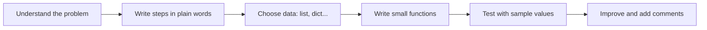

# Session 05: Practice Lab – Python Fundamentals

> Module: Application Based Programming in Python · Diploma in AI / Data Science · Term 1 · ⏱ ~2 hours

This lab session revises Sessions 01 to 04 through three small but realistic programs: a **report card**, a set of **number tools** and a **shopping cart**. Try each task yourself first, then compare with the solution script. Programming is learnt by typing code, making mistakes and fixing them.

## 🎯 Learning Objectives

- Combine variables, data types and operators to solve a real task
- Use decisions and loops together in one program
- Break a problem into small functions with parameters and return values
- Apply recursion, default arguments, `*args` and lambda functions
- Read and debug error messages confidently

## 📖 Concepts Explained

### 1. How to approach a programming problem



Write the steps as comments first (*pseudocode*), then fill in code under each comment. This is how every solution in this folder is written.

### 2. Choosing the right data structure

| Data | Best structure | Why |
|---|---|---|
| Marks of one student by subject | `dict` | look up by subject name |
| List of prices | `list` | ordered, can sort and loop |
| Products in a cart | `list` of `dict` | each product has several fields |
| Unique cities | `set` | removes duplicates |
| Fixed coordinates | `tuple` | should not change |

### 3. Common beginner errors and fixes

| Error | Typical cause | Fix |
|---|---|---|
| `SyntaxError` | missing `:` or bracket | check the line shown and the one before |
| `IndentationError` | mixed tabs/spaces or missing indent | use 4 spaces |
| `NameError` | variable used before creation or misspelt | check spelling and order |
| `TypeError: can only concatenate str` | `"Age: " + 20` | use `str(20)` or an f-string |
| `ValueError: invalid literal for int()` | `int("abc")` | validate input (Session 06 shows `try/except`) |
| `KeyError` | missing dictionary key | use `dict.get(key)` |

### 4. Reading a traceback

Python prints a **traceback** when something fails. Read it from the **bottom**: the last line names the error type and message; the lines above show the file and line number where it happened.

### 5. Clean code habits

- One function = one job; name it with a verb (`calculate_total`).
- Use f-strings with alignment: `f"{name:<12}{score:>5}"` (left/right align in 12 and 5 spaces).
- Use `:.1f` to show one decimal place.
- Keep test code at the bottom or under `if __name__ == "__main__":`.

## 💻 Code Examples

### Lab 1: Report card (`lab1_report_card.py`)

```python
for subject in marks:
    total += marks[subject]
percentage = total / (len(marks) * 100) * 100
status = "Pass" if score >= 60 else "Fail"
```

**How it works:** a dictionary holds marks; a loop adds them; `if/elif/else` picks the grade; a one-line conditional expression sets Pass/Fail for each subject; f-string alignment prints a tidy table.

### Lab 2: Number tools (`lab2_number_tools.py`)

```python
def gcd(a, b):
    if b == 0:
        return a
    return gcd(b, a % b)
```

**How it works:** `is_prime` loops only up to √n; `gcd` uses recursion; `reverse_number` uses `% 10` and `// 10` in a `while` loop; `is_palindrome` reuses `reverse_number`.

### Lab 3: Shopping cart (`lab3_shopping_cart.py`)

```python
def bill_total(items, tax_percent=16, discount=0): ...
sorted(cart, key=lambda p: line_total(p), reverse=True)
list(filter(lambda p: p["price"] >= 1000, cart))
```

**How it works:** a list of dictionaries models the cart. Default arguments make tax and discount optional; lambdas drive sorting, mapping and filtering.

## 🧪 Lab Practice

1. **Report card:** extend Lab 1 to handle three students (a dictionary of dictionaries) and print who topped the class.
2. **Number tools:** add `factorial` (recursive) and `sum_of_digits` to Lab 2 and test them.
3. **Number tools:** write `fizz_buzz(n)` that prints 1..n but "Fizz" for multiples of 3, "Buzz" for 5, "FizzBuzz" for both.
4. **Shopping cart:** add a function `add_item(cart, item, price, qty=1)` and a function that removes an item by name.
5. **Debugging:** deliberately create each error from the table above and read its traceback.

## 📝 Assignment

Build `assignment-05.py`: a **menu-driven Student Manager**. Store students in a list of dictionaries (name, roll no, marks). Menu: 1) add student 2) show all 3) search by roll no 4) show topper (use `max` with a lambda) 5) exit. Each option must be its own function.

## ❓ Quick Quiz

1. Which data structure is best for "marks by subject name"?
2. What does `f"{name:<10}"` do?
3. What is printed by `print(17 % 10, 17 // 10)`?
4. Which line of a traceback tells you the error type?
5. How do you find the dictionary with the highest `marks` in a list?

<details>
<summary>Show answers</summary>

1. A dictionary
2. Prints `name` left-aligned in a space 10 characters wide.
3. `7 1`
4. The last line
5. `max(students, key=lambda s: s["marks"])`

</details>

## 💼 Interview Questions

**1. How do you check if a number is prime efficiently?**

> Test divisibility only from 2 up to √n; if no divisor is found, it is prime.

**2. What is a conditional (ternary) expression in Python?**

> A one-line if/else: `value_if_true if condition else value_if_false`, e.g. `"Pass" if marks >= 60 else "Fail"`.

**3. How do you approach debugging a program that gives the wrong answer but no error?**

> Print intermediate values (or use a debugger), test small parts separately with known inputs, and compare actual vs expected results step by step.

## ✅ Summary

- Plan with comments first, then code in small functions.
- Choose data structures to match how you will use the data.
- Combine loops, conditions, functions, recursion and lambdas to build real tools.
- Read tracebacks from the bottom up.
- Format output neatly with f-strings.

---

[⬅ Previous](../Session-04-Recursion-Lambda-Modules-and-Packages/README.md) · [🏠 Module Home](../README.md) · [Next ➡](../Session-06-File-Handling-and-Exception-Handling/README.md)

Prepared by Zeeshan Abbas · Aptech Learning North Nazimabad
