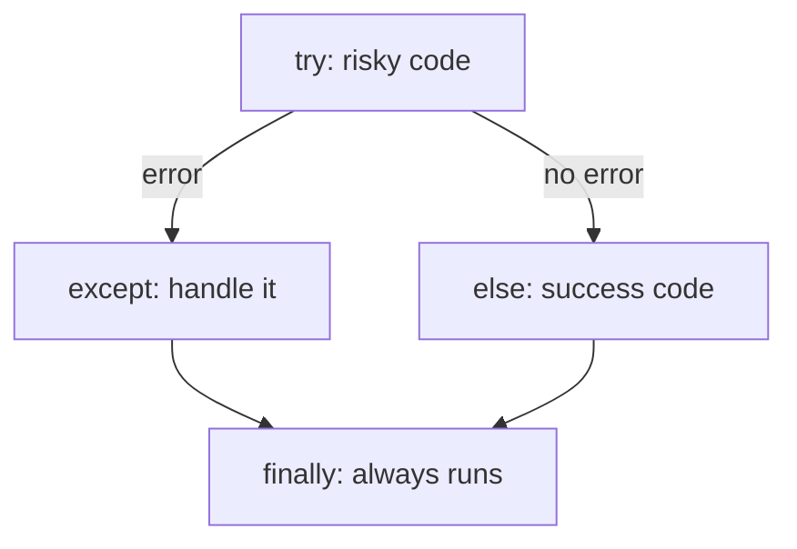

# Session 06: File Handling and Exception Handling

> Module: Application Based Programming in Python · Diploma in AI / Data Science · Term 1 · ⏱ ~2 hours

Variables disappear when a program ends. To keep data (marks, logs, settings, datasets) you must save it to **files**. And real programs face problems: a file is missing, a user types letters instead of numbers, a network fails. **Exception handling** lets your program deal with these problems gracefully instead of crashing. Both skills are used daily in data science, where most data arrives as CSV or JSON files.

## 🎯 Learning Objectives

- Identify file access modes and open/close files safely with `with`
- Read and write text files using `read`, `readline`, `readlines`, `write` and `writelines`
- Use `tell`, `seek` and the `os` module to manage files
- Read and write CSV and JSON files
- Explain errors vs exceptions and handle them with `try/except/else/finally`
- Raise built-in and custom exceptions

## 📖 Concepts Explained

### 1. Files and the file workflow

A file is data stored permanently on disk. Working with a file has three steps: **open → read/write → close**.

```python
with open("notes.txt", "r", encoding="utf-8") as file:
    data = file.read()
# the file is closed automatically here
```

The `with` statement (a *context manager*) closes the file automatically, even if an error occurs. Always prefer it.

### 2. File access modes

| Mode | Meaning | If file missing | If file exists |
|---|---|---|---|
| `"r"` | read (default) | error | reads from start |
| `"w"` | write | creates | **erases** then writes |
| `"a"` | append | creates | adds at the end |
| `"x"` | exclusive create | creates | error |
| `"r+"` | read and write | error | keeps content |
| add `"b"` | binary (`"rb"`, `"wb"`) | | for images, PDFs |
| add `"t"` | text (default) | | |

Use `encoding="utf-8"` so Urdu and other non-English text is saved correctly.

### 3. File methods

| Method | What it does |
|---|---|
| `read()` / `read(n)` | whole file / n characters as one string |
| `readline()` | the next line |
| `readlines()` | list of all lines |
| `for line in file:` | loop line by line (best for large files) |
| `write(text)` | write a string (no automatic newline) |
| `writelines(list)` | write a list of strings |
| `tell()` / `seek(pos)` | current position / move position |

The `os` and `os.path` modules check, rename and delete files: `os.path.exists`, `os.path.getsize`, `os.rename`, `os.remove`, `os.listdir`. The modern `pathlib.Path` offers the same in an object style.

### 4. CSV and JSON

| Format | Looks like | Python module | Typical use |
|---|---|---|---|
| CSV | `name,city,marks` rows | `csv` (`reader`, `writer`, `DictReader`) | tables, Excel exports, datasets |
| JSON | `{"name": "Sara", "skills": [...]}` | `json` (`dump`, `load`, `dumps`, `loads`) | web APIs, config files, nested data |

In Session 12 pandas will read CSV files in one line, but knowing the basics helps you understand what pandas does.

### 5. Errors vs exceptions

- **Syntax errors** happen before the program runs (missing colon). You must fix the code.
- **Exceptions** happen while the program runs (dividing by zero, missing file). They can be **handled**.

| Exception | Cause |
|---|---|
| `ZeroDivisionError` | dividing by 0 |
| `ValueError` | right type, wrong value: `int("abc")` |
| `TypeError` | wrong type: `"5" + 5` |
| `FileNotFoundError` | file does not exist |
| `KeyError` / `IndexError` | missing dict key / list position |

### 6. Exception handling mechanism



- Catch **specific** exceptions; a bare `except:` hides bugs.
- `except ValueError as error:` gives you the message.
- `raise ValueError("message")` creates an exception deliberately (input validation).
- A **custom exception** is a class that inherits from `Exception`, e.g. `class LowBalanceError(Exception): pass`.

## 💻 Code Examples

### Example 1: Write, append, read (`write_and_read.py`)

```python
with open("notes.txt", "a", encoding="utf-8") as file:
    file.write("Line 3: appended later\n")
for line_number, line in enumerate(file, start=1):
    print(line_number, line.strip())
```

**How it works:** `"w"` creates the file, `"a"` adds a line, and three reading styles show the same content. `strip()` removes the newline character.

### Example 2: File methods and `os` (`file_methods.py`)

```python
f.seek(0)
os.rename("cities.txt", "pk_cities.txt")
os.remove("pk_cities.txt")
```

**How it works:** `tell` and `seek` move around the file; the `os` functions check size, rename and finally delete the file.

### Example 3: CSV and JSON (`csv_and_json.py`)

```python
reader = csv.DictReader(f)
json.dump(profile, f, indent=2)
```

**How it works:** `DictReader` turns each CSV row into a dictionary keyed by the header. `json.dump` saves a Python dictionary as readable JSON; `json.load` reads it back.

### Example 4: Exceptions (`exceptions.py`)

```python
try:
    number = int(text)
except ValueError:
    print("not a whole number")
else:
    print("You entered", number)
finally:
    print("Check finished")
```

**How it works:** the program keeps running after each problem. The last parts show `raise` and a custom `LowBalanceError`.

## 🧪 Lab Practice

1. Write a program that asks for 5 to-do items and saves them in `todo.txt`, one per line. Then read and number them.
2. Count the lines, words and characters in any text file.
3. Read `students.csv` (created by Example 3) and print the average marks.
4. Ask the user for a number until they enter a valid integer (loop + `try/except`).
5. Write `open_file_safely(name)` that returns the content or a friendly message if the file is missing.

## 📝 Assignment

Create `assignment-06.py`: an **expense tracker** that appends each expense (date, category, amount) to `expenses.csv`, then reads the file and prints the total per category. Handle invalid amounts with `try/except` and raise a custom `NegativeAmountError` for negative values.

## ❓ Quick Quiz

1. Which mode adds data to the end of a file without deleting it?
2. Why is `with open(...)` preferred?
3. Which exception does `int("12a")` raise?
4. When does the `finally` block run?
5. Which module converts a dictionary to JSON text?

<details>
<summary>Show answers</summary>

1. `"a"` (append)
2. It closes the file automatically, even if an error occurs.
3. `ValueError`
4. Always, whether an exception happened or not.
5. `json` (`json.dump` / `json.dumps`)

</details>

## 💼 Interview Questions

**1. What is the difference between `"w"` and `"a"` modes?**

> `"w"` erases existing content and writes from the start; `"a"` keeps existing content and writes at the end.

**2. Why should you avoid a bare `except:`?**

> It catches every exception, including programming mistakes and keyboard interrupts, which hides bugs. Catch specific exceptions instead.

**3. What is the difference between `else` and `finally` in exception handling?**

> `else` runs only if no exception occurred in `try`; `finally` runs every time, and is used for clean-up such as closing connections.

## ✅ Summary

- Open files with `with open(name, mode, encoding="utf-8")`.
- Modes `r`, `w`, `a`, `x` (plus `b` for binary) control how a file is used.
- `csv` and `json` modules handle the two most common data formats.
- `try/except/else/finally` handles runtime problems without crashing.
- `raise` and custom exception classes make validation clear.

---

[⬅ Previous](../Session-05-Practice-Lab-Python-Fundamentals/README.md) · [🏠 Module Home](../README.md) · [Next ➡](../Session-07-Regular-Expressions-and-Tokenization/README.md)

Prepared by Zeeshan Abbas · Aptech Learning North Nazimabad
