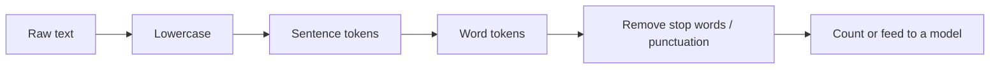

# Session 07: Regular Expressions and Tokenization of Text

> Module: Application Based Programming in Python · Diploma in AI / Data Science · Term 1 · ⏱ ~2 hours

Much real-world data is messy text: reviews, emails, chat messages, web pages. A **regular expression (regex)** is a mini-language for describing text patterns such as "a date", "an email" or "a phone number". **Tokenization** splits text into words or sentences, the first step of every Natural Language Processing (NLP) and chatbot project. In this session you will use Python's `re` module for both.

## 🎯 Learning Objectives

- Identify the benefits of regular expressions
- Explain character classes, special sequences and metacharacters
- Use `re` functions: `search`, `match`, `fullmatch`, `findall`, `finditer`, `sub`, `split`, `compile`
- Capture parts of a match with groups
- Tokenize text into words and sentences using regular expressions
- Clean tokens and count word frequency

## 📖 Concepts Explained

### 1. Why regular expressions?

Without regex, finding every phone number in 10,000 messages needs many loops and `if`s. With regex, one line does it.

| Benefit | Example |
|---|---|
| Search for patterns, not fixed text | all dates, all emails |
| Validate input | is this a valid CNIC or mobile number? |
| Extract data | pull prices from product pages |
| Clean and replace | remove extra spaces, mask numbers |
| Split text flexibly | split on commas *or* semicolons |

Always write patterns as **raw strings**: `r"\d+"`. The `r` stops Python from treating `\` as an escape character.

### 2. Metacharacters

| Symbol | Meaning | Example | Matches |
|---|---|---|---|
| `.` | any character except newline | `c.t` | cat, cot |
| `^` | start of string | `^Hi` | "Hi there" |
| `$` | end of string | `end$` | "the end" |
| `*` | 0 or more | `ab*` | a, ab, abbb |
| `+` | 1 or more | `\d+` | 7, 450 |
| `?` | 0 or 1 (optional) | `colou?r` | color, colour |
| `{n}` / `{n,m}` | exactly n / n to m times | `\d{4}` | 2026 |
| `[]` | character class | `[aeiou]` | any vowel |
| `\|` | OR | `cat\|dog` | cat or dog |
| `()` | group / capture | `(\d+)-(\d+)` | captures both parts |
| `\` | escape a metacharacter | `\.` | a real dot |

### 3. Character classes and special sequences

| Pattern | Meaning |
|---|---|
| `[abc]` | a, b or c |
| `[a-z]`, `[A-Z]`, `[0-9]` | ranges |
| `[^0-9]` | NOT a digit (`^` inside brackets means "not") |
| `\d` / `\D` | digit / non-digit |
| `\w` / `\W` | word character (letter, digit, `_`) / non-word |
| `\s` / `\S` | whitespace / non-whitespace |
| `\b` | word boundary: `\bcat\b` matches "cat" but not "category" |

### 4. Functions in the `re` module

| Function | Returns | Use |
|---|---|---|
| `re.search(p, s)` | first Match or `None` | is the pattern anywhere? |
| `re.match(p, s)` | Match at the start or `None` | does it start with...? |
| `re.fullmatch(p, s)` | Match if the whole string fits | validation |
| `re.findall(p, s)` | list of strings | extract all |
| `re.finditer(p, s)` | iterator of Match objects | positions too |
| `re.sub(p, repl, s)` | new string | replace / clean |
| `re.split(p, s)` | list | split on a pattern |
| `re.compile(p)` | pattern object | reuse a pattern many times |

A **Match object** has `.group()` (matched text), `.group(1)` (first captured group), `.start()`, `.end()` and `.span()`. Flags such as `re.IGNORECASE` change behaviour.

### 5. Tokenization

**Tokenization** breaks text into units called **tokens**.



| Type | Regex idea | Result |
|---|---|---|
| Word tokens | `\w+` | `["the", "food", "was"]` |
| Words + punctuation | `\w+\|[^\w\s]` | `["GREAT", "!", "!"]` |
| Sentence tokens | split on `(?<=[.!?])\s+` | one string per sentence |

**Stop words** (the, is, was) are very common and usually removed. Libraries like NLTK and spaCy provide advanced tokenizers, but they are built on these same ideas.

## 💻 Code Examples

### Example 1: Patterns (`regex_basics.py`)

```python
re.findall(r"\d{4}-\d{2}-\d{2}", text)   # dates
re.findall(r"03\d{2}-\d{7}", text)        # mobile numbers
```

**How it works:** each line demonstrates one metacharacter or class on the same order message, so you can see exactly what it matches.

### Example 2: `re` functions (`re_methods.py`)

```python
re.fullmatch(r"\d{5}-\d{7}-\d", "42101-1234567-1")
m = re.search(r"([\w.]+)@([\w.]+)", email)
print(m.group(1), m.group(2))
```

**How it works:** `fullmatch` validates a CNIC format; groups split an email into user and domain; `compile` creates a reusable phone validator.

### Example 3: Tokenization (`tokenization.py`)

```python
words = re.findall(r"\w+", review.lower())
sentences = re.split(r"(?<=[.!?])\s+", review)
Counter(clean).most_common(3)
```

**How it works:** the review is tokenized into words and sentences; stop words and numbers are removed; `Counter` finds the most frequent words ("great" appears twice).

## 🧪 Lab Practice

1. Extract all email addresses from a paragraph containing three emails.
2. Validate passwords: at least 8 characters, one digit and one capital letter (use `re.search` three times).
3. Replace every mobile number in a text with `03XX-XXXXXXX` using `re.sub`.
4. Tokenize a news paragraph into sentences and count the words in each.
5. Find the 5 most common words (excluding stop words) in any text file using Session 06 file reading.

## 📝 Assignment

Write `assignment-07.py` that reads a list of customer reviews (save 8 reviews in `reviews.txt`), tokenizes them, removes stop words, prints the 10 most common words and extracts any order numbers written like `#1234`.

## ❓ Quick Quiz

1. What does `\d{3}` match?
2. What is the difference between `re.match` and `re.search`?
3. What does `[^aeiou]` mean?
4. Why do we write patterns as raw strings `r"..."`?
5. What is a token in NLP?

<details>
<summary>Show answers</summary>

1. Exactly three digits.
2. `match` checks only at the start of the string; `search` looks anywhere.
3. Any character that is NOT a lowercase vowel.
4. So that backslashes are passed to the regex engine instead of being treated as Python escape sequences.
5. A small unit of text, usually a word, punctuation mark or sentence.

</details>

## 💼 Interview Questions

**1. How would you extract all URLs or emails from a large text?**

> Use `re.findall` with a suitable pattern (compiled once with `re.compile` for speed), then clean and de-duplicate the results.

**2. What is the difference between greedy and non-greedy matching?**

> Greedy quantifiers (`.*`) match as much as possible; adding `?` (`.*?`) makes them match as little as possible, e.g. for extracting text between tags.

**3. Why is tokenization important in NLP?**

> Models cannot process raw text directly. Tokenization turns text into units that can be counted, cleaned and converted into numbers (vectors) for machine learning.

## ✅ Summary

- Regex describes text patterns using metacharacters, classes and special sequences.
- `search`, `match`, `fullmatch`, `findall`, `sub`, `split` and `compile` cover most needs.
- Groups `()` capture parts of a match.
- Tokenization splits text into sentences and words; stop words are often removed.
- These are the first steps of text cleaning for NLP and AI.

---

[⬅ Previous](../Session-06-File-Handling-and-Exception-Handling/README.md) · [🏠 Module Home](../README.md) · [Next ➡](../Session-08-Web-Development-Using-Flask/README.md)

Prepared by Zeeshan Abbas · Aptech Learning North Nazimabad
