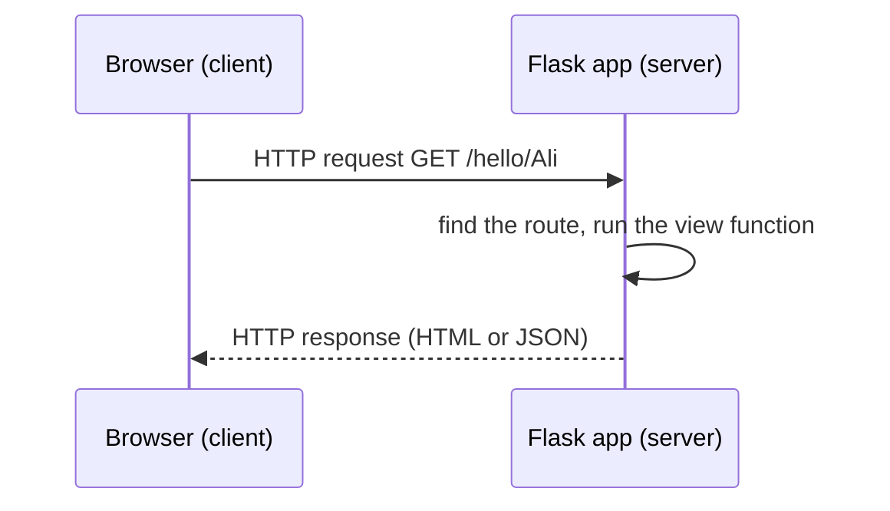

# Session 08: Web Development Using Flask

> Module: Application Based Programming in Python · Diploma in AI / Data Science · Term 1 · ⏱ ~2 hours

A trained AI model is useful only when people can reach it, and the easiest way is through a web page or a web API. **Flask** is a lightweight Python web framework: a few lines of code turn a Python function into a web page. In this session you will set up Flask, create routes, use HTML templates and handle a form, the same skills used to put a machine learning model online.

## 🎯 Learning Objectives

- Explain how the web works (client, server, request, response) and what Flask is
- Set up Flask in a virtual environment
- Create routes, including dynamic URL parts
- Return HTML, text and JSON responses
- Render Jinja2 templates with variables, loops and conditions, and serve static files
- Handle GET and POST requests from an HTML form

## 📖 Concepts Explained

### 1. How a web application works



| Term | Meaning |
|---|---|
| Client | the browser or mobile app asking for data |
| Server | the program that answers (our Flask app) |
| URL / route | the address, e.g. `/about` |
| HTTP method | `GET` (read/view) or `POST` (send data, e.g. a form) |
| Response | what the server sends back: HTML, JSON, a file, plus a status code (200 OK, 404 Not Found) |

### 2. What is Flask?

Flask is a **micro-framework**: it gives you routing, templates and request handling, and lets you add extras (databases, logins) only when needed. It is popular for small sites, REST APIs and ML model demos. Django is a larger "batteries included" alternative.

### 3. Setup and installation

```bash
python -m venv venv              # 1. create a virtual environment
venv\Scripts\activate            # 2. activate (Windows)  |  source venv/bin/activate (macOS/Linux)
pip install -r requirements.txt  # 3. install Flask
python app_hello.py              # 4. run, then open http://127.0.0.1:5000
```

A **virtual environment** keeps each project's packages separate so versions do not clash.

### 4. Building a Flask application step by step

1. `app = Flask(__name__)` creates the app.
2. `@app.route("/path")` is a **decorator** that links a URL to the function below it (the **view function**).
3. The view returns a string (HTML), `jsonify(data)` for JSON, or `render_template(...)` for a template.
4. `app.run(debug=True)` starts the development server. Debug mode shows errors in the browser and reloads on changes; never use it on a live site.

**Dynamic routes:** `/hello/<name>` passes `name` to the function. Converters like `<int:number>` accept only certain types.

### 5. Templates with Jinja2

Writing HTML inside Python strings quickly becomes messy. Flask looks in the `templates/` folder for HTML files and fills them using **Jinja2** syntax:

| Syntax | Purpose | Example |
|---|---|---|
| `{{ ... }}` | print a value | `{{ s.name }}` |
| `` ... `` | loop | rows of a table |
| `` ... `` | condition | Pass / Fail |
| `` + `` | template inheritance | shared header/menu |
| `{{ list\|length }}` | filters | count items |
| `url_for('index')` | build URLs from function names | links and CSS |

CSS, images and JavaScript go in the `static/` folder.

### 6. Forms: GET vs POST

The add page shows an empty form on **GET**. When the user clicks Save, the browser sends a **POST** request with the form data. In the view, `request.method` tells you which one it is and `request.form.get("name")` reads a field. Always **validate** input before using it.

### 7. Project structure

```
Session-08-Web-Development-Using-Flask/
├── app_hello.py  app_routes.py  app_templates.py  test_apps.py
├── requirements.txt
├── templates/   base.html  index.html  add.html
└── static/      style.css
```

## 💻 Code Examples

### Example 1: Hello Flask (`app_hello.py`)

```python
app = Flask(__name__)

@app.route("/")
def home():
    return "<h1>Hello from Flask!</h1>"
```

**How it works:** visiting `/` runs `home()` and the returned HTML is shown in the browser.

### Example 2: Routes and JSON (`app_routes.py`)

```python
@app.route("/square/<int:number>")
def square(number):
    return f"{number} squared is {number * number}"

@app.route("/api/courses")
def api_courses():
    return jsonify(courses)
```

**How it works:** `/square/7` passes 7 as an int. `/api/courses` returns JSON, which a mobile app or JavaScript can read.

### Example 3: Templates and a form (`app_templates.py`, `templates/`)

```python
return render_template("index.html", title="Student List", students=students)
if request.method == "POST":
    name = request.form.get("name", "").strip()
```

**How it works:** `index.html` loops over students and marks Pass/Fail; `add.html` posts a form back to `/add`, which validates and appends the new student.

### Example 4: Testing without a browser (`test_apps.py`)

`app.test_client()` sends fake requests to your app, so you can check pages automatically: `python test_apps.py`.

## 🧪 Lab Practice

1. Run `app_hello.py`, change the message and watch debug mode reload it.
2. Add a route `/table/<int:n>` that shows the multiplication table of n as an HTML list.
3. Add `/api/student/<name>` that returns one student's data as JSON, or a 404 message if not found.
4. Add a "Grade" column to `index.html` using `` / ``.
5. Add a contact form page with name, email and message fields, and show a thank-you message after POST.

## 📝 Assignment

Build `assignment-08/` with a Flask **BMI calculator**: a form asks for weight (kg) and height (m), the result page shows the BMI and its category (Underweight, Normal, Overweight, Obese). Use template inheritance and a CSS file, and validate that inputs are positive numbers.

## ❓ Quick Quiz

1. Which decorator links a URL to a function?
2. In which folder does Flask look for HTML templates?
3. What does `{{ name }}` do in a Jinja2 template?
4. Which HTTP method is used to submit form data?
5. Why should `debug=True` never be used on a live server?

<details>
<summary>Show answers</summary>

1. `@app.route()`
2. `templates/`
3. Prints the value of the variable `name` in the HTML.
4. `POST`
5. It shows internal error details and allows running code through the debugger, which is a security risk.

</details>

## 💼 Interview Questions

**1. What is the difference between Flask and Django?**

> Flask is a lightweight micro-framework where you choose your own extensions; Django is a full-stack framework with built-in ORM, admin panel and authentication.

**2. How would you serve a machine learning model with Flask?**

> Load the trained model once at start-up, create a POST route (e.g. `/predict`) that reads JSON input, runs `model.predict`, and returns the result with `jsonify`.

**3. What is template inheritance?**

> A base template defines the common layout with `` areas; child templates `` it and fill only the blocks they change.

## ✅ Summary

- Flask maps URLs (routes) to Python view functions.
- Views return HTML, JSON (`jsonify`) or rendered Jinja2 templates.
- Templates live in `templates/`, CSS/images in `static/`.
- Forms send POST data read with `request.form`.
- Use a virtual environment and test with `app.test_client()`.

---

[⬅ Previous](../Session-07-Regular-Expressions-and-Tokenization/README.md) · [🏠 Module Home](../README.md) · [Next ➡](../Session-09-Web-Scraping-and-GUI-Programming-with-Tkinter/README.md)

Prepared by Zeeshan Abbas · Aptech Learning North Nazimabad
