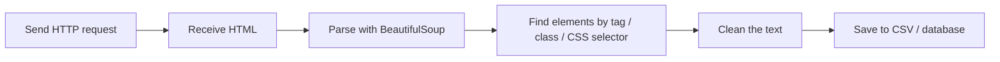

# Session 09: Web Scraping in Python and GUI Programming with Tkinter

> Module: Application Based Programming in Python · Diploma in AI / Data Science · Term 1 · ⏱ ~2 hours

This session covers two practical skills. **Web scraping** collects data from websites automatically, a common way to build datasets for analysis and AI (prices, reviews, news). **Tkinter** builds desktop windows with buttons and text boxes, so non-programmers can use your Python tools. Both turn your scripts into real applications.

## 🎯 Learning Objectives

- Describe web scraping, its uses and the rules for scraping ethically and legally
- Explain the main Python scraping libraries: `requests`, `BeautifulSoup`, and when to use Selenium or Scrapy
- Download a page, parse HTML and extract data into a CSV file
- Describe Tkinter and its purpose
- Explain widgets, their properties and layout managers
- Build simple GUI applications that respond to button clicks

## 📖 Concepts Explained

### Part A: Web scraping

#### 1. What is web scraping?

Web scraping is using a program to **download web pages and extract specific data** from their HTML. Uses: price comparison, collecting reviews for sentiment analysis, job listings, research datasets, news monitoring.



#### 2. Rules of web scraping

| Rule | Why |
|---|---|
| Prefer an official **API** if one exists | stable, legal, structured data |
| Read the site's **Terms of Service** and `robots.txt` (e.g. `site.com/robots.txt`) | shows what is allowed |
| Do not overload the server: add delays (`time.sleep`) | be polite; avoid getting blocked |
| Identify your script with a `User-Agent` | transparency |
| Do not scrape personal data or content behind logins without permission | privacy and law |
| Respect copyright: use data for analysis, do not republish it | legal |

#### 3. Libraries

| Library | Role |
|---|---|
| `requests` | download pages (`requests.get(url)`) |
| `BeautifulSoup` (bs4) | parse HTML and search it |
| `lxml` | a very fast parser, optional |
| Selenium / Playwright | control a real browser for JavaScript-heavy pages |
| Scrapy | a full framework for large crawling projects |

#### 4. BeautifulSoup essentials

| Method | Returns |
|---|---|
| `soup.find("h1")` | first matching element |
| `soup.find_all("div", class_="book")` | list of all matches |
| `soup.select("#timings tr")` | CSS selector, list |
| `soup.select_one("p.price")` | CSS selector, first match |
| `element.text` / `.get_text(strip=True)` | the visible text |
| `element["href"]` | an attribute value |

Use your browser's **Inspect** tool (right-click → Inspect) to discover the tags and classes that hold the data.

### Part B: GUI programming with Tkinter

#### 5. What is Tkinter?

Tkinter is Python's **built-in** library for desktop graphical user interfaces (GUIs). No installation is needed on Windows/macOS. A GUI program is **event-driven**: it waits in `mainloop()` and runs your functions when events happen (clicks, key presses).

#### 6. Widgets and their properties

| Widget | Purpose | Key properties |
|---|---|---|
| `Label` | show text/image | `text`, `font`, `fg`, `bg` |
| `Button` | clickable action | `text`, `command`, `width` |
| `Entry` | one-line text input | `width`, `.get()`, `.insert()`, `.delete()` |
| `Text` | multi-line input | `height`, `width` |
| `Checkbutton` | on/off option | `variable` (BooleanVar) |
| `Radiobutton` | one choice from a group | `variable`, `value` |
| `Listbox` | list of items | `.insert()`, `.curselection()` |
| `Frame` | container to group widgets | `padx`, `pady` |
| `messagebox` | pop-up messages | `showinfo`, `showwarning`, `showerror` |

Change a property later with `widget.config(text="New")`. Special variables (`StringVar`, `IntVar`, `BooleanVar`) link widgets to values.

#### 7. Ways to create and place widgets

Create a widget by passing its **parent** (`tk.Label(window, text="Hi")`), then place it with one layout manager per container:

| Manager | How it places widgets | Best for |
|---|---|---|
| `pack()` | top-to-bottom or side by side | simple stacks |
| `grid(row, column)` | table of rows and columns | forms |
| `place(x, y)` | exact pixel position | rarely, special layouts |

## 💻 Code Examples

> Install scraping libraries with `pip install -r requirements.txt`. Tkinter is included with Python (on Linux: `sudo apt install python3-tk`).

### Example 1: Parse local HTML (`parse_local_html.py`, `sample_page.html`)

```python
soup = BeautifulSoup(html, "html.parser")
for book in soup.find_all("div", class_="book"):
    title = book.find("h2", class_="title").text
```

**How it works:** practising on a local file is fast and needs no internet. The script reads titles, prices, links and a table.

### Example 2: Scrape a practice website (`scrape_books.py`)

```python
response = requests.get(url, headers=HEADERS, timeout=10)
for item in soup.select("article.product_pod"):
    title = item.h3.a["title"]
```

**How it works:** the script downloads books.toscrape.com (a sandbox built for scraping practice), extracts 20 books with title, price and star rating, and saves them to `books.csv`. Errors are handled with `try/except`.

### Example 3: First window (`tk_hello.py`)

```python
hello_button = tk.Button(window, text="Say Hello", command=say_hello)
window.mainloop()
```

**How it works:** `command=say_hello` connects the click event to the function, which updates the label with `config`.

### Example 4: Widgets and grid (`tk_widgets.py`) and calculator (`tk_calculator.py`)

```python
tk.Radiobutton(window, text="Morning", variable=batch_var, value="Morning")
command=lambda s=symbol: calculate(s)
```

**How it works:** the registration form uses Entry, Radiobutton, Checkbutton, Listbox and messagebox in a grid. The calculator reuses one function for four buttons by passing the symbol through a lambda, and handles bad input with `try/except`.

## 🧪 Lab Practice

1. Add the "Details" link of each book to the output of `parse_local_html.py`, as a full URL.
2. Change `scrape_books.py` to also scrape page 2 (`catalogue/page-2.html`) with a one-second delay.
3. Open `https://books.toscrape.com/robots.txt` and any news site's `robots.txt`. What do they allow?
4. Add a "Clear" button to `tk_calculator.py` that empties both boxes.
5. Build a Tkinter temperature converter (Celsius ↔ Fahrenheit) with two radio buttons.

## 📝 Assignment

Combine both skills in `assignment-09/`: a Tkinter app with a **"Fetch Books"** button that scrapes the practice site, shows titles and prices in a `Listbox`, and a **"Save CSV"** button that writes them to a file. Show a `messagebox` if the internet is unavailable.

## ❓ Quick Quiz

1. Which library downloads web pages?
2. Which file tells bots what they may crawl?
3. What does `soup.find_all("a")` return?
4. Which layout manager arranges widgets in rows and columns?
5. What does `window.mainloop()` do?

<details>
<summary>Show answers</summary>

1. `requests`
2. `robots.txt`
3. A list of all `<a>` (link) elements.
4. `grid()`
5. Starts the event loop that keeps the window open and responds to user actions.

</details>

## 💼 Interview Questions

**1. How do you scrape a page whose content is loaded by JavaScript?**

> Look for the underlying API call in the browser's Network tab and request it directly, or use a browser automation tool such as Selenium or Playwright.

**2. Is web scraping legal?**

> It depends on the site's terms, the data and the country's laws. Scraping public data politely for analysis is often acceptable; scraping personal data, bypassing logins or ignoring terms can be illegal.

**3. What is event-driven programming?**

> The program waits for events (clicks, keys, timers) and runs handler functions when they occur, instead of running top to bottom once. GUIs and web servers work this way.

## ✅ Summary

- Web scraping = download HTML with `requests`, parse with BeautifulSoup, save the data.
- Follow the rules: APIs first, `robots.txt`, terms, delays, no personal data.
- Tkinter is Python's built-in GUI toolkit; programs run in an event loop.
- Widgets (Label, Button, Entry, Listbox...) have properties changed with `config`.
- Place widgets with `pack`, `grid` or `place`.

---

[⬅ Previous](../Session-08-Web-Development-Using-Flask/README.md) · [🏠 Module Home](../README.md) · [Next ➡](../Session-10-Practice-Lab-Files-Regex-Flask-Scraping-and-GUI/README.md)

Prepared by Zeeshan Abbas · Aptech Learning North Nazimabad
