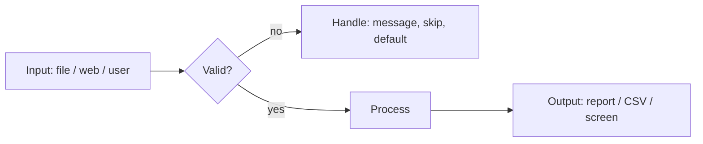

# Session 10: Practice Lab – Files, Regex, Flask, Scraping and GUI

> Module: Application Based Programming in Python · Diploma in AI / Data Science · Term 1 · ⏱ ~2 hours

This lab combines Sessions 06 to 09. Each exercise mixes two or more skills, just like real projects: a **log analyser** (files + regex + exceptions), a **notes web API** (Flask + JSON), a **quote scraper** (scraping + regex + CSV) and a **desktop notes app** (Tkinter + files).

## 🎯 Learning Objectives

- Read and process a real-looking log file with regular expressions
- Build a small JSON API with Flask that stores data in a file
- Scrape a practice website and save structured results to CSV
- Build a Tkinter app that loads and saves data
- Handle errors at every step so programs never crash

## 📖 Concepts Explained

### 1. Skills map for this lab

| Lab | Files | Regex | Exceptions | Flask | Scraping | Tkinter |
|---|---|---|---|---|---|---|
| 1. Log analyser | ✔ | ✔ | ✔ | | | |
| 2. Notes API | ✔ (JSON) | | ✔ | ✔ | | |
| 3. Quote scraper | ✔ (CSV) | ✔ | ✔ | | ✔ | |
| 4. Notes desktop app | ✔ | | ✔ | | | ✔ |

### 2. Log files

Servers write one line per event: date, time, level (`INFO`, `WARN`, `ERROR`) and a message. Analysing logs finds failed logins (security), errors (bugs) and usage patterns. A compiled regex with **groups** splits each line into fields:

`^(\d{4}-\d{2}-\d{2}) (\d{2}:\d{2}:\d{2}) (\w+)\s+(.*)$` → date, time, level, message.

`collections.Counter` counts things quickly: `levels[level] += 1`.

### 3. REST API basics

A **REST API** exposes data over HTTP using URLs and methods:

| Method + URL | Action | Status code |
|---|---|---|
| `GET /notes` | list all notes | 200 OK |
| `POST /notes` with JSON `{"text": "..."}` | create a note | 201 Created / 400 Bad Request |

Flask reads the JSON body with `request.get_json()` and returns `jsonify(data), status`. Test it with the browser (GET), with `curl`, or with tools like Postman:

```bash
curl -X POST -H "Content-Type: application/json" -d "{\"text\": \"Revise regex\"}" http://127.0.0.1:5000/notes
```

### 4. Robust programs



- Files may be missing → `FileNotFoundError`.
- Websites may be down → `requests.RequestException`.
- Users may leave boxes empty → check before saving.
- Lines may not match the pattern → `continue` to skip them.

## 💻 Code Examples

### Lab 1: Log analyser (`lab1_log_analyzer.py`, `server.log`)

```python
match = line_pattern.match(line.strip())
date, time, level, message = match.groups()
failed_logins[email.group(1)] += 1
```

**How it works:** each line is matched; levels, failed logins per user and unique IPs are counted; a summary is written to `log_report.txt`. The `try/except/else` keeps it safe if the log is missing.

### Lab 2: Notes API (`lab2_notes_api.py`)

```python
@app.route("/notes", methods=["POST"])
def add_note():
    data = request.get_json(silent=True) or {}
    ...
    return jsonify(note), 201
```

**How it works:** notes live in `notes.json`, so they survive a server restart. Empty text returns a 400 error with a clear message.

### Lab 3: Quote scraper (`lab3_scrape_quotes.py`)

```python
for q in soup.select("div.quote"):
    text = q.select_one("span.text").get_text(strip=True)
    word_count = len(re.findall(r"\w+", text))
```

**How it works:** the practice site quotes.toscrape.com is scraped; each quote's author, tags and word count (via regex tokenization) are saved to `quotes.csv`.

### Lab 4: Desktop notes app (`lab4_tk_notes_app.py`)

```python
with open(NOTES_FILE, "a", encoding="utf-8") as f:
    f.write(text + "\n")
load_notes()
```

**How it works:** the Add button appends to `notes.txt` and reloads the Listbox; a missing file simply means "no notes yet".

## 🧪 Lab Practice

1. Extend Lab 1 to print the busiest hour of the day (hint: count the first two digits of the time).
2. Add `DELETE /notes/<int:note_id>` to Lab 2 that removes a note, returning 404 if it does not exist.
3. Change Lab 3 to follow the "Next" button and scrape the first 3 pages, with a 1-second delay.
4. Add a "Delete selected" button to Lab 4 that removes the chosen note from the file.
5. Write a small Flask page that displays `quotes.csv` as an HTML table using a template.

## 📝 Assignment

Create `assignment-10/`: a **Job Board Collector**. Scrape any practice listing site (or use a local HTML file you write), use regex to extract salary numbers, save the jobs to JSON, and serve them with a Flask route `/jobs?min_salary=50000` that filters results.

## ❓ Quick Quiz

1. What does `Counter` from `collections` do?
2. Which HTTP status code means "created"?
3. How does Flask read a JSON request body?
4. Why do we `continue` when a log line does not match the pattern?
5. Which exception does `requests` raise for network problems?

<details>
<summary>Show answers</summary>

1. Counts how many times each item occurs.
2. 201
3. `request.get_json()`
4. To skip bad or unexpected lines without stopping the whole program.
5. `requests.RequestException` (and its subclasses such as `ConnectionError`, `Timeout`).

</details>

## 💼 Interview Questions

**1. How would you find suspicious login activity in server logs?**

> Parse each line with regex, count failed logins per user and IP within a time window, and flag those above a threshold.

**2. What is the difference between GET and POST in a REST API?**

> GET retrieves data and should not change anything on the server; POST sends data to create a new resource.

**3. Why store data in a file or database instead of a Python list in a web app?**

> A list is lost when the server restarts and is not shared between multiple server processes; files or databases persist and can be shared.

## ✅ Summary

- Real tasks combine several skills: files, regex, exceptions, web and GUI.
- Compiled regex with groups turns log lines into fields.
- Flask + JSON files make a simple persistent API.
- Scrapers should handle network errors and save structured output.
- Tkinter apps can load and save data with ordinary file handling.

---

[⬅ Previous](../Session-09-Web-Scraping-and-GUI-Programming-with-Tkinter/README.md) · [🏠 Module Home](../README.md) · [Next ➡](../Session-11-Database-Integration-with-Python/README.md)

Prepared by Zeeshan Abbas · Aptech Learning North Nazimabad
