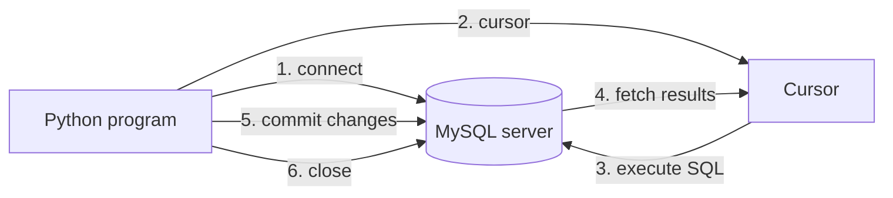

# Session 11: Database Integration with Python

> Module: Application Based Programming in Python · Diploma in AI / Data Science · Term 1 · ⏱ ~2 hours

Files are fine for small data, but real applications store data in a **database**: many users, fast searching, safe updates. In this session you will connect Python to **MySQL**, create a database from the MySQL command line, run CRUD operations (Create, Read, Update, Delete) safely from Python and build a Tkinter form that manages records. You already know SQL from Module 01; now Python will send that SQL for you.

## 🎯 Learning Objectives

- Explain database connectivity in Python and the DB-API pattern (connection, cursor, execute, commit)
- Install MySQL and the `mysql-connector-python` driver and connect to a server
- Create a database, a table and a user from the MySQL command-line interface
- Insert, read, update and delete records from Python with parameterised queries
- Design a Tkinter application that inserts, updates and deletes database records
- Practise the same steps with SQLite when no server is available

## 📖 Concepts Explained

### 1. Database connectivity

Python talks to a database through a **driver** (connector). Almost all Python drivers follow the same standard (**DB-API 2.0**), so the steps look the same for MySQL, SQLite, PostgreSQL or SQL Server.



| Object / method | Role |
|---|---|
| `mysql.connector.connect(...)` | opens a **connection** (host, user, password, database) |
| `conn.cursor()` | creates a **cursor** that runs SQL and holds results |
| `cursor.execute(sql, values)` | runs one statement |
| `cursor.executemany(sql, list)` | runs it for many rows |
| `fetchone()` / `fetchall()` | read one / all result rows |
| `conn.commit()` | saves INSERT/UPDATE/DELETE changes |
| `conn.rollback()` | undoes uncommitted changes |
| `cursor.rowcount`, `cursor.lastrowid` | rows affected / new auto-increment ID |
| `conn.close()` | frees the connection |

### 2. Steps to connect Python with MySQL

1. Install **MySQL Community Server** (and MySQL Workbench if you want a GUI).
2. Install the driver: `pip install mysql-connector-python`.
3. Create the database and a user (next section).
4. Put connection settings in `db_config.py` (better: environment variables).
5. Run `connect_test.py` to confirm the connection.

### 3. Creating a database and table with the MySQL CLI

```bash
mysql -u root -p          # log in (enter the root password)
```

```sql
CREATE DATABASE campus_db;
USE campus_db;
CREATE TABLE students (id INT AUTO_INCREMENT PRIMARY KEY, name VARCHAR(50) NOT NULL, city VARCHAR(30), marks INT);
SHOW TABLES;
DESCRIBE students;
```

The file [`create_db.sql`](./create_db.sql) does all of this plus sample rows and an app user. Run it with `SOURCE create_db.sql;` inside the client. Using a separate user with limited rights (`campus_app`) is safer than connecting as `root`.

### 4. Parameterised queries (preventing SQL injection)

Never build SQL by joining strings with user input:

```python
# DANGEROUS
cursor.execute("DELETE FROM students WHERE name = '" + name + "'")
# SAFE
cursor.execute("DELETE FROM students WHERE name = %s", (name,))
```

With placeholders the driver sends values separately, so input like `x' OR '1'='1` cannot change your SQL. MySQL uses `%s`; SQLite uses `?`. Note `(name,)` – a one-item tuple needs a trailing comma.

### 5. Designing a CRUD application with Tkinter

| Button | SQL | After it runs |
|---|---|---|
| Insert | `INSERT INTO students (...) VALUES (%s, %s, %s)` | refresh the list |
| Update | `UPDATE students SET ... WHERE id = %s` | show rows updated |
| Delete | `DELETE FROM students WHERE id = %s` | confirm first with `askyesno` |
| (on start) | `SELECT ... ORDER BY id` | fill the Listbox |

Good design: one helper function runs SQL, validation happens before any query, and database errors are shown in a `messagebox` instead of crashing.

### 6. SQLite: a database in a file

SQLite comes with Python (`import sqlite3`), needs no server and stores everything in one file. It is perfect for practice, small apps and mobile apps. `sqlite_crud_demo.py` repeats the CRUD steps with SQLite so you can practise anywhere.

## 💻 Code Examples

### Example 1: Test the connection (`connect_test.py`)

```python
connection = mysql.connector.connect(**DB_CONFIG)
cursor = connection.cursor()
cursor.execute("SELECT DATABASE()")
```

**How it works:** `**DB_CONFIG` unpacks the settings dictionary into keyword arguments. `try/except/finally` reports errors and always closes the connection.

### Example 2: CRUD functions (`crud_mysql.py`)

```python
sql = "INSERT INTO students (name, city, marks) VALUES (%s, %s, %s)"
cursor.execute(sql, (name, city, marks))
conn.commit()
cursor = conn.cursor(dictionary=True)
```

**How it works:** each operation is a small function. `commit()` saves changes; `dictionary=True` returns rows like `{'id': 1, 'name': 'Ali', ...}`.

### Example 3: SQLite version (`sqlite_crud_demo.py`)

```python
conn = sqlite3.connect("campus.db")
cursor.executemany("INSERT INTO students (name, city, marks) VALUES (?, ?, ?)", rows)
```

**How it works:** identical steps, built into Python. Run it now: `python sqlite_crud_demo.py`.

### Example 4: Tkinter + MySQL (`tk_student_manager.py`)

```python
run_sql("UPDATE students SET name=%s, city=%s, marks=%s WHERE id=%s", (name, city, int(marks), int(sid)))
```

**How it works:** the form reads the entries, validates them, calls `run_sql` and refreshes the Listbox. Delete asks for confirmation.

## 🧪 Lab Practice

1. Install MySQL, run `create_db.sql`, then run `connect_test.py`.
2. Add a function `search_by_city(city)` to `crud_mysql.py` using a placeholder.
3. Add a `courses` table and an `enrollments` table, then write a JOIN query from Python.
4. In `sqlite_crud_demo.py`, print the average marks using `SELECT AVG(marks)`.
5. Add a "Search" button to `tk_student_manager.py` that shows only students whose name contains the typed text (`LIKE %s` with `f"%{text}%"`).

## 📝 Assignment

Build `assignment-11/`: a **Library Book Manager** with Tkinter and MySQL (or SQLite). Table `books(id, title, author, copies)`. Provide Insert, Update copies, Delete and "Show available" (copies > 0) features, with input validation and error messages.

## ❓ Quick Quiz

1. Which method saves INSERT/UPDATE/DELETE changes?
2. What placeholder does MySQL Connector use?
3. Why use parameterised queries?
4. Which method returns all rows of a result?
5. Which database is built into Python and needs no server?

<details>
<summary>Show answers</summary>

1. `connection.commit()`
2. `%s`
3. To prevent SQL injection and handle quoting/data types correctly.
4. `cursor.fetchall()`
5. SQLite (`sqlite3`)

</details>

## 💼 Interview Questions

**1. What is SQL injection and how do you prevent it in Python?**

> An attack where user input changes the meaning of a SQL query. Prevent it with parameterised queries (placeholders), never string concatenation, plus least-privilege database users.

**2. What happens if you forget `commit()`?**

> Changes stay in the current transaction and are lost (rolled back) when the connection closes, so other users never see them.

**3. Why should an application not connect as the database root user?**

> If the app is compromised, the attacker gets full control of the server. A limited user with only the needed permissions reduces the damage.

## ✅ Summary

- DB-API steps: connect → cursor → execute → fetch / commit → close.
- Create databases, tables and users in the MySQL CLI.
- Always use placeholders (`%s` in MySQL, `?` in SQLite).
- Tkinter forms can drive full CRUD operations with validation.
- SQLite is a zero-setup alternative for practice and small apps.

---

[⬅ Previous](../Session-10-Practice-Lab-Files-Regex-Flask-Scraping-and-GUI/README.md) · [🏠 Module Home](../README.md) · [Next ➡](../Session-12-Data-Handling-Using-Pandas/README.md)

Prepared by Zeeshan Abbas · Aptech Learning North Nazimabad
