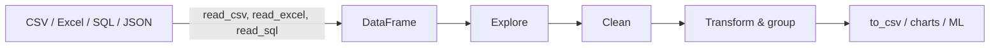

# Session 12: Data Handling Using Pandas

> Module: Application Based Programming in Python · Diploma in AI / Data Science · Term 1 · ⏱ ~2 hours

**pandas** is the most important library for a data scientist. It loads data from CSV, Excel, SQL and JSON, and lets you clean, filter, combine and summarise it with a few readable lines. Think of pandas as "Excel inside Python", but faster, repeatable and able to handle millions of rows. Everything you build later (charts, machine learning) starts with a pandas DataFrame.

## 🎯 Learning Objectives

- Describe the purpose of pandas and where it fits in the data science workflow
- Explain the two pandas data structures: Series and DataFrame
- Load data from a CSV file and explore it (`head`, `shape`, `dtypes`, `describe`)
- Select data with column names, `loc` and `iloc`
- Manipulate data: handle missing values, add columns, filter, sort, group, merge and save
- Process text columns with `.str` functions

## 📖 Concepts Explained

### 1. Purpose of pandas

| Task | Without pandas | With pandas |
|---|---|---|
| Read a CSV | `csv` module + loops | `pd.read_csv("file.csv")` |
| Average of a column | loop and divide | `df["marks"].mean()` |
| Group totals | dictionaries and loops | `df.groupby("city")["total"].sum()` |
| Join two tables | nested loops | `df1.merge(df2, on="id")` |

Install with `pip install pandas` and import with the standard alias: `import pandas as pd`.

### 2. The two data structures

| Structure | Dimensions | Analogy | Create |
|---|---|---|---|
| **Series** | 1-D (one column) with an **index** | a single Excel column with row labels | `pd.Series([78, 91], index=["Ali", "Sara"])` |
| **DataFrame** | 2-D (rows × columns) | a whole Excel sheet / SQL table | `pd.DataFrame({"name": [...], "marks": [...]})` |

Each DataFrame column is a Series. Both support **vectorised** operations: `marks + 5` adds 5 to every value without a loop.



### 3. Exploring data

| Command | Shows |
|---|---|
| `df.head(n)` / `df.tail(n)` | first / last rows |
| `df.shape` | (rows, columns) |
| `df.dtypes` / `df.info()` | column types and non-null counts |
| `df.describe()` | count, mean, std, min, quartiles, max |
| `df["col"].value_counts()` | frequency of each value |
| `df.isna().sum()` | missing values per column |

### 4. Selecting data

| Need | Code |
|---|---|
| one column (Series) | `df["city"]` |
| several columns | `df[["city", "total"]]` |
| rows by position | `df.iloc[0]`, `df.iloc[0:3]` |
| rows/columns by label | `df.loc[0:2, ["product", "total"]]` |
| rows by condition | `df[df["city"] == "Karachi"]` |
| several conditions | `df[(cond1) & (cond2)]`, use `\|` for OR, brackets required |

### 5. Commonly used manipulation functions

| Function | Purpose |
|---|---|
| `fillna(value)`, `dropna()` | handle missing values |
| `astype(int)` | change type |
| `df["new"] = df["a"] * df["b"]` | calculated column |
| `sort_values("col", ascending=False)` | sort |
| `groupby("col").agg(...)` | summarise per group (sum, mean, count) |
| `merge(other, on="key", how="left")` | join tables like SQL |
| `drop(columns=[...])`, `rename(columns={...})` | remove / rename columns |
| `drop_duplicates()` | remove repeated rows |
| `apply(function)` | apply your own function to each value |
| `to_csv("file.csv", index=False)` | save the result |

### 6. Text processing functions

Text columns have a `.str` accessor with vectorised string methods:

| Method | Example result |
|---|---|
| `.str.strip()` | removes leading/trailing spaces |
| `.str.lower()`, `.str.upper()`, `.str.title()` | change case |
| `.str.contains("board", case=False)` | True/False for filtering |
| `.str.replace("old", "new")` | replace text |
| `.str.split(" ", n=1, expand=True)` | split into columns |
| `.str.len()` | length of each string |
| `.str.startswith("A")` | True/False |

Real data is messy: " ali RAZA " and "Ali Raza" are the same customer only after cleaning.

## 💻 Code Examples

All scripts read [`sales.csv`](./sales.csv) (10 orders with a missing quantity and messy customer names). Run them from this folder.

### Example 1: Series (`series_basics.py`)

```python
marks = pd.Series([78, 91, 64, 85], index=["Ali", "Sara", "Bilal", "Hina"])
print(marks[marks > 80])
print(marks.idxmax())
```

**How it works:** labels make lookup easy (`marks["Sara"]`); conditions filter values; `idxmax` returns the label of the highest value.

### Example 2: DataFrame basics (`dataframe_basics.py`)

```python
sales = pd.read_csv("sales.csv")
print(sales.shape, sales.dtypes)
print(sales.loc[0:2, ["order_id", "product"]])
```

**How it works:** the file is loaded into a table, explored and sliced with `iloc` (positions) and `loc` (labels).

### Example 3: Manipulation (`data_manipulation.py`)

```python
sales["quantity"] = sales["quantity"].fillna(1)
sales["total"] = sales["quantity"] * sales["unit_price"]
sales.groupby("city")["total"].sum()
sales.merge(regions, on="city", how="left")
```

**How it works:** the script fills the missing quantity, adds a `total` column, filters, sorts, groups revenue by city and category, joins a province table and saves `sales_clean.csv`.

### Example 4: Text processing (`text_processing.py`)

```python
sales["customer"] = sales["customer"].str.strip().str.title()
sales[["first_name", "last_name"]] = sales["customer"].str.split(" ", n=1, expand=True)
```

**How it works:** names are cleaned so that repeat customers (Ali Raza, Sara Khan) are counted correctly by `value_counts`.

## 🧪 Lab Practice

1. Create a Series of 7 daily temperatures with day names as the index. Print the hottest day.
2. Load `sales.csv` and show only Lahore orders sorted by unit price.
3. Add a column `discount` = 5% of total for Electronics and 0 otherwise (hint: `apply` with a lambda, or `numpy.where`).
4. Find the average unit price per product with `groupby`.
5. Clean the `customer` column and count how many unique customers there are.

## 📝 Assignment

Download any small public CSV dataset (for example, from data.gov or Kaggle) or create one with 30 rows. In `assignment-12.py`: load it, report missing values, fix them, add one calculated column, produce two `groupby` summaries, clean one text column and save the cleaned file.

## ❓ Quick Quiz

1. What are the two main data structures in pandas?
2. What is the difference between `loc` and `iloc`?
3. How do you count missing values in each column?
4. Why do we need brackets in `df[(a > 1) & (b < 5)]`?
5. Which accessor gives string functions for a column?

<details>
<summary>Show answers</summary>

1. Series (1-D) and DataFrame (2-D)
2. `loc` selects by labels; `iloc` selects by integer positions.
3. `df.isna().sum()`
4. `&` has higher precedence than comparison operators, so each condition must be in brackets.
5. `.str`

</details>

## 💼 Interview Questions

**1. How do you handle missing values in pandas?**

> Detect with `isna()`, then drop rows/columns (`dropna`) or fill them (`fillna`) with a constant, the mean/median, or forward-fill, depending on the meaning of the data.

**2. What is the difference between `merge` and `concat`?**

> `merge` joins tables side by side on key columns (like SQL JOIN); `concat` stacks DataFrames on top of each other or side by side by position/index.

**3. What does `groupby` do?**

> It splits data into groups by one or more columns, applies a function (sum, mean, count) to each group and combines the results: split-apply-combine.

## ✅ Summary

- pandas loads, cleans and analyses tabular data in a few lines.
- A Series is one labelled column; a DataFrame is a table of Series.
- Explore with `head`, `shape`, `dtypes`, `describe` and `isna().sum()`.
- Select with `[]`, `loc`, `iloc` and boolean conditions.
- Manipulate with `fillna`, new columns, `sort_values`, `groupby`, `merge`, and clean text with `.str`.

---

[⬅ Previous](../Session-11-Database-Integration-with-Python/README.md) · [🏠 Module Home](../README.md) · [Next ➡](../Session-13-Practice-Lab-Databases-and-Pandas/README.md)

Prepared by Zeeshan Abbas · Aptech Learning North Nazimabad
