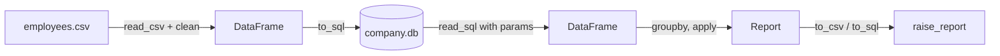

# Session 13: Practice Lab – Databases and Pandas

> Module: Application Based Programming in Python · Diploma in AI / Data Science · Term 1 · ⏱ ~2 hours

This lab joins Session 11 (databases) and Session 12 (pandas). In real jobs data usually lives in a database, and analysts pull it into pandas, analyse it and sometimes write results back. You will work with an HR dataset, [`employees.csv`](./employees.csv), move it into a database, query it with SQL and pandas, and produce a salary-raise report.

## 🎯 Learning Objectives

- Load a CSV into a database table with `DataFrame.to_sql`
- Query a database with a cursor and with `pd.read_sql`, using parameters
- Clean and enrich data with pandas (text, missing values, dates, bins)
- Summarise data with `groupby`, `value_counts` and `pivot_table`
- Apply a business rule with `apply` and save results to CSV and a database

## 📖 Concepts Explained

### 1. Database ↔ pandas round trip



| Function | Direction | Notes |
|---|---|---|
| `df.to_sql("table", conn, if_exists="replace", index=False)` | pandas → DB | `"append"` adds rows, `"fail"` stops if table exists |
| `pd.read_sql(query, conn, params=(...))` | DB → pandas | returns a DataFrame |
| `cursor.execute(...)` + `fetchall()` | DB → Python lists | good for simple counts and inserts |

We use **SQLite** so the lab runs anywhere. With MySQL you would create the connection with `mysql.connector.connect(...)` (or a SQLAlchemy engine) and use `%s` placeholders; the pandas calls stay the same.

### 2. Useful pandas tools in this lab

| Tool | What it does | Example |
|---|---|---|
| `parse_dates=["join_date"]` | reads text as dates | then `df["join_date"].dt.year` |
| `fillna(df["rating"].mean())` | fills missing with the average | |
| `pd.cut(values, bins, labels)` | puts numbers into ranges | Junior / Mid / Senior |
| `groupby(...)["col"].idxmax()` | row label of the max in each group | top performer per department |
| `pd.pivot_table(...)` | 2-D summary like an Excel pivot | department × city |
| `apply(function)` | runs your function on each value | raise percentage |
| `to_string(index=False)` | prints a table without the index | |

### 3. Business rules as functions

Write rules as small functions, then apply them. Here: rating ≥ 4.5 → 15% raise, ≥ 4.0 → 10%, else 5%. Keeping the rule in one function makes it easy to test and change when management changes its mind.

### 4. Checking your work

- Compare row counts before and after each step.
- Print a few rows after every change (`head()`).
- Re-calculate one value by hand (e.g. one employee's new salary).

## 💻 Code Examples

Run in order from this folder: lab 1 creates `company.db`, which lab 3 also uses.

### Lab 1: CSV → database → DataFrame (`lab1_csv_to_database.py`)

```python
df.to_sql("employees", conn, if_exists="replace", index=False)
high_paid = pd.read_sql(query, conn, params=(150000,))
```

**How it works:** the cleaned CSV becomes a table; a cursor counts staff per department; `read_sql` with a `?` parameter returns high earners as a DataFrame; a new employee is inserted safely.

### Lab 2: Analysis (`lab2_employee_analysis.py`)

```python
df["salary_band"] = pd.cut(df["salary"], bins=[0, 100000, 160000, 1000000], labels=["Junior", "Mid", "Senior"])
best = df.loc[df.groupby("department")["rating"].idxmax()]
pd.pivot_table(df, values="salary", index="department", columns="city", aggfunc="mean")
```

**How it works:** missing ratings are filled, service years and salary bands are added, and three summaries answer typical HR questions.

### Lab 3: Raise report (`lab3_raise_report.py`)

```python
df["raise_pct"] = df["rating"].apply(raise_percent)
report.to_sql("raise_report", conn, if_exists="replace", index=False)
```

**How it works:** the rule function is applied to each rating, new salaries are calculated, the total extra cost is printed, and the report is saved to both CSV and the database.

## 🧪 Lab Practice

1. In Lab 1, write a query (with a parameter) that lists employees of one city chosen by the user.
2. Use `pd.read_sql` to compute the average salary per city directly in SQL (`GROUP BY`), and compare with pandas `groupby`.
3. In Lab 2, find the department with the longest average years of service.
4. In Lab 3, add a rule: employees with fewer than 2 years of service get at most a 5% raise.
5. Write the HR department's rows only to a new table `hr_staff` using `to_sql`.

## 📝 Assignment

Create `assignment-13.py` for a **school results database**: build a `results` table (student, subject, marks) from a CSV of at least 30 rows, query it with `read_sql`, calculate each student's percentage and grade with pandas, and store a `report_cards` table back in the database.

## ❓ Quick Quiz

1. Which method saves a DataFrame as a database table?
2. What does `if_exists="append"` do?
3. Which function runs a SQL query and returns a DataFrame?
4. What does `pd.cut` do?
5. Why pass values through `params` instead of building the SQL string?

<details>
<summary>Show answers</summary>

1. `DataFrame.to_sql`
2. Adds the rows to the existing table instead of replacing it.
3. `pd.read_sql`
4. Groups numeric values into labelled ranges (bins).
5. To prevent SQL injection and handle data types correctly.

</details>

## 💼 Interview Questions

**1. When would you do aggregation in SQL instead of pandas?**

> When the data is large: letting the database filter and aggregate sends far fewer rows to Python. Use pandas for complex transformations on manageable data.

**2. How do you find the top record within each group in pandas?**

> Use `df.loc[df.groupby("group")["value"].idxmax()]`, or sort and use `groupby().head(1)`.

**3. What is a pivot table?**

> A summary that turns unique values of one column into rows and another into columns, filling cells with an aggregate (mean, sum) of a value column.

## ✅ Summary

- `to_sql` and `read_sql` move data between pandas and databases.
- Use parameters in SQL queries from Python.
- `pd.cut`, `.dt`, `fillna`, `apply` and `pivot_table` enrich and summarise data.
- Express business rules as functions and apply them to columns.
- Save results where others can use them: CSV files or database tables.

---

[⬅ Previous](../Session-12-Data-Handling-Using-Pandas/README.md) · [🏠 Module Home](../README.md) · [Next ➡](../Session-14-Data-Visualization-in-Python/README.md)

Prepared by Zeeshan Abbas · Aptech Learning North Nazimabad
