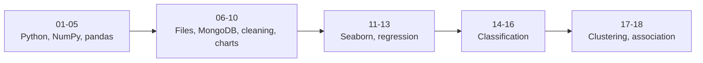

# Module 05: Data Science with Python

      

> Diploma in AI · Term 1 · 18 sessions × 2 hours · [⬅ Term Home](../README.md)

This module turns your Python skills into **data science skills**. You will store and crunch numbers with NumPy, shape tables with pandas, bring in data from CSV, Excel, JSON, PDF and MongoDB, clean it, draw clear charts with Matplotlib and Seaborn, and finally build your first machine learning models: regression, classification, clustering and association rules with scikit-learn. Every idea comes with small, commented `.py` files you can run on your own computer.

## 🎯 What You Will Learn

- Explain types of data, the data science workflow and the role of a data scientist
- Work with NumPy arrays and pandas Series/DataFrames (including `loc`/`iloc` and `groupby`)
- Read and write CSV, text, Excel, JSON, PDF and pickle files, and query MongoDB with PyMongo
- Clean data: missing values, duplicates, wrong types, scaling, date parsing and character encoding
- Choose and draw the right chart with Matplotlib and Seaborn
- Fit non-linear (polynomial, exponential, logistic-curve) regression models
- Build and evaluate classifiers: KNN, SVM, Naive Bayes, Decision Tree, Random Forest
- Group data with k-means and hierarchical clustering, and find patterns with the Apriori algorithm

## 📋 Prerequisites

- Python basics: variables, lists, dictionaries, loops, functions (Module 04: Application Based Programming in Python)
- Basic statistics: mean, median, standard deviation (Module 03: Inferential Statistical Analysis)
- For Session 06: a running MongoDB (Module 02: Managing Large Datasets using MongoDB)

## 🛠 Tools to Install

| Tool | Why you need it | Official link |
|---|---|---|
| Python 3.12 | runs every example | [https://www.python.org/downloads/](https://www.python.org/downloads/) |
| Anaconda (optional, recommended) | Python + Jupyter + most libraries in one installer | [https://www.anaconda.com/download](https://www.anaconda.com/download) |
| JupyterLab | notebook-style coding | [https://jupyter.org/install](https://jupyter.org/install) |
| Google Colab (no install) | notebooks in the browser | [https://colab.research.google.com/](https://colab.research.google.com/) |
| VS Code + Python extension | code editor | [https://code.visualstudio.com/docs/languages/python](https://code.visualstudio.com/docs/languages/python) |
| MongoDB Community Server | database for Session 06 | [https://www.mongodb.com/try/download/community](https://www.mongodb.com/try/download/community) |

Install all Python libraries used in this module with one command:

```bash
pip install numpy pandas matplotlib seaborn scikit-learn openpyxl pypdf pymongo
```

> ▶ **How to run the examples:** open a terminal **inside the session folder** (so data files are found) and run `python file_name.py`. Charts are saved as `.png` files in the same folder instead of popping up a window, so the scripts work everywhere, including servers and Colab.

## 📚 Session Index

| Session | Topic | Link |
|---|---|---|
| 01 | Introduction to Data Science with Python | [Open notes](./Session-01-Introduction-to-Data-Science-with-Python/README.md) |
| 02 | NumPy Library | [Open notes](./Session-02-NumPy-Library/README.md) |
| 03 | Pandas Series and DataFrames | [Open notes](./Session-03-Pandas-Series-and-DataFrames/README.md) |
| 04 | Advanced Pandas: CSV, Exploration and GroupBy | [Open notes](./Session-04-Advanced-Pandas-CSV-Exploration-GroupBy/README.md) |
| 05 | Practice Lab: Python, NumPy and Pandas | [Open notes](./Session-05-Practice-Lab-Python-NumPy-Pandas/README.md) |
| 06 | Data Visualization Basics and MongoDB with PyMongo | [Open notes](./Session-06-Data-Visualization-and-MongoDB-with-PyMongo/README.md) |
| 07 | Handling Different File Formats | [Open notes](./Session-07-Handling-Different-File-Formats/README.md) |
| 08 | Cleaning Imported Data | [Open notes](./Session-08-Cleaning-Imported-Data/README.md) |
| 09 | Data Visualization with Matplotlib | [Open notes](./Session-09-Data-Visualization-with-Matplotlib/README.md) |
| 10 | Practice Lab: Files, Cleaning and Charts | [Open notes](./Session-10-Practice-Lab-Files-Cleaning-and-Charts/README.md) |
| 11 | Data Visualization with Seaborn | [Open notes](./Session-11-Data-Visualization-with-Seaborn/README.md) |
| 12 | Non-Linear Regression | [Open notes](./Session-12-Non-Linear-Regression/README.md) |
| 13 | Practice Lab: Seaborn and Regression | [Open notes](./Session-13-Practice-Lab-Seaborn-and-Regression/README.md) |
| 14 | Classification I: KNN and SVM | [Open notes](./Session-14-Classification-KNN-and-SVM/README.md) |
| 15 | Classification II and Evaluating Classifiers | [Open notes](./Session-15-Classification-II-and-Model-Evaluation/README.md) |
| 16 | Practice Lab: Classification | [Open notes](./Session-16-Practice-Lab-Classification/README.md) |
| 17 | Clustering and Association Rules | [Open notes](./Session-17-Clustering-and-Association-Rules/README.md) |
| 18 | Practice Lab: Clustering and Association | [Open notes](./Session-18-Practice-Lab-Clustering-and-Association/README.md) |



## 🚀 Module Mini-Project

**Student Performance Analyzer** - an end-to-end data science project:

1. Create or collect a CSV of at least 200 students: gender, city, attendance %, study hours per day, previous term %, internet at home (yes/no), final result (pass/fail) and final marks.
2. Load it with pandas, run the exploration checklist and clean it (missing values, duplicates, wrong types).
3. Draw at least five saved charts: distribution of marks, attendance vs marks, result count by city, correlation heatmap, box plot of marks by gender.
4. Fit a polynomial regression to predict final marks from study hours and report R².
5. Train two classifiers (e.g. Decision Tree and Random Forest) to predict pass/fail; compare accuracy, precision, recall and the confusion matrix.
6. Use k-means to group students into 3 learning profiles and describe each group in plain words.
7. Submit your `.py` files, the cleaned CSV, the `.png` charts and a README with findings and recommendations for teachers.

## 🔗 Resources (official documentation)

- [NumPy user guide](https://numpy.org/doc/stable/user/)
- [pandas user guide](https://pandas.pydata.org/docs/user_guide/index.html)
- [Matplotlib tutorials](https://matplotlib.org/stable/tutorials/index.html)
- [Seaborn tutorial](https://seaborn.pydata.org/tutorial.html)
- [scikit-learn user guide](https://scikit-learn.org/stable/user_guide.html)
- [PyMongo documentation](https://pymongo.readthedocs.io/)
- [Python `json`](https://docs.python.org/3/library/json.html) and [`pickle`](https://docs.python.org/3/library/pickle.html) modules

---

[⬅ Term Home](../README.md)

Prepared by Zeeshan Abbas · Aptech Learning North Nazimabad
