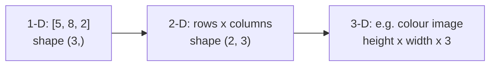

# Session 02: NumPy Library

> Module: Data Science with Python · Diploma in AI · Term 1 · ⏱ ~2 hours

Python lists are flexible but slow when you have millions of numbers. **NumPy** (Numerical Python) gives you the **array**: a fast, compact grid of numbers that lets you do maths on all items at once. pandas, Matplotlib and scikit-learn are all built on top of NumPy, so this session is the foundation for everything that follows.

## 🎯 Learning Objectives

- Create 1-D and 2-D NumPy arrays and read their shape, size and data type
- Explain why NumPy arrays are preferred over Python lists for numeric work
- Index, slice and filter arrays using conditions
- Use built-in functions such as `mean`, `median`, `std`, `argmax`, `sort` and `reshape`
- Apply NumPy to a real use case: a class result sheet

## 📖 Concepts Explained

### 1. What is a NumPy array?

An **ndarray** (n-dimensional array) is a container where **every item has the same data type** and items sit next to each other in memory. That is the secret of its speed.

| Term | Meaning | Example |
|---|---|---|
| `ndim` | number of dimensions | 1 for a row of numbers, 2 for a table |
| `shape` | size of each dimension | `(3, 4)` = 3 rows, 4 columns |
| `size` | total number of items | 12 |
| `dtype` | data type of the items | `int64`, `float64`, `bool` |



> **Analogy:** A Python list is a bag where you can throw anything: a number, a name, another bag. A NumPy array is an egg tray: every slot holds the same thing, so it is easy to process the whole tray in one go.

### 2. NumPy array vs Python list

| Feature | Python list | NumPy array |
|---|---|---|
| Item types | can be mixed | all the same type |
| Maths on all items | needs a loop | one expression (`arr * 2`) |
| Speed | slower | 10-100x faster for big data |
| Memory | more | less |
| `*` operator | repeats the list | multiplies each value |
| Built-in statistics | few (`sum`, `max`) | many (`mean`, `std`, `median`, ...) |

Doing an operation on every item without writing a loop is called **vectorisation**. It makes code shorter *and* faster.

### 3. Creating arrays

| Function | Result |
|---|---|
| `np.array([1, 2, 3])` | from a list |
| `np.zeros(4)` / `np.ones(3)` | filled with 0s / 1s |
| `np.arange(0, 10, 2)` | `[0 2 4 6 8]` like `range` |
| `np.linspace(0, 1, 5)` | 5 evenly spaced values from 0 to 1 |
| `rng.integers(1, 7, size=10)` | random whole numbers |

### 4. Indexing, slicing and filtering

- `arr[0]` first item, `arr[-1]` last item, `arr[1:4]` items 1 to 3.
- In 2-D use `arr[row, column]`. `arr[:, 0]` means "all rows, column 0".
- A condition like `arr > 50` creates a **boolean mask** (`True/False` per item). `arr[arr > 50]` keeps only the `True` items.

### 5. The `axis` idea

For a 2-D array, `axis=0` works **down the columns** (one answer per column) and `axis=1` works **across the rows** (one answer per row).

| Call on a 3x4 marks table | Gives |
|---|---|
| `marks.sum(axis=1)` | total of each student (3 values) |
| `marks.mean(axis=0)` | average of each subject (4 values) |

### 6. Real-world uses of NumPy

- Image processing: a photo is just a 3-D array of pixel values.
- Finance: daily returns and risk of stock prices.
- Sensors and IoT: averaging thousands of temperature readings per second.
- Machine learning: models receive their inputs as NumPy arrays.

## 💻 Code Examples

### Example 1: Creating arrays

📄 File: [`numpy_basics.py`](./numpy_basics.py)

```python
# numpy_basics.py
# Creating NumPy arrays and looking at their properties.

import numpy as np   # "np" is the short name everyone uses

# 1) Create an array from a Python list
marks = np.array([78, 85, 62, 90, 71])
print("Array:", marks)
print("Type:", type(marks))
print("Data type of items:", marks.dtype)   # int64 = whole numbers
print("Shape:", marks.shape)                # (5,) -> 5 items, 1 dimension
print("Dimensions:", marks.ndim)

# 2) A 2-D array (rows x columns): 3 students, 4 subjects
scores = np.array([
    [78, 85, 62, 90],
    [55, 67, 80, 72],
    [88, 91, 79, 95],
])
print("\n2-D array:\n", scores)
print("Shape:", scores.shape)               # (3, 4) -> 3 rows, 4 columns
print("Total items:", scores.size)

# 3) Ready-made arrays
print("\nZeros:", np.zeros(4))
print("Ones:", np.ones(3))
print("Range 0..9 step 2:", np.arange(0, 10, 2))
print("5 evenly spaced numbers 0..1:", np.linspace(0, 1, 5))

# 4) Indexing and slicing (same idea as lists)
print("\nFirst mark:", marks[0])
print("Last mark:", marks[-1])
print("First three marks:", marks[:3])
print("Student 2, subject 3:", scores[1, 2])   # row 1, column 2 (counting from 0)
print("All marks of subject 1:", scores[:, 0])  # every row, column 0
```

**How it works:** `np.array()` turns a list into an array. `shape`, `ndim`, `size` and `dtype` describe it. `scores[1, 2]` reads row 1, column 2, and `scores[:, 0]` takes a full column.

### Example 2: Array vs list

📄 File: [`numpy_vs_list.py`](./numpy_vs_list.py)

```python
# numpy_vs_list.py
# Why use a NumPy array instead of a normal Python list?

import time
import numpy as np

prices_list = [100, 250, 80]
prices_array = np.array([100, 250, 80])

# 1) Maths on every item
# With a list you need a loop:
with_tax_list = [p * 1.18 for p in prices_list]
print("List + 18% tax :", with_tax_list)
# With NumPy you write the maths once (this is called vectorisation):
print("Array + 18% tax:", prices_array * 1.18)

# 2) Be careful: "*" means different things!
print("\nList * 2 :", prices_list * 2)    # repeats the list
print("Array * 2:", prices_array * 2)     # doubles every value

# 3) Speed test on one million numbers
numbers_list = list(range(1_000_000))
numbers_array = np.arange(1_000_000)

start = time.time()
squares_list = [n * n for n in numbers_list]
list_time = time.time() - start

start = time.time()
squares_array = numbers_array * numbers_array
array_time = time.time() - start

print(f"\nList time : {list_time:.4f} seconds")
print(f"Array time: {array_time:.4f} seconds")
print("NumPy is roughly", round(list_time / max(array_time, 1e-6)), "times faster here")
```

**How it works:** multiplying an array applies the maths to each item, while multiplying a list repeats it. The timing test squares one million numbers both ways so you can see the speed difference on your own PC.

### Example 3: Built-in functions

📄 File: [`numpy_functions.py`](./numpy_functions.py)

```python
# numpy_functions.py
# Useful built-in NumPy functions for quick analysis.

import numpy as np

temps = np.array([31, 34, 29, 36, 38, 33, 30])   # one week of temperatures in Karachi

# 1) Summary statistics
print("Mean (average):", temps.mean())
print("Median:", np.median(temps))
print("Minimum:", temps.min(), " Maximum:", temps.max())
print("Standard deviation:", round(temps.std(), 2))
print("Sum:", temps.sum())

# 2) Position of the min and max values
print("Hottest day index:", temps.argmax())
print("Coolest day index:", temps.argmin())

# 3) Filtering with a condition (boolean mask)
hot_days = temps > 33          # gives True/False for each day
print("\nIs it hot?", hot_days)
print("Hot temperatures:", temps[hot_days])
print("How many hot days:", hot_days.sum())   # True counts as 1

# 4) Sorting and rounding
print("\nSorted:", np.sort(temps))
print("Square root:", np.round(np.sqrt(temps), 2))

# 5) Reshape: 6 numbers into 2 rows x 3 columns
numbers = np.arange(1, 7)
table = numbers.reshape(2, 3)
print("\nReshaped:\n", table)
print("Column sums:", table.sum(axis=0))  # axis=0 -> down the columns
print("Row sums:", table.sum(axis=1))     # axis=1 -> across the rows

# 6) Random numbers (seed makes results repeatable)
rng = np.random.default_rng(seed=42)
dice = rng.integers(1, 7, size=10)   # 10 dice rolls (1 to 6)
print("\nDice rolls:", dice)
```

**How it works:** statistics methods summarise the array in one call. `temps > 33` builds a mask and `temps[mask]` filters it. `reshape(2, 3)` reorganises 6 numbers into a table, and `axis` decides the direction of the sum.

### Example 4: Use case - result sheet

📄 File: [`numpy_use_case.py`](./numpy_use_case.py)

```python
# numpy_use_case.py
# Real-world use case: a class result sheet calculated with NumPy.

import numpy as np

names = np.array(["Ali", "Hina", "Usman", "Zara"])
# columns: English, Maths, Science (out of 100)
marks = np.array([
    [72, 88, 65],
    [91, 79, 94],
    [45, 52, 60],
    [83, 95, 77],
])

# Step 1: total and percentage of each student
totals = marks.sum(axis=1)
percentages = totals / 300 * 100
print("Totals:", totals)
print("Percentages:", np.round(percentages, 1))

# Step 2: give grades using np.where (if / else for arrays)
grades = np.where(percentages >= 80, "A",
         np.where(percentages >= 60, "B", "C"))

# Step 3: print a neat result sheet
print("\nName    Total  Percent  Grade")
for i in range(len(names)):
    print(f"{names[i]:<7} {totals[i]:>5}  {percentages[i]:>6.1f}   {grades[i]}")

# Step 4: subject-wise class average and topper
print("\nSubject averages (Eng, Math, Sci):", marks.mean(axis=0).round(1))
print("Class topper:", names[totals.argmax()])
```

**How it works:** row totals come from `sum(axis=1)`. `np.where(condition, a, b)` works like if/else on every item, so nested `np.where` gives grades. `argmax()` returns the position of the top total, which we use to find the topper's name.

## 🧪 Lab Practice

1. Create an array of the ages of 8 friends and print the mean, median, oldest and youngest.
2. Using `np.arange` and `reshape`, create a 4x5 table of numbers 1 to 20. Print the third row and the last column.
3. From an array of 10 product prices, print only the prices above Rs 500 and how many there are.
4. Run `numpy_vs_list.py` with 5 million numbers and compare the timings.
5. In `numpy_use_case.py` add a fourth subject and a fifth student, then re-run.

## 📝 Assignment

Create `electricity_bill.py`: store 12 monthly units used by a house in an array. Print the yearly total, the monthly average, the month with the highest units, the months above 300 units, and each month's bill if one unit costs Rs 45 (use vectorisation, no loop for the bill).

## ❓ Quick Quiz

1. What does `arr.shape` return for a table with 5 rows and 2 columns?
2. What is the result of `np.array([1, 2]) * 3`?
3. Which axis gives one result per column in a 2-D array?
4. What does `arr[arr % 2 == 0]` return?
5. Why are NumPy arrays faster than lists?

<details><summary>Answers</summary>

1. `(5, 2)`
2. `[3 6]`
3. `axis=0`
4. Only the even numbers in the array
5. Same-type items stored next to each other in memory, and operations run in optimised C code without a Python loop

</details>

## 💼 Interview Questions

1. **What is broadcasting in NumPy?** Applying an operation between arrays of different shapes (or an array and a single number) by automatically stretching the smaller one, e.g. `prices * 1.18`.
2. **Difference between `np.arange` and `np.linspace`?** `arange` uses a step size; `linspace` uses the number of points you want between start and end (end included).
3. **What is a boolean mask?** An array of True/False created by a condition, used to select items where the value is True.

## ✅ Summary

- A NumPy array holds same-type items and is much faster than a list for maths.
- Know `shape`, `ndim`, `size` and `dtype`.
- Vectorisation replaces loops: `arr * 2`, `arr > 50`.
- Use `axis=0` for columns and `axis=1` for rows in 2-D arrays.
- NumPy is the base layer under pandas, Matplotlib and scikit-learn.

---

[⬅ Previous](../Session-01-Introduction-to-Data-Science-with-Python/README.md) · [🏠 Module Home](../README.md) · [Next ➡](../Session-03-Pandas-Series-and-DataFrames/README.md)

Prepared by Zeeshan Abbas · Aptech Learning North Nazimabad
