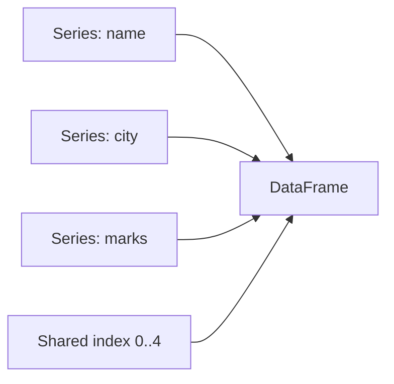

# Session 03: Pandas Series and DataFrames

> Module: Data Science with Python · Diploma in AI · Term 1 · ⏱ ~2 hours

NumPy is great for pure numbers, but real data has names, dates, cities and missing values. **pandas** gives Python two powerful structures for this kind of labelled data: the **Series** (one column) and the **DataFrame** (a whole table). Think of pandas as "Excel inside Python", but faster and repeatable.

## 🎯 Learning Objectives

- Explain one-dimensional and two-dimensional data structures
- Create a pandas Series from a list and a dictionary, with a custom index
- Create a DataFrame and select columns, rows and single values
- Add, rename and drop columns, and filter and sort rows
- Clearly distinguish between `loc` (labels) and `iloc` (positions)

## 📖 Concepts Explained

### 1. One-dimensional vs two-dimensional data

| | 1-D | 2-D |
|---|---|---|
| Shape | a single column (or row) of values | rows and columns |
| Real-life example | marks of a class in one subject | the full result sheet |
| pandas structure | **Series** | **DataFrame** |
| NumPy cousin | 1-D array | 2-D array |

### 2. The Series

A **Series** = values + an **index** (labels). The index is what makes pandas different from a plain array: you can say `marks["Hina"]` instead of remembering that Hina is at position 1.

```text
index   value
Ali       78
Hina      85      <- marks["Hina"] = 85
Usman     62
Zara      90
```

Key facts:
- If you do not give an index, pandas uses `0, 1, 2, ...`.
- A dictionary's keys become the index automatically.
- All maths (`+`, `mean()`, `max()`) works on the whole Series, just like NumPy.
- `idxmax()` returns the *label* of the largest value.

### 3. The DataFrame

A **DataFrame** is a table where every column is a Series and all columns share the same row index.



| Task | Code | Result type |
|---|---|---|
| One column | `df["marks"]` | Series |
| Several columns | `df[["name", "marks"]]` (double brackets!) | DataFrame |
| New column | `df["passed"] = df["marks"] >= 65` | adds a column |
| Filter rows | `df[df["city"] == "Karachi"]` | DataFrame |
| Sort | `df.sort_values("marks", ascending=False)` | DataFrame |
| Rename | `df.rename(columns={"old": "new"})` | DataFrame |
| Remove column | `df.drop(columns=["price"])` | DataFrame |
| Size | `df.shape` | (rows, columns) |

> Tip: most pandas methods return a **new** DataFrame and leave the original unchanged. Save the result: `df = df.rename(...)`.

### 4. `loc` vs `iloc`

This is the most common beginner confusion, so remember one word each:

| | `loc` | `iloc` |
|---|---|---|
| Think | **L**abel | **I**nteger position |
| Rows | by index label (`"bag"`) | by number (`2`) |
| Columns | by name (`"price"`) | by number (`0`) |
| Slice end | **included** (`"a":"c"` gives a, b, c) | **excluded** (`0:2` gives 0, 1) |
| Conditions | yes: `df.loc[df["stock"] < 20]` | no (needs positions) |

> **Analogy:** In a cinema, `loc` is "seat named F-12", while `iloc` is "the 5th seat from the left". Same seat, two ways to point at it.

### 5. `apply` for custom logic

When no ready-made method fits, write a small function and call `df["col"].apply(my_function)`. pandas runs the function on every value and returns a new Series.

## 💻 Code Examples

### Example 1: Series basics

📄 File: [`series_basics.py`](./series_basics.py)

```python
# series_basics.py
# A pandas Series is a 1-D labelled column of data.

import pandas as pd   # "pd" is the usual short name

# 1) Series from a list (pandas adds labels 0, 1, 2 ... automatically)
marks = pd.Series([78, 85, 62, 90])
print(marks)

# 2) Series with our own labels (the index)
marks = pd.Series([78, 85, 62, 90], index=["Ali", "Hina", "Usman", "Zara"])
print("\nWith names as index:\n", marks)

# 3) Series from a dictionary: keys become the index
city_population = pd.Series({"Karachi": 20.4, "Lahore": 13.0, "Faisalabad": 3.6})
print("\nPopulation (millions):\n", city_population)

# 4) Reading values
print("\nHina's marks:", marks["Hina"])        # by label
print("First value:", marks.iloc[0])           # by position
print("Index:", list(marks.index))
print("Values:", marks.values)

# 5) Maths and statistics work on the whole Series
print("\nAdd 5 grace marks:\n", marks + 5)
print("Average:", marks.mean(), " Highest:", marks.max())
print("Who got the highest?", marks.idxmax())

# 6) Filtering
print("\nPassed with 70+:\n", marks[marks >= 70])
```

**How it works:** we first let pandas create the index, then give our own names. Values are read by label (`marks["Hina"]`) or by position (`marks.iloc[0]`). Maths and filtering apply to all values at once.

### Example 2: DataFrame basics

📄 File: [`dataframe_basics.py`](./dataframe_basics.py)

```python
# dataframe_basics.py
# A DataFrame is a 2-D table: many Series sharing the same index.

import pandas as pd

# 1) Create a DataFrame from a dictionary of lists (each key = one column)
data = {
    "name":  ["Ali", "Hina", "Usman", "Zara", "Omar"],
    "city":  ["Karachi", "Lahore", "Karachi", "Islamabad", "Lahore"],
    "age":   [20, 22, 19, 21, 23],
    "marks": [78, 91, 62, 85, 70],
}
df = pd.DataFrame(data)
print(df)

# 2) Basic information
print("\nShape (rows, columns):", df.shape)
print("Column names:", list(df.columns))
print("Data types:\n", df.dtypes)

# 3) Select one column -> you get a Series
print("\nMarks column:\n", df["marks"])

# 4) Select several columns -> you get a DataFrame
print("\nName and marks:\n", df[["name", "marks"]])

# 5) Add a new column calculated from another column
df["passed"] = df["marks"] >= 65
print("\nWith a new 'passed' column:\n", df)

# 6) Filter rows with a condition
print("\nStudents from Karachi:\n", df[df["city"] == "Karachi"])

# 7) Sort rows
print("\nSorted by marks (high to low):\n", df.sort_values("marks", ascending=False))
```

**How it works:** each dictionary key becomes a column. Single brackets return a Series, double brackets return a DataFrame. A comparison creates a True/False column, which can also be used to filter rows.

### Example 3: loc vs iloc

📄 File: [`loc_vs_iloc.py`](./loc_vs_iloc.py)

```python
# loc_vs_iloc.py
# loc  = select by LABEL (names)
# iloc = select by POSITION (numbers 0, 1, 2 ...)

import pandas as pd

df = pd.DataFrame(
    {"price": [250, 120, 900, 60], "stock": [10, 35, 4, 100]},
    index=["pen_box", "notebook", "bag", "eraser"],   # row labels
)
print(df, "\n")

# ---- loc: use row and column NAMES ----
print("loc['bag', 'price']        ->", df.loc["bag", "price"])
print("loc['notebook'] (full row) ->\n", df.loc["notebook"], "\n")
print("loc['pen_box':'bag', 'stock'] (end label INCLUDED) ->\n", df.loc["pen_box":"bag", "stock"], "\n")

# ---- iloc: use row and column POSITIONS ----
print("iloc[2, 0]          ->", df.iloc[2, 0])          # row 2, column 0 = bag price
print("iloc[0:2] (end position EXCLUDED) ->\n", df.iloc[0:2], "\n")
print("iloc[-1] (last row) ->\n", df.iloc[-1], "\n")

# ---- loc with a condition (very common) ----
print("Items with stock under 20 ->\n", df.loc[df["stock"] < 20], "\n")

# ---- change a value safely with loc ----
df.loc["bag", "stock"] = 15
print("After updating bag stock ->\n", df)
```

**How it works:** the index uses product names, so `loc` takes names while `iloc` takes numbers. Notice that the `loc` slice includes `"bag"`, but `iloc[0:2]` stops before row 2. Updating with `df.loc[row, col] = value` is the safe way to change one cell.

### Example 4: Everyday operations

📄 File: [`dataframe_operations.py`](./dataframe_operations.py)

```python
# dataframe_operations.py
# Common everyday operations on a DataFrame.

import pandas as pd

sales = pd.DataFrame({
    "product":  ["Tea", "Sugar", "Milk", "Rice", "Oil"],
    "price":    [450, 160, 220, 380, 600],
    "quantity": [30, 50, 80, 25, 15],
})

# 1) New column from two columns
sales["revenue"] = sales["price"] * sales["quantity"]
print(sales, "\n")

# 2) Column statistics
print("Total revenue:", sales["revenue"].sum())
print("Average price:", sales["price"].mean())

# 3) Rename a column
sales = sales.rename(columns={"quantity": "qty"})
print("\nRenamed columns:", list(sales.columns))

# 4) Drop (remove) a column
smaller = sales.drop(columns=["price"])
print("\nWithout price:\n", smaller)

# 5) Add a new row with pd.concat
new_row = pd.DataFrame({"product": ["Flour"], "price": [140], "qty": [60], "revenue": [8400]})
sales = pd.concat([sales, new_row], ignore_index=True)
print("\nAfter adding Flour:\n", sales)

# 6) Apply a simple function to each value of a column
def price_band(price):
    # returns a label depending on the price
    if price >= 400:
        return "High"
    return "Normal"

sales["band"] = sales["price"].apply(price_band)
print("\nWith price band:\n", sales)
```

**How it works:** multiplying two columns makes a revenue column. `rename`, `drop` and `concat` return new tables. `apply(price_band)` runs our small function on each price to label it.

## 🧪 Lab Practice

1. Create a Series of the prices of 5 mobile phones with model names as the index. Print the cheapest model using `idxmin()`.
2. Build a DataFrame of 6 employees with columns `name`, `department`, `salary`. Add a `bonus` column equal to 10% of salary.
3. Show only employees of the "IT" department, sorted by salary.
4. Using `loc`, print the salary of the employee at label 3. Using `iloc`, print the last two rows.
5. Write a function that returns "Senior" if salary > 150000 else "Junior" and apply it to make a new column.

## 📝 Assignment

Create `cricket_stats.py` with a DataFrame of 8 players (`player`, `matches`, `runs`, `wickets`). Add an `average` column (runs / matches), list players with average above 30, find the top wicket taker with `idxmax`, and print the rows from position 2 to 5 using `iloc`.

## ❓ Quick Quiz

1. Which pandas structure is one-dimensional?
2. What is the difference between `df["a"]` and `df[["a"]]`?
3. `df.loc["x":"z"]` - is row "z" included?
4. What does `df.shape` return?
5. Which method runs your own function on every value of a column?

<details><summary>Answers</summary>

1. Series
2. The first returns a Series, the second a DataFrame with one column
3. Yes, `loc` slices include the end label
4. A tuple `(number_of_rows, number_of_columns)`
5. `apply()`

</details>

## 💼 Interview Questions

1. **Explain the difference between `loc` and `iloc`.** `loc` selects by labels and includes the slice end; `iloc` selects by integer positions and excludes the slice end.
2. **What is the index in pandas and why is it useful?** It is the set of row labels; it allows fast lookup by label and automatic alignment when combining Series or DataFrames.
3. **How is a DataFrame related to a Series?** A DataFrame is a collection of Series (columns) that share the same index.

## ✅ Summary

- Series = 1-D labelled values; DataFrame = 2-D table of Series.
- Select columns with `df["col"]` or `df[["c1", "c2"]]`; filter rows with conditions.
- `loc` uses labels (end included); `iloc` uses positions (end excluded).
- `rename`, `drop`, `concat`, `sort_values` and `apply` cover most daily table edits.

---

[⬅ Previous](../Session-02-NumPy-Library/README.md) · [🏠 Module Home](../README.md) · [Next ➡](../Session-04-Advanced-Pandas-CSV-Exploration-GroupBy/README.md)

Prepared by Zeeshan Abbas · Aptech Learning North Nazimabad
