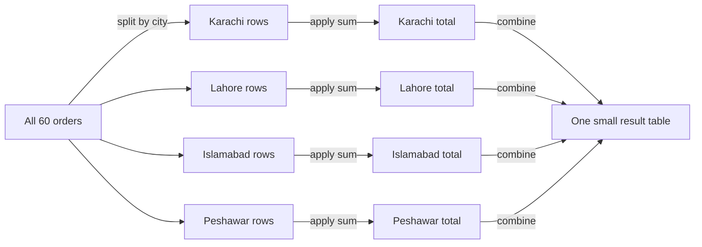

# Session 04: Advanced Pandas - CSV Files, Data Exploration and GroupBy

> Module: Data Science with Python · Diploma in AI · Term 1 · ⏱ ~2 hours

Real datasets do not live inside your code; they arrive as files, and the most common format is **CSV**. In this session you will load a sales file into pandas, run the standard "first look" commands every analyst uses, and answer business questions with **groupby**, the single most useful tool for summarising data.

> ▶ Open a terminal **inside this session folder** and run `python make_sales_csv.py` once. It creates `sales.csv` (60 orders) used by every example below. A copy is already included.

## 🎯 Learning Objectives

- Read CSV files into a DataFrame and write DataFrames back to CSV
- Use exploration commands: `head`, `tail`, `shape`, `info`, `describe`, `isnull`, `value_counts`, `unique`
- Explain the split-apply-combine idea behind `groupby()`
- Summarise data with `sum`, `mean`, `agg()` and `pivot_table()`
- Solve a small real-time case study end to end

## 📖 Concepts Explained

### 1. What is a CSV file?

**CSV = Comma-Separated Values.** It is a plain text file where each line is a row and commas separate the columns. The first line usually holds the column names.

```text
order_id,date,city,category,quantity,unit_price
1001,2026-01-01,Karachi,Grocery,3,250
1002,2026-01-04,Lahore,Clothing,1,1500
```

Why CSV is everywhere: it opens in Excel, Notepad, Google Sheets and every programming language, and almost every system can export it.

### 2. Reading and writing

| Task | Code |
|---|---|
| Read a file | `pd.read_csv("sales.csv")` |
| Read only some columns | `pd.read_csv("sales.csv", usecols=["city", "quantity"])` |
| Treat a column as dates | `pd.read_csv("sales.csv", parse_dates=["date"])` |
| Different separator (e.g. `;`) | `pd.read_csv("file.csv", sep=";")` |
| Save to CSV | `df.to_csv("out.csv", index=False)` |

> Tip: always use `index=False` when saving, otherwise pandas adds an extra unnamed column of row numbers.

### 3. Data exploration commands

Before analysing, **look at your data**. These commands answer "what do I have?":

| Command | Answers the question |
|---|---|
| `df.head()` / `df.tail()` | What do the first / last rows look like? |
| `df.shape` | How many rows and columns? |
| `df.info()` | Which columns, which data types, any missing values? |
| `df.describe()` | Count, mean, min, max, quartiles of number columns |
| `df.isnull().sum()` | How many missing values per column? |
| `df["col"].unique()` | Which different values exist? |
| `df["col"].value_counts()` | How often does each value appear? |
| `df.nlargest(3, "col")` | Which rows have the biggest values? |

### 4. groupby: split - apply - combine

`groupby` answers questions like "total sales **per city**" or "average marks **per class**".



> **Analogy:** A teacher sorts the answer sheets into piles by section (split), counts the marks of each pile (apply), and writes one line per section on the board (combine).

The pattern is always: `df.groupby("group_column")["value_column"].function()`

| Need | Code |
|---|---|
| One calculation | `.sum()`, `.mean()`, `.count()`, `.max()` |
| Many calculations | `.agg(["count", "sum", "mean"])` |
| Two grouping columns | `df.groupby(["city", "category"])` |
| Excel-style cross table | `df.pivot_table(values=..., index=..., columns=..., aggfunc="sum")` |

### 5. Working with dates

After `parse_dates`, the `.dt` accessor gives date parts: `df["date"].dt.month`, `.dt.month_name()`, `.dt.day_name()`, `.dt.year`. Group by them for monthly or weekday trends.

## 💻 Code Examples

### Example 1: Create the practice file

📄 File: [`make_sales_csv.py`](./make_sales_csv.py)

```python
# make_sales_csv.py
# Creates the practice file "sales.csv" used in this session.
# Run it once:  python make_sales_csv.py

import numpy as np
import pandas as pd

rng = np.random.default_rng(seed=7)      # fixed seed -> same data every time
rows = 60

data = pd.DataFrame({
    "order_id": range(1001, 1001 + rows),
    "date": pd.date_range("2026-01-01", periods=rows, freq="3D").strftime("%Y-%m-%d"),
    "city": rng.choice(["Karachi", "Lahore", "Islamabad", "Peshawar"], size=rows),
    "category": rng.choice(["Electronics", "Clothing", "Grocery"], size=rows),
    "quantity": rng.integers(1, 10, size=rows),
    "unit_price": rng.choice([250, 800, 1500, 3200, 12000], size=rows),
})

data.to_csv("sales.csv", index=False)    # index=False -> don't write row numbers
print("sales.csv created with", len(data), "rows")
```

**How it works:** a random number generator with a fixed seed creates the same 60 fake orders every time. `to_csv(..., index=False)` writes them to `sales.csv`.

### Example 2: Read and write CSV

📄 File: [`read_write_csv.py`](./read_write_csv.py)

```python
# read_write_csv.py
# Reading a CSV file into a DataFrame and writing results back to CSV.

import pandas as pd

# 1) Read the CSV file (it must be in the same folder)
sales = pd.read_csv("sales.csv")
print("Loaded", len(sales), "rows")
print(sales.head())          # first 5 rows

# 2) Read only some columns
small = pd.read_csv("sales.csv", usecols=["city", "quantity"])
print("\nOnly two columns:\n", small.head(3))

# 3) Tell pandas which column holds dates
sales = pd.read_csv("sales.csv", parse_dates=["date"])
print("\nDate column type:", sales["date"].dtype)

# 4) Add a column and save a new CSV
sales["total"] = sales["quantity"] * sales["unit_price"]
karachi = sales[sales["city"] == "Karachi"]
karachi.to_csv("karachi_sales.csv", index=False)
print("\nSaved karachi_sales.csv with", len(karachi), "rows")
```

**How it works:** `read_csv` loads the file. `usecols` limits columns and `parse_dates` converts text to real dates. After filtering Karachi orders we save them with `to_csv`.

### Example 3: Explore the data

📄 File: [`explore_data.py`](./explore_data.py)

```python
# explore_data.py
# The first commands to run on ANY new dataset.

import pandas as pd

sales = pd.read_csv("sales.csv")

print("1) First rows:\n", sales.head(), "\n")
print("2) Last rows:\n", sales.tail(3), "\n")
print("3) Shape:", sales.shape, "\n")

print("4) Info (columns, types, non-null counts):")
sales.info()

print("\n5) Statistics of number columns:\n", sales.describe().round(1), "\n")
print("6) Missing values per column:\n", sales.isnull().sum(), "\n")
print("7) Unique cities:", sales["city"].unique())
print("8) How many orders per city:\n", sales["city"].value_counts(), "\n")
print("9) Largest 3 quantities:\n", sales.nlargest(3, "quantity"))
```

**How it works:** these nine commands are your checklist for any new dataset. `info()` prints directly (no need for `print`), while the others return results we print.

### Example 4: GroupBy analysis

📄 File: [`groupby_analysis.py`](./groupby_analysis.py)

```python
# groupby_analysis.py
# groupby = split the rows into groups, calculate something, combine the answers.

import pandas as pd

sales = pd.read_csv("sales.csv")
sales["total"] = sales["quantity"] * sales["unit_price"]

# 1) Total sales per city
print("Total sales per city:\n", sales.groupby("city")["total"].sum(), "\n")

# 2) Average quantity per category
print("Average quantity per category:\n",
      sales.groupby("category")["quantity"].mean().round(2), "\n")

# 3) Several calculations at once with agg()
summary = sales.groupby("city")["total"].agg(["count", "sum", "mean", "max"])
print("City summary:\n", summary.round(0), "\n")

# 4) Group by two columns
city_cat = sales.groupby(["city", "category"])["total"].sum()
print("City + category:\n", city_cat, "\n")

# 5) Same result as a neat table (cities as rows, categories as columns)
table = sales.pivot_table(values="total", index="city", columns="category", aggfunc="sum")
print("Pivot table:\n", table)
```

**How it works:** each line splits the orders into groups, applies a calculation and combines the answers. `agg()` runs several calculations at once and `pivot_table` reshapes a two-column grouping into a readable grid.

### Example 5: Real-time case study

📄 File: [`case_study_sales.py`](./case_study_sales.py)

```python
# case_study_sales.py
# Mini case study: a manager asks 4 questions about the shop's sales.

import pandas as pd

sales = pd.read_csv("sales.csv", parse_dates=["date"])
sales["total"] = sales["quantity"] * sales["unit_price"]

# Q1: Which city brings the most money?
city_totals = sales.groupby("city")["total"].sum().sort_values(ascending=False)
print("Q1 Best city:", city_totals.index[0], "-> Rs", city_totals.iloc[0])

# Q2: Which category sells the most items?
items = sales.groupby("category")["quantity"].sum()
print("Q2 Most items sold in:", items.idxmax(), "->", items.max(), "items")

# Q3: How did sales change month by month?
sales["month"] = sales["date"].dt.month_name()      # e.g. "January"
monthly = sales.groupby("month", sort=False)["total"].sum()
print("\nQ3 Monthly sales:\n", monthly)

# Q4: What are the 5 biggest orders?
print("\nQ4 Top 5 orders:\n", sales.nlargest(5, "total")[["order_id", "city", "category", "total"]])

# Save the city report for the manager
city_totals.to_csv("city_report.csv", header=["total_sales"])
print("\nSaved city_report.csv")
```

**How it works:** each manager question becomes one or two lines of pandas. `sort_values` + `index[0]` gives the best city, `idxmax()` gives the top category, `.dt.month_name()` enables monthly totals, and `nlargest` lists the biggest orders. The answer is saved as a small report file.

## 🧪 Lab Practice

1. Run `explore_data.py` and write down: number of rows, number of columns, and the most common category.
2. Find the average `unit_price` per city with `groupby`.
3. Count how many orders each category has in each city (`groupby(["city", "category"]).size()`).
4. Add a `weekday` column using `.dt.day_name()` and find which weekday has the highest total sales.
5. Save a CSV containing only Electronics orders with total above Rs 10,000.

## 📝 Assignment

Download any small public CSV dataset (for example from data.world or Kaggle) or create one with 30 rows about your own topic. Write `my_analysis.py` that reads it, runs the exploration checklist, answers three questions with `groupby`, and saves one summary CSV.

## ❓ Quick Quiz

1. Which argument stops pandas from writing row numbers to a CSV?
2. Which command shows column data types and non-null counts?
3. What does `df["city"].value_counts()` return?
4. Write the code for average quantity per category.
5. What are the three steps of groupby?

<details><summary>Answers</summary>

1. `index=False`
2. `df.info()`
3. Each unique city with how many times it appears, sorted high to low
4. `df.groupby("category")["quantity"].mean()`
5. Split, apply, combine

</details>

## 💼 Interview Questions

1. **What does `describe()` show?** Count, mean, standard deviation, minimum, 25%, 50% (median), 75% and maximum for numeric columns.
2. **Difference between `groupby` and `pivot_table`?** Both summarise by groups; `pivot_table` arranges the result as a 2-D grid with one grouping on rows and another on columns.
3. **How do you read a very large CSV that does not fit in memory?** Read only needed columns with `usecols`, set smaller dtypes, or process it in pieces with `chunksize`.

## ✅ Summary

- `read_csv` and `to_csv(index=False)` move data in and out of pandas.
- Always explore first: `head`, `shape`, `info`, `describe`, `isnull().sum()`, `value_counts()`.
- `groupby` = split, apply, combine; use `agg` for several results and `pivot_table` for grids.
- Dates become powerful after `parse_dates` and the `.dt` accessor.

---

[⬅ Previous](../Session-03-Pandas-Series-and-DataFrames/README.md) · [🏠 Module Home](../README.md) · [Next ➡](../Session-05-Practice-Lab-Python-NumPy-Pandas/README.md)

Prepared by Zeeshan Abbas · Aptech Learning North Nazimabad
