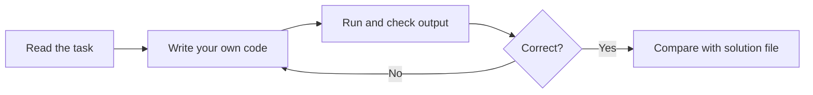

# Session 05: Practice Lab - Python, NumPy and Pandas

> Module: Data Science with Python · Diploma in AI · Term 1 · ⏱ ~2 hours

This is a **hands-on revision session** for Sessions 01 to 04. There is no new theory: you will solve a set of guided tasks on one small dataset, `students.csv` (12 students, attendance and marks in Python, Statistics and SQL). Try each task yourself first, then compare with the solution file.

## 🎯 Learning Objectives

- Revise data types and the data science workflow from Session 01
- Apply NumPy arrays, `axis`, boolean masks and `argmax` (Session 02)
- Apply Series, DataFrames, `loc` and `iloc` (Session 03)
- Apply CSV reading, exploration commands and `groupby` (Session 04)
- Build the habit of solving a problem step by step with comments

## 📖 Concepts Explained

### 1. How to use this lab



> Tip: do not open the solution until you have tried for at least 10 minutes. Struggling a little is how programming skill grows.

### 2. The dataset

| Column | Meaning | Kind |
|---|---|---|
| `roll_no` | student ID | categorical (identifier) |
| `name`, `gender`, `section` | labels | categorical (nominal) |
| `attendance` | attendance % | numerical (continuous) |
| `python`, `stats`, `sql` | marks out of 100 | numerical (discrete) |

### 3. Quick revision sheet

| Topic | Remember |
|---|---|
| Data types | structured / semi-structured / unstructured; numerical vs categorical |
| NumPy | `arr.mean(axis=0)` per column, `axis=1` per row; `arr[arr > 50]` filters |
| `np.unravel_index` | turns a flat position (from `argmax`) into a (row, column) pair |
| `np.minimum(a, 100)` | caps every value at 100 |
| Series | `idxmax()` gives the label of the largest value |
| `set_index("col")` | makes a column the row labels, so `loc` can use it |
| `loc` vs `iloc` | labels (end included) vs positions (end excluded) |
| Two conditions | `(cond1) & (cond2)`, each in brackets; use `|` for OR |
| groupby | `df.groupby("g")["v"].mean()`; `agg([...])` for several results |

### 4. Common mistakes to avoid

| Mistake | Fix |
|---|---|
| `df[df["a"] > 5 and df["b"] < 3]` | use `&` and brackets: `df[(df["a"] > 5) & (df["b"] < 3)]` |
| `df["name", "age"]` | double brackets: `df[["name", "age"]]` |
| Forgetting to save the result: `df.rename(...)` | `df = df.rename(...)` |
| `FileNotFoundError` for the CSV | run the script from inside this session folder |
| Using `iloc` with a label | use `loc` for labels |

## 💻 Code Examples

### Task 1 (Session 01): Column types and a plain-Python summary

📄 File: [`task1_python_basics.py`](./task1_python_basics.py)

```python
# task1_python_basics.py  (Practice for Session 01)
# Task: classify the columns of students.csv and do a plain-Python summary.

# Step 1: describe each column's data type by hand
column_types = {
    "roll_no": "Categorical (an ID, not for maths)",
    "name": "Categorical - nominal",
    "gender": "Categorical - nominal",
    "section": "Categorical - nominal",
    "attendance": "Numerical - continuous (percentage)",
    "python": "Numerical - discrete (marks)",
}
for column, kind in column_types.items():
    print(f"{column:<11} -> {kind}")

# Step 2: plain-Python average of a list of marks
python_marks = [78, 91, 55, 88, 42, 73, 85, 66, 39, 94, 70, 80]
average = sum(python_marks) / len(python_marks)
print("\nAverage Python marks:", round(average, 2))

# Step 3: count how many students scored below 50
below_50 = 0
for mark in python_marks:
    if mark < 50:
        below_50 = below_50 + 1
print("Students below 50:", below_50)
```

**How it works:** we label each column's data type, then calculate an average and count low scores with a simple loop, exactly as a data scientist would before using any library.

### Task 2 (Session 02): NumPy marks analysis

📄 File: [`task2_numpy_practice.py`](./task2_numpy_practice.py)

```python
# task2_numpy_practice.py  (Practice for Session 02)
# Task: use NumPy to analyse the marks of 12 students in 3 subjects.

import numpy as np

# Step 1: marks as a 2-D array (rows = students, columns = python, stats, sql)
marks = np.array([
    [78, 65, 81], [91, 84, 77], [55, 48, 60], [88, 92, 90],
    [42, 51, 58], [73, 70, 69], [85, 79, 88], [66, 58, 72],
    [39, 44, 50], [94, 89, 96], [70, 74, 65], [80, 77, 83],
])
print("Shape:", marks.shape)

# Step 2: average of each subject (down the columns)
print("Subject averages:", marks.mean(axis=0).round(1))

# Step 3: total and percentage of each student (across the rows)
totals = marks.sum(axis=1)
percent = (totals / 300 * 100).round(1)
print("Percentages:", percent)

# Step 4: how many students got 80% or more?
print("Students with 80%+:", (percent >= 80).sum())

# Step 5: the highest single mark and where it is
row, col = np.unravel_index(marks.argmax(), marks.shape)
print("Highest mark", marks.max(), "-> student row", row, "subject column", col)

# Step 6: add 5 grace marks to stats only, but never above 100
marks[:, 1] = np.minimum(marks[:, 1] + 5, 100)
print("Stats after grace:", marks[:, 1])
```

**How it works:** `axis=0` gives subject averages and `axis=1` student totals. A boolean mask counts high achievers. `argmax()` returns a flat position, so `np.unravel_index` converts it to a row and column. `np.minimum` keeps marks from crossing 100.

### Task 3 (Session 03): Series, DataFrame, loc and iloc

📄 File: [`task3_pandas_practice.py`](./task3_pandas_practice.py)

```python
# task3_pandas_practice.py  (Practice for Session 03)
# Task: Series, DataFrame, loc and iloc on students.csv

import pandas as pd

df = pd.read_csv("students.csv")

# Step 1: make roll_no the index so we can use loc with roll numbers
df = df.set_index("roll_no")

# Step 2: a Series of Python marks
python_marks = df["python"]
print("Top scorer in Python:", df.loc[python_marks.idxmax(), "name"])

# Step 3: add total and percentage columns
df["total"] = df["python"] + df["stats"] + df["sql"]
df["percent"] = (df["total"] / 300 * 100).round(1)

# Step 4: loc - name and percent of roll numbers 104 to 107 (107 included)
print("\nloc 104..107:\n", df.loc[104:107, ["name", "percent"]])

# Step 5: iloc - first 3 rows and first 2 columns
print("\niloc first 3 rows, 2 columns:\n", df.iloc[0:3, 0:2])

# Step 6: filter - girls with attendance above 85
girls = df[(df["gender"] == "F") & (df["attendance"] > 85)]
print("\nGirls with 85%+ attendance:\n", girls[["name", "attendance"]])
```

**How it works:** after `set_index("roll_no")`, `loc[104:107]` uses roll numbers (107 included) while `iloc[0:3, 0:2]` uses positions. The combined filter uses `&` with each condition in brackets.

### Task 4 (Session 04): Exploration and groupby

📄 File: [`task4_groupby_practice.py`](./task4_groupby_practice.py)

```python
# task4_groupby_practice.py  (Practice for Session 04)
# Task: explore and summarise students.csv, then save a report.

import pandas as pd

df = pd.read_csv("students.csv")
df["percent"] = ((df["python"] + df["stats"] + df["sql"]) / 3).round(1)

# Step 1: quick exploration
print("Shape:", df.shape)
print("Missing values:", df.isnull().sum().sum())
print("Students per section:\n", df["section"].value_counts())

# Step 2: average percent per section
section_avg = df.groupby("section")["percent"].mean().round(1)
print("\nAverage % per section:\n", section_avg)

# Step 3: several statistics per gender
print("\nAttendance by gender:\n", df.groupby("gender")["attendance"].agg(["mean", "min", "max"]))

# Step 4: does attendance matter? compare high and low attendance groups
def attendance_group(value):
    # label each student by attendance
    if value >= 80:
        return "80+"
    return "below 80"

df["attendance_group"] = df["attendance"].apply(attendance_group)
print("\nAverage % by attendance group:\n", df.groupby("attendance_group")["percent"].mean().round(1))

# Step 5: save the section report
section_avg.to_csv("section_report.csv", header=["average_percent"])
print("\nSaved section_report.csv")
```

**How it works:** we explore, then group by section and gender. A small function creates an attendance group, and grouping by it shows whether higher attendance links to better results. The section report is saved with `to_csv`.

## 🧪 Lab Practice

1. Add three new students of your own to `students.csv` and re-run all four tasks.
2. Using NumPy, find which subject has the **lowest** class average and its standard deviation.
3. Using pandas, list the students who scored above 70 in **all three** subjects.
4. Find the topper of each section (hint: sort by percent, then `groupby("section").head(1)`).
5. Create a pivot table of average Python marks with `section` as rows and `gender` as columns.

## 📝 Assignment

Create `shop_inventory.csv` with 15 products (`product`, `category`, `price`, `stock`, `sold_last_month`). Write `inventory_lab.py` that: (1) explores the data, (2) adds a `stock_value` column, (3) lists products with stock below 10 using `loc`, (4) shows total `sold_last_month` per category, and (5) saves the low-stock list to `reorder.csv`.

## ❓ Quick Quiz

1. Which function converts the position returned by `argmax()` into row and column?
2. Write a filter for students in section "A" with python marks above 80.
3. After `df.set_index("roll_no")`, how do you read the name of roll number 105?
4. What does `df.groupby("section").size()` return?
5. Why does `and` fail inside a pandas filter?

<details><summary>Answers</summary>

1. `np.unravel_index(position, array.shape)`
2. `df[(df["section"] == "A") & (df["python"] > 80)]`
3. `df.loc[105, "name"]`
4. The number of rows (students) in each section
5. `and` works on single True/False values; pandas needs element-wise logic, which `&` provides

</details>

## 💼 Interview Questions

1. **How would you find the top N rows within each group in pandas?** Sort by the value column, then use `groupby(...).head(N)`, or use `nlargest` inside a group-wise apply.
2. **What is the difference between `size()` and `count()` after groupby?** `size()` counts all rows including missing values; `count()` counts only non-missing values per column.
3. **Why set a meaningful index on a DataFrame?** It makes lookups with `loc` readable and fast and helps pandas align data when joining or combining tables.

## ✅ Summary

- You practised every core skill from Sessions 01-04 on one dataset.
- NumPy handles fast number crunching; pandas handles labelled tables.
- Filters need `&` / `|` and brackets; selecting many columns needs double brackets.
- Explore first, then group and summarise, then save results.

---

[⬅ Previous](../Session-04-Advanced-Pandas-CSV-Exploration-GroupBy/README.md) · [🏠 Module Home](../README.md) · [Next ➡](../Session-06-Data-Visualization-and-MongoDB-with-PyMongo/README.md)

Prepared by Zeeshan Abbas · Aptech Learning North Nazimabad
