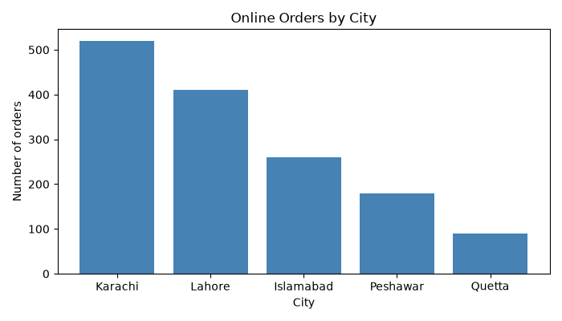
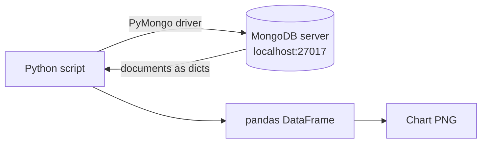

# Session 06: Data Visualization Basics and MongoDB with PyMongo

> Module: Data Science with Python · Diploma in AI · Term 1 · ⏱ ~2 hours

Data science needs two things before any analysis: **a source of data** and **a way to see it**. In this session you will learn why charts matter, then connect Python to **MongoDB** (the NoSQL database from Module 02) using the official **PyMongo** driver. You will insert, query, update and delete documents from Python, load the results into pandas, and save a chart.

## 🎯 Learning Objectives

- Describe what data visualization is and why it beats raw tables for spotting patterns
- Name common chart types and when each one is used
- Explain what a database driver is and how PyMongo connects Python to MongoDB
- Perform insert, find (with filters, projection, sort), update and delete operations from Python
- Move MongoDB query results into a pandas DataFrame and visualise them

## 📖 Concepts Explained

### 1. What is data visualization?

**Data visualization** is showing data as pictures (bars, lines, dots, colours) so the human eye can spot patterns, trends and outliers instantly. Our brain compares lengths and colours far faster than it reads numbers.

| Why visualise? | Example |
|---|---|
| Compare categories | which city has the most orders |
| See a trend over time | sales rising every month |
| Find relationships | more study hours, higher marks |
| Spot outliers and errors | one order of Rs 9,000,000 (typo?) |
| Communicate to non-technical people | a manager understands a chart in seconds |

Common chart types (we go deeper in Sessions 09 and 11):

| Chart | Best for |
|---|---|
| Bar chart | comparing categories |
| Line chart | change over time |
| Histogram | how values are spread (distribution) |
| Scatter plot | relationship between two numeric columns |
| Pie chart | parts of a whole (few categories only) |
| Box plot | spread, median and outliers |



> In this module every chart is **saved as a PNG** with `plt.savefig(...)` and we use `matplotlib.use("Agg")`. This means no pop-up window is needed, so scripts work on any PC, server or online notebook.

### 2. What is a database driver?

A **driver** is a library that lets a programming language talk to a database. Python cannot speak MongoDB's network language by itself; **PyMongo** translates Python dictionaries into MongoDB commands and MongoDB documents back into dictionaries.



### 3. MongoDB words in Python

| MongoDB | SQL equivalent | PyMongo code |
|---|---|---|
| Server connection | connection | `client = MongoClient("mongodb://localhost:27017")` |
| Database | database | `db = client["aptech_ds"]` |
| Collection | table | `students = db["students"]` |
| Document | row | a Python `dict` |
| Field | column | a dictionary key |

> **Analogy:** The client is your phone call to the library, the database is one library building, the collection is a shelf, and each document is a book on that shelf.

### 4. CRUD with PyMongo

| Operation | Method |
|---|---|
| Create | `insert_one(doc)`, `insert_many([doc, doc])` |
| Read | `find(filter, projection)`, `find_one(filter)`, `count_documents(filter)` |
| Update | `update_one(filter, {"$set": {...}})`, `update_many(...)` |
| Delete | `delete_one(filter)`, `delete_many(filter)` |

Filters use the same operators you learned in Module 02: `$gt`, `$lt`, `$gte`, `$in`, `$ne`. A **projection** like `{"_id": 0, "name": 1}` chooses which fields come back. `.sort("marks", -1)` sorts high to low.

### 5. Setup checklist

1. Install and start MongoDB Community Server (or create a free MongoDB Atlas cluster).
2. `pip install pymongo pandas matplotlib`
3. Run `mongo_connect.py`. If it prints "Connected", run the other files in order.
4. For Atlas, replace the connection string with the one from Atlas (and never share your password in public code).

## 💻 Code Examples

### Example 1: Why visualise?

📄 File: [`why_visualize.py`](./why_visualize.py)

```python
# why_visualize.py
# The same numbers as a table and as a chart: which is easier to read?

import matplotlib
matplotlib.use("Agg")              # "Agg" = draw into files, no pop-up window
import matplotlib.pyplot as plt

cities = ["Karachi", "Lahore", "Islamabad", "Peshawar", "Quetta"]
orders = [520, 410, 260, 180, 90]

# 1) As text: you must read every number to compare
print("City       Orders")
for city, count in zip(cities, orders):
    print(f"{city:<10} {count}")

# 2) As a bar chart: the pattern is visible in one second
plt.figure(figsize=(7, 4))
plt.bar(cities, orders, color="steelblue")
plt.title("Online Orders by City")
plt.xlabel("City")
plt.ylabel("Number of orders")
plt.tight_layout()                 # avoids labels being cut off
plt.savefig("orders_by_city.png")  # saved in this folder
print("\nChart saved as orders_by_city.png")
```

**How it works:** the same five numbers are printed as text and drawn as a bar chart. `plt.bar` draws bars, labels make it readable, and `savefig` writes the image file shown above.

### Example 2: Connect to MongoDB

📄 File: [`mongo_connect.py`](./mongo_connect.py)

```python
# mongo_connect.py
# Connect Python to a local MongoDB server using the PyMongo driver.
# Install first:  pip install pymongo   (and start MongoDB on your PC)

from pymongo import MongoClient
from pymongo.errors import ServerSelectionTimeoutError

# 1) The connection string: where is the server?
#    Local default: mongodb://localhost:27017
#    For MongoDB Atlas, paste the string from the Atlas "Connect" button instead.
connection_string = "mongodb://localhost:27017"

# 2) Create the client (wait max 3 seconds for the server)
client = MongoClient(connection_string, serverSelectionTimeoutMS=3000)

try:
    # 3) "ping" checks that the server really answers
    client.admin.command("ping")
    print("Connected to MongoDB!")

    # 4) List the databases on the server
    print("Databases:", client.list_database_names())
except ServerSelectionTimeoutError:
    print("Could not reach MongoDB. Is the server running on localhost:27017?")
finally:
    client.close()   # always close the connection when done
```

**How it works:** `MongoClient` prepares the connection, the `ping` command proves the server is alive, and the `try/except` gives a friendly message if MongoDB is not running. `finally` closes the client either way.

### Example 3: Insert and find documents

📄 File: [`mongo_insert_find.py`](./mongo_insert_find.py)

```python
# mongo_insert_find.py
# Insert documents and read them back with filters.

from pymongo import MongoClient

client = MongoClient("mongodb://localhost:27017", serverSelectionTimeoutMS=3000)

db = client["aptech_ds"]          # database (created automatically on first insert)
students = db["students"]          # collection (like a table)

students.delete_many({})           # start fresh every time we run the demo

# 1) Insert one document (a Python dictionary)
students.insert_one({"name": "Ayesha", "city": "Karachi", "marks": 88})

# 2) Insert many documents at once
students.insert_many([
    {"name": "Bilal", "city": "Lahore",    "marks": 72},
    {"name": "Sana",  "city": "Karachi",   "marks": 95},
    {"name": "Umar",  "city": "Islamabad", "marks": 64},
    {"name": "Hira",  "city": "Lahore",    "marks": 81},
])
print("Documents in collection:", students.count_documents({}))

# 3) Find all students from Karachi
print("\nKarachi students:")
for doc in students.find({"city": "Karachi"}):
    print("  ", doc["name"], doc["marks"])

# 4) Find students with marks greater than 80, show only name and marks, sorted
print("\nMarks above 80 (highest first):")
query = {"marks": {"$gt": 80}}            # $gt = greater than
fields = {"_id": 0, "name": 1, "marks": 1}  # 1 = show, 0 = hide
for doc in students.find(query, fields).sort("marks", -1):
    print("  ", doc)

# 5) Update and delete
students.update_one({"name": "Umar"}, {"$set": {"marks": 70}})
students.delete_one({"name": "Bilal"})
print("\nAfter update/delete:", list(students.find({}, {"_id": 0, "name": 1, "marks": 1})))

client.close()
```

**How it works:** databases and collections are created automatically on the first insert. `find()` returns a cursor that we loop over. The filter `{"marks": {"$gt": 80}}` keeps high scorers and the projection hides `_id`.

### Example 4: MongoDB to pandas to chart

📄 File: [`mongo_to_pandas_chart.py`](./mongo_to_pandas_chart.py)

```python
# mongo_to_pandas_chart.py
# Typical data science flow: MongoDB -> pandas DataFrame -> chart (PNG file).
# Run mongo_insert_find.py first so the collection has data.

import matplotlib
matplotlib.use("Agg")
import matplotlib.pyplot as plt
import pandas as pd
from pymongo import MongoClient

client = MongoClient("mongodb://localhost:27017", serverSelectionTimeoutMS=3000)
students = client["aptech_ds"]["students"]

# 1) Read the documents (hide the _id field) into a list of dictionaries
documents = list(students.find({}, {"_id": 0}))

# 2) Turn the list into a DataFrame
df = pd.DataFrame(documents)
print(df)

# 3) Average marks per city with pandas
city_avg = df.groupby("city")["marks"].mean()
print("\nAverage marks per city:\n", city_avg)

# 4) Draw and save a bar chart
plt.figure(figsize=(6, 4))
plt.bar(city_avg.index, city_avg.values, color="seagreen")
plt.title("Average Marks by City (from MongoDB)")
plt.ylabel("Average marks")
plt.tight_layout()
plt.savefig("mongo_city_marks.png")
print("\nChart saved as mongo_city_marks.png")

client.close()
```

**How it works:** `list(collection.find(...))` gives a list of dictionaries, which `pd.DataFrame` turns into a table. From there it is normal pandas: `groupby` for averages and Matplotlib to save `mongo_city_marks.png`.

## 🧪 Lab Practice

1. Run `mongo_connect.py` and make sure it connects. Open MongoDB Compass to see the `aptech_ds` database after running Example 3.
2. Insert 5 more students with a new field `semester` and find all students in semester 2.
3. Use `$in` to find students from Karachi or Islamabad.
4. Use `update_many` to add 5 marks to every student below 75.
5. Load the collection into pandas and save a bar chart of the number of students per city.

## 📝 Assignment

Create a `products` collection with 10 products (`name`, `category`, `price`, `stock`). Write `products_report.py` that finds products with stock below 20, increases their stock by 50 with `update_many`, loads everything into pandas, and saves a bar chart of total stock per category as `stock_by_category.png`.

## ❓ Quick Quiz

1. What is PyMongo?
2. Which method inserts several documents at once?
3. What does the projection `{"_id": 0, "name": 1}` do?
4. Write a filter for marks greater than or equal to 50.
5. Which chart type is best for showing a trend over months?

<details><summary>Answers</summary>

1. The official Python driver for MongoDB
2. `insert_many()`
3. Returns only the `name` field and hides `_id`
4. `{"marks": {"$gte": 50}}`
5. Line chart

</details>

## 💼 Interview Questions

1. **How do you load MongoDB data into pandas?** Query with `find()`, convert the cursor to a list of dicts, and pass it to `pd.DataFrame()`; for nested documents use `pd.json_normalize()`.
2. **Difference between `find()` and `find_one()`?** `find()` returns a cursor over all matching documents; `find_one()` returns the first matching document or `None`.
3. **Why should credentials not be hard-coded in a connection string?** Code may be shared publicly; use environment variables or a config file excluded from version control.

## ✅ Summary

- Visualization makes patterns, trends and outliers obvious; pick the chart for the question.
- PyMongo is the driver that connects Python to MongoDB.
- Database → collection → document (dict); CRUD with `insert_*`, `find`, `update_*`, `delete_*`.
- MongoDB results become a DataFrame with one line, then normal pandas and charts follow.

---

[⬅ Previous](../Session-05-Practice-Lab-Python-NumPy-Pandas/README.md) · [🏠 Module Home](../README.md) · [Next ➡](../Session-07-Handling-Different-File-Formats/README.md)

Prepared by Zeeshan Abbas · Aptech Learning North Nazimabad
