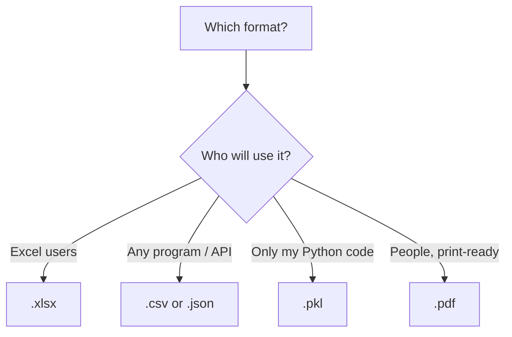

# Session 07: Handling Different File Formats

> Module: Data Science with Python · Diploma in AI · Term 1 · ⏱ ~2 hours

Data reaches you in many shapes: a `.txt` log from a machine, an Excel sheet from the accounts office, a JSON response from a web API, a PDF bank statement, or a saved Python object. A data scientist must be comfortable reading **and** writing all of them. Each example in this session creates its own file first and then reads it back, so you need nothing extra except the libraries.

## 🎯 Learning Objectives

- Read and write plain text files safely with `open()` and `with`
- Write and read Excel workbooks with multiple sheets using pandas
- Handle JSON data with the `json` module and flatten nested JSON with pandas
- Save and load Python objects with `pickle`
- Create a simple PDF and extract text from PDF files with `pypdf`
- Choose the right file format for a given situation

## 📖 Concepts Explained

### 1. Two families of files

| Family | Can you read it in Notepad? | Examples |
|---|---|---|
| **Text files** | Yes | `.txt`, `.csv`, `.json`, `.xml`, `.html` |
| **Binary files** | No (looks like garbage) | `.xlsx`, `.pdf`, `.pkl`, `.png`, `.mp3` |

Text files need an **encoding** (use `utf-8`, which supports Urdu and emojis). Binary files are opened with `"rb"` / `"wb"` or through a library that understands them.

### 2. Text files and the `with` statement

| Mode | Meaning |
|---|---|
| `"r"` | read (file must exist) |
| `"w"` | write (creates or **replaces** the file) |
| `"a"` | append (adds to the end) |
| `"rb"` / `"wb"` | read / write binary |

```python
with open("notes.txt", "r", encoding="utf-8") as file:
    data = file.read()
# the file is closed automatically here
```

> **Analogy:** `with` is like a library card that automatically returns the book when you leave, even if you trip on the way out (an error).

### 3. Excel files

pandas reads and writes `.xlsx` through the **openpyxl** engine.

| Task | Code |
|---|---|
| Read the first sheet | `pd.read_excel("file.xlsx")` |
| Read a named sheet | `pd.read_excel("file.xlsx", sheet_name="Staff")` |
| Read every sheet | `pd.read_excel("file.xlsx", sheet_name=None)` → dict |
| Write one sheet | `df.to_excel("file.xlsx", index=False)` |
| Write many sheets | `with pd.ExcelWriter("file.xlsx") as w: df.to_excel(w, sheet_name="A")` |

### 4. JSON

**JSON (JavaScript Object Notation)** stores data as key-value pairs and lists, exactly like Python dictionaries and lists. It is the language of web APIs and MongoDB.

| Function | Direction |
|---|---|
| `json.dump(obj, file)` | Python → JSON **file** |
| `json.load(file)` | JSON **file** → Python |
| `json.dumps(obj)` | Python → JSON **string** |
| `json.loads(text)` | JSON **string** → Python |
| `pd.json_normalize(data, record_path=...)` | nested JSON → flat DataFrame |

> Memory trick: the **s** in `dumps`/`loads` stands for **s**tring.

### 5. Pickle

**Pickle** turns any Python object (dict, list, DataFrame, even a trained model) into bytes and back. It is perfect for saving work between runs, but:

- it only works with Python,
- files may break between very different library versions,
- **never unpickle files from unknown sources**, because loading can run hidden code.

### 6. PDF files

PDFs are designed for printing, not for data, so extracting text is "best effort". Text-based PDFs work well with `pypdf`; scanned PDFs are images and need OCR (e.g. Tesseract) instead.



| Format | Strength | Weakness |
|---|---|---|
| CSV | universal, simple | one table, no types |
| Excel | many sheets, business friendly | needs a library, slower |
| JSON | nested data, web standard | bigger files |
| Pickle | exact Python objects | Python-only, unsafe from strangers |
| PDF | looks the same everywhere | hard to extract data |

## 💻 Code Examples

### Example 1: Text files

📄 File: [`text_files.py`](./text_files.py)

```python
# text_files.py
# Reading and writing plain text (.txt) files.

# 1) WRITE: "w" creates the file (or replaces it). "with" closes it for us.
with open("notes.txt", "w", encoding="utf-8") as file:
    file.write("Data science is fun.\n")
    file.write("Python makes it easy.\n")
    file.write("Practice every day.\n")
print("notes.txt written")

# 2) APPEND: "a" adds to the end without deleting old lines
with open("notes.txt", "a", encoding="utf-8") as file:
    file.write("Clean data first!\n")

# 3) READ the whole file as one string
with open("notes.txt", "r", encoding="utf-8") as file:
    content = file.read()
print("\nWhole file:\n" + content)

# 4) READ line by line (best for big files)
with open("notes.txt", "r", encoding="utf-8") as file:
    for number, line in enumerate(file, start=1):
        print(number, line.strip())    # strip() removes the "\n" at the end

# 5) A simple analysis: count words
words = content.split()
print("\nTotal words:", len(words))
```

**How it works:** `"w"` creates the file, `"a"` adds a line, `read()` returns everything as one string, and looping over the file object reads it line by line. `strip()` removes the newline character.

### Example 2: Excel files

📄 File: [`excel_files.py`](./excel_files.py)

```python
# excel_files.py
# Writing and reading Excel (.xlsx) files with pandas.
# Needs:  pip install openpyxl

import pandas as pd

# 1) Two small tables
staff = pd.DataFrame({
    "name": ["Kamran", "Rabia", "Junaid"],
    "department": ["IT", "HR", "IT"],
    "salary": [120000, 95000, 135000],
})
leaves = pd.DataFrame({"name": ["Kamran", "Rabia"], "days": [3, 5]})

# 2) Write both tables into ONE workbook, each on its own sheet
with pd.ExcelWriter("office.xlsx") as writer:
    staff.to_excel(writer, sheet_name="Staff", index=False)
    leaves.to_excel(writer, sheet_name="Leaves", index=False)
print("office.xlsx written with 2 sheets")

# 3) Read one sheet back
staff_back = pd.read_excel("office.xlsx", sheet_name="Staff")
print("\nStaff sheet:\n", staff_back)

# 4) Read ALL sheets: you get a dictionary {sheet name: DataFrame}
all_sheets = pd.read_excel("office.xlsx", sheet_name=None)
print("\nSheet names:", list(all_sheets.keys()))
print("Leaves sheet:\n", all_sheets["Leaves"])
```

**How it works:** `ExcelWriter` keeps one workbook open so two DataFrames can go on two sheets. `sheet_name=None` reads every sheet into a dictionary.

### Example 3: JSON data

📄 File: [`json_files.py`](./json_files.py)

```python
# json_files.py
# JSON = the format used by web APIs and MongoDB. Python handles it with the json module.

import json
import pandas as pd

# 1) A Python dictionary with a nested list
course = {
    "course": "Data Science with Python",
    "sessions": 18,
    "students": [
        {"name": "Asad", "marks": 81},
        {"name": "Mehwish", "marks": 92},
    ],
}

# 2) WRITE to a .json file (indent=2 makes it nicely readable)
with open("course.json", "w", encoding="utf-8") as file:
    json.dump(course, file, indent=2)
print("course.json written")

# 3) READ it back into a dictionary
with open("course.json", "r", encoding="utf-8") as file:
    loaded = json.load(file)
print("Course name:", loaded["course"])
print("First student:", loaded["students"][0]["name"])

# 4) Convert between a JSON string and Python
text = json.dumps({"city": "Karachi", "temp": 34})   # dict -> string
print("\nAs a string:", text)
back = json.loads(text)                               # string -> dict
print("Back to dict, temp =", back["temp"])

# 5) Nested JSON straight into a table with pandas
table = pd.json_normalize(loaded, record_path="students", meta=["course"])
print("\nAs a DataFrame:\n", table)
```

**How it works:** `dump`/`load` work with files, `dumps`/`loads` with strings. `json_normalize` turns the nested list of students into rows and copies the `course` name into each row.

### Example 4: Pickled data

📄 File: [`pickle_files.py`](./pickle_files.py)

```python
# pickle_files.py
# Pickle saves ANY Python object to a file and loads it back exactly the same.
# Warning: only load pickle files you created yourself (they can run code).

import pickle
import pandas as pd

# 1) Save a normal Python object (a dictionary with a list inside)
settings = {"model": "KNN", "k": 5, "features": ["age", "income"]}
with open("settings.pkl", "wb") as file:      # "wb" = write binary
    pickle.dump(settings, file)
print("settings.pkl saved")

# 2) Load it back
with open("settings.pkl", "rb") as file:      # "rb" = read binary
    loaded = pickle.load(file)
print("Loaded:", loaded, "| same as before?", loaded == settings)

# 3) pandas has shortcut methods for DataFrames
df = pd.DataFrame({"product": ["Pen", "Book"], "price": [50, 400]})
df.to_pickle("products.pkl")
df_back = pd.read_pickle("products.pkl")
print("\nDataFrame from pickle:\n", df_back)
print("Column types kept:", dict(df_back.dtypes.astype(str)))
```

**How it works:** files are opened in binary mode (`"wb"`, `"rb"`). The loaded dictionary is identical to the original, and the pandas shortcut keeps column data types.

### Example 5: PDF files

📄 File: [`pdf_files.py`](./pdf_files.py)

```python
# pdf_files.py
# Writing a simple PDF and reading its text back.
# Needs:  pip install pypdf matplotlib

import matplotlib
matplotlib.use("Agg")
matplotlib.rcParams["pdf.fonttype"] = 42      # store real text in the PDF (searchable)
import matplotlib.pyplot as plt
from pypdf import PdfReader

# ---------- PART 1: WRITE a one-page PDF report with Matplotlib ----------
lines = [
    "Monthly Sales Report",
    "Karachi: 520 orders",
    "Lahore: 410 orders",
    "Islamabad: 260 orders",
]
page = plt.figure(figsize=(8.27, 11.69))      # A4 size in inches
for i, text in enumerate(lines):
    size = 20 if i == 0 else 14               # bigger font for the title
    page.text(0.1, 0.9 - i * 0.05, text, fontsize=size)
page.savefig("report.pdf")
plt.close(page)
print("report.pdf written")

# ---------- PART 2: READ text from the PDF with pypdf ----------
reader = PdfReader("report.pdf")
print("Number of pages:", len(reader.pages))

first_page_text = reader.pages[0].extract_text()
print("\nText found on page 1:")
print(first_page_text)

# ---------- PART 3: use the text ----------
for line in first_page_text.splitlines():
    if "orders" in line:
        city, count = line.split(":")
        print(f"{city.strip()} has {count.strip()}")
```

**How it works:** Matplotlib can draw text on an A4-sized figure and save it as a PDF. `PdfReader` opens it, `pages[0].extract_text()` returns the text, and simple string methods pull out each city's count.

## 🧪 Lab Practice

1. Write a program that saves 5 of your favourite quotes to `quotes.txt`, then reads it and prints the longest quote.
2. Read `office.xlsx`, add a `bonus` column (10% of salary) and save it as a new sheet `Staff_Bonus`.
3. Create a JSON file of 3 books with nested `authors` lists, load it and print every author.
4. Train-style practice: put a list of 1,000 random numbers in a pickle, then load and print their average.
5. Open any text-based PDF you have (e.g. a course outline) with `pypdf` and count how many times the word "Python" appears.

## 📝 Assignment

Write `format_converter.py` that reads the `sales.csv` file from Session 04 and saves the same data as Excel (`sales.xlsx`), JSON (`sales.json`, using `df.to_json(orient="records", indent=2)`) and pickle (`sales.pkl`). Then read each file back and print its shape to prove all four contain the same data.

## ❓ Quick Quiz

1. Which mode adds text to the end of a file?
2. What is the difference between `json.load` and `json.loads`?
3. How do you read all sheets of an Excel file at once?
4. Why is it unsafe to load a pickle file from an unknown source?
5. Why might `extract_text()` return nothing for a scanned PDF?

<details><summary>Answers</summary>

1. `"a"` (append)
2. `load` reads from a file object; `loads` reads from a string
3. `pd.read_excel("file.xlsx", sheet_name=None)`
4. Unpickling can execute arbitrary code hidden in the file
5. A scanned page is an image with no text layer; it needs OCR

</details>

## 💼 Interview Questions

1. **When would you choose JSON over CSV?** When data is nested or hierarchical (lists inside records), or when exchanging data with web APIs.
2. **What does the `with` statement do when working with files?** It is a context manager that closes the file automatically, even if an error happens.
3. **How do you save a trained model in Python?** With `pickle` or `joblib.dump`, then load it later to predict without retraining.

## ✅ Summary

- Use `with open(..., encoding="utf-8")` for text; modes r, w, a, rb, wb.
- pandas reads/writes Excel (`read_excel`, `ExcelWriter`) and JSON (`json_normalize`).
- `json` converts between Python and JSON; the `s` versions work with strings.
- Pickle stores any Python object; only load your own pickles.
- `pypdf` extracts text from text-based PDFs.

---

[⬅ Previous](../Session-06-Data-Visualization-and-MongoDB-with-PyMongo/README.md) · [🏠 Module Home](../README.md) · [Next ➡](../Session-08-Cleaning-Imported-Data/README.md)

Prepared by Zeeshan Abbas · Aptech Learning North Nazimabad
